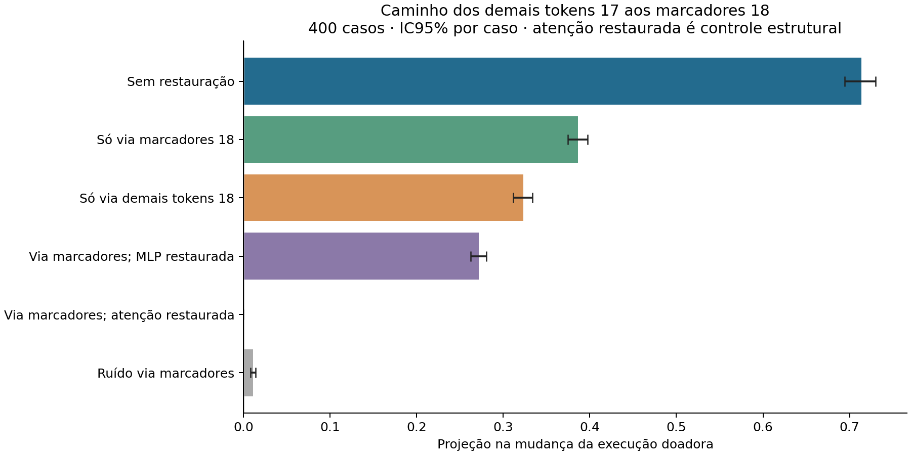

# Mecanismo de transmissão da sensibilidade à ordem no Laya

## Resposta à pergunta da pesquisa

**Identificamos e confirmamos um caminho causal de transmissão da sensibilidade à ordem no checkpoint multilíngue do Laya estudado.** Representações dos tokens fora dos marcadores das alternativas, na camada 17, conseguem modificar os marcadores durante o processamento do bloco 18; esses marcadores carregam parte da mudança até as pontuações finais. A atualização da MLP contribui adicionalmente para o efeito desse caminho.

Essa é uma explicação mecanicista parcial, confirmada no teste para as intervenções definidas. Ainda não isolamos a origem inicial da sensibilidade, uma cabeça específica, a contribuição separada de RoPE e máscaras/janelas, ou um mecanismo universal para todos os modelos System One.

## Arquitetura e significado do caminho

O Laya recebe pergunta, alternativas e estado do caso numa sequência. Cada alternativa tem um marcador `[MASK]` próprio. O encoder contextualiza os tokens; duas camadas Transformer da cabeça de decisão os processam; um scorer lê o vetor do marcador de cada alternativa e produz sua pontuação. A distribuição de probabilidades é calculada sobre essas pontuações.

Mudar a ordem das alternativas muda a organização dos tokens e suas relações posicionais, mesmo mantendo IDs, descrições e estado. As representações dos marcadores podem receber informação dos demais tokens por atenção. No bloco 18 inspecionado, a atualização de atenção é somada ao residual, seguida de uma MLP por token, também com residual.

O caminho testado foi:

```text
Demais tokens na saída da camada 17
                 ↓
Processamento do bloco 18
                 ↓
Marcadores das alternativas na saída da camada 18
                 ↓
Camadas restantes e scorer
                 ↓
Pontuações relativas das alternativas
```

O experimento não apenas observou correlações: transplantou ativações entre duas ordens e bloqueou a passagem das alterações por outros grupos de tokens.

## Evidência acumulada

1. **Comportamento:** em descoberta, 66,19% das decisões choice mudam de escolha em alguma das ordens avaliadas. O conteúdo permanece preservado e as saídas são alinhadas por identidade semântica. Essa taxa não é a mudança após um único embaralhamento.
2. **Localização:** a transferência somente dos marcadores cresce entre as saídas enc_17 e enc_18. O contraste foi escolhido em descoberta e replicou no desenvolvimento: diferença 0,4041, IC95% [0,3799; 0,4272].
3. **Distribuição:** no fatorial de descoberta, os demais tokens já transmitem efeito considerável em enc_17. A baixa eficácia dos marcadores nessa camada não significa ausência do efeito na sequência. Na saída final, os marcadores são suficientes para transferir quase todo o contraste testado em projeção.
4. **Caminho:** ao alterar somente os demais tokens em enc_17 e restaurá-los na saída de enc_18, deixando passar apenas os marcadores atualizados, parte do efeito permanece. O contraste desse caminho acima do ruído foi congelado antes da avaliação no teste.

## Confirmação no teste

O job 4297 concluiu os **400 casos e 600 decisões choice**, sem selecionar casos por erro, mudança de escolha ou tamanho de efeito. O contraste usa a ordem canônica e uma rotação de uma posição, nas duas direções. O conjunto já foi utilizado em estudos anteriores do grupo; esta é uma confirmação prospectiva desta hipótese, não um teste nunca visto pelo grupo.

A hipótese primária única foi: a transferência pelo caminho demais tokens17 → marcadores18 supera a média de quatro perturbações isotrópicas de mesma norma por token. O critério registrado exigia estimativa positiva e limite inferior do IC95% pareado por caso acima de zero.

**Resultado primário: 0,3754, IC95% [0,3629; 0,3867]. O critério foi atendido.**

| Resultado | Descoberta | Teste |
|---|---:|---:|
| Projeção do caminho isolado | 0,3782 | 0,3865 |
| Projeção do controle de ruído | 0,0151 | 0,0111 |
| Diferença caminho menos ruído | 0,3631 | **0,3754** |
| IC95% da diferença | 0,3311–0,3979 | **0,3629–0,3867** |



## Como interpretar a medida

Os logits são centrados por decisão. A mudança provocada pela intervenção é projetada sobre o contraste doador menos receptor. O resultado agregado é a soma dos produtos internos dividida pela soma das normas quadráticas desses contrastes. No primário, subtrai-se primeiro o numerador médio dos quatro controles nulos.

Uma projeção maior indica maior transferência na direção da mudança entre ordens. **0,3754 não significa que explicamos 37,54% do viés, nem que essa seja uma proporção de mediação causal.** O índice pondera mais os contrastes maiores e pode ultrapassar 1 ou ser negativo.

Foram 2.000 reamostras dos 400 casos, semente 0, preservando juntas perguntas, duas direções e controles. O caso de maior peso representou 3,92% da soma dos contrastes quadráticos. Nenhuma razão ficou indefinida por denominador ≤1e-8.

A mediana das razões individuais do caminho foi 0,3854; os quantis 5% e 95% foram 0,1622 e 0,5813. A norma média da mudança de logits centrados foi 0,4763, com componente ortogonal médio 0,1303. A projeção, portanto, não descreve toda a alteração vetorial.

## Resultado secundário da MLP

Restaurar nos marcadores a atualização receptora original da MLP reduz a projeção do caminho de 0,3865 para 0,2720. O contraste secundário pré-definido é **0,1145**, IC95% **[0,1083; 0,1204]**. Isso sustenta uma contribuição adicional dessa atualização ao caminho sob a intervenção. Não prova que a MLP origine a sensibilidade nem mede sua contribuição isolada no processamento natural.

Restaurar a atenção nos marcadores zera o efeito, como esperado pela estrutura: os marcadores entram limpos no bloco, a atenção é restaurada, a MLP subsequente é local por token e o restante da sequência é restaurado na saída. Essa condição é um controle estrutural; não é uma descoberta independente de que a atenção causa o viés. Além disso, alterar a atenção muda a entrada da MLP, impedindo uma interpretação como parcelas aditivas independentes.

## Mudança de escolha e alcance comportamental

No par específico canônica/rotação, 138 das 600 decisões de teste mudam a escolha: **23,0%**. Isso não contradiz os 66,19% de descoberta, que consideravam múltiplas ordens por decisão.

Há 276 pares direcionais com flip, correspondentes a 138 decisões, e não 276 observações independentes. O caminho isolado recupera a escolha doadora em 37,32% desses pares; o ruído, em 3,62%. Esses números são descritivos e secundários. A hipótese primária usa todas as decisões, inclusive as que não mudam a escolha.

## Integridade e execução

O manifesto e o protocolo congelado foram verificados por SHA256. A análise conferiu a grade completa de condições, ausência de duplicatas, cobertura dos casos e recálculo dos efeitos a partir dos logits. Foram 13.200 execuções das condições, além das referências e controles de alinhamento.

| Controle | Maior diferença absoluta de logits | Tolerância |
|---|---:|---:|
| Self patch | 0 | 0,00001 |
| Restauração completa em enc_18 | 0 | 0,00001 |
| Todos os tokens em enc_final versus doador | 0,000001907 | 0,0001 |

Todos passaram. O piloto do código final ocorreu em dois casos de descoberta, antes do teste, e reproduziu as intervenções determinísticas anteriores dentro da tolerância registrada. A precisão foi FP32, sem TF32; uma thread CPU/interop foi fixada e registrada. A rodada completa terminou em aproximadamente 4min33s, com o ambiente e caches já preparados. Isso é um tempo observado, não uma medição isolada do ganho causado pelo ajuste de threads.

## Conclusão que podemos apresentar

> No Laya multilíngue, encontramos evidência de que a sensibilidade à reordenação é transmitida por representações fora dos marcadores no encoder e por sua influência sobre os marcadores das alternativas no bloco 18. Ao permitir que apenas esses marcadores atualizados transmitissem a intervenção, persistiu uma mudança de pontuações na direção da ordem doadora, acima de controles isotrópicos de mesma norma. O efeito foi confirmado prospectivamente nas 600 decisões choice do teste. A atualização da MLP contribuiu adicionalmente. O estudo identifica um caminho de transmissão sob intervenção, mas não a origem inicial da sensibilidade nem sua universalidade entre modelos System One.

## O que permanece em aberto

- A origem inicial da informação sensível à ordem, antes da camada 17.
- A separação causal entre posição ordinal, posição absoluta, distâncias, vizinhança e máscaras/janelas.
- Quais cabeças de atenção ou direções de representação sustentam o efeito.
- A necessidade do caminho no processamento natural, pois os transplantes criam estados internos híbridos.
- Generalização a outros checkpoints do Laya e outros modelos System One.

Não houve treinamento de novos SAEs nem uma avaliação que refutasse o método SAE. As intervenções diretas nas ativações forneceram a evidência causal desta etapa. SAEs continuam sendo uma possível ferramenta para decompor representações ou componentes já localizados.

Não há necessidade de novas inferências para concluir esta confirmação. Estudos sobre a origem do efeito ou generalização devem ter protocolos próprios, distinguindo exploração de confirmação.

## Reprodutibilidade e arquivos

- Branch: `experiment/position-mechanism`; coleta confirmatória no commit `8366a02`, job 4297.
- Checkpoint: `convaiinnovations/laya`, multilingual, revisão `7b928d828b7b0e022f929d9bd2e44165aa270148`.
- Dados: `LocalLLaMA/typed-decisions`, revisão `c76749ec58bd8c3d2ea706b31c333a9059c38f90`.
- SHA256 do protocolo congelado: `d250aee992736e85245b1e5c6cf5c35c80e6612bb70c11c33d4187de6407ad88`.
- SHA256 do manifesto: `984fafc0e0bbd7acaa2cbbf3e1ff7d25b2c1ebac3677ac2f36003d821e58ffac`.
- SHA256 do backup externo: `534912aae46f107c1d25168c6b2cbc3dac16570580a7fb6cbfcda6ec2f6a3e9b`.
- Análise: `analyze_position_path.py`. Resultado primário em `confirmation.json`; demais tabelas em `summary.csv`, `summary.json`, `contrasts.json` e `audit.json`.
