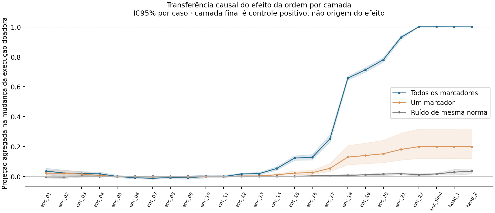

# Replicação da transmissão do efeito da ordem no Laya

## A hipótese registrada replicou

A transferência dos marcadores transmite mais da mudança de logits em enc_18 do que em enc_17 no conjunto de desenvolvimento. A diferença foi **0,4041**, com IC95% bootstrap pareado por caso de **0,3799 a 0,4272**. O limite inferior é positivo, atendendo ao critério registrado antes da execução.

| Conjunto | Projeção em enc_17 | Projeção em enc_18 | Diferença enc_18 menos enc_17 | IC95% da diferença |
|---|---:|---:|---:|---:|
| Descoberta | 0,2715 | 0,6648 | 0,3933 | 0,3522–0,4322 |
| Desenvolvimento | 0,2528 | 0,6569 | 0,4041 | 0,3799–0,4272 |

A projeção é a mudança dos logits provocada pela intervenção na direção do contraste entre duas ordens, após centrar os logits. A agregação pondera mais os contrastes de ordem maiores. Esses coeficientes **não são porcentagens do viés explicado nem proporções de mediação causal**.

## População e verificações

O job 4095 terminou com sucesso em aproximadamente 11 minutos, usando o ambiente já instalado. A coleta incluiu os 180 casos de desenvolvimento e suas 259 decisões choice. O patching incluiu 91 decisões dos primeiros 64 casos pelo hash pré-definido, sem seleção por erro ou mudança de escolha. Foram 36.400 execuções de intervenção e 5.096 apresentações por condição comportamental.

O modelo, a precisão FP32 e os controles foram os mesmos da descoberta. O hash do protocolo usado no job coincide com o documento congelado: `ff1b64866f4c2c72ec93105a715e6e7a0bf3dfb7e07789b924e3f898af58bb53`.

- Diferença máxima das probabilidades entre caminho oficial e instrumentado: 0.
- Diferença máxima dos logits no self patch: 0.
- Diferença máxima no controle positivo da última camada: 0.
- Manifesto, cobertura dos casos, permutações, referências e numeradores/denominadores das intervenções conferidos na análise offline.

Na condição original, 71,43% das decisões mudam de escolha em alguma ordem avaliada (IC95% por caso: 66,03–77,04%). Essa taxa não significa que 71% de cada apresentação individual mude a escolha. O desacordo médio com a ordem canônica é 23,55%.

## Interpretação mecanicista

O resultado fortalece a localização de transmissão: a informação que permite transferir o efeito da reordenação fica mais acessível nos marcadores entre as saídas das camadas 17 e 18. Em enc_22, a projeção já é aproximadamente 1,001 e todos os pares direcionais com mudança de escolha recuperam a escolha doadora sob transferência dos marcadores.

O crescimento tardio não demonstra que o efeito nasceu no bloco 18. Outros tokens podem carregar informação relevante ou reconstruir o efeito depois de uma transferência precoce. As representações transferidas também contêm conteúdo contextualizado, não apenas posição.

Esta é uma replicação no desenvolvimento de um checkpoint e um benchmark. O teste de 400 casos permanece reservado. As outras camadas da varredura são análises secundárias/exploratórias, não novos contrastes confirmatórios selecionados após observar o desenvolvimento.

## Próximo experimento

O experimento fatorial exploratório usa somente os mesmos 64 casos de descoberta. Transfere separadamente os marcadores, os demais tokens e ambos nas camadas 17 e 18. O alinhamento é feito por função, identidade da alternativa e deslocamento do token, com cobertura bijetiva; tokens repetidos não definem o mapeamento.

Além de self patches e ruídos de norma pareada, ele deve reproduzir o patch dos marcadores da coleta original e passar um controle de transferência de todos os tokens em enc_final. A transferência em camadas anteriores continua sujeita à geometria RoPE das camadas restantes.

O objetivo é testar a contribuição causal adicional das representações fora dos marcadores. A interação entre as intervenções mede não aditividade, sem identificar automaticamente uma cabeça ou circuito específico.

## Reprodutibilidade

- Código da coleta de desenvolvimento: `c7f3f2f026e18fb432ab868e1c3b7d0d44bc2a7a`, job Sauron 4095.
- SHA256 do backup externo: `79fcaeaf4bd0e2c0d2b448d3c163cf9550434e9d7ad91a54c345912c865ac68e`.
- SHA256 do manifesto: `9a15a46aaf973283769c09951aa835eb8c9f3d53859e6fd143d2a0fccda962d1`.
- Análise: `analyze_position.py`, 2.000 reamostras dos casos, semente 0, mantendo juntas perguntas e direções.
- Arquivos: `audit.json`, `enc18_minus_enc17.json`, `behavior_summary.json`, `patch_summary.csv`, `patch_by_workflow.csv`, `behavior.png` e `patching.png`.
