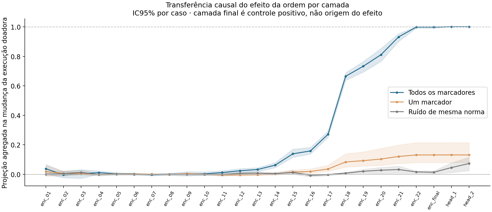
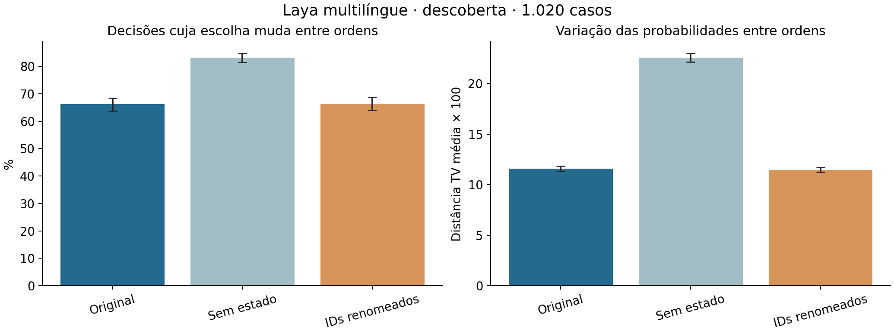

# Sensibilidade à ordem no Laya e transmissão pelo encoder

## Resultado principal

No Laya multilíngue, mudar a apresentação das alternativas altera a escolha em **66,19% das 1.541 decisões choice** do conjunto de descoberta (IC95% por caso: 63,78–68,48%). O efeito se torna fortemente transferível pelos vetores dos marcadores das alternativas no final do encoder, com um aumento pronunciado entre as saídas das camadas 17 e 18.

Esse resultado localiza **transmissão e concentração da informação que afeta a decisão**. Ainda não identifica o componente que originalmente produz a dependência da ordem. Em particular, um marcador transferido cedo pode ser atualizado novamente usando os outros tokens da execução receptora.

## O que foi avaliado

- Checkpoint público `convaiinnovations/laya`, subpasta `multilingual`, revisão `7b928d828b7b0e022f929d9bd2e44165aa270148`; pacote Laya 0.4.30.
- Typed Decisions, revisão `c76749ec58bd8c3d2ea706b31c333a9059c38f90`.
- Descoberta: 1.020 casos e 1.541 perguntas choice; nenhum caso de desenvolvimento ou teste nesta coleta.
- Todas as permutações para quatro alternativas; rotações e rotações reversas para cinco. A cobertura de cinco alternativas não é exaustiva.
- Quatro condições: original, estado vazio, estado trocado entre casos de mesma especificação e IDs renomeados.
- 29.704 apresentações por condição, totalizando 118.816 apresentações comportamentais.
- Intervenções em 94 decisões de 64 casos escolhidos por hash, independentemente de erro ou mudança de escolha: 37.600 execuções de patching.
- Par de ordens das intervenções: ordem canônica e rotação de uma posição, nas duas direções. O resultado causal está limitado a esse contraste.
- Inferência FP32, sem TF32, modelo em avaliação; os SAEs não foram usados.

## Como interpretar a sensibilidade comportamental

“Muda em alguma ordem” significa que ao menos duas apresentações da mesma pergunta levam a alternativas semanticamente diferentes. Não significa que 66% de todas as apresentações individuais mudem a resposta. O desacordo médio com a ordem canônica é **21,82%** (IC95%: 20,55–23,06%). Essas métricas não são diretamente comparáveis à taxa de mudança após um único embaralhamento de outros estudos.

| Condição | Decisões com alguma mudança de escolha | IC95% por caso | Desacordo médio com a ordem canônica |
|---|---:|---:|---:|
| Original | 66,19% | 63,78–68,48% | 21,82% |
| Estado vazio | 83,13% | 81,47–84,71% | 28,61% |
| IDs renomeados | 66,45% | 63,99–68,80% | 26,47% |

Sem os dados do caso, a sensibilidade persiste e aumenta. Isso mostra que uma entrada artificial sem estado também apresenta o fenômeno; não demonstra que o modelo ignore o estado em entradas naturais. Retirar o estado muda a escolha, em média, em 61,48% das apresentações pareadas.

Renomear os identificadores não elimina a sensibilidade agregada. Entretanto, muda a escolha em 52,59% das apresentações pareadas e aumenta a entropia normalizada de 0,607 para 0,758. Portanto, a semelhança das taxas de flip não demonstra irrelevância dos IDs nem equivalência entre as condições. A renomeação também muda tokenização e comprimentos.

No controle de estado trocado, a taxa agregada de sensibilidade é exatamente igual à original por construção: os mesmos estados são permutados dentro de cada conjunto de perguntas. Essa igualdade não é evidência independente. A comparação pareada é diferente: trocar o estado muda a escolha em 52,77% das apresentações. Esse número é descritivo, sem intervalo ingênuo que trate receptores e doadores como independentes. Não foi calculada acurácia de estados vazios ou trocados contra o gabarito do receptor.

O efeito varia por pergunta. A fração com mudança entre ordens vai de 29,23% em `customer_service/category` a 94,21% em `invoice_processing/disposition`. Não há uma preferência universal pela última posição: nas ordens contrabalanceadas, a primeira posição vence em 36,90% das apresentações de `invoice_processing/disposition`, enquanto a quarta vence em 33,14% de `agent_trace_observability/outcome`.

## O que as intervenções mostram

Cada alternativa tem um marcador `[MASK]`. Transferimos os vetores desses marcadores da execução doadora para os da mesma alternativa na execução receptora. A posição do marcador muda, mas a identidade semântica usada no alinhamento permanece.

A medida principal projeta a mudança de logits provocada pela intervenção sobre a diferença original entre as duas ordens, depois de remover o deslocamento comum dos logits. Uma projeção próxima de 0 indica pouca transferência na direção da doadora; próxima de 1 indica reprodução desse contraste. **Não é porcentagem de viés explicado nem proporção de mediação causal.** A agregação dá mais peso a contrastes de ordem maiores e pode assumir valores negativos ou acima de 1.

| Local da transferência de todos os marcadores | Projeção agregada | IC95% por caso |
|---|---:|---:|
| enc_08 | 0,0008 | −0,0075 a 0,0066 |
| enc_17 | 0,2715 | 0,2510 a 0,2929 |
| enc_18 | 0,6648 | 0,6369 a 0,6885 |
| enc_22 | 0,9978 | 0,9906 a 1,0026 |
| head_1 | 1,0002 | 0,9995 a 1,0010 |
| head_2 | 1,0000 | 1,0000 a 1,0000 |

A diferença enc_18 menos enc_17 é **0,3933**, IC95% pareado por caso **0,3522–0,4322**. Esse contraste foi selecionado nesta descoberta, portanto o intervalo é exploratório. Ele será a hipótese primária congelada para a replicação no desenvolvimento.

O padrão também aparece nas estimativas descritivas de cada um dos quatro workflows: enc_17 entre 0,257 e 0,337; enc_18 entre 0,653 e 0,701. A agregação é influenciada por `customer_service`: o caso de maior peso representa 12,35% da soma dos contrastes quadráticos. As medianas individuais também aumentam, de 0,287 em enc_17 para 0,670 em enc_18.

Ruídos de mesma norma não reproduzem o efeito dos vetores verdadeiros: em enc_17 a projeção média é −0,0024, comparada a 0,2715 na transferência alinhada. São quatro direções de ruído por condição, úteis como controle, mas insuficientes para p-valores empíricos precisos.

Entre as 94 decisões intervindas, somente 20 mudam a escolha no par específico canônica/rotação. São 40 pares direcionais, não 40 decisões independentes. Nesse subconjunto, a transferência recupera a escolha doadora em 27,5% dos pares em enc_17, 57,5% em enc_18 e 100% em enc_22. Essa recuperação é um resultado secundário descritivo.

## Integridade da coleta

Os arquivos de conclusão correspondem a todos os 1.020 casos previstos e a 1.541 decisões únicas. As ativações selecionadas estão presentes. A auditoria recalculou os numeradores e denominadores das projeções a partir dos logits salvos.

- Diferença máxima entre probabilidades oficiais e execução instrumentada: 0.
- Diferença máxima de logits na transferência da própria execução: 0.
- Diferença máxima entre logits doadores e transferência final de todos os marcadores: 0.

O último controle é trivial: substituir os vetores imediatamente antes do scorer deve transferir suas pontuações. Ele valida a implementação e não revela a origem do viés.

## O que isso responde sobre o mecanismo

Já podemos afirmar que a sensibilidade à reordenação existe em entradas de conteúdo preservado e que os marcadores no encoder tardio carregam informação suficiente para transferir quase integralmente o contraste de logits testado. O resultado é incompatível com tratar a sensibilidade apenas como um erro de remapeamento dos índices da saída.

Ainda não podemos afirmar que a camada 18 cria o viés, identificar uma cabeça de atenção responsável, separar posição ordinal de distância e vizinhança, ou generalizar para todos os modelos System One. As intervenções transferem representações contextualizadas completas, e não exclusivamente “posição”. A baixa transferência precoce pode ocorrer porque outros tokens reintroduzem o efeito mais adiante.

O resultado também não refuta SAEs. Ele indica que a pergunta sobre ordem requer contrastes específicos e que investigar somente as features associadas ao erro em enc_08/enc_17 não cobre toda a trajetória de transmissão observada.

## Replicação e próximo experimento

A replicação no desenvolvimento terá como hipótese primária o aumento enc_18 menos enc_17, com os mesmos controles e casos escolhidos por hash. O teste permanecerá reservado. O protocolo está em `DEV_REPLICATION.md`.

Se o contraste replicar, o próximo passo mecanicista é transferir separadamente os marcadores, os demais tokens e ambos, nas camadas 17 e 18. Isso distinguirá informação já distribuída pela sequência de informação concentrada nos marcadores. Em seguida, intervenções nas ramificações de atenção e MLP poderão testar a contribuição dos componentes, preservando os caminhos residuais.

## Reprodutibilidade e arquivos

- Coleta: job Sauron 4056; código `68d7fab3b9ff8404975a2e1eab467faaa92a2da1`.
- SHA256 do arquivo externo de backup: `1c0711399c286fe354855b5fb5f2876564c8fcc6d3da0409d4643b2c99598b78`.
- SHA256 do manifesto da coleta: `fa83dbe02aaa0b6ea1bbb7a0e664ff2ba39f8835d6b96d7ae7822e2d4673e33b`.
- Análise offline: `analyze_position.py`, 2.000 reamostras de casos, semente 0. Todas as perguntas e direções do caso permanecem juntas. Os intervalos da varredura por camada são pontuais e exploratórios.
- Tabelas: `behavior_summary.json`, `behavior_by_question.csv`, `patch_summary.csv`, `patch_by_workflow.csv`, `enc18_minus_enc17.json` e `audit.json`.
- As saídas por decisão e os pesos/ativações volumosos permanecem fora do Git. Uma cópia compactada foi preservada localmente e verificada por SHA256.
