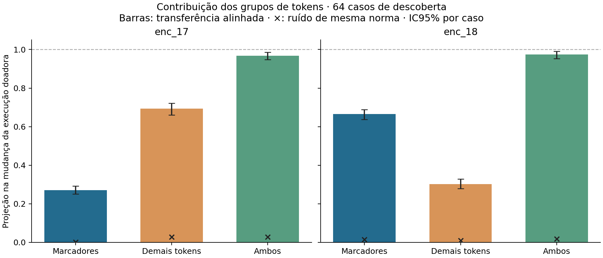

# Contribuição dos grupos de tokens para o efeito da ordem no Laya

## Informação distribuída antes de se concentrar nos marcadores

Na camada 17, transferir os demais tokens entre duas ordens transmite uma contribuição maior na direção da mudança de pontuações do que transferir somente os marcadores. Na camada 18, a contribuição dos marcadores aumenta e a dos demais tokens diminui. Transferir ambos os grupos já produz uma projeção alta nas duas camadas.

Isso corrige uma interpretação possível da varredura anterior: **a baixa transferência dos marcadores na camada 17 não indica que o efeito ainda não esteja disponível na sequência**. As representações fora dos marcadores já contribuem fortemente. O resultado é compatível com uma concentração posterior nos marcadores, mas não demonstra diretamente uma transferência entre esses grupos dentro do bloco 18.

## Resultados do fatorial

Projeção agregada da mudança provocada pela intervenção sobre o contraste de logits entre execução doadora e receptora, após centrar os logits. Uma projeção próxima de 1 indica forte transferência na direção desse contraste, mas não garante igualdade dos vetores de logits. **Não é porcentagem do viés explicado nem proporção de mediação causal.**

| Ponto da intervenção | Marcadores | Demais tokens | Ambos |
|---|---:|---:|---:|
| enc_17 | 0,2715 [0,2510; 0,2929] | 0,6942 [0,6613; 0,7220] | 0,9685 [0,9485; 0,9855] |
| enc_18 | 0,6648 [0,6369; 0,6885] | 0,3023 [0,2786; 0,3292] | 0,9739 [0,9531; 0,9913] |
| enc_final | 0,9978 [0,9906; 1,0026] | 0,0022 [−0,0026; 0,0094] | 1,0000 [1,0000; 1,0000] |

Os intervalos são IC95% por reamostragem de casos. As perguntas, direções e condições do mesmo caso permanecem juntas. São resultados exploratórios em descoberta, não uma nova confirmação no desenvolvimento.

Entre as camadas 17 e 18, a projeção dos marcadores aumenta 0,3933 [0,3522; 0,4322] e a dos demais tokens diminui 0,3919 [0,3507; 0,4293]. A transferência conjunta aumenta apenas 0,0053 [0,0009; 0,0099]. Esse pequeno aumento não é igualdade exata; as mudanças principais aparecem na eficácia das intervenções em cada grupo.

Na saída final normalizada do encoder, os demais tokens isolados contribuem muito pouco para o contraste testado. Os marcadores são suficientes para transferi-lo quase integralmente em projeção. A transferência conjunta nesse ponto é um controle de alinhamento: a cabeça de decisão não acrescenta posição, portanto permutar os vetores completos por identidade deve preservar as pontuações correspondentes.

## Controles e limites da interpretação

O grupo de marcadores contém, em média, 4,36 tokens, enquanto o restante contém 312,41. Os tamanhos e as normas totais das intervenções são muito diferentes. A contribuição maior dos demais tokens na camada 17 não demonstra maior especificidade nem um conceito representado por esse grupo.

Os ruídos têm a norma da mudança pareada por token. Suas projeções são muito menores: em enc_17, aproximadamente 0,002 nos marcadores e 0,028 nos demais tokens ou no conjunto; em enc_18, aproximadamente 0,016, 0,010 e 0,019, respectivamente. Isso favorece a importância da direção das representações transferidas. Quatro ruídos por condição não permitem p-valores empíricos precisos.

A interação vetorial é calculada como Y(ambos) − Y(marcadores) − Y(demais) + Y(original). Sua projeção média é 0,0028 [−0,0051; 0,0147] em enc_17 e 0,0067 [−0,0047; 0,0188] em enc_18. Porém, a norma média da interação é 0,115 e 0,141, respectivamente. **Não é correto concluir que o processamento seja aditivo ou linear**: a projeção pode ocultar cancelamentos entre casos e componentes ortogonais.

As camadas restantes continuam usando a geometria posicional receptora após o transplante em enc_17/18. Assim, uma transferência conjunta inferior a 1 é compatível com novas transformações posteriores; não prova ausência de informação nas ativações transferidas.

## Auditoria e retomada

O job 4099 atingiu o limite de uma hora após 53 decisões. O job 4283 retomou os mesmos arquivos e concluiu as 94 decisões dos 64 casos previstos. O protocolo e os arquivos de código incluídos no manifesto permaneceram iguais; somente o limite do agendador aumentou para duas horas.

A análise verificou 6.768 execuções de intervenção, a grade completa de condições, referências, cobertura dos casos, ausência de duplicatas e recálculo dos efeitos a partir dos logits. Foram derivados 564 contrastes de interação.

| Controle | Maior diferença absoluta de logits | Tolerância |
|---|---:|---:|
| Transferência da própria execução | 0 | 0,00001 |
| Todos os tokens em enc_final versus doador | 0,000000954 | 0,0001 |
| Marcadores versus coleta original | 0,0000687 | 0,0001 |

Todos passaram. A pequena diferença entre as execuções de marcadores permaneceu dentro da tolerância pré-definida; as estimativas agregadas reproduzem os resultados anteriores.

## Próximo teste causal de caminho

Para demonstrar especificamente o caminho dos demais tokens na camada 17 até os marcadores na camada 18, transplantar os demais tokens em enc_17 e restaurar todos os demais tokens receptores na saída de enc_18. Somente os marcadores atualizados poderão transmitir a mudança às camadas seguintes.

Se o efeito sobreviver, haverá evidência desse caminho sob a intervenção. Restaurar a saída receptora da atenção ou da MLP nos marcadores permitirá examinar como a atualização participa. Preservar o residual é essencial. Restaurar atenção também modifica a entrada da MLP subsequente, portanto esses efeitos não constituem contribuições aditivas independentes.

Como os marcadores entram limpos no bloco, restaurar a atenção nos marcadores deve recuperar o receptor por construção. Essa condição é um controle estrutural, não uma descoberta independente da origem da sensibilidade.

Esse teste usa somente descoberta; o teste final continua reservado. Ele ainda não identifica a origem inicial da sensibilidade, uma cabeça específica ou uma explicação universal para modelos System One.

## Reprodutibilidade

- Coleta: código `8a6f342`, retomada operacional `437fdc9`; jobs 4099 e 4283.
- Modelo público Laya multilíngue, revisão `7b928d828b7b0e022f929d9bd2e44165aa270148`, FP32, sem TF32.
- Typed Decisions, revisão `c76749ec58bd8c3d2ea706b31c333a9059c38f90`; mesmos 64 casos/94 decisões de descoberta.
- Duas direções do contraste entre ordem canônica e rotação de uma posição, sem seleção de casos por flip ou erro.
- SHA256 do backup externo: `c55492dfe42b6f65e6653dda1daa95c41fa09e645d5eafddb3598c5ea6f2992e`.
- SHA256 do manifesto: `e309f296946bd22593269e24923614e3695cad9dd62affeacb5b03bd6ed25a28`.
- Análise offline: `analyze_position_factorial.py`, 2.000 reamostras de casos, semente 0.
- Tabelas e figura: `summary.csv`, `summary.json`, `contrasts.json`, `audit.json` e `factorial.png`.
