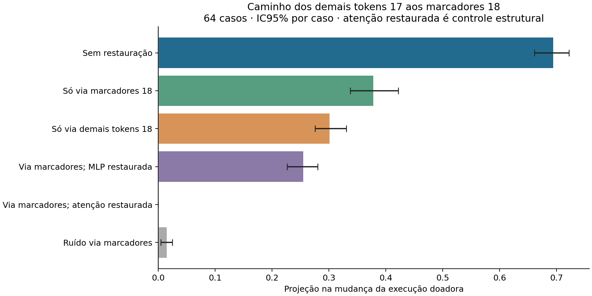

# Caminho causal dos demais tokens aos marcadores no bloco 18

## O efeito sobrevive pelo caminho isolado

Ao transplantar os demais tokens na saída de enc_17 e restaurá-los ao estado receptor na saída de enc_18, deixando passar apenas os marcadores atualizados, permanece uma mudança de pontuações na direção da execução doadora. A projeção é **0,3782**, contra **0,0151** no controle isotrópico de norma pareada. A diferença pareada é **0,3631**, IC95% **[0,3311; 0,3979]**.

Esse resultado fornece evidência causal de transmissão pelo caminho **demais tokens em enc_17 → marcadores atualizados em enc_18 → pontuações finais**, condicionado às intervenções usadas. Ele é mais específico do que simplesmente observar maior eficácia dos marcadores em uma camada tardia.

## Intervenções e resultados

O conteúdo e a identidade das alternativas permanecem fixos entre a ordem canônica e a rotação de uma posição. As ativações doadoras são alinhadas por papel, identidade da alternativa e deslocamento dentro do segmento. Os marcadores de enc_17 permanecem receptores; somente os demais tokens são transplantados inicialmente.

| Condição | Projeção agregada | IC95% por caso |
|---|---:|---:|
| Sem restauração posterior | 0,6942 | 0,6613–0,7220 |
| Restaurar demais tokens em enc_18, deixando passar só marcadores | 0,3782 | 0,3379–0,4218 |
| Restaurar marcadores em enc_18, deixando passar só demais tokens | 0,3014 | 0,2758–0,3310 |
| Caminho pelos marcadores, com MLP restaurada nos marcadores | 0,2553 | 0,2268–0,2807 |
| Caminho pelos marcadores, com atenção restaurada nos marcadores | 0 | 0–0 |
| Ruído de mesma norma pelo caminho dos marcadores | 0,0151 | 0,0050–0,0248 |

A medida projeta a mudança provocada pela intervenção sobre o contraste de logits doador menos receptor, após centrar logits. A agregação pondera mais os contrastes maiores. **Os coeficientes não são porcentagens de viés explicado, nem proporções de mediação causal.** Os efeitos dos caminhos tampouco precisam somar exatamente a intervenção completa, devido à não linearidade.

## Atenção e MLP

O bloco ModernBERT usa uma atualização de atenção com residual, seguida de normalização e MLP por token com outro residual. A atenção é a operação que mistura tokens dentro desse bloco.

Restaurar a atualização original da MLP nos marcadores reduz a projeção de 0,3782 para 0,2553. A diferença é **0,1230**, IC95% **[0,1016; 0,1469]**. Isso mostra contribuição adicional da atualização da MLP ao efeito desse caminho sob a intervenção, sem provar que a MLP cria a sensibilidade inicial.

Restaurar a atenção nos marcadores zera o efeito por construção: os marcadores entram no bloco com o residual receptor; a atualização de atenção é restaurada; a MLP subsequente é local por token; e os demais tokens são restaurados na saída do bloco. Esse é um controle estrutural, não uma descoberta independente sobre a origem do viés. Além disso, restaurar atenção modifica a entrada da MLP, portanto os dois clamping não são parcelas aditivas independentes.

## Auditoria

O job 4288 terminou com sucesso em aproximadamente 32 minutos. A coleta contém os 64 casos e 94 decisões choice de descoberta pré-definidos, nas duas direções, sem selecionar erros ou flips. São 2.068 execuções das condições, além das referências.

A análise confirmou o manifesto, a cobertura das condições, a unicidade das decisões e o recálculo dos numeradores, denominadores e normas a partir dos logits.

- Erro máximo no self patch: 0.
- Erro máximo ao restaurar todos os tokens em enc_18: 0.
- Erro máximo ao reproduzir a condição não-marcadora do fatorial: 0.

Os intervalos usam 2.000 reamostras dos casos, semente 0, mantendo juntas perguntas, direções e condições. Os quatro ruídos são primeiro promediados por decisão e direção. A análise é exploratória em descoberta.

## O que já podemos afirmar

O efeito da reordenação não fica restrito aos marcadores no encoder intermediário. As representações dos demais tokens na camada 17 conseguem alterar os marcadores durante o processamento do bloco 18, e esses marcadores carregam parte da mudança até a pontuação final, mesmo depois de restaurarmos o restante da sequência.

Ainda não está estabelecida a origem inicial da sensibilidade, a necessidade desse caminho em entradas naturais, uma cabeça específica de atenção ou a contribuição separada de RoPE, máscaras e janelas. Os transplantes criam entradas internas híbridas. A conclusão se refere a esse checkpoint do Laya e a esse contraste de ordem, sem generalização automática para todos os modelos System One.

## Confirmação prospectiva

O próximo passo é um único contraste primário congelado antes de novas inferências: caminho pelos marcadores menos a média dos quatro ruídos de mesma norma, nos 400 casos/600 decisões choice do teste. Sucesso exige limite inferior do IC95% pareado por caso acima de zero. O contraste da MLP fica secundário.

O teste já foi usado em estudos anteriores do grupo, mas não para selecionar ou executar estas intervenções nesta investigação. A confirmação é prospectiva para esta hipótese, não um teste nunca examinado. Antes dela, o código final será validado em dois casos de descoberta. Nenhum resultado parcial do teste será usado para alterar a hipótese.

## Reprodutibilidade

- Job 4288, código `f28de61`, modelo Laya multilíngue e dataset nas revisões fixadas do projeto; FP32, TF32 desativado.
- SHA256 do backup externo: `6ebe65122504d838215586e2ba9ec925b4a2343a2507a602d353b7960e7fe3e0`.
- SHA256 do manifesto: `947302ab058ad968b64cc315e4ac5094a21b155b5f818789b300a1d6857902bc`.
- Análise offline: `analyze_position_path.py`. Arquivos: `audit.json`, `summary.json`, `summary.csv`, `contrasts.json` e `path.png`.
