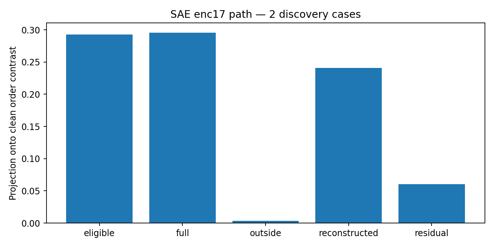

# Piloto SAE de contraste de ordem — job 4505

## Estado

Piloto concluído; auditoria completa de descoberta ainda pendente. Nenhuma feature
foi selecionada causalmente e nenhum SAE novo foi treinado. Código de inferência:
728eeed, baseado em 2317b25. Modelo/dados nas revisões fixadas do protocolo.

Dois casos, duas decisões choice, duas camadas, ambas as direções, um ruído por
condição. Passaram 20 testes de posição, 16 SAE e todos os gates técnicos de
inferência. O maior erro de controle foi 1,12e-5 (reprodução/recombinação, tolerância
1e-4); self e restauração total foram zero. A análise offline verificou hashes,
cobertura completa de condições e recálculo das métricas dos logits.

## Observações de fidelidade, sem conclusão populacional

Substituir a reconstrução nas duas ordens, mantendo o mesmo domínio elegível:

| Camada e grupo | Projeção do contraste reconstruído | Erro L2 relativo |
|---|---:|---:|
| enc_17 demais tokens | 0,643 | 0,578 |
| enc_17 marcadores | 0,948 | 0,174 |
| enc_08 demais tokens | 0,856 | 0,600 |
| enc_08 marcadores | 1,138 | 0,233 |

Os demais tokens sinalizam falha dos limiares convencionais pré-registrados.
Fidelidade da resposta individual não basta para preservar o contraste de ordem.
Com dois casos, isso é alerta de piloto; os intervalos em arquivos não devem ser
interpretados como estabilidade populacional ou confirmação.

No caminho demais17 → marcadores18, as projeções foram: transplante completo
0,296; elegíveis 0,293; delta reconstruído 0,241; residual 0,060; fora do domínio
0,003; ruído pareado ao delta reconstruído 0,037. Não são porcentagens de viés
explicado. A soma de efeitos nos logits não é exigida pela decomposição de ativações.
O ruído está pareado ao delta reconstruído, não ao transplante completo; comparar
com controles anteriores exige respeitar essa diferença de norma e denominadores.

## Decisão operacional

Executar A nos mesmos 64 casos/94 decisões de descoberta, sem seleção de erro/flip,
quatro ruídos por condição, incluindo as duas camadas. A coleta quantificará a
fidelidade e o papel do residual antes de qualquer atribuição a features. As
estatísticas de Δz serão apenas candidatas exploratórias. Falha de fidelidade
persistente exige avaliar configuração/suporte antes de seleção causal; não autoriza
concluir que SAEs em geral falham nem treinar automaticamente enc_18.

O protocolo B/C e o cruzamento de fatores posicionais ainda precisam ser fechados
após A; desenvolvimento e teste não foram acessados nesta extensão. O teste existente
não é intocado. Não há ainda relatório comparativo final ou conclusão SAE confirmada.

## Recursos, preservação e incidentes

Job: cerca de 23 s incluindo testes/carregamento. GPU pico alocado 1,44 GiB,
reservado 1,53 GiB; RSS máximo do processo 2,98 GiB. Manter 8 GB RAM, 2 CPUs,
1 thread CPU/interop e pedir 8 GB mínimos de VRAM (classe disponível 89 GB), com
15 min de limite para a auditoria. O limite tem margem sobre a extrapolação do piloto.

Workspace isolado `~/workspace/sae-position-sae-mechanism-v1`; ambiente da investigação
anterior reutilizado por caminho absoluto, sem uv sync ou reinstalação. Caches preservados.
Os resultados antigos são lidos por caminho e não alterados. Ativações existentes da
coleta guardam marcadores; esta decomposição requer também os demais tokens FP32,
portanto recaptura somente os pares necessários e usa path_v1 como referência numérica.

Backup local e remoto: `pilot-4505.tar.gz`, SHA256
`3804fed8f8656526236ee260569c73acdd72052cd5299d32d3a2c3d3cad6f764`.
Manifesto: `a206d3fa6c58d3d4af1d469ad1dd711fc4fda5de8ac0e628426e3f91da66035b`.
Detalhes auditados em [pilot/audit.json](pilot/audit.json), tabelas CSV e summary.json.

Primeira tentativa de submissão -c foi rejeitada pelo CLI novo sem criar job.
4504 falhou antes dos testes/inferência por CRLF no Bash; corrigido empacotamento LF.
4505 passou. Nenhuma dessas falhas é resultado científico negativo.

## Branches e PR

A branch `experiment/position-sae-mechanism` deriva de `experiment/position-mechanism`.
O PR incremental deve ter esta última como base; ela contém alinhamento, controles,
intervenções e evidências causais reutilizadas. A branch `experiment/sae-features`
é a origem histórica dos SAEs, já incorporada na base; não é o destino recomendado
para esta continuação. Merge e force-push não foram realizados.