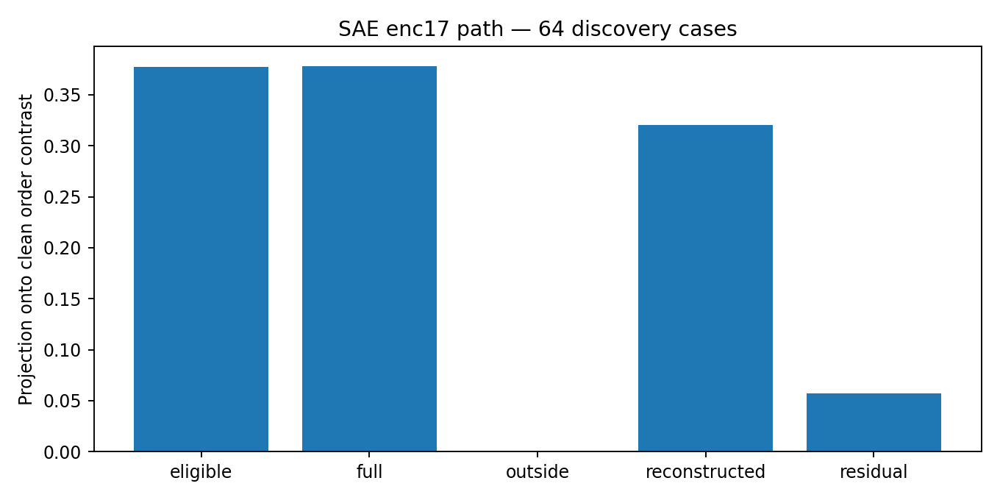

# SAE e transmissão da sensibilidade à ordem no Laya

## Resultado atual e decisão

A auditoria de descoberta **A está concluída**: 64 casos, 94 decisões choice, dois
SAEs e duas direções. O SAE principal enc17 preserva o contraste funcional segundo
os critérios congelados e transmite sinal pelo caminho demais17 → marcadores18,
com residual receptor preservado. O efeito é menor que o transplante das ativações
elegíveis. O SAE enc08 falha no diagnóstico de contraste dos demais tokens.
Não treinamos outro SAE. B/C está protocolado; ainda não há resultado causal de
features selecionadas nem confirmação no desenvolvimento nesta extensão.

## Comparação com as intervenções sem SAE

Todos os valores abaixo usam o mesmo contraste limpo centrado entre ordens.
São projeções de mudanças de logits, não porcentagens de viés ou mediação.

| Intervenção no caminho demais17 → marcadores18 | Projeção | IC95% por caso |
|---|---:|---:|
| Ativações originais completas | 0,3782 | 0,3379–0,4218 |
| Ativações originais, domínio elegível E | 0,3773 | 0,3366–0,4224 |
| Delta reconstruído SAE, preservando residual receptor | 0,3205 | 0,2784–0,3555 |
| Delta do residual de reconstrução | 0,0574 | 0,0362–0,0761 |
| Tokens fora do domínio O | 0,0004 | −0,0008–0,0014 |
| Delta reconstruído menos média de 4 ruídos pareados | **0,3062** | **0,2699–0,3366** |
| Delta reconstruído menos ativações elegíveis | **−0,0568** | **−0,0774–−0,0347** |

O caminho de referência foi reproduzido (maior erro 4,77e-6 logit); a transferência
direta dos demais tokens também (5,72e-6). A diferença reconstruído–elegível mostra
uma lacuna funcional desta configuração, sem invalidar o efeito que o SAE transmite.
A soma de efeitos no logit não é imposta pela identidade de decomposição das ativações;
interações e efeitos ortogonais estão nos arquivos de diagnóstico.

## Fidelidade funcional e geométrica são diferentes

Substituição bilateral pela reconstrução, sempre no mesmo domínio E alinhado:

| Camada/grupo substituído | Projeção do contraste | Erro L2 relativo do contraste | Gate |
|---|---:|---:|---|
| enc17 demais tokens | 0,8951 [0,8302;0,9498] | 0,2462 | passa |
| enc17 marcadores | 0,9630 [0,9379;0,9865] | 0,1232 | passa |
| enc08 demais tokens | 0,6725 [0,5521;0,8011] | 0,7083 | falha |
| enc08 marcadores | 0,9993 [0,9604;1,0386] | 0,0967 | passa |

Os gates convencionais registrados foram desvio da projeção >0,20 ou erro relativo
>0,50. O alerta enc17 do piloto não se sustentou na população de 64 casos pelos
mesmos critérios; não ajustamos os limiares. O alerta enc08 persistiu.

Para o próprio delta das ativações elegíveis dos demais tokens enc17, o erro L2
relativo é 0,7049, projeção geométrica 0,7016 e cosseno 0,7395. Assim, preservar boa
parte do contraste funcional não significa decompor fielmente toda a mudança interna.
FVE pooled dos tokens elegíveis: enc17 demais 0,8848, marcadores 0,6669; enc08 demais
0,9483, marcadores 0,5761. São entradas reordenadas FP32 e população diferente da
auditoria bf16 original dos SAEs; os números históricos não são comparação direta.

## Domínio, efeitos colaterais e estabilidade

São 1394/29367 demais tokens fora do domínio nas duas ordens de enc17 (4,75%). Eles
concentram 99,80% da energia do delta bruto, mas seu efeito isolado no caminho é
pequeno. Norma ou FVE literal dominada por esses tokens não mede relevância causal
para a ordem. Nenhum marcador ficou fora do domínio. Enc08 não teve exclusões.

No caminho reconstruído, a acurácia média das apresentações permaneceu 0,2340;
a entropia normalizada aumentou 0,0045, a margem top2 caiu 0,0475 e KL média foi
0,0172 nat. Esses valores descrevem o transplante entre ordens, não uma mitigação
validada de viés. Não há evidência de sucesso por uniformização.

Customer_service concentra 77,2% do denominador, e o maior caso 12,35%. A projeção
reconstruída é positiva nos quatro workflows; análises por direção, retirada de
workflow e retirada do maior caso estão em discovery/sensitivity.csv. Perguntas,
direções e controles permanecem juntos nas 2000 reamostras por caso, seed0. Não houve
razões indefinidas por denominador <=1e-8. Normas, efeitos ortogonais, quantis,
recuperação de escolha em casos com/sem flip e cobertura constam nas tabelas.

## O que isso demonstra — e o que falta

Demonstrado nesta descoberta: a representação reconstruída pelo enc17 k32, editada
como delta com residual receptor preservado, transmite parte do contraste pelo
caminho já localizado, acima de ruído de mesma norma. O residual tem contribuição
adicional. O checkpoint/camada/configuração enc08 não preserva o contraste dos
demais tokens nos limiares definidos. Isso não é uma falha geral de SAEs.

Ainda não demonstrado: quais features isolam esse sinal, sua seletividade à posição,
robustez entre sementes/k, origem inicial da sensibilidade ou generalização fora
deste Laya. Resta cruzar conteúdo, IDs, ordinal, posição absoluta e vizinhança.
Não há motivo para treinar automaticamente um SAE enc18; primeiro explorar os
pesos existentes se os próximos testes indicarem necessidade.

## Próxima etapa B/C

[FEATURE_PROTOCOL.md](FEATURE_PROTOCOL.md) congela 32 features por mudança absoluta
por token, com peso igual por caso, suporte em 20 casos e quatro folds por caso.
Cada lista é avaliada nos casos que ficaram fora de sua seleção. Oito controles
pareados por cardinalidade/frequência/magnitude são congelados por fold. Houve
3 fallbacks em 1280 pareamentos (inclui a lista completa para futuro dev); a dose
efetiva e o balanceamento serão reportados. Concordância alta entre rankings de
folds não basta para identificar features causais ou conceitos de posição.

C testará selected-only e drop-selected, correspondentes aleatórios, self, reset,
ruído e referências. Gradientes predirão o contraste limpo de ordem, sem gabarito;
não serão usados para selecionar features. Nenhum dev/teste será acessado nessa
rodada. O teste anterior já foi usado; confirmação genuinamente nova exige conjunto
adicional definido antes dos resultados.

## Integridade e reprodutibilidade

Job4507 concluiu em cerca de 3min48s; pico GPU alocado 1,48GiB e RSS do processo
2,97GiB. Ambiente bloqueado reutilizado, caches preservados, 1 thread CPU/interop,
FP32, AMP/TF32/MHA fastpath off. Código de coleta e protocolo iguais ao piloto;
manifestos e hashes por decisão verificados. Self/reset foram zero; maior erro de
recombinação 2,67e-5, abaixo de 1e-4. Cobertura: 188 decisões-camada, 14664 execuções
de condições, sem duplicatas; referências, probabilidades e contrastes recalculados.

Backup externo e remoto: discovery-audit-4507.tar.gz, SHA256
`4265a098dd4f6c946b3e9653e3467e22fa0b7416bfb799962f11d2b673182989`.
Manifesto `c2ea1a194a686332c8e9ddd81171f08649f2b20d795156358f9244606d07f6e0`.
Análise: analyze_position_sae.py e analyze_position_sae_diagnostics.py.
O [relatório do piloto](PILOT_REPORT.md) preserva os incidentes operacionais.

Branch própria: experiment/position-sae-mechanism, derivada de experiment/position-mechanism.
PR incremental recomendado para esta última; o trabalho SAE original veio de
experiment/sae-features e já está na base. Sem merge ou force-push.