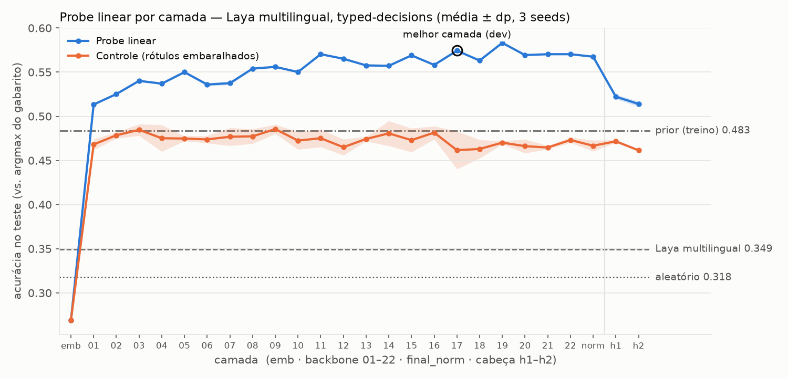

# Probe linear por camada — Laya multilingual × typed-decisions

> Execução completa (1.200 casos de treino, 400 de teste).

## Resultado

- **Melhor camada (escolhida no dev, nunca no teste): `enc_17`.** Acurácia de teste do probe 0.574 ± 0.001 (3 seeds), contra 0.349 do próprio Laya, 0.483 do prior e 0.318 do aleatório.
- Probe vs. Laya: acima, por +22.5 p.p. (IC95% bootstrap por caso: +19.4 a +25.7).
- Probe vs. prior: acima, por +9.1 p.p. (IC95% bootstrap por caso: +6.8 a +11.6).
- **Controle** (mesmo probe e wd, gabarito embaralhado dentro de cada (workflow, pergunta)): 0.462 ± 0.021. Seletividade (probe − controle) = +11.3 p.p. O controle preserva a marginal de cada pergunta, então ele mede o que se acerta só com a identidade da opção (≈ prior); a seletividade é o que vem da informação específica de cada caso.

| modelo | acc | acc suave | KL(gold‖p) | choice | score | noul | agent_trace_observability | customer_service | invoice_processing | security_incidents |
|---|---|---|---|---|---|---|---|---|---|---|
| probe enc_17 | 0.574 ± 0.001 | 0.508 | 0.269 | 0.577 | 0.476 | 0.703 | 0.436 | 0.587 | 0.670 | 0.605 |
| controle enc_17 | 0.462 ± 0.021 | 0.424 | 0.361 | 0.414 | 0.395 | 0.599 | 0.359 | 0.388 | 0.542 | 0.557 |
| Laya multilingual | 0.349 | 0.338 | 1.112 | 0.295 | 0.282 | 0.493 | 0.284 | 0.416 | 0.308 | 0.390 |
| prior (treino) | 0.483 | 0.434 | 0.374 | 0.418 | 0.414 | 0.642 | 0.362 | 0.452 | 0.518 | 0.602 |
| aleatório | 0.318 | 0.318 | 0.444 | 0.233 | 0.244 | 0.500 | 0.300 | 0.280 | 0.350 | 0.340 |

Acurácia = argmax da predição igual ao `label` do gabarito (o `label` está sempre entre os argmax da distribuição; 35 decisões de teste têm empate no gabarito e contam pelo `label`). Acurácia suave = média de `gold_dist[pred]`. KL = KL(gabarito ‖ predição), média por decisão. Aleatório: acurácia esperada (média de 1/k). Prior: frequência do `label` por (workflow, pergunta) no treino, suavizada com +0,5 (só afeta a KL).

## Ressalvas (ler antes de citar os números)

- **O prior aqui é 0,483, não o 0,461 citado no enunciado.** Pela definição pedida (para cada (workflow, pergunta), a resposta mais frequente no treino), o resultado é 0,4835. Outras variantes também não dão 0,461: argmax da distribuição média do gabarito por pergunta = 0,4785; maioria por pergunta calculada no próprio teste = 0,5225; rótulo mais frequente por tipo de pergunta = 0,3685; posição mais frequente por (tipo, k) = 0,403. A origem do 0,461 ainda não foi identificada. Isso não muda a conclusão: o probe passa do prior mais forte (0,483) por +9,1 p.p. O Laya (0,349) e o aleatório (0,318) batem com os números de referência.
- **O probe é supervisionado no próprio benchmark** (4.800 decisões de treino, mesmos workflows e mesmas perguntas do teste), enquanto o Laya é zero-shot. "Probe > Laya" mostra que a informação existe nas representações e pode ser lida linearmente com dados do domínio. Não mostra que o Laya "deveria" acertar isso sem esses dados.
- **A seletividade é moderada.** O controle (0,462 ± 0,021) mostra que identidade da opção + prior da pergunta explicam boa parte da acurácia. O ganho atribuível à informação específica de cada caso é de ~11 p.p. na camada escolhida, e de ~5–12 p.p. ao longo do backbone.
- **Curva por camada:** o probe sobe rápido até a camada ~3 (0,54) e depois fica num patamar largo de ~0,55–0,58 da camada 8 até o `final_norm`. As diferenças entre camadas vizinhas desse patamar são da ordem do ruído do teste. A camada `enc_19` tem o maior teste (0,583), mas foi o dev que escolheu a `enc_17` (empate em acurácia no dev com a `enc_12`, decidido pela KL). Nas duas camadas da cabeça de decisão o probe cai para 0,522 e 0,514. Ainda assim, na `head_2`, um leitor linear treinado no domínio sobre os mesmos vetores que o scorer do Laya lê chega a 0,514, contra 0,349 do próprio modelo. Isso é compatível com um problema de leitura/prior no scorer, mas o scorer do Laya é não linear e foi treinado em outra distribuição, então isso não é prova de causa.
- **Borda da grade de weight decay:** várias camadas escolheram o menor valor (1e-5), entre elas a `enc_17`. No dev da `enc_17` a curva é plana de 1e-5 a 1e-3 (0,597 → 0,586), então estender a grade para baixo dificilmente mudaria a conclusão. Isso não foi testado.
- **Variância entre seeds:** ±0,001 no probe é esperado. O problema é convexo e a seed só muda a inicialização, então esse desvio não mede incerteza do resultado. Para incerteza, use o IC por bootstrap acima.

## Método (resumo)

- Ativações no `[MASK]` de cada opção, capturadas por hooks **dentro** de `agent.predict` (entrada montada pelo próprio `laya.common.build_sequence`, `max_len`/`head_max_len` do checkpoint: 1024/256; autocast `torch.bfloat16` em `cuda`). Camadas: emb, enc_01, enc_02, enc_03, enc_04, enc_05, enc_06, enc_07, enc_08, enc_09, enc_10, enc_11, enc_12, enc_13, enc_14, enc_15, enc_16, enc_17, enc_18, enc_19, enc_20, enc_21, enc_22, enc_final, head_1, head_2.
- Probe: `s = w·h + b` por marcador, softmax entre as opções da pergunta, CE contra o gabarito suave + wd·‖w‖². O `b` se cancela no softmax. Features padronizadas com estatísticas do conjunto de ajuste. L-BFGS em batch cheio; o problema é convexo, então a variação entre seeds do probe real é ~0 por construção (a seed só muda a inicialização); no controle a seed também muda a permutação.
- `emb` é um piso de sanidade, não uma camada informativa: na saída dos embeddings todo marcador é o mesmo vetor de `[MASK]` (o ModernBERT não tem embedding posicional; a posição entra via RoPE na atenção), então o probe só pode dar distribuição uniforme e o argmax cai na primeira opção.
- Seleção só no dev (900 decisões = 15% dos casos de treino por hash do `case_id`): wd ∈ [1e-05, 0.0001, 0.001, 0.01, 0.1, 1.0] por camada e melhor camada, ambos por acurácia média no dev (empate → menor KL). Depois, reajuste no treino inteiro (6000 decisões) e avaliação no teste.

## Paridade (checagem obrigatória da etapa A)

- train: 6000 decisões, passou=True; máx |Δlogit| recomputado vs forward = 0.00e+00; máx |Δp| recomputado vs predict sem hooks = 0.00e+00 (predict arredonda para 4 casas; tolerância 0.0001); máx |Δlogit| a partir dos vetores salvos em fp16 = 3.12e-02.
- test: 2000 decisões, passou=True; máx |Δlogit| recomputado vs forward = 0.00e+00; máx |Δp| recomputado vs predict sem hooks = 0.00e+00 (predict arredonda para 4 casas; tolerância 0.0001); máx |Δlogit| a partir dos vetores salvos em fp16 = 3.12e-02.

## Truncamento

- train: 0/1200 casos com o estado cortado (0 tokens descartados; maior estado 563 tokens, maior sequência 666); opções cortadas no limite de 48 tokens: 0; decisões com orçamento por opção reduzido: 0; opções colapsadas: 0.
- test: 0/400 casos com o estado cortado (0 tokens descartados; maior estado 528 tokens, maior sequência 631); opções cortadas no limite de 48 tokens: 0; decisões com orçamento por opção reduzido: 0; opções colapsadas: 0.

## Reprodutibilidade

- Versões: Python 3.14.10, torch 2.15.0+cu132 (CUDA 13.2), laya 0.4.30, transformers 5.22.2; GPU: NVIDIA B200 MIG 3g.90gb. Ambiente completo: `uv.lock` (raiz do repo) e `pip_freeze.txt` ao lado deste relatório.
- Laya `7b928d828b7b0e022f929d9bd2e44165aa270148`; dataset `LocalLLaMA/typed-decisions@c76749ec58bd8c3d2ea706b31c333a9059c38f90`.
- Seeds: [0, 1, 2] (probe/controle); bootstrap seed 0, 2000 reamostras por caso.
- Jobs (Sauron, B200 MIG 3g.90gb, commit `080fa96f258e` da branch `experiment/linear-probe`): **3026** extração curta + smoke da etapa B (20 casos por split); **3027** extração completa; **3029** probes. O Sauron não expõe o ID do job dentro do container; os IDs foram anotados a partir do `sauron submit`.
- Artefatos (relativos à raiz do repo): ativações `data/activations/typed_decisions/<split>/L??_*.npy` (+ `markers.parquet`, `decisions.parquet`, `parity*.`, `truncation.json`, `meta.json`); `results/probe_typed/per_decision.parquet`, `probe_by_layer.csv`, `wd_selection.csv`, `summary_table.csv`, `results.json`, `acc_by_layer.png`.
