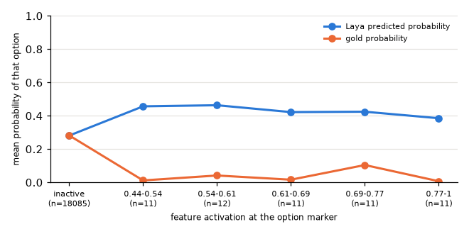

# Feature 239

Critérios em que aparece: pred_error

**Interpretação (preencher):** 

---

## Maiores ativações

**tr_security_incidents_000188 / urgency** (score, security_incidents) | ativação 7.848 em `estado` | opções ['0', '1', '2', '3'] | Laya: **1** [0.106, 0.635, 0.123, 0.136] | gabarito: **2**

```
[CLS]score question: How quickly must a responder act on this alert?[SEP]
▸ [MASK] level 0: No time pressure; can wait indefinitely.
▸ [MASK] level 1: Routine; handle within the normal queue.
▸ [MASK] level 2: Elevated; should be handled within the same week.
▸ [MASK] level 3: Critical; requires action within the same day.

[SEP]

{"alert": {"description": "a long-unused account became active", "evidence": "Employee account \"blee\" that had no successful logon events since 2025-12-01 logged in from an unknown external address 203.0.113.88 at 20⟦26⟧-09-16 14:03:19 UTC. This activity marks the first use of the account in over 180 days, with its password last changed 14 days ago.", "rule": "dormant_account_use"}, "context": {"asset_criticality": "medium", "change_window_active": false, "source_on_allowlist": false}, "history": {"credential_rotation_days_ago": 14, "distinct_countries_30d": 2, "logins_30d": 49, "prior_alerts_90d": 0}, "principal": {"mfa_enrolled": true, "name": "usr-deploy-427", "privileges": ["repo:read"], "type": "employee"}}[SEP]
```

**tr_security_incidents_000188 / true_positive** (noul, security_incidents) | ativação 7.578 em `estado` | opções ['false', 'true'] | Laya: **false** [0.537, 0.463] | gabarito: **true**

```
[CLS]noul question: This alert reflects genuinely malicious or unauthorised activity.[SEP]
▸ [MASK] false: Benign activity, a misconfiguration, or a known false positive.
▸ [MASK] true: The underlying behaviour is malicious or unauthorised.

[SEP]

{"alert": {"description": "a long-unused account became active", "evidence": "Employee account \"blee\" that had no successful logon events since 2025-12-01 logged in from an unknown external address 203.0.113.88 at 20⟦26⟧-09-16 14:03:19 UTC. This activity marks the first use of the account in over 180 days, with its password last changed 14 days ago.", "rule": "dormant_account_use"}, "context": {"asset_criticality": "medium", "change_window_active": false, "source_on_allowlist": false}, "history": {"credential_rotation_days_ago": 14, "distinct_countries_30d": 2, "logins_30d": 49, "prior_alerts_90d": 0}, "principal": {"mfa_enrolled": true, "name": "usr-deploy-427", "privileges": ["repo:read"], "type": "employee"}}[SEP]
```

**tr_security_incidents_000188 / disposition** (choice, security_incidents) | ativação 7.230 em `estado` | opções ['close_benign', 'contain', 'investigate', 'monitor'] | Laya: **close_benign** [0.334, 0.269, 0.104, 0.293] | gabarito: **investigate**

```
[CLS]choice question: How should this security alert be dispositioned?[SEP]
▸ [MASK] close_benign: Expected, explainable activity; close without analyst time.
▸ [MASK] contain: Contain the host or account immediately; do not wait for triage.
▸ [MASK] investigate: Warrants an analyst opening an investigation.
▸ [MASK] monitor: Not clearly malicious, but worth watching for recurrence.

[SEP]

{"alert": {"description": "a long-unused account became active", "evidence": "Employee account \"blee\" that had no successful logon events since 2025-12-01 logged in from an unknown external address 203.0.113.88 at 20⟦26⟧-09-16 14:03:19 UTC. This activity marks the first use of the account in over 180 days, with its password last changed 14 days ago.", "rule": "dormant_account_use"}, "context": {"asset_criticality": "medium", "change_window_active": false, "source_on_allowlist": false}, "history": {"credential_rotation_days_ago": 14, "distinct_countries_30d": 2, "logins_30d": 49, "prior_alerts_90d": 0}, "principal": {"mfa_enrolled": true, "name": "usr-deploy-427", "privileges": ["repo:read"], "type": "employee"}}[SEP]
```

**tr_security_incidents_000188 / severity** (score, security_incidents) | ativação 6.949 em `estado` | opções ['0', '1', '2', '3', '4'] | Laya: **1** [0.076, 0.398, 0.386, 0.084, 0.057] | gabarito: **2**

```
[CLS]score question: How severe is the potential impact if this alert is real?[SEP]
▸ [MASK] level 0: Negligible: no access to anything sensitive.
▸ [MASK] level 1: Low: limited access, easily reversed.
▸ [MASK] level 2: Moderate: access to internal systems or non-public data.
▸ [MASK] level 3: High: access to production, secrets or customer data.
▸ [MASK] level 4: Critical: active compromise of crown-jewel systems.

[SEP]

{"alert": {"description": "a long-unused account became active", "evidence": "Employee account \"blee\" that had no successful logon events since 2025-12-01 logged in from an unknown external address 203.0.113.88 at 20⟦26⟧-09-16 14:03:19 UTC. This activity marks the first use of the account in over 180 days, with its password last changed 14 days ago.", "rule": "dormant_account_use"}, "context": {"asset_criticality": "medium", "change_window_active": false, "source_on_allowlist": false}, "history": {"credential_rotation_days_ago": 14, "distinct_countries_30d": 2, "logins_30d": 49, "prior_alerts_90d": 0}, "principal": {"mfa_enrolled": true, "name": "usr-deploy-427", "privileges": ["repo:read"], "type": "employee"}}[SEP]
```

**tr_security_incidents_000190 / severity** (score, security_incidents) | ativação 6.801 em `estado` | opções ['0', '1', '2', '3', '4'] | Laya: **2** [0.036, 0.29, 0.419, 0.214, 0.04] | gabarito: **3**

```
[CLS]score question: How severe is the potential impact if this alert is real?[SEP]
▸ [MASK] level 0: Negligible: no access to anything sensitive.
▸ [MASK] level 1: Low: limited access, easily reversed.
▸ [MASK] level 2: Moderate: access to internal systems or non-public data.
▸ [MASK] level 3: High: access to production, secrets or customer data.
▸ [MASK] level 4: Critical: active compromise of crown-jewel systems.

[SEP]

{"alert": {"description": "an account granted itself or received elevated permissions", "evidence": "CI runner \"runner-42\" was added to the \"docker-admin\" group on 20⟦26⟧-09-15 04:12:57 UTC originating from IP 198.51.100.22. The API token used for the change was last rotated on 2025-03-15.", "rule": "privilege_escalation"}, "context": {"asset_criticality": "high", "change_window_active": false, "source_on_allowlist": false}, "history": {"credential_rotation_days_ago": 180, "distinct_countries_30d": 1, "logins_30d": 451, "prior_alerts_90d": 8}, "principal": {"mfa_enrolled": true, "name": "svc-analytics-751", "privileges": ["repo:read"], "type": "ci_runner"}}[SEP]
```

## Ativações medianas (faixa 40-60%, mediana 1.030)

**tr_invoice_processing_000240 / matches_order** (noul, invoice_processing) | ativação 0.900 em `estado` | opções ['false', 'true'] | Laya: **true** [0.492, 0.508] | gabarito: **false**

```
[CLS]noul question: The invoice reconciles with the purchase order and the recorded delivery.[SEP]
▸ [MASK] false: There is a discrepancy against the order or the delivery.
▸ [MASK] true: Line items, quantities and amounts reconcile.

[SEP]

{"delivery": {"condition": "accepted with exceptions", "date": "2026-03-01", "received_qty": 400}, "invoice": {"currency": "USD", "id": "INV-20⟦26⟧-7564", "lines": [{"qty": 400, "sku": "SKU-444", "total_usd": 113636.0, "unit_usd": 284.09}], "total_usd": 113636.0, "vendor": "Orbit Logistics"}, "payment": {"days_until_due": 0, "discount_expires_in_days": null, "early_payment_discount_pct": null, "status": "scheduled", "terms": "net 60"}, "purchase_order": {"freight_terms": "freight prepaid by vendor, not separately billable", "id": "PO-7772", "lines": [{"qty": 400, "unit_usd": 284.09}], "total_usd": 113636.0}, "vendor_history": {"disputes_12m": 2, "invoices_12m": 47, "prior_invoice_ids": ["INV-2026-9066"]}}[SEP]
```

**tr_invoice_processing_000065 / discrepancy_severity** (score, invoice_processing) | ativação 0.932 em `estado` | opções ['0', '1', '2', '3'] | Laya: **0** [0.318, 0.224, 0.231, 0.227] | gabarito: **0**

```
[CLS]score question: How material is any discrepancy between the invoice, the order and the delivery?[SEP]
▸ [MASK] level 0: None: everything reconciles.
▸ [MASK] level 1: Trivial: rounding or a cosmetic difference.
▸ [MASK] level 2: Moderate: a real difference worth confirming.
▸ [MASK] level 3: Material: a large or unexplained difference.

[SEP]

{"delivery": {"condition": "accepted", "date": "2026-03-22", "received_qty": 250}, "invoice": {"currency": "USD", "id": "INV-2026-7⟦887⟧", "lines": [{"qty": 250, "sku": "SKU-490", "total_usd": 31982.5, "unit_usd": 127.93}], "total_usd": 31982.5, "vendor": "Orbit Logistics"}, "payment": {"days_until_due": 0, "discount_expires_in_days": 5, "early_payment_discount_pct": 2.0, "status": "scheduled", "terms": "net 15"}, "purchase_order": {"freight_terms": "freight prepaid by vendor, not separately billable", "id": "PO-8246", "lines": [{"qty": 250, "unit_usd": 127.93}], "total_usd": 31982.5}, "vendor_history": {"disputes_12m": 1, "invoices_12m": 17, "prior_invoice_ids": ["INV-2026-4688", "INV-2026-4365", "INV-2026-2955"]}}[SEP]
```

**tr_customer_service_000171 / urgency** (score, customer_service) | ativação 0.978 em `estado` | opções ['0', '1', '2', '3'] | Laya: **1** [0.147, 0.54, 0.094, 0.218] | gabarito: **3**

```
[CLS]score question: How time-sensitive is this conversation?[SEP]
▸ [MASK] level 0: No time pressure; can wait indefinitely.
▸ [MASK] level 1: Routine; handle within the normal queue.
▸ [MASK] level 2: Elevated; should be handled within the same week.
▸ [MASK] level 3: Critical; requires action within the same day.

[SEP]

{"account": {"lifetime_value_usd": 2300, "prior_tickets_90d": 0, "seats": 1, "tenure_months": 26, "tier": "standard"}, "orders": [{"amount_usd": 49, "date": "2026-02-14", "id": "A-88180", "status": "refunded"}, {"amount_usd": 49, "date": "2026-02-⟦22⟧", "id": "A-79800", "status": "settled"}, {"amount_usd": 49, "date": "2026-02-08", "id": "A-91927", "status": "refunded"}], "thread": [{"role": "customer", "text": "The service is painfully slow right now—I'm on a deadline and can't get anything done."}, {"role": "agent", "text": "I hear the urgency. Can you tell me which device and operating system you’re using?"}, {"role": "customer", "text": "It’s a Windows 10 desktop, and the slowdown started after the latest update."}, {"role": "agent", "text": "Thanks for the details. Have you tried clearing the application cache or restarting the app?"}, {"role": "customer", "text": "Yes, I cleared everything and rebooted, but it’s still crawling. I need this resolved quickly."}]}[SEP]
```

**tr_customer_service_000215 / action** (choice, customer_service) | ativação 1.165 em `estado` | opções ['answer_directly', 'close_no_action', 'escalate_to_human', 'execute_refund', 'request_information'] | Laya: **close_no_action** [0.215, 0.3, 0.194, 0.099, 0.191] | gabarito: **request_information**

```
[CLS]choice question: What should the assistant do next with this conversation?[SEP]
▸ [MASK] answer_directly: The assistant can resolve this itself with information it already has.
▸ [MASK] close_no_action: No further action is warranted; the matter is settled.
▸ [MASK] escalate_to_human: Hand off to a human agent with the appropriate authority.
▸ [MASK] execute_refund: Issue the refund or credit the customer is owed.
▸ [MASK] request_information: More detail is needed from the customer before anything can be done.

[SEP]

{"account": {"lifetime_value_usd": 182, "prior_tickets_90d": 1, "seats": 1, "tenure_months": 8, "tier": "free"}, "thread": [{"role": "customer", "text": "Managing seats on the free tier is a nightmare—every time I try to add or remove a user, the UI freezes and I lose my changes."}, {"role": "agent", "text": "That definitely isn’t the experience we want you to have. Could you let me know exactly where in the seat management page the freeze occurs?"}, {"role": "customer", "text": "It happens when I hit ‘Add new seat’ and also when I click the trash can icon to delete a user. The screen just spins and never updates."}, {"role": "agent", "text": "Thanks for the specifics. Are you seeing any error messages in the browser console, or does it just stay on the loading spinner?"}, {"role": "customer", "text": "No error pop‑ups, just the endless spinner. I’ve been on the free plan for⟦ eight⟧ months and this is the only time I’ve run into such a problem."}]}[SEP]
```

**tr_security_incidents_000145 / urgency** (score, security_incidents) | ativação 0.982 em `estado` | opções ['0', '1', '2', '3'] | Laya: **1** [0.05, 0.715, 0.139, 0.096] | gabarito: **3**

```
[CLS]score question: How quickly must a responder act on this alert?[SEP]
▸ [MASK] level 0: No time pressure; can wait indefinitely.
▸ [MASK] level 1: Routine; handle within the normal queue.
▸ [MASK] level 2: Elevated; should be handled within the same week.
▸ [MASK] level 3: Critical; requires action within the same day.

[SEP]

{"alert": {"description": "a long-unused account became active", "evidence": "A contractor account, which had been dormant for an extended period, performed authentication from an unrecognized source during an active change window. The account holds privileged access and had its credentials last rotated 14 days prior to⟦ this⟧ event.", "rule": "dormant_account_use"}, "context": {"asset_criticality": "crown_jewel", "change_window_active": true, "source_on_allowlist": false}, "history": {"credential_rotation_days_ago": 14, "distinct_countries_30d": 1, "logins_30d": 805, "prior_alerts_90d": 3}, "principal": {"mfa_enrolled": true, "name": "adm-billing-648", "privileges": ["deploy:production", "secrets:read"], "type": "contractor"}}[SEP]
```

## Estatísticas (conjunto de descoberta, dev e teste)

**pred / error**

| split | decisões | ativas | ativas e Laya errou | taxa | lift | q (BH) | OR (CMH) | q (CMH) |
|---|---|---|---|---|---|---|---|---|
| discovery | 5100 | 44 | 43 | 0.977 | 1.54 | 5.3e-07 | 2.61 | 0.701 |
| dev | 900 | 8 | 8 | 1.000 | 1.52 | nan | nan | nan |
| test | 2000 | 12 | 12 | 1.000 | 1.57 | nan | nan | nan |

**corr / error**

| split | decisões | ativas | ativas e Laya errou | taxa | lift | q (BH) | OR (CMH) | q (CMH) |
|---|---|---|---|---|---|---|---|---|
| discovery | 5100 | 1 | 0 | 0.000 | 0.00 | nan | nan | nan |
| dev | 900 | 0 | 0 | nan | nan | nan | nan | nan |
| test | 2000 | 0 | 0 | nan | nan | nan | nan | nan |

**state / error**

| split | decisões | ativas | ativas e Laya errou | taxa | lift | q (BH) | OR (CMH) | q (CMH) |
|---|---|---|---|---|---|---|---|---|
| discovery | 5100 | 3706 | 2343 | 0.632 | 0.99 | 0.649 | 1.24 | 0.0374 |
| dev | 900 | 668 | 436 | 0.653 | 0.99 | 1 | 0.92 | 0.845 |
| test | 2000 | 1471 | 964 | 0.655 | 1.03 | 0.164 | 1.53 | 0.0108 |

Confusão mais sobre-representada (pred): `action|1>2` (n=23, lift 21.33, p=1.46e-26). Formato `pergunta|índice previsto>índice correto`.

Confusão mais sobre-representada (state): `duplicate|1>0` (n=215, lift 1.37, p=1.66e-29). Formato `pergunta|índice previsto>índice correto`.



