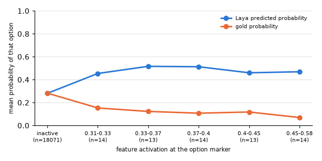

# Feature 345

Critérios em que aparece: pred_error

**Interpretação (preencher):** 

---

## Maiores ativações

**tr_security_incidents_000244 / true_positive** (noul, security_incidents) | ativação 5.715 em `estado` | opções ['false', 'true'] | Laya: **false** [0.644, 0.356] | gabarito: **false**

```
[CLS]noul question: This alert reflects genuinely malicious or unauthorised activity.[SEP]
▸ [MASK] false: Benign activity, a misconfiguration, or a known false positive.
▸ [MASK] true: The underlying behaviour is malicious or unauthorised.

[SEP]

{"alert": {"description": "a session token was presented from a second address", "evidence": "The authentication system recorded a reuse of session token \"f1e2d3c4b5a6\" at 2026-09-16 08:41:12 UTC from IP 198⟦.⟧51.100.22 after the token had previously been used from IP 198.51.100.7; both source IPs are on the allowlist. The token was presented by the admin user \"admin_user@contoso.com\" (MFA enabled, unprivileged) and the account's credentials were last rotated 14 days prior.", "rule": "token_reuse"}, "context": {"asset_criticality": "crown_jewel", "change_window_active": false, "source_on_allowlist": true}, "history": {"credential_rotation_days_ago": 14, "distinct_countries_30d": 3, "logins_30d": 1356, "prior_alerts_90d": 0}, "principal": {"mfa_enrolled": true, "name": "adm-billing-855", "privileges": ["repo:read"], "type": "admin"}}[SEP]
```

**tr_security_incidents_000244 / credential_compromise** (noul, security_incidents) | ativação 5.410 em `estado` | opções ['false', 'true'] | Laya: **false** [0.52, 0.48] | gabarito: **false**

```
[CLS]noul question: The evidence indicates a credential or account has been compromised.[SEP]
▸ [MASK] false: no, the statement does not hold
▸ [MASK] true: yes, the statement holds

[SEP]

{"alert": {"description": "a session token was presented from a second address", "evidence": "The authentication system recorded a reuse of session token \"f1e2d3c4b5a6\" at 2026-09-16 08:41:12 UTC from IP 198⟦.⟧51.100.22 after the token had previously been used from IP 198.51.100.7; both source IPs are on the allowlist. The token was presented by the admin user \"admin_user@contoso.com\" (MFA enabled, unprivileged) and the account's credentials were last rotated 14 days prior.", "rule": "token_reuse"}, "context": {"asset_criticality": "crown_jewel", "change_window_active": false, "source_on_allowlist": true}, "history": {"credential_rotation_days_ago": 14, "distinct_countries_30d": 3, "logins_30d": 1356, "prior_alerts_90d": 0}, "principal": {"mfa_enrolled": true, "name": "adm-billing-855", "privileges": ["repo:read"], "type": "admin"}}[SEP]
```

**tr_security_incidents_000109 / true_positive** (noul, security_incidents) | ativação 5.180 em `estado` | opções ['false', 'true'] | Laya: **true** [0.498, 0.502] | gabarito: **true**

```
[CLS]noul question: This alert reflects genuinely malicious or unauthorised activity.[SEP]
▸ [MASK] false: Benign activity, a misconfiguration, or a known false positive.
▸ [MASK] true: The underlying behaviour is malicious or unauthorised.

[SEP]

{"alert": {"description": "two successful logins from distant locations too close together", "evidence": "Successful VPN logins were observed for the contractor account \"jdoe_cont\" at 2026-09-16 08:02 UTC from IP 198.51.100.22 (Chicago) and again at 08:07 UTC from IP 203⟦.⟧0.113.77 (Tokyo), representing a distance of over 9,000 km within a five‑minute interval. The account is unprivileged, MFA is active, credentials were rotated 14 days prior, and the source devices are not on the recognized inventory list.", "rule": "impossible_travel"}, "context": {"asset_criticality": "medium", "change_window_active": false, "source_on_allowlist": false}, "history": {"credential_rotation_days_ago": 14, "distinct_countries_30d": 2, "logins_30d": 650, "prior_alerts_90d": 0}, "principal": {"mfa_enrolled": true, "name": "adm-billing-167", "privileges": ["repo:read"], "type": "contractor"}}[SEP]
```

**tr_security_incidents_000244 / disposition** (choice, security_incidents) | ativação 5.121 em `estado` | opções ['close_benign', 'contain', 'investigate', 'monitor'] | Laya: **monitor** [0.318, 0.153, 0.165, 0.363] | gabarito: **close_benign**

```
[CLS]choice question: How should this security alert be dispositioned?[SEP]
▸ [MASK] close_benign: Expected, explainable activity; close without analyst time.
▸ [MASK] contain: Contain the host or account immediately; do not wait for triage.
▸ [MASK] investigate: Warrants an analyst opening an investigation.
▸ [MASK] monitor: Not clearly malicious, but worth watching for recurrence.

[SEP]

{"alert": {"description": "a session token was presented from a second address", "evidence": "The authentication system recorded a reuse of session token \"f1e2d3c4b5a6\" at 2026-09-16 08:41:12 UTC from IP 198⟦.⟧51.100.22 after the token had previously been used from IP 198.51.100.7; both source IPs are on the allowlist. The token was presented by the admin user \"admin_user@contoso.com\" (MFA enabled, unprivileged) and the account's credentials were last rotated 14 days prior.", "rule": "token_reuse"}, "context": {"asset_criticality": "crown_jewel", "change_window_active": false, "source_on_allowlist": true}, "history": {"credential_rotation_days_ago": 14, "distinct_countries_30d": 3, "logins_30d": 1356, "prior_alerts_90d": 0}, "principal": {"mfa_enrolled": true, "name": "adm-billing-855", "privileges": ["repo:read"], "type": "admin"}}[SEP]
```

**tr_security_incidents_000109 / true_positive** (noul, security_incidents) | ativação 5.047 em `estado` | opções ['false', 'true'] | Laya: **true** [0.498, 0.502] | gabarito: **true**

```
[CLS]noul question: This alert reflects genuinely malicious or unauthorised activity.[SEP]
▸ [MASK] false: Benign activity, a misconfiguration, or a known false positive.
▸ [MASK] true: The underlying behaviour is malicious or unauthorised.

[SEP]

{"alert": {"description": "two successful logins from distant locations too close together", "evidence": "Successful VPN logins were observed for the contractor account \"jdoe_cont\" at 2026-09-16 08:02 UTC from IP 198⟦.⟧51.100.22 (Chicago) and again at 08:07 UTC from IP 203.0.113.77 (Tokyo), representing a distance of over 9,000 km within a five‑minute interval. The account is unprivileged, MFA is active, credentials were rotated 14 days prior, and the source devices are not on the recognized inventory list.", "rule": "impossible_travel"}, "context": {"asset_criticality": "medium", "change_window_active": false, "source_on_allowlist": false}, "history": {"credential_rotation_days_ago": 14, "distinct_countries_30d": 2, "logins_30d": 650, "prior_alerts_90d": 0}, "principal": {"mfa_enrolled": true, "name": "adm-billing-167", "privileges": ["repo:read"], "type": "contractor"}}[SEP]
```

## Ativações medianas (faixa 40-60%, mediana 1.203)

**tr_security_incidents_000120 / urgency** (score, security_incidents) | ativação 1.207 em `estado` | opções ['0', '1', '2', '3'] | Laya: **1** [0.115, 0.678, 0.113, 0.094] | gabarito: **3**

```
[CLS]score question: How quickly must a responder act on this alert?[SEP]
▸ [MASK] level 0: No time pressure; can wait indefinitely.
▸ [MASK] level 1: Routine; handle within the normal queue.
▸ [MASK] level 2: Elevated; should be handled within the same week.
▸ [MASK] level 3: Critical; requires action within the same day.

[SEP]

{"alert": {"description": "an endpoint agent matched a known signature", "evidence": "The endpoint agent on CI runner host 'runner-7x2' identified a signature match for 'malware.linux.syslog' during an active session. This connection originated from an unrecognized IP address (203.0⟦.⟧113.88) using unprivileged credentials that were last rotated 90 days ago.", "rule": "malware_signature"}, "context": {"asset_criticality": "high", "change_window_active": false, "source_on_allowlist": false}, "history": {"credential_rotation_days_ago": 90, "distinct_countries_30d": 1, "logins_30d": 1882, "prior_alerts_90d": 8}, "principal": {"mfa_enrolled": true, "name": "usr-billing-642", "privileges": ["repo:read"], "type": "ci_runner"}}[SEP]
```

**tr_invoice_processing_000163 / matches_order** (noul, invoice_processing) | ativação 1.082 em `estado` | opções ['false', 'true'] | Laya: **true** [0.477, 0.523] | gabarito: **true**

```
[CLS]noul question: The invoice reconciles with the purchase order and the recorded delivery.[SEP]
▸ [MASK] false: There is a discrepancy against the order or the delivery.
▸ [MASK] true: Line items, quantities and amounts reconcile.

[SEP]

{"delivery": {"condition": "accepted", "date": "2026-03-03", "received_qty": 1000}, "invoice": {"currency": "USD", "id": "INV-2026-4638", "lines": [{"qty": 1000, "sku": "SKU-842", "total_usd": 251570.0, "unit_usd": 251.57}], "total_usd": 251570.0, "vendor": "Kestrel Supply"}, "payment": {"days_until_due": 0, "discount_expires_in_days": null, "early_payment_discount_pct": null, "status": "scheduled", "terms": "net 30"}, "purchase_order": {"freight_terms": "freight prepaid by vendor, not separately billable", "id": null, "lines": [{"qty": 1000, "unit_usd": 251.57}], "total_usd": 251570.0}, "vendor_history": {"disputes_12m": 0, "invoices_12m": 55, "prior_invoice_ids": ["INV-2026-7565", "INV⟦-⟧2026-8662", "INV-2026-6843", "INV-2026-4110"]}}[SEP]
```

**tr_invoice_processing_000278 / matches_order** (noul, invoice_processing) | ativação 1.380 em `estado` | opções ['false', 'true'] | Laya: **false** [0.504, 0.496] | gabarito: **true**

```
[CLS]noul question: The invoice reconciles with the purchase order and the recorded delivery.[SEP]
▸ [MASK] false: There is a discrepancy against the order or the delivery.
▸ [MASK] true: Line items, quantities and amounts reconcile.

[SEP]

{"delivery": {"condition": "accepted", "date": "2026⟦-⟧03-20", "received_qty": 25}, "invoice": {"currency": "USD", "id": "INV-2026-7761", "lines": [{"qty": 25, "sku": "SKU-466", "total_usd": 8533.0, "unit_usd": 341.32}], "total_usd": 8533.0, "vendor": "Vantage Materials"}, "payment": {"days_until_due": 5, "discount_expires_in_days": null, "early_payment_discount_pct": null, "status": "scheduled", "terms": "net 45"}, "purchase_order": {"freight_terms": "freight prepaid by vendor, not separately billable", "id": "PO-3755", "lines": [{"qty": 25, "unit_usd": 341.32}], "total_usd": 8533.0}, "vendor_history": {"disputes_12m": 5, "invoices_12m": 51, "prior_invoice_ids": ["INV-2026-2143", "INV-2026-9910"]}}[SEP]
```

**tr_security_incidents_000231 / true_positive** (noul, security_incidents) | ativação 1.091 em `estado` | opções ['false', 'true'] | Laya: **false** [0.772, 0.228] | gabarito: **false**

```
[CLS]noul question: This alert reflects genuinely malicious or unauthorised activity.[SEP]
▸ [MASK] false: Benign activity, a misconfiguration, or a known false positive.
▸ [MASK] true: The underlying behaviour is malicious or unauthorised.

[SEP]

{"alert": {"description": "a first-ever sign-in from an unfamiliar country", "evidence": "On 2026-09-15 08:45:12 UTC, employee user \"jdoe@example.com\" performed a successful interactive login to the corporate VPN from IP 203.0.113.45, which resolves to São Paulo, Brazil—a country not previously seen for this account. The login required MFA, the source IP is listed in the approved allowlist, and the account's password was last rotated on⟦ 20⟧26-09-12.", "rule": "new_country_login"}, "context": {"asset_criticality": "high", "change_window_active": false, "source_on_allowlist": true}, "history": {"credential_rotation_days_ago": 3, "distinct_countries_30d": 2, "logins_30d": 1789, "prior_alerts_90d": 0}, "principal": {"mfa_enrolled": true, "name": "svc-support-177", "privileges": ["repo:read"], "type": "employee"}}[SEP]
```

**tr_invoice_processing_000244 / urgency** (score, invoice_processing) | ativação 1.058 em `estado` | opções ['0', '1', '2', '3'] | Laya: **1** [0.222, 0.536, 0.159, 0.082] | gabarito: **3**

```
[CLS]score question: How time-sensitive is processing this invoice?[SEP]
▸ [MASK] level 0: No time pressure; can wait indefinitely.
▸ [MASK] level 1: Routine; handle within the normal queue.
▸ [MASK] level 2: Elevated; should be handled within the same week.
▸ [MASK] level 3: Critical; requires action within the same day.

[SEP]

{"delivery": {"condition": "accepted", "date": "2026⟦-⟧03-03", "received_qty": 25}, "invoice": {"currency": "USD", "id": "INV-2026-6816", "lines": [{"qty": 25, "sku": "SKU-219", "total_usd": 3414.75, "unit_usd": 136.59}], "total_usd": 3414.75, "vendor": "Vantage Materials"}, "payment": {"days_until_due": -21, "discount_expires_in_days": null, "early_payment_discount_pct": null, "status": "overdue", "terms": "net 60"}, "purchase_order": {"freight_terms": "freight prepaid by vendor, not separately billable", "id": "PO-2088", "lines": [{"qty": 25, "unit_usd": 136.59}], "total_usd": 3414.75}, "vendor_history": {"disputes_12m": 0, "invoices_12m": 51, "prior_invoice_ids": ["INV-2026-6621", "INV-2026-7698"]}}[SEP]
```

## Estatísticas (conjunto de descoberta, dev e teste)

**pred / error**

| split | decisões | ativas | ativas e Laya errou | taxa | lift | q (BH) | OR (CMH) | q (CMH) |
|---|---|---|---|---|---|---|---|---|
| discovery | 5100 | 64 | 62 | 0.969 | 1.52 | 2.07e-09 | 5.80 | 0.0427 |
| dev | 900 | 7 | 5 | 0.714 | 1.09 | nan | nan | nan |
| test | 2000 | 18 | 13 | 0.722 | 1.13 | nan | nan | nan |

**corr / error**

| split | decisões | ativas | ativas e Laya errou | taxa | lift | q (BH) | OR (CMH) | q (CMH) |
|---|---|---|---|---|---|---|---|---|
| discovery | 5100 | 2 | 0 | 0.000 | 0.00 | nan | nan | nan |
| dev | 900 | 2 | 0 | 0.000 | 0.00 | nan | nan | nan |
| test | 2000 | 7 | 2 | 0.286 | 0.45 | nan | nan | nan |

**state / error**

| split | decisões | ativas | ativas e Laya errou | taxa | lift | q (BH) | OR (CMH) | q (CMH) |
|---|---|---|---|---|---|---|---|---|
| discovery | 5100 | 2912 | 1830 | 0.628 | 0.99 | 0.481 | 1.23 | 0.0381 |
| dev | 900 | 563 | 364 | 0.647 | 0.98 | 1 | 0.93 | 0.871 |
| test | 2000 | 1175 | 765 | 0.651 | 1.02 | 0.573 | 1.41 | 0.0612 |

Confusão mais sobre-representada (pred): `action|0>1` (n=40, lift 26.79, p=0). Formato `pergunta|índice previsto>índice correto`.

Confusão mais sobre-representada (state): `matches_order|1>0` (n=110, lift 1.75, p=6.87e-28). Formato `pergunta|índice previsto>índice correto`.



