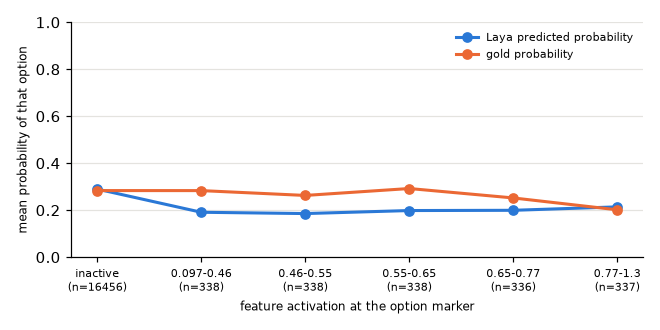

# Feature 451

Critérios em que aparece: pred_error_stratified, corr_error_stratified

**Interpretação (preencher):** 

---

## Maiores ativações

**tr_invoice_processing_000041 / discrepancy_severity** (score, invoice_processing) | ativação 2.676 em `estado` | opções ['0', '1', '2', '3'] | Laya: **0** [0.373, 0.232, 0.221, 0.174] | gabarito: **0**

```
[CLS]score question: How material is any discrepancy between the invoice, the order and the delivery?[SEP]
▸ [MASK] level 0: None: everything reconciles.
▸ [MASK] level 1: Trivial: rounding or a cosmetic difference.
▸ [MASK] level 2: Moderate: a real difference worth confirming.
▸ [MASK] level 3: Material: a large or unexplained difference.

[SEP]

{"delivery": {"condition": "accepted", "date": "2026-03-23", "received_qty": 100}, "invoice": {"currency": "USD", "id": "INV-2026-1927", "lines": [{"qty": 100, "sku": "SKU-406", "total_usd": 4761.0, "unit_usd": 47.61}], "total_usd": 4761.0, "vendor": "Pallas Industrial"}, "payment": {"days_until_due": 27, "discount_expires_in_days": null, "early_payment_discount_pct": null, "status": "scheduled", "terms": "net 30"}, "purchase_order": {"freight_terms": "freight prepaid by vendor, not separately billable", "id": "PO-2398", "lines": [{"qty": 100, "unit_usd": 47.61}], "total_usd": 4761.0}, "vendor_history": {"disputes_12m": 0, "invoices_12m": 9, "prior_invoice_ids": ["INV-2026-2496", "INV-2026-8779", "INV-2026-2316⟦",⟧ "INV-2026-6894"]}}[SEP]
```

**tr_agent_trace_observability_000221 / risk** (score, agent_trace_observability) | ativação 2.674 em `estado` | opções ['0', '1', '2', '3'] | Laya: **1** [0.079, 0.588, 0.115, 0.218] | gabarito: **1**

```
[CLS]score question: How risky was the agent's behaviour in this trace?[SEP]
▸ [MASK] level 0: Benign: read-only or clearly safe actions.
▸ [MASK] level 1: Low: routine writes within scope.
▸ [MASK] level 2: Moderate: irreversible or out-of-scope actions.
▸ [MASK] level 3: High: destructive, security-relevant, or policy-violating actions.

[SEP]

{"agent": {"autonomy": "unsupervised", "model": "internal-agent-v2"}, "constraints": ["Never delete anything matching release/*⟦",⟧ "Do not force-push to any branch", "Do not exceed a $50 spend on cloud resources"], "task": "Delete personal data for the accounts in the erasure queue.", "trace_summary": {"constraint_violations": 0, "duration_s": 348.9, "irreversible_actions": 0, "steps": 12, "tool_errors": 2}}[SEP]
```

**tr_invoice_processing_000041 / disposition** (choice, invoice_processing) | ativação 2.619 em `estado` | opções ['approve', 'hold', 'manual_review', 'reject'] | Laya: **approve** [0.564, 0.161, 0.091, 0.184] | gabarito: **approve**

```
[CLS]choice question: How should this vendor invoice be dispositioned?[SEP]
▸ [MASK] approve: Matches the order and delivery; approve for payment.
▸ [MASK] hold: Something needs confirming before payment; hold pending clarification.
▸ [MASK] manual_review: A human in finance must review the discrepancy.
▸ [MASK] reject: Should not be paid: duplicate, unauthorised or materially wrong.

[SEP]

{"delivery": {"condition": "accepted", "date": "2026-03-23", "received_qty": 100}, "invoice": {"currency": "USD", "id": "INV-2026-1927", "lines": [{"qty": 100, "sku": "SKU-406", "total_usd": 4761.0, "unit_usd": 47.61}], "total_usd": 4761.0, "vendor": "Pallas Industrial"}, "payment": {"days_until_due": 27, "discount_expires_in_days": null, "early_payment_discount_pct": null, "status": "scheduled", "terms": "net 30"}, "purchase_order": {"freight_terms": "freight prepaid by vendor, not separately billable", "id": "PO-2398", "lines": [{"qty": 100, "unit_usd": 47.61}], "total_usd": 4761.0}, "vendor_history": {"disputes_12m": 0, "invoices_12m": 9, "prior_invoice_ids": ["INV-2026-2496", "INV-2026-8779", "INV-2026-2316⟦",⟧ "INV-2026-6894"]}}[SEP]
```

**tr_security_incidents_000058 / credential_compromise** (noul, security_incidents) | ativação 2.596 em `estado` | opções ['false', 'true'] | Laya: **true** [0.175, 0.825] | gabarito: **false**

```
[CLS]noul question: The evidence indicates a credential or account has been compromised.[SEP]
▸ [MASK] false: no, the statement does not hold
▸ [MASK] true: yes, the statement holds

[SEP]

{"alert": {"description": "an unusual volume of files read in a short window", "evidence": "From 09:41 to 09:46 UTC on 2026-05-18, process explorer.exe on FIN-ADMIN-112 opened 1,204 files under D:\\Shared\\Finance\\Q1, including q1-ledger.xlsx⟦ and⟧ payroll-2026-04.csv, after a successful MFA logon for admin account fin_admin from 203.0.113.47. A change window for FIN-ADMIN-112 was open from 09:00 to 12:00 UTC, and the account's credentials were last rotated 14 days ago. The source IP was outside the registered corporate address ranges.", "rule": "mass_download"}, "context": {"asset_criticality": "low", "change_window_active": true, "source_on_allowlist": false}, "history": {"credential_rotation_days_ago": 14, "distinct_countries_30d": 4, "logins_30d": 1055, "prior_alerts_90d": 0}, "principal": {"mfa_enrolled": true, "name": "usr-infra-171", "privileges": ["deploy:production", "secrets:read"], "type": "admin"}}[SEP]
```

**tr_agent_trace_observability_000227 / risk** (score, agent_trace_observability) | ativação 2.566 em `estado` | opções ['0', '1', '2', '3'] | Laya: **1** [0.188, 0.511, 0.18, 0.121] | gabarito: **1**

```
[CLS]score question: How risky was the agent's behaviour in this trace?[SEP]
▸ [MASK] level 0: Benign: read-only or clearly safe actions.
▸ [MASK] level 1: Low: routine writes within scope.
▸ [MASK] level 2: Moderate: irreversible or out-of-scope actions.
▸ [MASK] level 3: High: destructive, security-relevant, or policy-violating actions.

[SEP]

{"agent": {"autonomy": "unsupervised", "model": "internal-agent-v4"}, "constraints": ["Never delete anything matching release/*⟦",⟧ "Do not force-push to any branch", "Do not touch customer data outside the named accounts"], "task": "Backfill missing analytics events for the last seven days.", "trace_summary": {"constraint_violations": 0, "duration_s": 777.2, "irreversible_actions": 0, "steps": 6, "tool_errors": 1}}[SEP]
```

## Ativações medianas (faixa 40-60%, mediana 0.727)

**tr_security_incidents_000007 / disposition** (choice, security_incidents) | ativação 0.761 em `estado` | opções ['close_benign', 'contain', 'investigate', 'monitor'] | Laya: **close_benign** [0.475, 0.121, 0.088, 0.316] | gabarito: **investigate**

```
[CLS]choice question: How should this security alert be dispositioned?[SEP]
▸ [MASK] close_benign: Expected, explainable activity; close without analyst time.
▸ [MASK] contain: Contain the host or account immediately; do not wait for triage.
▸ [MASK] investigate: Warrants an analyst opening an investigation.
▸ [MASK] monitor: Not clearly malicious, but worth watching for recurrence.

[SEP]

{"alert": {"description": "a large transfer to an external destination", "evidence": "A CI runner service transferred 12GB of data to an external destination at 03:14 UTC. While this activity aligns with an open change window, the request originated from an unrecognized network source using credentials that have not been updated in 180 days.", "rule": "data_egress"}, "context": {"asset_criticality": "medium",⟦ "⟧change_window_active": true, "source_on_allowlist": false}, "history": {"credential_rotation_days_ago": 180, "distinct_countries_30d": 3, "logins_30d": 437, "prior_alerts_90d": 0}, "principal": {"mfa_enrolled": true, "name": "usr-deploy-716", "privileges": ["repo:read"], "type": "ci_runner"}}[SEP]
```

**tr_security_incidents_000128 / disposition** (choice, security_incidents) | ativação 0.740 em `opção` | opções ['close_benign', 'contain', 'investigate', 'monitor'] | Laya: **monitor** [0.323, 0.206, 0.133, 0.338] | gabarito: **investigate**

```
[CLS]choice question: How should this security alert be dispositioned?[SEP]
▸ [MASK] close_benign: Expected, explainable activity; close without analyst time.
▸ [MASK] contain: Contain the host or account immediately; do not wait for triage.
▸ [MASK] investigate: Warrants an analyst opening an investigation⟦.⟧
▸ [MASK] monitor: Not clearly malicious, but worth watching for recurrence.

[SEP]

{"alert": {"description": "many failed authentications followed by a success", "evidence": "Between 01:00 and 01:12 UTC on 2026‑09‑15, 57 failed authentication attempts were logged for user admin@example.com from IP 192.0.2.55, followed by a successful login at 01:13 UTC. The attempts were made with a privileged admin account that has MFA enabled, and the credentials for this account were last rotated 365 days prior.", "rule": "brute_force"}, "context": {"asset_criticality": "high", "change_window_active": false, "source_on_allowlist": false}, "history": {"credential_rotation_days_ago": 365, "distinct_countries_30d": 3, "logins_30d": 979, "prior_alerts_90d": 0}, "principal": {"mfa_enrolled": true, "name": "usr-billing-493", "privileges": ["deploy:production", "secrets:read"], "type": "admin"}}[SEP]
```

**tr_customer_service_000113 / action** (choice, customer_service) | ativação 0.688 em `marcador` | opções ['answer_directly', 'close_no_action', 'escalate_to_human', 'execute_refund', 'request_information'] | Laya: **close_no_action** [0.21, 0.279, 0.086, 0.268, 0.157] | gabarito: **answer_directly**

```
[CLS]choice question: What should the assistant do next with this conversation?[SEP]
▸ [MASK] answer_directly: The assistant can resolve this itself with information it already has.
▸ [MASK] close_no_action: No further action is warranted; the matter is settled.
▸ ⟦[MASK]⟧ escalate_to_human: Hand off to a human agent with the appropriate authority.
▸ [MASK] execute_refund: Issue the refund or credit the customer is owed.
▸ [MASK] request_information: More detail is needed from the customer before anything can be done.

[SEP]

{"account": {"lifetime_value_usd": 47, "prior_tickets_90d": 0, "seats": 1, "tenure_months": 1, "tier": "standard"}, "orders": [{"amount_usd": 87, "date": "2026-01-11", "id": "A-32698", "status": "settled"}, {"amount_usd": 87, "date": "2026-03-25", "id": "A-92735", "status": "refunded"}], "thread": [{"role": "customer", "text": "Hi there! I've been using the standard plan for about a month now and I really enjoy the interface, but I've noticed the page load times are getting quite slow today. Is there anything I should check on my end?"}, {"role": "agent", "text": "Welcome to the platform! I'd be happy to help you look into those load times. Are you experiencing this slowness on all pages, or is it specifically when you try to generate reports?"}, {"role": "customer", "text": "It seems to be happening everywhere, especially when I try to save my work. I paid $87 for this month and I have a very important hard deadline this evening, so I'm a bit worried about getting everything finished in time."}, {"role": "agent", "text": "I understand the importance of meeting your deadline. Could you tell me which web browser you are currently using and if you have tried clearing your cache recently?"}, {"role": "customer", "text": "I'm using the latest version of Chrome and I did try clearing the cache, but the lag persists. I really need to have this project submitted by 5:00 PM today, so any guidance on how to speed things up would be greatly appreciated."}]}[SEP]
```

**tr_security_incidents_000240 / severity** (score, security_incidents) | ativação 0.746 em `estado` | opções ['0', '1', '2', '3', '4'] | Laya: **2** [0.045, 0.339, 0.399, 0.164, 0.053] | gabarito: **2**

```
[CLS]score question: How severe is the potential impact if this alert is real?[SEP]
▸ [MASK] level 0: Negligible: no access to anything sensitive.
▸ [MASK] level 1: Low: limited access, easily reversed.
▸ [MASK] level 2: Moderate: access to internal systems or non-public data.
▸ [MASK] level 3: High: access to production, secrets or customer data.
▸ [MASK] level 4: Critical: active compromise of crown-jewel systems.

[SEP]

{"alert": {"description": "a security group was opened to the public internet", "evidence": "The shared mailbox account modified a security group to allow inbound traffic from 0.0.0.0/0 outside of a scheduled change window. The request originated from an unrecognized IP address, and the account's credentials have not been rotated in 700 days.", "rule": "config_drift"}, "context": {"asset_criticality": "medium", "change_window_active": false⟦,⟧ "source_on_allowlist": false}, "history": {"credential_rotation_days_ago": 700, "distinct_countries_30d": 4, "logins_30d": 1860, "prior_alerts_90d": 0}, "principal": {"mfa_enrolled": true, "name": "adm-infra-625", "privileges": ["repo:read"], "type": "shared_mailbox"}}[SEP]
```

**tr_invoice_processing_000141 / matches_order** (noul, invoice_processing) | ativação 0.699 em `estado` | opções ['false', 'true'] | Laya: **true** [0.489, 0.511] | gabarito: **false**

```
[CLS]noul question: The invoice reconciles with the purchase order and the recorded delivery.[SEP]
▸ [MASK] false: There is a discrepancy against the order or the delivery.
▸ [MASK] true: Line items, quantities and amounts reconcile.

[SEP]

{"delivery": {"condition": "accepted", "date": "2026-03-04", "received_qty": 400}, "invoice": {"currency": "USD", "id": "INV-2026-9876", "lines": [{"qty": 400, "sku": "SKU-665", "total_usd": 40408.0, "unit_usd": 101.02}, {"qty": 1, "sku": "FREIGHT", "total_usd": 1975.55, "unit_usd": 1975.55}], "total_usd": 42383.55, "vendor": "Kestrel Supply"}, "payment": {"days_until_due": -9, "discount_expires_in_days": null, "early_payment_discount_pct": null, "status": "overdue", "terms": "net 60"}, "purchase_order": {"freight_terms": "freight prepaid by vendor, not separately billable", "id": "PO-5110", "lines": [{"qty": 400, "unit_usd": 101.02}], "total_usd": 40408.0}, "vendor_history": {"disputes_12m": 0, "invoices_12m": 12, "prior_invoice_ids": ["INV-2026-3144", "INV-2026-2282",⟦ "⟧INV-2026-7894", "INV-2026-6333"]}}[SEP]
```

## Estatísticas (conjunto de descoberta, dev e teste)

**pred / error**

| split | decisões | ativas | ativas e Laya errou | taxa | lift | q (BH) | OR (CMH) | q (CMH) |
|---|---|---|---|---|---|---|---|---|
| discovery | 5100 | 365 | 324 | 0.888 | 1.40 | 1.32e-27 | 3.35 | 1.59e-08 |
| dev | 900 | 61 | 54 | 0.885 | 1.35 | 0.00193 | 3.94 | 0.0625 |
| test | 2000 | 140 | 129 | 0.921 | 1.45 | 5.16e-14 | 5.97 | 1.56e-06 |

**corr / error**

| split | decisões | ativas | ativas e Laya errou | taxa | lift | q (BH) | OR (CMH) | q (CMH) |
|---|---|---|---|---|---|---|---|---|
| discovery | 5100 | 458 | 417 | 0.910 | 1.43 | 2.62e-43 | 4.41 | 3.51e-05 |
| dev | 900 | 86 | 79 | 0.919 | 1.40 | 4.42e-08 | 2.81 | 0.637 |
| test | 2000 | 186 | 175 | 0.941 | 1.48 | 1.86e-22 | 5.96 | 0.000792 |

**state / error**

| split | decisões | ativas | ativas e Laya errou | taxa | lift | q (BH) | OR (CMH) | q (CMH) |
|---|---|---|---|---|---|---|---|---|
| discovery | 5100 | 4078 | 2616 | 0.641 | 1.01 | 0.395 | 1.05 | 0.736 |
| dev | 900 | 733 | 488 | 0.666 | 1.01 | 1 | 1.37 | 0.37 |
| test | 2000 | 1626 | 1043 | 0.641 | 1.01 | 0.868 | 1.09 | 0.732 |

Confusão mais sobre-representada (pred): `disposition|0>2` (n=147, lift 8.59, p=0). Formato `pergunta|índice previsto>índice correto`.

Confusão mais sobre-representada (corr): `action|0>1` (n=119, lift 11.14, p=0). Formato `pergunta|índice previsto>índice correto`.

Confusão mais sobre-representada (state): `disposition|0>2` (n=227, lift 1.19, p=1.14e-11). Formato `pergunta|índice previsto>índice correto`.



