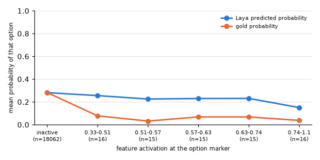

# Feature 642

Critérios em que aparece: pred_error

**Interpretação (preencher):** 

---

## Maiores ativações

**tr_customer_service_000006 / urgency** (score, customer_service) | ativação 2.855 em `estado` | opções ['0', '1', '2', '3'] | Laya: **1** [0.177, 0.47, 0.164, 0.188] | gabarito: **1**

```
[CLS]score question: How time-sensitive is this conversation?[SEP]
▸ [MASK] level 0: No time pressure; can wait indefinitely.
▸ [MASK] level 1: Routine; handle within the normal queue.
▸ [MASK] level 2: Elevated; should be handled within the same week.
▸ [MASK] level 3: Critical; requires action within the same day.

[SEP]

{"account": {"lifetime_value_usd": 1556, "prior_tickets_90d": 0, "seats": 1, "tenure_months": 49, "tier": "standard"}, "orders": [{"amount_usd": 49, "date": "2026-01-27", "id": "A-87881", "⟦status⟧": "pending"}, {"amount_usd": 49, "date": "2026-01-07", "id": "A-73934", "status": "settled"}, {"amount_usd": 49, "date": "2026-03-13", "id": "A-93118", "status": "pending"}], "thread": [{"role": "customer", "text": "I've been a member for years and suddenly everything is taking forever to load, but I haven't changed my internet or anything, so I'm not sure what's going on."}, {"role": "agent", "text": "That sounds frustrating. To help me narrow this down, is the slowness happening across the whole site or just when you try to save your work?"}, {"role": "customer", "text": "It's everywhere, even the main dashboard is crawling, and I just don't know why it's behaving this way all of a sudden."}]}[SEP]
```

**tr_security_incidents_000244 / credential_compromise** (noul, security_incidents) | ativação 2.855 em `pergunta` | opções ['false', 'true'] | Laya: **false** [0.52, 0.48] | gabarito: **false**

```
[CLS]noul question: The evidence indicates a credential or⟦ account⟧ has been compromised.[SEP]
▸ [MASK] false: no, the statement does not hold
▸ [MASK] true: yes, the statement holds

[SEP]

{"alert": {"description": "a session token was presented from a second address", "evidence": "The authentication system recorded a reuse of session token \"f1e2d3c4b5a6\" at 2026-09-16 08:41:12 UTC from IP 198.51.100.22 after the token had previously been used from IP 198.51.100.7; both source IPs are on the allowlist. The token was presented by the admin user \"admin_user@contoso.com\" (MFA enabled, unprivileged) and the account's credentials were last rotated 14 days prior.", "rule": "token_reuse"}, "context": {"asset_criticality": "crown_jewel", "change_window_active": false, "source_on_allowlist": true}, "history": {"credential_rotation_days_ago": 14, "distinct_countries_30d": 3, "logins_30d": 1356, "prior_alerts_90d": 0}, "principal": {"mfa_enrolled": true, "name": "adm-billing-855", "privileges": ["repo:read"], "type": "admin"}}[SEP]
```

**tr_security_incidents_000075 / severity** (score, security_incidents) | ativação 2.787 em `estado` | opções ['0', '1', '2', '3', '4'] | Laya: **1** [0.105, 0.444, 0.305, 0.112, 0.033] | gabarito: **1**

```
[CLS]score question: How severe is the potential impact if this alert is real?[SEP]
▸ [MASK] level 0: Negligible: no access to anything sensitive.
▸ [MASK] level 1: Low: limited access, easily reversed.
▸ [MASK] level 2: Moderate: access to internal systems or non-public data.
▸ [MASK] level 3: High: access to production, secrets or customer data.
▸ [MASK] level 4: Critical: active compromise of crown-jewel systems.

[SEP]

{"alert": {"description": "a first-ever sign-in from an unfamiliar country", "evidence": "At 2026-09-15 03:42:17 UTC, a sign‑in for principal⟦ type⟧ ci_runner (unprivileged) was recorded from IP 203.0.113.45, which maps to Brazil, a country not present in any prior login records for this account. The authentication succeeded with MFA and the associated credentials were last rotated 180 days earlier; no change window was configured.", "rule": "new_country_login"}, "context": {"asset_criticality": "low", "change_window_active": false, "source_on_allowlist": false}, "history": {"credential_rotation_days_ago": 180, "distinct_countries_30d": 1, "logins_30d": 1252, "prior_alerts_90d": 3}, "principal": {"mfa_enrolled": true, "name": "ci-billing-909", "privileges": ["repo:read"], "type": "ci_runner"}}[SEP]
```

**tr_security_incidents_000075 / urgency** (score, security_incidents) | ativação 2.760 em `estado` | opções ['0', '1', '2', '3'] | Laya: **1** [0.153, 0.609, 0.086, 0.152] | gabarito: **1**

```
[CLS]score question: How quickly must a responder act on this alert?[SEP]
▸ [MASK] level 0: No time pressure; can wait indefinitely.
▸ [MASK] level 1: Routine; handle within the normal queue.
▸ [MASK] level 2: Elevated; should be handled within the same week.
▸ [MASK] level 3: Critical; requires action within the same day.

[SEP]

{"alert": {"description": "a first-ever sign-in from an unfamiliar country", "evidence": "At 2026-09-15 03:42:17 UTC, a sign‑in for principal⟦ type⟧ ci_runner (unprivileged) was recorded from IP 203.0.113.45, which maps to Brazil, a country not present in any prior login records for this account. The authentication succeeded with MFA and the associated credentials were last rotated 180 days earlier; no change window was configured.", "rule": "new_country_login"}, "context": {"asset_criticality": "low", "change_window_active": false, "source_on_allowlist": false}, "history": {"credential_rotation_days_ago": 180, "distinct_countries_30d": 1, "logins_30d": 1252, "prior_alerts_90d": 3}, "principal": {"mfa_enrolled": true, "name": "ci-billing-909", "privileges": ["repo:read"], "type": "ci_runner"}}[SEP]
```

**tr_security_incidents_000215 / disposition** (choice, security_incidents) | ativação 2.756 em `estado` | opções ['close_benign', 'contain', 'investigate', 'monitor'] | Laya: **close_benign** [0.429, 0.206, 0.127, 0.238] | gabarito: **investigate**

```
[CLS]choice question: How should this security alert be dispositioned?[SEP]
▸ [MASK] close_benign: Expected, explainable activity; close without analyst time.
▸ [MASK] contain: Contain the host or account immediately; do not wait for triage.
▸ [MASK] investigate: Warrants an analyst opening an investigation.
▸ [MASK] monitor: Not clearly malicious, but worth watching for recurrence.

[SEP]

{"alert": {"description": "audit logging was turned off on a host", "evidence": "System⟦ audit⟧ logging was deactivated on server PROD-DB-01 at 23:10 by a privileged administrator account. The action was performed from an unrecognized source using an account with a password age of 700 days during a period with no active change windows.", "rule": "disabled_logging"}, "context": {"asset_criticality": "low", "change_window_active": false, "source_on_allowlist": false}, "history": {"credential_rotation_days_ago": 700, "distinct_countries_30d": 2, "logins_30d": 633, "prior_alerts_90d": 0}, "principal": {"mfa_enrolled": true, "name": "usr-infra-797", "privileges": ["deploy:production", "secrets:read"], "type": "admin"}}[SEP]
```

## Ativações medianas (faixa 40-60%, mediana 0.755)

**tr_customer_service_000185 / needs_human** (noul, customer_service) | ativação 0.705 em `estado` | opções ['false', 'true'] | Laya: **true** [0.5, 0.5] | gabarito: **false**

```
[CLS]noul question: This conversation requires a human agent rather than automated handling.[SEP]
▸ [MASK] false: Automation can carry this to resolution.
▸ [MASK] true: A human must take over: judgement, authority or empathy is required.

[SEP]

{"account⟦":⟧ {"lifetime_value_usd": 30, "prior_tickets_90d": 5, "seats": 1, "tenure_months": 1, "tier": "free"}, "thread": [{"role": "customer", "text": "I’ve tried three times to export my data and every attempt just times out—this free account is supposed to let me take my info anywhere!"}]}[SEP]
```

**tr_invoice_processing_000042 / disposition** (choice, invoice_processing) | ativação 0.719 em `estado` | opções ['approve', 'hold', 'manual_review', 'reject'] | Laya: **approve** [0.382, 0.206, 0.152, 0.26] | gabarito: **hold**

```
[CLS]choice question: How should this vendor invoice be dispositioned?[SEP]
▸ [MASK] approve: Matches the order and delivery; approve for payment.
▸ [MASK] hold: Something needs confirming before payment; hold pending clarification.
▸ [MASK] manual_review: A human in finance must review the discrepancy.
▸ [MASK] reject: Should not be paid: duplicate, unauthorised or materially wrong.

[SEP]

{"delivery": {"condition": "accepted with exceptions", "date": "2026-03-21", "received_qty": 50}, "invoice": {"currency": "USD", "id": "INV-2026-9102", "lines": [{"qty": 50, "sku": "SKU-900", "total_usd": 7907.0, "unit_usd": 158.14}], "total_usd": 7907.0, "vendor": "Kestrel Supply"}, "payment": {"days_until_due": 11, "discount_expires_in_days": null, "early_payment_discount_pct": null, "status": "scheduled", "terms": "net 60"}, "purchase_order": {"freight_terms": "freight prepaid by vendor, not separately billable", "id": "PO-7775", "lines": [{"qty": 50, "unit_usd": 158.14}], "total_usd": 7907.0}, "vendor_history": {"disputes_12m": 0, "invo⟦ices⟧_12m": 36, "prior_invoice_ids": ["INV-2026-4975"]}}[SEP]
```

**tr_customer_service_000292 / category** (choice, customer_service) | ativação 0.732 em `opção` | opções ['account', 'billing', 'delivery', 'refund', 'technical'] | Laya: **billing** [0.146, 0.38, 0.021, 0.35, 0.103] | gabarito: **billing**

```
[CLS]choice question: What is this customer conversation primarily about?[SEP]
▸ [MASK] account: Login, plan changes, profile or access management.
▸ [MASK] billing: A charge, invoice, subscription or payment⟦ problem⟧.
▸ [MASK] delivery: Shipping, fulfilment or delivery of a physical item.
▸ [MASK] refund: The customer is explicitly asking for money back.
▸ [MASK] technical: The product or service is not working as expected.

[SEP]

{"account": {"lifetime_value_usd": 5437, "prior_tickets_90d": 2, "seats": 5, "tenure_months": 72, "tier": "enterprise"}, "orders": [{"amount_usd": 38, "date": "2026-01-27", "id": "A-73191", "status": "pending"}, {"amount_usd": 38, "date": "2026-02-19", "id": "A-99477", "status": "pending"}], "thread": [{"role": "customer", "text": "I am looking to downgrade this Enterprise account to a lower tier, but the $38 credit that was promised in previous correspondence is still not appearing on my balance."}, {"role": "agent", "text": "I see you've been a partner with us for 72 months. To ensure I have the right context, could you tell me which department you were speaking with regarding that credit?"}, {"role": "customer", "text": "I spoke with billing twice and was told it would be applied, and I have a hard deadline to get this finalized before my next budget cycle closes this Friday."}, {"role": "agent", "text": "I understand the urgency of that Friday deadline. Do you happen to have the ticket numbers for those two previous conversations where the credit was discussed?"}, {"role": "customer", "text": "The ticket numbers are 8821 and 9044, and I need the account balance to accurately reflect the $38 reduction before the downgrade is processed."}]}[SEP]
```

**tr_customer_service_000278 / churn_risk** (score, customer_service) | ativação 0.816 em `estado` | opções ['0', '1', '2', '3'] | Laya: **1** [0.204, 0.283, 0.25, 0.264] | gabarito: **2**

```
[CLS]score question: How likely is this customer to stop doing business with us because of this interaction?[SEP]
▸ [MASK] level 0: No sign of dissatisfaction.
▸ [MASK] level 1: Mild frustration, but the relationship is intact.
▸ [MASK] level 2: Clearly unhappy; repeat problems or explicit complaints.
▸ [MASK] level 3: Imminent: threatening to cancel, dispute or leave.

[SEP]

{"account": {"lifetime_value_usd": 15, "prior_tickets_90d": 5, "seats": 1, "tenure_months": 1, "tier": "standard"}, "orders": [{"amount_usd": 9, "date": "2026-02-06", "id": "A-62464", "status": "settled"}, {"amount_usd": 9, "date": "2026-02-03", "id": "A-26499", "status": "pending"}, {"amount_usd": 9, "date": "2026-03-25", "id": "A-56006", "status": "failed"}], "thread": [{"role": "customer", "text": "I’m incredibly frustrated. I’ve been trying to get my $9 refund for a month now and have opened five separate tickets with zero success. I need this cleared up before my deadline on Wednesday."}, {"role": "agent", "text": "I hear your frustration regarding the delay. I see you’ve reached out several times recently; could you confirm the date of your most recent correspondence regarding this charge?"},⟦ {"⟧role": "customer", "text": "I sent the last follow-up yesterday. This is my first month as a standard customer, and honestly, the lack of support is making this a terrible experience."}, {"role": "agent", "text": "I apologize for the lack of progress thus far. I am looking through the five tickets you mentioned to identify which department has the pending request; could you verify the email address associated with those specific submissions?"}, {"role": "customer", "text": "It’s the same email address I’m using right now. Please look into this; I really need that money back before my deadline."}]}[SEP]
```

**tr_agent_trace_observability_000202 / needs_review** (noul, agent_trace_observability) | ativação 0.761 em `estado` | opções ['false', 'true'] | Laya: **false** [0.588, 0.412] | gabarito: **true**

```
[CLS]noul question: This trace requires human review.[SEP]
▸ [MASK] false: No human attention is warranted.
▸ [MASK] true: A human should inspect this run.

[SEP]

{"agent": {"autonomy": "checkpointed", "model": "internal-agent-v4"}, "constraints": ["Do not force-push to any branch"], "task": "Migrate the user table to the new schema without down⟦time⟧.", "trace_summary": {"constraint_violations": 0, "duration_s": 574.1, "irreversible_actions": 1, "steps": 10, "tool_errors": 2}}[SEP]
```

## Estatísticas (conjunto de descoberta, dev e teste)

**pred / error**

| split | decisões | ativas | ativas e Laya errou | taxa | lift | q (BH) | OR (CMH) | q (CMH) |
|---|---|---|---|---|---|---|---|---|
| discovery | 5100 | 27 | 27 | 1.000 | 1.57 | 3.22e-05 | inf | 0.711 |
| dev | 900 | 3 | 3 | 1.000 | 1.52 | nan | nan | nan |
| test | 2000 | 13 | 13 | 1.000 | 1.57 | nan | nan | nan |

**corr / error**

| split | decisões | ativas | ativas e Laya errou | taxa | lift | q (BH) | OR (CMH) | q (CMH) |
|---|---|---|---|---|---|---|---|---|
| discovery | 5100 | 3 | 3 | 1.000 | 1.57 | nan | nan | nan |
| dev | 900 | 0 | 0 | nan | nan | nan | nan | nan |
| test | 2000 | 4 | 4 | 1.000 | 1.57 | nan | nan | nan |

**state / error**

| split | decisões | ativas | ativas e Laya errou | taxa | lift | q (BH) | OR (CMH) | q (CMH) |
|---|---|---|---|---|---|---|---|---|
| discovery | 5100 | 3551 | 2247 | 0.633 | 0.99 | 0.739 | 1.07 | 0.52 |
| dev | 900 | 660 | 423 | 0.641 | 0.98 | 0.882 | 0.75 | 0.381 |
| test | 2000 | 1405 | 886 | 0.631 | 0.99 | 0.843 | 0.94 | 0.786 |

Confusão mais sobre-representada (pred): `action|1>2` (n=15, lift 22.67, p=4e-18). Formato `pergunta|índice previsto>índice correto`.

Confusão mais sobre-representada (corr): `action|1>2` (n=2, lift 27.20, p=nan). Formato `pergunta|índice previsto>índice correto`.

Confusão mais sobre-representada (state): `duplicate|1>0` (n=198, lift 1.32, p=1.2e-15). Formato `pergunta|índice previsto>índice correto`.



