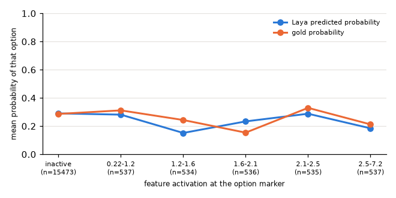

# Feature 728

Critérios em que aparece: attribution_toward_correct

**Interpretação (preencher):** 

---

## Maiores ativações

**tr_invoice_processing_000046 / disposition** (choice, invoice_processing) | ativação 7.211 em `marcador` | opções ['approve', 'hold', 'manual_review', 'reject'] | Laya: **approve** [0.404, 0.222, 0.142, 0.232] | gabarito: **approve**

```
[CLS]choice question: How should this vendor invoice be dispositioned?[SEP]
▸ [MASK] approve: Matches the order and delivery; approve for payment.
▸ [MASK] hold: Something needs confirming before payment; hold pending clarification.
▸ ⟦[MASK]⟧ manual_review: A human in finance must review the discrepancy.
▸ [MASK] reject: Should not be paid: duplicate, unauthorised or materially wrong.

[SEP]

{"delivery": {"condition": "accepted", "date": "2026-03-12", "received_qty": -25}, "invoice": {"currency": "USD", "id": "INV-2026-4544", "lines": [{"qty": -25, "sku": "SKU-695", "total_usd": -1475.25, "unit_usd": 59.01}], "total_usd": -1475.25, "vendor": "Northwind Components"}, "payment": {"days_until_due": -9, "discount_expires_in_days": null, "early_payment_discount_pct": null, "status": "overdue", "terms": "net 30"}, "purchase_order": {"freight_terms": "freight prepaid by vendor, not separately billable", "id": "PO-3009", "lines": [{"qty": 25, "unit_usd": 59.01}], "total_usd": 1475.25}, "vendor_history": {"disputes_12m": 0, "invoices_12m": 56, "prior_invoice_ids": ["INV-2026-8275"]}}[SEP]
```

**tr_invoice_processing_000142 / disposition** (choice, invoice_processing) | ativação 7.105 em `marcador` | opções ['approve', 'hold', 'manual_review', 'reject'] | Laya: **approve** [0.52, 0.194, 0.117, 0.169] | gabarito: **manual_review**

```
[CLS]choice question: How should this vendor invoice be dispositioned?[SEP]
▸ [MASK] approve: Matches the order and delivery; approve for payment.
▸ [MASK] hold: Something needs confirming before payment; hold pending clarification.
▸ ⟦[MASK]⟧ manual_review: A human in finance must review the discrepancy.
▸ [MASK] reject: Should not be paid: duplicate, unauthorised or materially wrong.

[SEP]

{"delivery": {"condition": "accepted", "date": "2026-03-27", "received_qty": 10}, "invoice": {"currency": "USD", "id": "INV-2026-5434", "lines": [{"qty": 60, "sku": "SKU-316", "total_usd": 3445.2, "unit_usd": 57.42}], "total_usd": 3445.2, "vendor": "Northwind Components"}, "payment": {"days_until_due": -21, "discount_expires_in_days": null, "early_payment_discount_pct": null, "status": "overdue", "terms": "net 30"}, "purchase_order": {"freight_terms": "freight prepaid by vendor, not separately billable", "id": "PO-2682", "lines": [{"qty": 10, "unit_usd": 57.42}], "total_usd": 574.2}, "vendor_history": {"disputes_12m": 0, "invoices_12m": 8, "prior_invoice_ids": ["INV-2026-8778", "INV-2026-3447"]}}[SEP]
```

**tr_invoice_processing_000182 / disposition** (choice, invoice_processing) | ativação 7.082 em `marcador` | opções ['approve', 'hold', 'manual_review', 'reject'] | Laya: **approve** [0.465, 0.176, 0.114, 0.244] | gabarito: **hold**

```
[CLS]choice question: How should this vendor invoice be dispositioned?[SEP]
▸ [MASK] approve: Matches the order and delivery; approve for payment.
▸ [MASK] hold: Something needs confirming before payment; hold pending clarification.
▸ ⟦[MASK]⟧ manual_review: A human in finance must review the discrepancy.
▸ [MASK] reject: Should not be paid: duplicate, unauthorised or materially wrong.

[SEP]

{"delivery": {"condition": "accepted with exceptions", "date": "2026-03-16", "received_qty": 25}, "invoice": {"currency": "USD", "id": "INV-2026-1869", "lines": [{"qty": 25, "sku": "SKU-634", "total_usd": 7297.25, "unit_usd": 291.89}], "total_usd": 7297.25, "vendor": "Kestrel Supply"}, "payment": {"days_until_due": 0, "discount_expires_in_days": null, "early_payment_discount_pct": null, "status": "scheduled", "terms": "net 60"}, "purchase_order": {"freight_terms": "freight prepaid by vendor, not separately billable", "id": "PO-8882", "lines": [{"qty": 25, "unit_usd": 291.89}], "total_usd": 7297.25}, "vendor_history": {"disputes_12m": 1, "invoices_12m": 11, "prior_invoice_ids": ["INV-2026-5214", "INV-2026-5412", "INV-2026-2686", "INV-2026-8750"]}}[SEP]
```

**tr_invoice_processing_000261 / disposition** (choice, invoice_processing) | ativação 7.059 em `marcador` | opções ['approve', 'hold', 'manual_review', 'reject'] | Laya: **approve** [0.539, 0.199, 0.112, 0.15] | gabarito: **approve**

```
[CLS]choice question: How should this vendor invoice be dispositioned?[SEP]
▸ [MASK] approve: Matches the order and delivery; approve for payment.
▸ [MASK] hold: Something needs confirming before payment; hold pending clarification.
▸ ⟦[MASK]⟧ manual_review: A human in finance must review the discrepancy.
▸ [MASK] reject: Should not be paid: duplicate, unauthorised or materially wrong.

[SEP]

{"delivery": {"condition": "accepted", "date": "2026-03-09", "received_qty": 400}, "invoice": {"currency": "USD", "id": "INV-2026-6026", "lines": [{"qty": 400, "sku": "SKU-802", "total_usd": 72944.0, "unit_usd": 182.36}], "total_usd": 72944.0, "vendor": "Orbit Logistics"}, "payment": {"days_until_due": -21, "discount_expires_in_days": null, "early_payment_discount_pct": null, "status": "overdue", "terms": "net 30"}, "purchase_order": {"freight_terms": "freight prepaid by vendor, not separately billable", "id": "PO-7576", "lines": [{"qty": 400, "unit_usd": 182.36}], "total_usd": 72944.0}, "vendor_history": {"disputes_12m": 0, "invoices_12m": 18, "prior_invoice_ids": ["INV-2026-6063", "INV-2026-2691"]}}[SEP]
```

**tr_invoice_processing_000053 / disposition** (choice, invoice_processing) | ativação 7.059 em `marcador` | opções ['approve', 'hold', 'manual_review', 'reject'] | Laya: **approve** [0.491, 0.2, 0.129, 0.18] | gabarito: **approve**

```
[CLS]choice question: How should this vendor invoice be dispositioned?[SEP]
▸ [MASK] approve: Matches the order and delivery; approve for payment.
▸ [MASK] hold: Something needs confirming before payment; hold pending clarification.
▸ ⟦[MASK]⟧ manual_review: A human in finance must review the discrepancy.
▸ [MASK] reject: Should not be paid: duplicate, unauthorised or materially wrong.

[SEP]

{"delivery": {"condition": "accepted", "date": "2026-03-06", "received_qty": 25}, "invoice": {"currency": "USD", "id": "INV-2026-3291", "lines": [{"qty": 25, "sku": "SKU-304", "total_usd": 8290.0, "unit_usd": 331.6}], "total_usd": 8290.0, "vendor": "Orbit Logistics"}, "payment": {"days_until_due": -9, "discount_expires_in_days": 7, "early_payment_discount_pct": 2.0, "status": "overdue", "terms": "net 30"}, "purchase_order": {"freight_terms": "freight prepaid by vendor, not separately billable", "id": "PO-9829", "lines": [{"qty": 25, "unit_usd": 331.6}], "total_usd": 8290.0}, "vendor_history": {"disputes_12m": 0, "invoices_12m": 40, "prior_invoice_ids": ["INV-2026-8586", "INV-2026-8046"]}}[SEP]
```

## Ativações medianas (faixa 40-60%, mediana 1.772)

**tr_invoice_processing_000219 / urgency** (score, invoice_processing) | ativação 1.682 em `marcador` | opções ['0', '1', '2', '3'] | Laya: **1** [0.23, 0.502, 0.157, 0.111] | gabarito: **2**

```
[CLS]score question: How time-sensitive is processing this invoice?[SEP]
▸ ⟦[MASK]⟧ level 0: No time pressure; can wait indefinitely.
▸ [MASK] level 1: Routine; handle within the normal queue.
▸ [MASK] level 2: Elevated; should be handled within the same week.
▸ [MASK] level 3: Critical; requires action within the same day.

[SEP]

{"delivery": {"condition": "accepted", "date": "2026-03-15", "received_qty": 25}, "invoice": {"currency": "USD", "id": "INV-2026-4321", "lines": [{"qty": 25, "sku": "SKU-749", "total_usd": 10465.25, "unit_usd": 418.61}], "total_usd": 10465.25, "vendor": "Orbit Logistics"}, "payment": {"days_until_due": 2, "discount_expires_in_days": 7, "early_payment_discount_pct": 2.0, "status": "scheduled", "terms": "net 15"}, "purchase_order": {"freight_terms": "freight prepaid by vendor, not separately billable", "id": "PO-7678", "lines": [{"qty": 25, "unit_usd": 418.61}], "total_usd": 10465.25}, "vendor_history": {"disputes_12m": 0, "invoices_12m": 26, "prior_invoice_ids": ["INV-2026-4321", "INV-2026-7478", "INV-2026-8769", "INV-2026-2219"]}}[SEP]
```

**tr_invoice_processing_000211 / urgency** (score, invoice_processing) | ativação 1.890 em `opção` | opções ['0', '1', '2', '3'] | Laya: **1** [0.219, 0.565, 0.138, 0.078] | gabarito: **1**

```
[CLS]score question: How time-sensitive is processing this invoice?[SEP]
▸ [MASK] level 0: No time pressure; can wait indefinitely.
▸ [MASK] level 1: Routine; handle within the normal queue.
▸ [MASK] level 2: Elevated; should be handled within the same week⟦.⟧
▸ [MASK] level 3: Critical; requires action within the same day.

[SEP]

{"delivery": {"condition": "accepted", "date": "2026-03-13", "received_qty": 250}, "invoice": {"currency": "USD", "id": "INV-2026-3915", "lines": [{"qty": 250, "sku": "SKU-253", "total_usd": 8630.0, "unit_usd": 34.52}], "total_usd": 8630.0, "vendor": "Northwind Components"}, "payment": {"days_until_due": 18, "discount_expires_in_days": 8, "early_payment_discount_pct": 2.0, "status": "scheduled", "terms": "net 15"}, "purchase_order": {"freight_terms": "freight prepaid by vendor, not separately billable", "id": "PO-7813", "lines": [{"qty": 250, "unit_usd": 34.52}], "total_usd": 8630.0}, "vendor_history": {"disputes_12m": 0, "invoices_12m": 13, "prior_invoice_ids": ["INV-2026-9545", "INV-2026-2014", "INV-2026-4515", "INV-2026-1956"]}}[SEP]
```

**tr_invoice_processing_000202 / urgency** (score, invoice_processing) | ativação 1.935 em `opção` | opções ['0', '1', '2', '3'] | Laya: **1** [0.198, 0.555, 0.158, 0.088] | gabarito: **2**

```
[CLS]score question: How time-sensitive is processing this invoice?[SEP]
▸ [MASK] level 0: No time pressure; can wait indefinitely.
▸ [MASK] level 1: Routine; handle within the normal queue.
▸ [MASK] level 2: Elevated; should be handled within the same week⟦.⟧
▸ [MASK] level 3: Critical; requires action within the same day.

[SEP]

{"delivery": {"condition": "accepted with exceptions", "date": "2026-03-22", "received_qty": 980}, "invoice": {"currency": "USD", "id": "INV-2026-2033", "lines": [{"qty": 980, "sku": "SKU-228", "total_usd": 141806.0, "unit_usd": 144.7}], "total_usd": 141806.0, "vendor": "Acme Fabrication"}, "payment": {"days_until_due": 11, "discount_expires_in_days": null, "early_payment_discount_pct": null, "status": "scheduled", "terms": "net 15"}, "purchase_order": {"freight_terms": "freight prepaid by vendor, not separately billable", "id": "PO-1122", "lines": [{"qty": 1000, "unit_usd": 144.7}], "total_usd": 144700.0}, "vendor_history": {"disputes_12m": 2, "invoices_12m": 27, "prior_invoice_ids": ["INV-2026-6170"]}}[SEP]
```

**tr_invoice_processing_000162 / urgency** (score, invoice_processing) | ativação 1.596 em `marcador` | opções ['0', '1', '2', '3'] | Laya: **1** [0.282, 0.53, 0.116, 0.072] | gabarito: **1**

```
[CLS]score question: How time-sensitive is processing this invoice?[SEP]
▸ ⟦[MASK]⟧ level 0: No time pressure; can wait indefinitely.
▸ [MASK] level 1: Routine; handle within the normal queue.
▸ [MASK] level 2: Elevated; should be handled within the same week.
▸ [MASK] level 3: Critical; requires action within the same day.

[SEP]

{"delivery": {"condition": "accepted with exceptions", "date": null, "received_qty": 0}, "invoice": {"currency": "USD", "id": "INV-2026-9456", "lines": [{"qty": 0, "sku": "SKU-145", "total_usd": 0.0, "unit_usd": 326.59}], "total_usd": 0.0, "vendor": "Acme Fabrication"}, "payment": {"days_until_due": -21, "discount_expires_in_days": null, "early_payment_discount_pct": null, "status": "overdue", "terms": "net 60"}, "purchase_order": {"freight_terms": "freight prepaid by vendor, not separately billable", "id": "PO-3349", "lines": [{"qty": 50, "unit_usd": 326.59}], "total_usd": 16329.5}, "vendor_history": {"disputes_12m": 2, "invoices_12m": 28, "prior_invoice_ids": ["INV-2026-4404", "INV-2026-6279"]}}[SEP]
```

**tr_invoice_processing_000073 / disposition** (choice, invoice_processing) | ativação 1.711 em `opção` | opções ['approve', 'hold', 'manual_review', 'reject'] | Laya: **approve** [0.453, 0.193, 0.131, 0.223] | gabarito: **hold**

```
[CLS]choice question: How should this vendor invoice be dispositioned?[SEP]
▸ [MASK] approve: Matches the order and delivery; approve for payment.
▸ [MASK] hold: Something needs confirming before payment; hold pending clarification.
▸ [MASK] manual_review: A human in finance must review the discrepancy.
▸ [MASK] reject: Should not be paid⟦:⟧ duplicate, unauthorised or materially wrong.

[SEP]

{"delivery": {"condition": "accepted", "date": "2026-03-01", "received_qty": 100}, "invoice": {"currency": "EUR", "id": "INV-2026-9369", "lines": [{"qty": 100, "sku": "SKU-485", "total_usd": 35742.0, "unit_usd": 357.42}], "total_usd": 35742.0, "vendor": "Vantage Materials"}, "payment": {"days_until_due": 18, "discount_expires_in_days": 1, "early_payment_discount_pct": 2.0, "status": "scheduled", "terms": "net 60"}, "purchase_order": {"freight_terms": "freight prepaid by vendor, not separately billable", "id": "PO-8320", "lines": [{"qty": 100, "unit_usd": 357.42}], "total_usd": 35742.0}, "vendor_history": {"disputes_12m": 0, "invoices_12m": 44, "prior_invoice_ids": ["INV-2026-7453"]}}[SEP]
```

## Estatísticas (conjunto de descoberta, dev e teste)

**pred / error**

| split | decisões | ativas | ativas e Laya errou | taxa | lift | q (BH) | OR (CMH) | q (CMH) |
|---|---|---|---|---|---|---|---|---|
| discovery | 5100 | 553 | 326 | 0.590 | 0.93 | 0.0331 | 0.73 | 0.108 |
| dev | 900 | 129 | 82 | 0.636 | 0.97 | 0.87 | 0.89 | 0.94 |
| test | 2000 | 234 | 152 | 0.650 | 1.02 | 0.815 | 0.78 | 0.58 |

**corr / error**

| split | decisões | ativas | ativas e Laya errou | taxa | lift | q (BH) | OR (CMH) | q (CMH) |
|---|---|---|---|---|---|---|---|---|
| discovery | 5100 | 672 | 445 | 0.662 | 1.04 | 0.172 | 4.44 | 0.131 |
| dev | 900 | 142 | 95 | 0.669 | 1.02 | 0.878 | inf | 0.685 |
| test | 2000 | 268 | 186 | 0.694 | 1.09 | 0.0563 | 4.44 | 0.137 |

**state / error**

| split | decisões | ativas | ativas e Laya errou | taxa | lift | q (BH) | OR (CMH) | q (CMH) |
|---|---|---|---|---|---|---|---|---|
| discovery | 5100 | 8 | 6 | 0.750 | 1.18 | nan | nan | nan |
| dev | 900 | 1 | 1 | 1.000 | 1.52 | nan | nan | nan |
| test | 2000 | 1 | 1 | 1.000 | 1.57 | nan | nan | nan |

Confusão mais sobre-representada (pred): `discrepancy_severity|0>2` (n=65, lift 9.22, p=0). Formato `pergunta|índice previsto>índice correto`.

Confusão mais sobre-representada (corr): `action|0>1` (n=119, lift 7.59, p=0). Formato `pergunta|índice previsto>índice correto`.

Confusão mais sobre-representada (state): `disposition|0>2` (n=3, lift 8.00, p=nan). Formato `pergunta|índice previsto>índice correto`.



