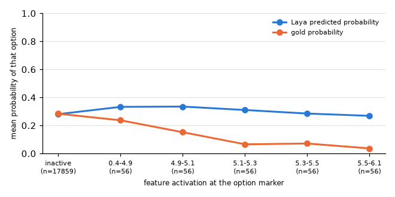

# Feature 901

Critérios em que aparece: attribution_toward_wrong

**Interpretação (preencher):** 

---

## Maiores ativações

**tr_customer_service_000161 / category** (choice, customer_service) | ativação 8.516 em `opção` | opções ['account', 'billing', 'delivery', 'refund', 'technical'] | Laya: **account** [0.82, 0.015, 0.011, 0.024, 0.13] | gabarito: **account**

```
[CLS]choice question: What is this customer conversation primarily about?[SEP]
▸ [MASK] account: Login, plan changes, profile or access management.
▸ [MASK] billing: A charge, invoice, subscription or payment problem.
▸ [MASK] delivery: Shipping, fulfilment or delivery of a physical item.
▸ [MASK] refund⟦:⟧ The customer is explicitly asking for money back.
▸ [MASK] technical: The product or service is not working as expected.

[SEP]

{"account": {"lifetime_value_usd": 2849, "prior_tickets_90d": 0, "seats": 40, "tenure_months": 72, "tier": "enterprise"}, "thread": [{"role": "customer", "text": "I’m a bit lost on how to downgrade my enterprise account; everything I try just loops back to the same page."}, {"role": "agent", "text": "Sorry for the confusion—could you tell me which part of the portal is giving you trouble?"}, {"role": "customer", "text": "When I click “Change Plan” nothing happens, and I need the downgrade done before Friday, so I’m not sure what to do next."}]}[SEP]
```

**tr_customer_service_000057 / category** (choice, customer_service) | ativação 8.508 em `opção` | opções ['account', 'billing', 'delivery', 'refund', 'technical'] | Laya: **technical** [0.289, 0.114, 0.07, 0.19, 0.338] | gabarito: **technical**

```
[CLS]choice question: What is this customer conversation primarily about?[SEP]
▸ [MASK] account: Login, plan changes, profile or access management.
▸ [MASK] billing: A charge, invoice, subscription or payment problem.
▸ [MASK] delivery: Shipping, fulfilment or delivery of a physical item.
▸ [MASK] refund⟦:⟧ The customer is explicitly asking for money back.
▸ [MASK] technical: The product or service is not working as expected.

[SEP]

{"account": {"lifetime_value_usd": 1386, "prior_tickets_90d": 1, "seats": 1, "tenure_months": 72, "tier": "free"}, "thread": [{"role": "customer", "text": "Your service is crawling at a snail’s pace and I’ve been on the free plan for six years – this is unacceptable."}, {"role": "agent", "text": "I’m sorry you’re experiencing slowness. Could you let me know which device and browser you’re using?"}, {"role": "customer", "text": "Ticket #6789 was supposed to fix this weeks ago, but nothing changed. It’s the same lag every time I log in."}, {"role": "agent", "text": "Got it. When did the slowdown start, and are you seeing any error messages on the screen?"}, {"role": "customer", "text": "It started yesterday, no error messages, just endless loading. My work is getting held up and I need an update."}]}[SEP]
```

**tr_customer_service_000022 / category** (choice, customer_service) | ativação 8.477 em `opção` | opções ['account', 'billing', 'delivery', 'refund', 'technical'] | Laya: **refund** [0.063, 0.053, 0.04, 0.728, 0.116] | gabarito: **refund**

```
[CLS]choice question: What is this customer conversation primarily about?[SEP]
▸ [MASK] account: Login, plan changes, profile or access management.
▸ [MASK] billing: A charge, invoice, subscription or payment problem.
▸ [MASK] delivery: Shipping, fulfilment or delivery of a physical item.
▸ [MASK] refund⟦:⟧ The customer is explicitly asking for money back.
▸ [MASK] technical: The product or service is not working as expected.

[SEP]

{"account": {"lifetime_value_usd": 60, "prior_tickets_90d": 1, "seats": 1, "tenure_months": 1, "tier": "premium"}, "thread": [{"role": "customer", "text": "Last week you promised a refund for my premium subscription, but nothing’s shown up yet. I’m just waiting for an update."}, {"role": "agent", "text": "I’m sorry you haven’t seen the refund yet. Could you provide the ticket number you were given for that request?"}, {"role": "customer", "text": "The ticket number is #4529. I just need to know if the refund is on its way."}, {"role": "agent", "text": "Thanks for the reference. I’ll check with our finance team. Do you still have the original payment method details handy?"}, {"role": "customer", "text": "Yes, it was the Visa ending in 1234. I’ll wait for your next update."}]}[SEP]
```

**tr_customer_service_000274 / category** (choice, customer_service) | ativação 8.438 em `opção` | opções ['account', 'billing', 'delivery', 'refund', 'technical'] | Laya: **refund** [0.202, 0.117, 0.078, 0.37, 0.233] | gabarito: **technical**

```
[CLS]choice question: What is this customer conversation primarily about?[SEP]
▸ [MASK] account: Login, plan changes, profile or access management.
▸ [MASK] billing: A charge, invoice, subscription or payment problem.
▸ [MASK] delivery: Shipping, fulfilment or delivery of a physical item.
▸ [MASK] refund⟦:⟧ The customer is explicitly asking for money back.
▸ [MASK] technical: The product or service is not working as expected.

[SEP]

{"account": {"lifetime_value_usd": 2198, "prior_tickets_90d": 0, "seats": 1, "tenure_months": 72, "tier": "free"}, "thread": [{"role": "customer", "text": "I need to export the data from my account. I’ve been on the free plan for seventy-two months, and I can’t keep hoping the export button works."}, {"role": "agent", "text": "I’m sorry that’s been so difficult. Can you tell me what you see when you open the export option?"}, {"role": "customer", "text": "Nothing. It looks the same as it has for days. I haven’t submitted a ticket before, so there’s no earlier trail."}, {"role": "agent", "text": "Thank you. Are you trying to export all records, or a specific collection?"}, {"role": "customer", "text": "All of it, if I can. I’m not asking for much, just a way out that doesn’t require more waiting."}]}[SEP]
```

**tr_customer_service_000100 / category** (choice, customer_service) | ativação 8.414 em `opção` | opções ['account', 'billing', 'delivery', 'refund', 'technical'] | Laya: **refund** [0.161, 0.082, 0.127, 0.352, 0.279] | gabarito: **delivery**

```
[CLS]choice question: What is this customer conversation primarily about?[SEP]
▸ [MASK] account: Login, plan changes, profile or access management.
▸ [MASK] billing: A charge, invoice, subscription or payment problem.
▸ [MASK] delivery: Shipping, fulfilment or delivery of a physical item.
▸ [MASK] refund⟦:⟧ The customer is explicitly asking for money back.
▸ [MASK] technical: The product or service is not working as expected.

[SEP]

{"account": {"lifetime_value_usd": 3569, "prior_tickets_90d": 0, "seats": 1, "tenure_months": 60, "tier": "free"}, "thread": [{"role": "customer", "text": "Hi there, I hope you’re doing well. I’ve been on the free plan for the past five years (about 60 months now) and I just received my latest order, but it looks like the wrong item was shipped. Could you help me figure this out?"}, {"role": "agent", "text": "Hello! I’m sorry to hear about the mix‑up. Could you share the order number and tell me which product you received versus what you expected?"}, {"role": "customer", "text": "Sure, the order number is #A987654. I was supposed to get the ergonomic mouse, but I got a standard wired mouse instead."}, {"role": "agent", "text": "Thanks for the details. To verify, may I ask for a quick photo of the item you received? You can attach it here or let me know the best way to receive it."}, {"role": "customer", "text": "I’ve attached a picture to this message. Let me know what the next steps are for getting the correct mouse sent."}]}[SEP]
```

## Ativações medianas (faixa 40-60%, mediana 2.618)

**tr_customer_service_000232 / category** (choice, customer_service) | ativação 2.555 em `opção` | opções ['account', 'billing', 'delivery', 'refund', 'technical'] | Laya: **refund** [0.171, 0.136, 0.032, 0.502, 0.158] | gabarito: **account**

```
[CLS]choice question: What is this customer conversation primarily about?[SEP]
▸ [MASK] account: Login, plan changes, profile or access management.
▸ [MASK] billing: A charge, invoice, subscription or payment problem.
▸ [MASK] delivery: Shipping, fulfilment or delivery of a physical item.
▸ [MASK] refund:⟦ The⟧ customer is explicitly asking for money back.
▸ [MASK] technical: The product or service is not working as expected.

[SEP]

{"account": {"lifetime_value_usd": 186, "prior_tickets_90d": 0, "seats": 5, "tenure_months": 3, "tier": "premium"}, "orders": [{"amount_usd": 2997, "date": "2026-01-02", "id": "A-95746", "status": "refunded"}, {"amount_usd": 2997, "date": "2026-03-02", "id": "A-16068", "status": "settled"}], "thread": [{"role": "customer", "text": "I'm looking at my dashboard and everything is grayed out, it says I'm on a trial but I've been a Premium member for three months? I don't understand why it would change now, especially since I have a massive project deadline tomorrow and I need my tools."}, {"role": "agent", "text": "I can certainly look into your subscription status for you. To get started, could you please confirm the email address associated with your $2997 annual Premium plan?"}, {"role": "customer", "text": "It's the same email I'm using for this chat, but I'm just so confused because my bank shows the payment went through months ago. Why would the system suddenly think I'm not a customer anymore?"}, {"role": "agent", "text": "Thank you for that information. I am reviewing your account history now. Have you recently made any changes to your team settings or tried to link a secondary account to this workspace?"}, {"role": "customer", "text": "I haven't touched the settings at all, I just logged in to finish my work and saw the 'downgraded' notification at the top. I'm really worried because I have to submit this work by 8 AM tomorrow and I can't even export my files right now."}, {"role": "agent", "text": "I appreciate you clarifying that. To help me narrow this down, could you tell me if you are seeing any specific error codes when you try to click on the export button?"}, {"role": "customer", "text": "There aren't any codes, it just opens a pop-up telling me to 'Upgrade to Premium' to use that feature, which makes no sense at all since I'm already paying. Can someone please figure out why the system isn't recognizing my plan before I lose my window to finish this?"}]}[SEP]
```

**tr_customer_service_000291 / category** (choice, customer_service) | ativação 2.615 em `opção` | opções ['account', 'billing', 'delivery', 'refund', 'technical'] | Laya: **delivery** [0.109, 0.179, 0.302, 0.186, 0.224] | gabarito: **delivery**

```
[CLS]choice question: What is this customer conversation primarily about?[SEP]
▸ [MASK] account: Login, plan changes, profile or access management.
▸ [MASK] billing: A charge, invoice, subscription or payment problem.
▸ [MASK] delivery: Shipping, fulfilment or delivery of a physical item.
▸ [MASK] refund: The customer⟦ is⟧ explicitly asking for money back.
▸ [MASK] technical: The product or service is not working as expected.

[SEP]

{"account": {"lifetime_value_usd": 403, "prior_tickets_90d": 1, "seats": 1, "tenure_months": 5, "tier": "standard"}, "thread": [{"role": "customer", "text": "My recent order, number 992-BX, has not arrived by the scheduled date of Tuesday and the tracking hasn't updated."}, {"role": "agent", "text": "I can look into that for you. Could you please provide the email address associated with your standard plan account?"}, {"role": "customer", "text": "The email is j.smith@example.com. I'm checking back because when I had a delay last month, the ticket was only partially addressed and I still haven't seen the full resolution."}, {"role": "agent", "text": "I see that prior ticket in our records. To help me narrow this down, has the tracking status changed at all in the last 24 hours?"}, {"role": "customer", "text": "The tracking has stayed at 'Processing' since Monday morning, so I would like to know the current location of the package."}]}[SEP]
```

**tr_customer_service_000121 / category** (choice, customer_service) | ativação 2.477 em `opção` | opções ['account', 'billing', 'delivery', 'refund', 'technical'] | Laya: **billing** [0.088, 0.584, 0.02, 0.226, 0.082] | gabarito: **billing**

```
[CLS]choice question: What is this customer conversation primarily about?[SEP]
▸ [MASK] account: Login, plan changes, profile or access management.
▸ [MASK] billing: A charge, invoice, subscription or payment problem.
▸ [MASK] delivery: Shipping, fulfilment or delivery of a physical item.
▸ [MASK] refund:⟦ The⟧ customer is explicitly asking for money back.
▸ [MASK] technical: The product or service is not working as expected.

[SEP]

{"account": {"lifetime_value_usd": 285, "prior_tickets_90d": 2, "seats": 5, "tenure_months": 5, "tier": "enterprise"}, "orders": [{"amount_usd": 999, "date": "2026-01-20", "id": "A-59192", "status": "settled"}], "thread": [{"role": "customer", "text": "I just checked our Enterprise account and we have been charged $999 twice this morning. This needs to be corrected immediately as it's a significant duplicate hit on our corporate card."}, {"role": "agent", "text": "I understand the urgency of this billing matter. Let me pull up your transaction history to see what might have triggered the double charge."}, {"role": "customer", "text": "We've only been with you for five months and I already have two other unresolved tickets regarding our seat configuration. Now this happens and I have a hard deadline of 4:00 PM today to finalize our monthly budget report."}, {"role": "agent", "text": "I see those open tickets in our system and I appreciate you bringing this new discrepancy to our attention. Are both charges showing as 'posted' on your bank statement, or is one still in a 'pending' state?"}, {"role": "customer", "text": "Both are fully posted. I cannot submit my financial report to my director with a $1,000 error, so I need a status update as soon as possible."}, {"role": "agent", "text": "Understood. To help me investigate further, could you confirm the last four digits of the credit card that was charged and the exact timestamps for both transactions?"}, {"role": "customer", "text": "The card ends in 8821. The first charge was at 8:05 AM and the second was at 8:07 AM. Please get back to me quickly because the clock is ticking on my reporting deadline."}]}[SEP]
```

**tr_customer_service_000289 / category** (choice, customer_service) | ativação 3.873 em `opção` | opções ['account', 'billing', 'delivery', 'refund', 'technical'] | Laya: **billing** [0.03, 0.689, 0.019, 0.142, 0.12] | gabarito: **billing**

```
[CLS]choice question: What is this customer conversation primarily about?[SEP]
▸ [MASK] account: Login, plan changes, profile or access management.
▸ [MASK] billing: A charge, invoice, subscription or payment problem.
▸ [MASK] delivery: Shipping, fulfilment or delivery of a physical item⟦.⟧
▸ [MASK] refund: The customer is explicitly asking for money back.
▸ [MASK] technical: The product or service is not working as expected.

[SEP]

{"account": {"lifetime_value_usd": 1589, "prior_tickets_90d": 0, "seats": 12, "tenure_months": 19, "tier": "premium"}, "thread": [{"role": "customer", "text": "The recurring payment for my premium subscription failed this morning. The card on file is active and has sufficient funds."}, {"role": "agent", "text": "I can certainly look into that for you. Could you please confirm the last four digits of the card you are currently using for this subscription?"}, {"role": "customer", "text": "The card ends in 1004. I have already verified with my bank that there are no blocks or restrictions on this account."}, {"role": "agent", "text": "Thank you for checking that. Are you seeing a specific error code in your billing dashboard, or did you only receive a generic failure notification via email?"}, {"role": "customer", "text": "The dashboard only indicates that the transaction was declined without providing a specific code. I need to know why the system is rejecting it."}]}[SEP]
```

**tr_customer_service_000222 / category** (choice, customer_service) | ativação 3.266 em `opção` | opções ['account', 'billing', 'delivery', 'refund', 'technical'] | Laya: **refund** [0.226, 0.047, 0.023, 0.638, 0.066] | gabarito: **account**

```
[CLS]choice question: What is this customer conversation primarily about?[SEP]
▸ [MASK] account: Login, plan changes, profile or access management.
▸ [MASK] billing: A charge, invoice, subscription or payment problem.
▸ [MASK] delivery: Shipping, fulfilment or delivery of a physical item⟦.⟧
▸ [MASK] refund: The customer is explicitly asking for money back.
▸ [MASK] technical: The product or service is not working as expected.

[SEP]

{"account": {"lifetime_value_usd": 3359, "prior_tickets_90d": 1, "seats": 12, "tenure_months": 41, "tier": "enterprise"}, "thread": [{"role": "customer", "text": "I am writing to request an immediate downgrade of my enterprise plan. Given that my previous request for service improvements was ignored, I am finding it difficult to justify continuing our partnership and may be forced to take my business elsewhere if this is not addressed promptly."}]}[SEP]
```

## Estatísticas (conjunto de descoberta, dev e teste)

**pred / error**

| split | decisões | ativas | ativas e Laya errou | taxa | lift | q (BH) | OR (CMH) | q (CMH) |
|---|---|---|---|---|---|---|---|---|
| discovery | 5100 | 105 | 77 | 0.733 | 1.15 | 0.0719 | 0.00 | 0.497 |
| dev | 900 | 16 | 14 | 0.875 | 1.33 | nan | nan | nan |
| test | 2000 | 36 | 32 | 0.889 | 1.40 | 0.00337 | nan | nan |

**corr / error**

| split | decisões | ativas | ativas e Laya errou | taxa | lift | q (BH) | OR (CMH) | q (CMH) |
|---|---|---|---|---|---|---|---|---|
| discovery | 5100 | 30 | 2 | 0.067 | 0.10 | 4.28e-10 | 0.03 | 0.155 |
| dev | 900 | 2 | 0 | 0.000 | 0.00 | nan | nan | nan |
| test | 2000 | 5 | 1 | 0.200 | 0.31 | nan | nan | nan |

**state / error**

| split | decisões | ativas | ativas e Laya errou | taxa | lift | q (BH) | OR (CMH) | q (CMH) |
|---|---|---|---|---|---|---|---|---|
| discovery | 5100 | 1 | 0 | 0.000 | 0.00 | nan | nan | nan |
| dev | 900 | 0 | 0 | nan | nan | nan | nan | nan |
| test | 2000 | 0 | 0 | nan | nan | nan | nan | nan |

Confusão mais sobre-representada (pred): `category|3>0` (n=26, lift 48.57, p=0). Formato `pergunta|índice previsto>índice correto`.

Confusão mais sobre-representada (corr): `category|1>3` (n=1, lift 170.00, p=0.00588). Formato `pergunta|índice previsto>índice correto`.



