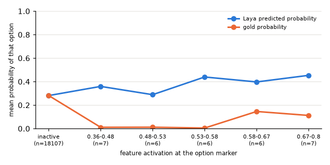

# Feature 931

Critérios em que aparece: pred_error

**Interpretação (preencher):** 

---

## Maiores ativações

**tr_customer_service_000228 / action** (choice, customer_service) | ativação 5.516 em `opção` | opções ['answer_directly', 'close_no_action', 'escalate_to_human', 'execute_refund', 'request_information'] | Laya: **close_no_action** [0.106, 0.734, 0.052, 0.054, 0.054] | gabarito: **escalate_to_human**

```
[CLS]choice question: What should the assistant do next with this conversation?[SEP]
▸ [MASK] answer_directly: The assistant can resolve this itself with information it already has.
▸ [MASK]⟦ close⟧_no_action: No further action is warranted; the matter is settled.
▸ [MASK] escalate_to_human: Hand off to a human agent with the appropriate authority.
▸ [MASK] execute_refund: Issue the refund or credit the customer is owed.
▸ [MASK] request_information: More detail is needed from the customer before anything can be done.

[SEP]

{"account": {"lifetime_value_usd": 1521, "prior_tickets_90d": 1, "seats": 1, "tenure_months": 26, "tier": "standard"}, "thread": [{"role": "customer", "text": "I've been with the standard plan for over two years now, and I think it's time to close my account. Please go ahead and cancel it."}, {"role": "agent", "text": "I’m sorry to hear you’d like to cancel. Could you confirm the email address associated with the account so I can pull up the details?"}, {"role": "customer", "text": "Sure, it's jane.doe@example.com. I’ve already tried this before; the last ticket was closed but the issue kept coming back."}]}[SEP]
```

**tr_security_incidents_000269 / true_positive** (noul, security_incidents) | ativação 5.504 em `estado` | opções ['false', 'true'] | Laya: **true** [0.493, 0.507] | gabarito: **false**

```
[CLS]noul question: This alert reflects genuinely malicious or unauthorised activity.[SEP]
▸ [MASK] false: Benign activity, a misconfiguration, or a known false positive.
▸ [MASK] true: The underlying behaviour is malicious or unauthorised.

[SEP]

{"alert": {"description": "an unrecogn⟦ised⟧ binary executed on a server", "evidence": "A binary not present in the approved inventory, located at /var/tmp/abcdef (SHA256 = d1e2f3a4…), executed on server 192.168.100.9 at 2026-09-15 22:18:03 UTC. The launch was performed by admin user \"bob\" using an MFA‑authenticated session, and the user’s credentials have not been rotated for 365 days (last rotation 2025-09-16).", "rule": "suspicious_process"}, "context": {"asset_criticality": "low", "change_window_active": false, "source_on_allowlist": true}, "history": {"credential_rotation_days_ago": 365, "distinct_countries_30d": 2, "logins_30d": 948, "prior_alerts_90d": 0}, "principal": {"mfa_enrolled": true, "name": "adm-infra-548", "privileges": ["repo:read"], "type": "admin"}}[SEP]
```

**tr_security_incidents_000296 / disposition** (choice, security_incidents) | ativação 5.184 em `opção` | opções ['close_benign', 'contain', 'investigate', 'monitor'] | Laya: **close_benign** [0.536, 0.205, 0.102, 0.157] | gabarito: **investigate**

```
[CLS]choice question: How should this security alert be dispositioned?[SEP]
▸ [MASK] close_ben⟦ign⟧: Expected, explainable activity; close without analyst time.
▸ [MASK] contain: Contain the host or account immediately; do not wait for triage.
▸ [MASK] investigate: Warrants an analyst opening an investigation.
▸ [MASK] monitor: Not clearly malicious, but worth watching for recurrence.

[SEP]

{"alert": {"description": "an unrecognised binary executed on a server", "evidence": "An unrecognized binary named 'svc_host_tmp.exe' was executed on server SRV-PROD-04 at 09:22 UTC. This activity originated from an unlisted IP address and was performed by an unprivileged employee account.", "rule": "suspicious_process"}, "context": {"asset_criticality": "high", "change_window_active": false, "source_on_allowlist": false}, "history": {"credential_rotation_days_ago": 30, "distinct_countries_30d": 4, "logins_30d": 158, "prior_alerts_90d": 0}, "principal": {"mfa_enrolled": true, "name": "usr-analytics-518", "privileges": ["repo:read"], "type": "employee"}}[SEP]
```

**tr_security_incidents_000196 / disposition** (choice, security_incidents) | ativação 5.160 em `opção` | opções ['close_benign', 'contain', 'investigate', 'monitor'] | Laya: **close_benign** [0.475, 0.186, 0.145, 0.194] | gabarito: **investigate**

```
[CLS]choice question: How should this security alert be dispositioned?[SEP]
▸ [MASK] close_ben⟦ign⟧: Expected, explainable activity; close without analyst time.
▸ [MASK] contain: Contain the host or account immediately; do not wait for triage.
▸ [MASK] investigate: Warrants an analyst opening an investigation.
▸ [MASK] monitor: Not clearly malicious, but worth watching for recurrence.

[SEP]

{"alert": {"description": "an unrecognised binary executed on a server", "evidence": "During an open change window, an unrecognized binary named 'svc_temp_6.exe' was executed on server WEB-PROD-01 by an unprivileged administrator account. The execution was initiated from an allowlisted source address using credentials that were last rotated 180 days ago.", "rule": "suspicious_process"}, "context": {"asset_criticality": "medium", "change_window_active": true, "source_on_allowlist": true}, "history": {"credential_rotation_days_ago": 180, "distinct_countries_30d": 4, "logins_30d": 5, "prior_alerts_90d": 25}, "principal": {"mfa_enrolled": true, "name": "adm-deploy-891", "privileges": ["repo:read"], "type": "admin"}}[SEP]
```

**tr_security_incidents_000035 / disposition** (choice, security_incidents) | ativação 5.098 em `opção` | opções ['close_benign', 'contain', 'investigate', 'monitor'] | Laya: **close_benign** [0.409, 0.206, 0.131, 0.254] | gabarito: **investigate**

```
[CLS]choice question: How should this security alert be dispositioned?[SEP]
▸ [MASK] close_ben⟦ign⟧: Expected, explainable activity; close without analyst time.
▸ [MASK] contain: Contain the host or account immediately; do not wait for triage.
▸ [MASK] investigate: Warrants an analyst opening an investigation.
▸ [MASK] monitor: Not clearly malicious, but worth watching for recurrence.

[SEP]

{"alert": {"description": "an unrecognised binary executed on a server", "evidence": "An unrecognized binary titled 'update_sys.bin' was executed on server WEB-PROD-01 at 02:15 UTC by an unprivileged contractor account. The session originated from an unrecognized remote IP address using MFA-authenticated credentials that were last rotated 365 days ago. No maintenance window was scheduled at the time of this process execution.", "rule": "suspicious_process"}, "context": {"asset_criticality": "crown_jewel", "change_window_active": false, "source_on_allowlist": false}, "history": {"credential_rotation_days_ago": 365, "distinct_countries_30d": 2, "logins_30d": 1459, "prior_alerts_90d": 1}, "principal": {"mfa_enrolled": true, "name": "ci-infra-369", "privileges": ["repo:read"], "type": "contractor"}}[SEP]
```

## Ativações medianas (faixa 40-60%, mediana 0.885)

**tr_invoice_processing_000127 / duplicate** (noul, invoice_processing) | ativação 0.867 em `estado` | opções ['false', 'true'] | Laya: **true** [0.264, 0.736] | gabarito: **false**

```
[CLS]noul question: This invoice appears to duplicate an invoice already submitted.[SEP]
▸ [MASK] false: no, the statement does not hold
▸ [MASK] true: yes, the statement holds

[SEP]

{"delivery": {"condition": "accepted with exceptions", "date": "2026-03-12", "received_qty": 1000}, "invoice": {"currency": "USD", "id": "INV-2026-3386", "lines": [{"qty": 1000, "sku": "SKU-688", "total_usd": 356860.0, "unit_usd": 356.86}], "total_usd": 356860.0, "vendor": "Acme Fabrication"}, "payment": {"days_until_due": 2, "discount_expires_in_days": null, "early_payment_discount_pct": null, "status": "scheduled", "terms": "net 30"}, "p⟦urchase⟧_order": {"freight_terms": "freight prepaid by vendor, not separately billable", "id": "PO-8577", "lines": [{"qty": 1000, "unit_usd": 356.86}], "total_usd": 356860.0}, "vendor_history": {"disputes_12m": 0, "invoices_12m": 9, "prior_invoice_ids": ["INV-2026-7212", "INV-2026-5909"]}}[SEP]
```

**tr_customer_service_000270 / category** (choice, customer_service) | ativação 0.825 em `estado` | opções ['account', 'billing', 'delivery', 'refund', 'technical'] | Laya: **account** [0.26, 0.216, 0.079, 0.202, 0.243] | gabarito: **technical**

```
[CLS]choice question: What is this customer conversation primarily about?[SEP]
▸ [MASK] account: Login, plan changes, profile or access management.
▸ [MASK] billing: A charge, invoice, subscription or payment problem.
▸ [MASK] delivery: Shipping, fulfilment or delivery of a physical item.
▸ [MASK] refund: The customer is explicitly asking for money back.
▸ [MASK] technical: The product or service is not working as expected.

[SEP]

{"account": {"lifetime_value_usd": 1765, "prior_tickets_90d": 2, "seats": 1, "tenure_months": 19, "tier": "⟦standard⟧"}, "orders": [{"amount_usd": 149, "date": "2026-02-28", "id": "A-88466", "status": "settled"}, {"amount_usd": 149, "date": "2026-02-27", "id": "A-17979", "status": "settled"}], "thread": [{"role": "customer", "text": "Hello, I’m writing about the seat‑management issue we’ve been seeing on our account. We’re on the standard plan, have been a customer for 19 months, and the monthly charge is about $149. This is the third time I’m reaching out—two earlier tickets were only partially addressed, and I have a hard deadline next Friday to reassign a few seats for an upcoming project."}, {"role": "agent", "text": "Thank you for the details. I’m sorry the prior tickets didn’t fully resolve the problem. Could you let me know exactly how many seats are affected and what the current error looks like?"}, {"role": "customer", "text": "Sure. We have five seats that are stuck in “pending” status, and when I try to move them to a different team they bounce back with a generic “operation failed” message. It’s preventing us from finalizing the team roster before the Friday deadline."}, {"role": "agent", "text": "Got it, five pending seats with a generic failure notice. Are there any particular teams or roles involved that might help us narrow down the cause?"}, {"role": "customer", "text": "The seats belong to our Marketing and Sales groups. Both groups use custom role configurations we set up last quarter, and the issue started after we added a new role hierarchy."}, {"role": "agent", "text": "Understood. I’ll note the custom role configurations and the recent hierarchy change. Just to confirm, have you noticed any impact on your billing or subscription status while this is happening?"}, {"role": "customer", "text": "No billing issues so far, but I really need those seats moved before Friday. Please let me know what you need from me to keep this moving forward."}]}[SEP]
```

**tr_security_incidents_000092 / disposition** (choice, security_incidents) | ativação 0.802 em `estado` | opções ['close_benign', 'contain', 'investigate', 'monitor'] | Laya: **close_benign** [0.403, 0.208, 0.108, 0.282] | gabarito: **investigate**

```
[CLS]choice question: How should this security alert be dispositioned?[SEP]
▸ [MASK] close_benign: Expected, explainable activity; close without analyst time.
▸ [MASK] contain: Contain the host or account immediately; do not wait for triage.
▸ [MASK] investigate: Warrants an analyst opening an investigation.
▸ [MASK] monitor: Not clearly malicious, but worth watching for recurrence.

[SEP]

{"alert": {"description": "a long-unused account became active", "evidence": "An employee account that had no recorded activity since 2024-02-01 generated a successful login at 2026-09-15 11:45:27 UTC from IP 198.51.100.99, which is not recognized in the known source list. The account is unprivileged, MFA was satisfied, and there was no active change window. The password for this account was last rotated on 2024-09-10, 700 days prior to the event.", "rule": "dormant_account_use"}, "context": {"asset_criticality": "medium", "change_window_active": false, "source_on_allowlist": false}, "history": {"⟦cred⟧ential_rotation_days_ago": 700, "distinct_countries_30d": 1, "logins_30d": 181, "prior_alerts_90d": 0}, "principal": {"mfa_enrolled": true, "name": "adm-billing-260", "privileges": ["repo:read"], "type": "employee"}}[SEP]
```

**tr_customer_service_000084 / action** (choice, customer_service) | ativação 0.818 em `opção` | opções ['answer_directly', 'close_no_action', 'escalate_to_human', 'execute_refund', 'request_information'] | Laya: **execute_refund** [0.176, 0.207, 0.158, 0.338, 0.122] | gabarito: **escalate_to_human**

```
[CLS]choice question: What should the assistant do next with this conversation?[SEP]
▸ [MASK] answer_⟦direct⟧ly: The assistant can resolve this itself with information it already has.
▸ [MASK] close_no_action: No further action is warranted; the matter is settled.
▸ [MASK] escalate_to_human: Hand off to a human agent with the appropriate authority.
▸ [MASK] execute_refund: Issue the refund or credit the customer is owed.
▸ [MASK] request_information: More detail is needed from the customer before anything can be done.

[SEP]

{"account": {"lifetime_value_usd": 228, "prior_tickets_90d": 1, "seats": 12, "tenure_months": 5, "tier": "premium"}, "orders": [{"amount_usd": 49, "date": "2026-02-23", "id": "A-33356", "status": "settled"}, {"amount_usd": 49, "date": "2026-03-08", "id": "A-82014", "status": "pending"}, {"amount_usd": 49, "date": "2026-02-05", "id": "A-73657", "status": "settled"}], "thread": [{"role": "customer", "text": "I've been waiting for my refund for the $49 I was charged on my premium plan, and this is the second time you've said it'll be processed and nothing happened. I'm fed up and I'm ready to cancel my subscription if this isn't sorted right now."}, {"role": "agent", "text": "I’m sorry you’ve had to deal with this again. Could you please share the ticket number you received previously so I can pull up the details and see where the hold‑up is?"}, {"role": "customer", "text": "The ticket was #123456, and I need that money back today—otherwise I'm pulling my account and moving to a competitor."}]}[SEP]
```

**tr_invoice_processing_000239 / matches_order** (noul, invoice_processing) | ativação 0.906 em `estado` | opções ['false', 'true'] | Laya: **true** [0.455, 0.545] | gabarito: **true**

```
[CLS]noul question: The invoice reconciles with the purchase order and the recorded delivery.[SEP]
▸ [MASK] false: There is a discrepancy against the order or the delivery.
▸ [MASK] true: Line items, quantities and amounts reconcile.

[SEP]

{"delivery": {"condition": "accepted with exceptions", "date": "2026-03-09", "received_qty": 25}, "invoice": {"currency": "USD", "id": "INV-2026-6058", "lines": [{"qty": 25, "sku": "SKU-229", "total_usd": 10799.0, "unit_usd": 431.96}], "total_usd": 10799.0, "vendor": "Kestrel Supply"}, "payment": {"days_until_due": -3, "discount_expires_in_days": null, "early_payment_discount_pct": null, "status": "overdue", "terms": "net 15"}, "purchase_order": {"fre⟦ight⟧_terms": "freight prepaid by vendor, not separately billable", "id": "PO-3159", "lines": [{"qty": 25, "unit_usd": 431.96}], "total_usd": 10799.0}, "vendor_history": {"disputes_12m": 2, "invoices_12m": 2, "prior_invoice_ids": ["INV-2026-6719", "INV-2026-4543", "INV-2026-1306"]}}[SEP]
```

## Estatísticas (conjunto de descoberta, dev e teste)

**pred / error**

| split | decisões | ativas | ativas e Laya errou | taxa | lift | q (BH) | OR (CMH) | q (CMH) |
|---|---|---|---|---|---|---|---|---|
| discovery | 5100 | 24 | 23 | 0.958 | 1.51 | 0.00138 | 3.84 | 0.75 |
| dev | 900 | 2 | 2 | 1.000 | 1.52 | nan | nan | nan |
| test | 2000 | 9 | 9 | 1.000 | 1.57 | nan | nan | nan |

**corr / error**

| split | decisões | ativas | ativas e Laya errou | taxa | lift | q (BH) | OR (CMH) | q (CMH) |
|---|---|---|---|---|---|---|---|---|
| discovery | 5100 | 2 | 1 | 0.500 | 0.79 | nan | nan | nan |
| dev | 900 | 0 | 0 | nan | nan | nan | nan | nan |
| test | 2000 | 0 | 0 | nan | nan | nan | nan | nan |

**state / error**

| split | decisões | ativas | ativas e Laya errou | taxa | lift | q (BH) | OR (CMH) | q (CMH) |
|---|---|---|---|---|---|---|---|---|
| discovery | 5100 | 3740 | 2383 | 0.637 | 1.00 | 0.977 | 1.43 | 0.000196 |
| dev | 900 | 700 | 464 | 0.663 | 1.01 | 1 | 1.33 | 0.493 |
| test | 2000 | 1498 | 968 | 0.646 | 1.01 | 0.613 | 1.38 | 0.0796 |

Confusão mais sobre-representada (pred): `action|1>2` (n=13, lift 22.10, p=1.22e-15). Formato `pergunta|índice previsto>índice correto`.

Confusão mais sobre-representada (corr): `category|3>1` (n=1, lift 141.67, p=nan). Formato `pergunta|índice previsto>índice correto`.

Confusão mais sobre-representada (state): `duplicate|1>0` (n=216, lift 1.36, p=1.45e-30). Formato `pergunta|índice previsto>índice correto`.



