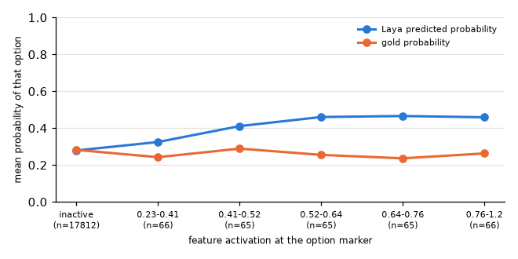

# Feature 1009

Critérios em que aparece: pred_error_stratified

**Interpretação (preencher):** 

---

## Maiores ativações

**tr_security_incidents_000025 / urgency** (score, security_incidents) | ativação 6.980 em `opção` | opções ['0', '1', '2', '3'] | Laya: **1** [0.048, 0.782, 0.092, 0.078] | gabarito: **1**

```
[CLS]score question: How quickly must a responder act on this alert?[SEP]
▸ [MASK] level 0: No time pressure; can wait indefinitely.
▸ [MASK] level 1: Routine; handle within the normal queue⟦.⟧
▸ [MASK] level 2: Elevated; should be handled within the same week.
▸ [MASK] level 3: Critical; requires action within the same day.

[SEP]

{"alert": {"description": "two successful logins from distant locations too close together", "evidence": "Two successful logins for the shared mailbox occurred from geographically distant locations within a timeframe that precludes physical travel. Both connections originated from an IP address currently on the allowlist.", "rule": "impossible_travel"}, "context": {"asset_criticality": "crown_jewel", "change_window_active": false, "source_on_allowlist": true}, "history": {"credential_rotation_days_ago": 180, "distinct_countries_30d": 4, "logins_30d": 1031, "prior_alerts_90d": 3}, "principal": {"mfa_enrolled": true, "name": "adm-deploy-597", "privileges": ["repo:read"], "type": "shared_mailbox"}}[SEP]
```

**tr_security_incidents_000164 / urgency** (score, security_incidents) | ativação 6.762 em `opção` | opções ['0', '1', '2', '3'] | Laya: **1** [0.054, 0.661, 0.166, 0.119] | gabarito: **3**

```
[CLS]score question: How quickly must a responder act on this alert?[SEP]
▸ [MASK] level 0: No time pressure; can wait indefinitely.
▸ [MASK] level 1: Routine; handle within the normal queue⟦.⟧
▸ [MASK] level 2: Elevated; should be handled within the same week.
▸ [MASK] level 3: Critical; requires action within the same day.

[SEP]

{"alert": {"description": "two successful logins from distant locations too close together", "evidence": "Two successful authentication events for a CI runner account originated from geographic locations that are physically impossible to traverse within the elapsed time between logins. Both requests were received from an IP address currently defined on the allowlist.", "rule": "impossible_travel"}, "context": {"asset_criticality": "low", "change_window_active": false, "source_on_allowlist": true}, "history": {"credential_rotation_days_ago": 30, "distinct_countries_30d": 2, "logins_30d": 1175, "prior_alerts_90d": 3}, "principal": {"mfa_enrolled": true, "name": "ci-support-866", "privileges": ["deploy:production", "secrets:read"], "type": "ci_runner"}}[SEP]
```

**tr_agent_trace_observability_000034 / urgency** (score, agent_trace_observability) | ativação 6.664 em `opção` | opções ['0', '1', '2', '3'] | Laya: **1** [0.042, 0.654, 0.242, 0.062] | gabarito: **2**

```
[CLS]score question: How quickly does this trace need attention?[SEP]
▸ [MASK] level 0: No time pressure; can wait indefinitely.
▸ [MASK] level 1: Routine; handle within the normal queue⟦.⟧
▸ [MASK] level 2: Elevated; should be handled within the same week.
▸ [MASK] level 3: Critical; requires action within the same day.

[SEP]

{"agent": {"autonomy": "checkpointed", "model": "internal-agent-v3"}, "constraints": ["Do not exceed a $50 spend on cloud resources", "Do not touch customer data outside the named accounts"], "task": "Clean up stale feature branches merged more than 90 days ago.", "trace_summary": {"constraint_violations": 1, "duration_s": 134.9, "irreversible_actions": 1, "steps": 11, "tool_errors": 1}}[SEP]
```

**tr_security_incidents_000007 / urgency** (score, security_incidents) | ativação 6.656 em `opção` | opções ['0', '1', '2', '3'] | Laya: **1** [0.025, 0.702, 0.127, 0.145] | gabarito: **2**

```
[CLS]score question: How quickly must a responder act on this alert?[SEP]
▸ [MASK] level 0: No time pressure; can wait indefinitely.
▸ [MASK] level 1: Routine; handle within the normal queue⟦.⟧
▸ [MASK] level 2: Elevated; should be handled within the same week.
▸ [MASK] level 3: Critical; requires action within the same day.

[SEP]

{"alert": {"description": "a large transfer to an external destination", "evidence": "A CI runner service transferred 12GB of data to an external destination at 03:14 UTC. While this activity aligns with an open change window, the request originated from an unrecognized network source using credentials that have not been updated in 180 days.", "rule": "data_egress"}, "context": {"asset_criticality": "medium", "change_window_active": true, "source_on_allowlist": false}, "history": {"credential_rotation_days_ago": 180, "distinct_countries_30d": 3, "logins_30d": 437, "prior_alerts_90d": 0}, "principal": {"mfa_enrolled": true, "name": "usr-deploy-716", "privileges": ["repo:read"], "type": "ci_runner"}}[SEP]
```

**tr_security_incidents_000202 / urgency** (score, security_incidents) | ativação 6.652 em `opção` | opções ['0', '1', '2', '3'] | Laya: **1** [0.038, 0.645, 0.077, 0.24] | gabarito: **1**

```
[CLS]score question: How quickly must a responder act on this alert?[SEP]
▸ [MASK] level 0: No time pressure; can wait indefinitely.
▸ [MASK] level 1: Routine; handle within the normal queue⟦.⟧
▸ [MASK] level 2: Elevated; should be handled within the same week.
▸ [MASK] level 3: Critical; requires action within the same day.

[SEP]

{"alert": {"description": "a long-unused account became active", "evidence": "A shared mailbox account that has been dormant for an extended period performed an authentication request. The account currently has MFA disabled, is not within a change window, and the credentials have not been updated for 700 days.", "rule": "dormant_account_use"}, "context": {"asset_criticality": "medium", "change_window_active": false, "source_on_allowlist": true}, "history": {"credential_rotation_days_ago": 700, "distinct_countries_30d": 3, "logins_30d": 251, "prior_alerts_90d": 25}, "principal": {"mfa_enrolled": false, "name": "adm-support-872", "privileges": ["repo:read"], "type": "shared_mailbox"}}[SEP]
```

## Ativações medianas (faixa 40-60%, mediana 2.529)

**tr_security_incidents_000004 / disposition** (choice, security_incidents) | ativação 2.682 em `opção` | opções ['close_benign', 'contain', 'investigate', 'monitor'] | Laya: **close_benign** [0.36, 0.188, 0.13, 0.321] | gabarito: **investigate**

```
[CLS]choice question: How should this security alert be dispositioned?[SEP]
▸ [MASK] close_benign: Expected, explainable activity; close without analyst time⟦.⟧
▸ [MASK] contain: Contain the host or account immediately; do not wait for triage.
▸ [MASK] investigate: Warrants an analyst opening an investigation.
▸ [MASK] monitor: Not clearly malicious, but worth watching for recurrence.

[SEP]

{"alert": {"description": "many failed authentications followed by a success", "evidence": "Between 03:12 and 03:20 UTC on 2026-09-15, 27 failed login attempts were logged from IP 203.0.113.45 targeting the CI runner service, followed by a successful authentication from the same IP at 03:21 UTC. The principal is an unprivileged CI runner with MFA enabled, operating from an unrecognised source, and the credentials were last rotated 30 days ago. No change window was defined for this period.", "rule": "brute_force"}, "context": {"asset_criticality": "high", "change_window_active": false, "source_on_allowlist": false}, "history": {"credential_rotation_days_ago": 30, "distinct_countries_30d": 1, "logins_30d": 502, "prior_alerts_90d": 0}, "principal": {"mfa_enrolled": true, "name": "usr-analytics-977", "privileges": ["repo:read"], "type": "ci_runner"}}[SEP]
```

**tr_invoice_processing_000028 / discrepancy_severity** (score, invoice_processing) | ativação 2.930 em `opção` | opções ['0', '1', '2', '3'] | Laya: **0** [0.333, 0.244, 0.24, 0.183] | gabarito: **3**

```
[CLS]score question: How material is any discrepancy between the invoice, the order and the delivery?[SEP]
▸ [MASK] level 0: None: everything reconciles⟦.⟧
▸ [MASK] level 1: Trivial: rounding or a cosmetic difference.
▸ [MASK] level 2: Moderate: a real difference worth confirming.
▸ [MASK] level 3: Material: a large or unexplained difference.

[SEP]

{"delivery": {"condition": "accepted", "date": "2026-03-15", "received_qty": 25}, "invoice": {"currency": "USD", "id": "INV-2026-2950", "lines": [{"qty": 75, "sku": "SKU-839", "total_usd": 25888.5, "unit_usd": 345.18}], "total_usd": 25888.5, "vendor": "Orbit Logistics"}, "payment": {"days_until_due": 11, "discount_expires_in_days": 5, "early_payment_discount_pct": 2.0, "status": "scheduled", "terms": "net 30"}, "purchase_order": {"freight_terms": "freight prepaid by vendor, not separately billable", "id": "PO-7854", "lines": [{"qty": 25, "unit_usd": 345.18}], "total_usd": 8629.5}, "vendor_history": {"disputes_12m": 0, "invoices_12m": 36, "prior_invoice_ids": ["INV-2026-5205", "INV-2026-9793", "INV-2026-6441", "INV-2026-7010"]}}[SEP]
```

**tr_invoice_processing_000071 / disposition** (choice, invoice_processing) | ativação 2.131 em `opção` | opções ['approve', 'hold', 'manual_review', 'reject'] | Laya: **approve** [0.448, 0.176, 0.118, 0.259] | gabarito: **manual_review**

```
[CLS]choice question: How should this vendor invoice be dispositioned?[SEP]
▸ [MASK] approve: Matches the order and delivery; approve for payment⟦.⟧
▸ [MASK] hold: Something needs confirming before payment; hold pending clarification.
▸ [MASK] manual_review: A human in finance must review the discrepancy.
▸ [MASK] reject: Should not be paid: duplicate, unauthorised or materially wrong.

[SEP]

{"delivery": {"condition": "accepted with exceptions", "date": "2026-03-08", "received_qty": 10}, "invoice": {"currency": "USD", "id": "INV-2026-5019", "lines": [{"qty": 10, "sku": "SKU-723", "total_usd": 3261.5, "unit_usd": 326.15}], "total_usd": 3261.5, "vendor": "Pallas Industrial"}, "payment": {"days_until_due": 44, "discount_expires_in_days": null, "early_payment_discount_pct": null, "status": "scheduled", "terms": "net 15"}, "purchase_order": {"freight_terms": "freight prepaid by vendor, not separately billable", "id": "PO-7622", "lines": [{"qty": 10, "unit_usd": 326.15}], "total_usd": 3261.5}, "vendor_history": {"disputes_12m": 2, "invoices_12m": 37, "prior_invoice_ids": ["INV-2026-5019", "INV-2026-2992", "INV-2026-6046", "INV-2026-9294"]}}[SEP]
```

**tr_customer_service_000055 / urgency** (score, customer_service) | ativação 2.312 em `opção` | opções ['0', '1', '2', '3'] | Laya: **1** [0.259, 0.462, 0.111, 0.168] | gabarito: **2**

```
[CLS]score question: How time-sensitive is this conversation?[SEP]
▸ [MASK] level 0: No time pressure; can wait indefinitely.
▸ [MASK] level 1: Routine; handle within the normal queue.
▸ [MASK] level 2: Elevated; should be handled within the same week⟦.⟧
▸ [MASK] level 3: Critical; requires action within the same day.

[SEP]

{"account": {"lifetime_value_usd": 936, "prior_tickets_90d": 0, "seats": 40, "tenure_months": 19, "tier": "premium"}, "orders": [{"amount_usd": 149, "date": "2026-03-09", "id": "A-69038", "status": "pending"}, {"amount_usd": 149, "date": "2026-03-25", "id": "A-22591", "status": "settled"}], "thread": [{"role": "customer", "text": "I just checked my statement and see two identical charges for $149 on the same day. I’m on the premium plan and this is really puzzling."}, {"role": "agent", "text": "I’m sorry for the confusion. Could you provide the transaction dates and the last four digits of the card used, so I can locate the duplicate entries?"}, {"role": "customer", "text": "Both charges are dated September 5th, and the card ends in 9012. I need this sorted out before the 15th of this month."}, {"role": "agent", "text": "Got it, thank you. I’ll need to verify the merchant name associated with those charges. Could you let me know how the description appears on your statement?"}, {"role": "customer", "text": "It just says ‘Premium Service – Monthly Billing’. Please let me know what you find."}]}[SEP]
```

**tr_customer_service_000115 / action** (choice, customer_service) | ativação 2.246 em `opção` | opções ['answer_directly', 'close_no_action', 'escalate_to_human', 'execute_refund', 'request_information'] | Laya: **execute_refund** [0.145, 0.318, 0.053, 0.426, 0.058] | gabarito: **escalate_to_human**

```
[CLS]choice question: What should the assistant do next with this conversation?[SEP]
▸ [MASK] answer_directly: The assistant can resolve this itself with information it already has.
▸ [MASK] close_no_action: No further action is warranted; the matter is settled⟦.⟧
▸ [MASK] escalate_to_human: Hand off to a human agent with the appropriate authority.
▸ [MASK] execute_refund: Issue the refund or credit the customer is owed.
▸ [MASK] request_information: More detail is needed from the customer before anything can be done.

[SEP]

{"account": {"lifetime_value_usd": 173, "prior_tickets_90d": 3, "seats": 5, "tenure_months": 11, "tier": "enterprise"}, "orders": [{"amount_usd": 98, "date": "2026-01-16", "id": "A-50500", "status": "settled"}, {"amount_usd": 98, "date": "2026-01-22", "id": "A-56044", "status": "settled"}, {"amount_usd": 98, "date": "2026-02-10", "id": "A-31954", "status": "refunded"}], "thread": [{"role": "customer", "text": "I am beyond frustrated that our enterprise API is down for the third time this quarter after I was told it was 'partially' fixed last week. We pay nearly $100 a month for a service that is currently blocking a massive deployment we have scheduled for noon today, and I need a real status update right now!"}]}[SEP]
```

## Estatísticas (conjunto de descoberta, dev e teste)

**pred / error**

| split | decisões | ativas | ativas e Laya errou | taxa | lift | q (BH) | OR (CMH) | q (CMH) |
|---|---|---|---|---|---|---|---|---|
| discovery | 5100 | 186 | 146 | 0.785 | 1.23 | 4.07e-05 | 2.19 | 0.00042 |
| dev | 900 | 34 | 32 | 0.941 | 1.43 | 0.00323 | 10.67 | 0.00651 |
| test | 2000 | 71 | 60 | 0.845 | 1.33 | 0.00053 | 2.03 | 0.176 |

**corr / error**

| split | decisões | ativas | ativas e Laya errou | taxa | lift | q (BH) | OR (CMH) | q (CMH) |
|---|---|---|---|---|---|---|---|---|
| discovery | 5100 | 80 | 40 | 0.500 | 0.79 | 0.0213 | 3.70 | 0.481 |
| dev | 900 | 12 | 10 | 0.833 | 1.27 | nan | nan | nan |
| test | 2000 | 30 | 19 | 0.633 | 0.99 | 1 | 2.43 | 0.876 |

**state / error**

| split | decisões | ativas | ativas e Laya errou | taxa | lift | q (BH) | OR (CMH) | q (CMH) |
|---|---|---|---|---|---|---|---|---|
| discovery | 5100 | 5 | 3 | 0.600 | 0.94 | nan | nan | nan |
| dev | 900 | 3 | 3 | 1.000 | 1.52 | nan | nan | nan |
| test | 2000 | 3 | 2 | 0.667 | 1.05 | nan | nan | nan |

Confusão mais sobre-representada (pred): `urgency|1>3` (n=90, lift 8.45, p=0). Formato `pergunta|índice previsto>índice correto`.

Confusão mais sobre-representada (corr): `urgency|1>2` (n=39, lift 8.91, p=6.47e-29). Formato `pergunta|índice previsto>índice correto`.

Confusão mais sobre-representada (state): `needs_human|1>0` (n=1, lift 15.94, p=nan). Formato `pergunta|índice previsto>índice correto`.



