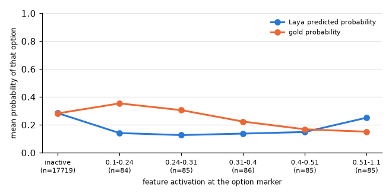

# Feature 1049

Critérios em que aparece: pred_error

**Interpretação (preencher):** 

---

## Maiores ativações

**tr_customer_service_000206 / category** (choice, customer_service) | ativação 1.960 em `estado` | opções ['account', 'billing', 'delivery', 'refund', 'technical'] | Laya: **billing** [0.138, 0.38, 0.035, 0.172, 0.276] | gabarito: **billing**

```
[CLS]choice question: What is this customer conversation primarily about?[SEP]
▸ [MASK] account: Login, plan changes, profile or access management.
▸ [MASK] billing: A charge, invoice, subscription or payment problem.
▸ [MASK] delivery: Shipping, fulfilment or delivery of a physical item.
▸ [MASK] refund: The customer is explicitly asking for money back.
▸ [MASK] technical: The product or service is not working as expected.

[SEP]

{"account": {"lifetime_value_usd": 152, "prior_tickets_90d": 3, "seats": 1, "tenure_months": 5, "tier": "standard"}, "orders": [{"amount_usd": 297, "date": "2026-03-11", "id": "A-35334", "status": "settled"}], "thread": [{"role": "customer", "text": "I just got an email saying my $297 payment failed, but I don't understand why because I haven't changed any of my bank settings."}, {"role": "agent", "text": "I can certainly look into that billing notification for you. Have you recently updated any of the security features on your credit card, such as a new expiration date⟦ or⟧ CVV?"}, {"role": "customer", "text": "No, everything is exactly the same as it was when it worked two months ago. This same thing happened back in June and then it just started working again for no reason."}, {"role": "agent", "text": "I see that we've had a few intermittent issues with this account in the past. Are you getting a specific error message when you try to manually process the payment through the 'Pay Now' button?"}, {"role": "customer", "text": "It just gives me a red box that says 'Transaction Denied' and tells me to contact my administrator, but I am the administrator."}, {"role": "agent", "text": "That is definitely confusing. Could you tell me if you are trying to process this through a VPN or a restricted corporate network, as that can sometimes trigger a decline?"}, {"role": "customer", "text": "I'm just using my home Wi-Fi like I always do, so I don't think it's a network problem on my end."}]}[SEP]
```

**tr_customer_service_000162 / needs_human** (noul, customer_service) | ativação 1.929 em `estado` | opções ['false', 'true'] | Laya: **true** [0.407, 0.593] | gabarito: **true**

```
[CLS]noul question: This conversation requires a human agent rather than automated handling.[SEP]
▸ [MASK] false: Automation can carry this to resolution.
▸ [MASK] true: A human must take over: judgement, authority or empathy is required.

[SEP]

{"account": {"lifetime_value_usd": 155, "prior_tickets_90d": 2, "seats": 1, "tenure_months": 2, "tier": "standard"}, "orders": [{"amount_usd": 897, "date": "2026-03-22", "id": "A-96291", "status": "settled"}, {"amount_usd": 897, "date": "2026-03-09", "id": "A-39764", "status": "pending"}], "thread": [{"role": "customer", "text": "Good afternoon, could you please update me on the status of my $897 refund? I’ve opened two tickets already and haven’t heard back."}, {"role": "agent", "text": "Thank you for reaching out; may I have the ticket numbers so I can review what’s been done so far?"}, {"role": "customer", "text": "Sure, they’re 11234⟦ and⟧ 11257. If this isn’t resolved soon I’ll have to think about moving to another provider."}]}[SEP]
```

**tr_customer_service_000008 / churn_risk** (score, customer_service) | ativação 1.915 em `estado` | opções ['0', '1', '2', '3'] | Laya: **1** [0.23, 0.346, 0.204, 0.22] | gabarito: **2**

```
[CLS]score question: How likely is this customer to stop doing business with us because of this interaction?[SEP]
▸ [MASK] level 0: No sign of dissatisfaction.
▸ [MASK] level 1: Mild frustration, but the relationship is intact.
▸ [MASK] level 2: Clearly unhappy; repeat problems or explicit complaints.
▸ [MASK] level 3: Imminent: threatening to cancel, dispute or leave.

[SEP]

{"account": {"lifetime_value_usd": 72, "prior_tickets_90d": 3, "seats": 1, "tenure_months": 3, "tier": "standard"}, "orders": [{"amount_usd": 87, "date": "2026-03-21", "id": "A-17904", "status": "settled"}, {"amount_usd": 87, "date": "2026-01-08", "id": "A-81775", "status": "settled"}, {"amount_usd": 87, "date": "2026-02-15", "id": "A-95492", "status": "failed"}], "thread": [{"role": "customer", "text": "Looking at my account, I need to add five more seats to the team before tomorrow’s rollout. This is my third ticket on the same issue, and I’m still on the $87 standard plan after three months."}, {"role": "agent", "text": "Got it, I see the previous tickets. Could you confirm the email addresses you’d like the new seats assigned to?"}, {"role": "customer", "text": "The emails are alice@example.com, bob@example.com, carol@example.com⟦,⟧ dave@example.com, and eve@example.com. I need all five active by end of day tomorrow."}, {"role": "agent", "text": "Thanks for the list. Are any of the current seats being de‑provisioned, or should we simply expand the total count?"}, {"role": "customer", "text": "No removals, just add the five on top of the current three seats."}, {"role": "agent", "text": "Understood. I’ll look into why the previous attempts didn’t stick. What verification method would you prefer for the new seats—email link or admin console?"}, {"role": "customer", "text": "Send the email links; I’ll forward them right away. Please make sure the seats are live before the 5 PM deadline."}]}[SEP]
```

**tr_customer_service_000008 / action** (choice, customer_service) | ativação 1.907 em `estado` | opções ['answer_directly', 'close_no_action', 'escalate_to_human', 'execute_refund', 'request_information'] | Laya: **close_no_action** [0.204, 0.257, 0.193, 0.193, 0.153] | gabarito: **request_information**

```
[CLS]choice question: What should the assistant do next with this conversation?[SEP]
▸ [MASK] answer_directly: The assistant can resolve this itself with information it already has.
▸ [MASK] close_no_action: No further action is warranted; the matter is settled.
▸ [MASK] escalate_to_human: Hand off to a human agent with the appropriate authority.
▸ [MASK] execute_refund: Issue the refund or credit the customer is owed.
▸ [MASK] request_information: More detail is needed from the customer before anything can be done.

[SEP]

{"account": {"lifetime_value_usd": 72, "prior_tickets_90d": 3, "seats": 1, "tenure_months": 3, "tier": "standard"}, "orders": [{"amount_usd": 87, "date": "2026-03-21", "id": "A-17904", "status": "settled"}, {"amount_usd": 87, "date": "2026-01-08", "id": "A-81775", "status": "settled"}, {"amount_usd": 87, "date": "2026-02-15", "id": "A-95492", "status": "failed"}], "thread": [{"role": "customer", "text": "Looking at my account, I need to add five more seats to the team before tomorrow’s rollout. This is my third ticket on the same issue, and I’m still on the $87 standard plan after three months."}, {"role": "agent", "text": "Got it, I see the previous tickets. Could you confirm the email addresses you’d like the new seats assigned to?"}, {"role": "customer", "text": "The emails are alice@example.com, bob@example.com, carol@example.com⟦,⟧ dave@example.com, and eve@example.com. I need all five active by end of day tomorrow."}, {"role": "agent", "text": "Thanks for the list. Are any of the current seats being de‑provisioned, or should we simply expand the total count?"}, {"role": "customer", "text": "No removals, just add the five on top of the current three seats."}, {"role": "agent", "text": "Understood. I’ll look into why the previous attempts didn’t stick. What verification method would you prefer for the new seats—email link or admin console?"}, {"role": "customer", "text": "Send the email links; I’ll forward them right away. Please make sure the seats are live before the 5 PM deadline."}]}[SEP]
```

**tr_customer_service_000008 / category** (choice, customer_service) | ativação 1.894 em `estado` | opções ['account', 'billing', 'delivery', 'refund', 'technical'] | Laya: **account** [0.278, 0.125, 0.149, 0.172, 0.276] | gabarito: **account**

```
[CLS]choice question: What is this customer conversation primarily about?[SEP]
▸ [MASK] account: Login, plan changes, profile or access management.
▸ [MASK] billing: A charge, invoice, subscription or payment problem.
▸ [MASK] delivery: Shipping, fulfilment or delivery of a physical item.
▸ [MASK] refund: The customer is explicitly asking for money back.
▸ [MASK] technical: The product or service is not working as expected.

[SEP]

{"account": {"lifetime_value_usd": 72, "prior_tickets_90d": 3, "seats": 1, "tenure_months": 3, "tier": "standard"}, "orders": [{"amount_usd": 87, "date": "2026-03-21", "id": "A-17904", "status": "settled"}, {"amount_usd": 87, "date": "2026-01-08", "id": "A-81775", "status": "settled"}, {"amount_usd": 87, "date": "2026-02-15", "id": "A-95492", "status": "failed"}], "thread": [{"role": "customer", "text": "Looking at my account, I need to add five more seats to the team before tomorrow’s rollout. This is my third ticket on the same issue, and I’m still on the $87 standard plan after three months."}, {"role": "agent", "text": "Got it, I see the previous tickets. Could you confirm the email addresses you’d like the new seats assigned to?"}, {"role": "customer", "text": "The emails are alice@example.com, bob@example.com, carol@example.com⟦,⟧ dave@example.com, and eve@example.com. I need all five active by end of day tomorrow."}, {"role": "agent", "text": "Thanks for the list. Are any of the current seats being de‑provisioned, or should we simply expand the total count?"}, {"role": "customer", "text": "No removals, just add the five on top of the current three seats."}, {"role": "agent", "text": "Understood. I’ll look into why the previous attempts didn’t stick. What verification method would you prefer for the new seats—email link or admin console?"}, {"role": "customer", "text": "Send the email links; I’ll forward them right away. Please make sure the seats are live before the 5 PM deadline."}]}[SEP]
```

## Ativações medianas (faixa 40-60%, mediana 0.476)

**tr_invoice_processing_000065 / duplicate** (noul, invoice_processing) | ativação 0.440 em `estado` | opções ['false', 'true'] | Laya: **true** [0.151, 0.849] | gabarito: **false**

```
[CLS]noul question: This invoice appears to duplicate an invoice already submitted.[SEP]
▸ [MASK] false: no, the statement does not hold
▸ [MASK] true: yes, the statement holds

[SEP]

{"delivery": {"condition": "accepted", "date": "2026-03-22", "received_qty": 250}, "invoice": {"currency": "USD", "id": "INV-2026-7887", "lines": [{"qty": 250, "sku": "SKU-490", "total_usd": 31982.5, "unit_usd": 127.93}], "total_usd": 31982.5, "vendor": "Orbit Logistics"}, "payment": {"days_until_due": 0, "discount_expires_in_days": 5, "early_payment_discount_pct": 2.0, "status": "scheduled", "terms": "net 15"}, "purchase_order": {"freight_terms": "freight prepaid by vendor, not separately billable", "id":⟦ "⟧PO-8246", "lines": [{"qty": 250, "unit_usd": 127.93}], "total_usd": 31982.5}, "vendor_history": {"disputes_12m": 1, "invoices_12m": 17, "prior_invoice_ids": ["INV-2026-4688", "INV-2026-4365", "INV-2026-2955"]}}[SEP]
```

**tr_invoice_processing_000269 / urgency** (score, invoice_processing) | ativação 0.428 em `estado` | opções ['0', '1', '2', '3'] | Laya: **1** [0.231, 0.488, 0.204, 0.077] | gabarito: **1**

```
[CLS]score question: How time-sensitive is processing this invoice?[SEP]
▸ [MASK] level 0: No time pressure; can wait indefinitely.
▸ [MASK] level 1: Routine; handle within the normal queue.
▸ [MASK] level 2: Elevated; should be handled within the same week.
▸ [MASK] level 3: Critical; requires action within the same day.

[SEP]

{"delivery": {"condition": "accepted with exceptions", "date": "2026-03-04", "received_qty": 250}, "invoice": {"currency": "USD", "id": "INV-2026-5045", "lines": [{"qty": 250, "sku": "SKU-657", "total_usd": 71242.5, "unit_usd": 284.97}], "total_usd": 71242.5, "vendor": "Vantage Materials"}, "payment": {"days_until_due": 44, "discount_expires_in_days": null, "early_payment_discount_pct": null, "status": "scheduled", "terms": "net 15"}, "purchase_order": {"freight_terms": "freight prepaid by vendor, not separately billable", "id":⟦ "⟧PO-7733", "lines": [{"qty": 250, "unit_usd": 284.97}], "total_usd": 71242.5}, "vendor_history": {"disputes_12m": 0, "invoices_12m": 42, "prior_invoice_ids": ["INV-2026-5045"]}}[SEP]
```

**tr_security_incidents_000028 / urgency** (score, security_incidents) | ativação 0.504 em `estado` | opções ['0', '1', '2', '3'] | Laya: **1** [0.145, 0.32, 0.314, 0.22] | gabarito: **3**

```
[CLS]score question: How quickly must a responder act on this alert?[SEP]
▸ [MASK] level 0: No time pressure; can wait indefinitely.
▸ [MASK] level 1: Routine; handle within the normal queue.
▸ [MASK] level 2: Elevated; should be handled within the same week.
▸ [MASK] level 3: Critical; requires action within the same day.

[SEP]

{"alert": {"description": "a security group was opened to the public internet⟦",⟧ "evidence": "On 2026-09-14 17:08 UTC, administrator \"admin_jdoe\" (privileged, MFA enabled) altered security group SG-9F2C to add an inbound rule allowing 0.0.0.0/0 on TCP port 22, thereby exposing the group to the public internet. The modification was made during an open change window, the initiating IP 198.51.100.23 is not recognized, and the account’s credentials were rotated 14 days earlier.", "rule": "config_drift"}, "context": {"asset_criticality": "medium", "change_window_active": true, "source_on_allowlist": false}, "history": {"credential_rotation_days_ago": 14, "distinct_countries_30d": 3, "logins_30d": 58, "prior_alerts_90d": 1}, "principal": {"mfa_enrolled": true, "name": "ci-support-253", "privileges": ["deploy:production", "secrets:read"], "type": "admin"}}[SEP]
```

**tr_customer_service_000268 / action** (choice, customer_service) | ativação 0.474 em `marcador` | opções ['answer_directly', 'close_no_action', 'escalate_to_human', 'execute_refund', 'request_information'] | Laya: **close_no_action** [0.215, 0.316, 0.116, 0.244, 0.108] | gabarito: **escalate_to_human**

```
[CLS]choice question: What should the assistant do next with this conversation?[SEP]
▸ [MASK] answer_directly: The assistant can resolve this itself with information it already has.
▸ ⟦[MASK]⟧ close_no_action: No further action is warranted; the matter is settled.
▸ [MASK] escalate_to_human: Hand off to a human agent with the appropriate authority.
▸ [MASK] execute_refund: Issue the refund or credit the customer is owed.
▸ [MASK] request_information: More detail is needed from the customer before anything can be done.

[SEP]

{"account": {"lifetime_value_usd": 549, "prior_tickets_90d": 3, "seats": 1, "tenure_months": 8, "tier": "standard"}, "orders": [{"amount_usd": 99, "date": "2026-01-21", "id": "A-65314", "status": "refunded"}, {"amount_usd": 99, "date": "2026-02-28", "id": "A-55952", "status": "failed"}, {"amount_usd": 99, "date": "2026-02-26", "id": "A-57626", "status": "failed"}], "thread": [{"role": "customer", "text": "I’ve been double‑charged $99 for the same month and I need this fixed by tomorrow or I won’t be able to pay my rent."}, {"role": "agent", "text": "I understand how important this is. Could you tell me the date of the two transactions and the payment method you used, so I can locate them?"}, {"role": "customer", "text": "Both charges show up on my statement for the 5th of this month, using the same Visa card that ends in 1234."}]}[SEP]
```

**tr_invoice_processing_000026 / discrepancy_severity** (score, invoice_processing) | ativação 0.424 em `opção` | opções ['0', '1', '2', '3'] | Laya: **0** [0.277, 0.249, 0.277, 0.197] | gabarito: **0**

```
[CLS]score question: How material is any discrepancy between the invoice, the order and the delivery?[SEP]
▸ [MASK] level 0: None: everything reconciles.
▸ [MASK] level 1: Trivial⟦:⟧ rounding or a cosmetic difference.
▸ [MASK] level 2: Moderate: a real difference worth confirming.
▸ [MASK] level 3: Material: a large or unexplained difference.

[SEP]

{"delivery": {"condition": "accepted", "date": "2026-03-01", "received_qty": 25}, "invoice": {"currency": "USD", "id": "INV-2026-4433", "lines": [{"qty": 25, "sku": "SKU-294", "total_usd": 8313.5, "unit_usd": 332.54}], "total_usd": 8313.5, "vendor": "Kestrel Supply"}, "payment": {"days_until_due": 2, "discount_expires_in_days": null, "early_payment_discount_pct": null, "status": "scheduled", "terms": "net 45"}, "purchase_order": {"freight_terms": "freight prepaid by vendor, not separately billable", "id": "PO-2485", "lines": [{"qty": 25, "unit_usd": 332.54}], "total_usd": 8313.5}, "vendor_history": {"disputes_12m": 5, "invoices_12m": 55, "prior_invoice_ids": ["INV-2026-2147"]}}[SEP]
```

## Estatísticas (conjunto de descoberta, dev e teste)

**pred / error**

| split | decisões | ativas | ativas e Laya errou | taxa | lift | q (BH) | OR (CMH) | q (CMH) |
|---|---|---|---|---|---|---|---|---|
| discovery | 5100 | 47 | 45 | 0.957 | 1.50 | 1.81e-06 | 5.88 | 0.103 |
| dev | 900 | 8 | 8 | 1.000 | 1.52 | nan | nan | nan |
| test | 2000 | 19 | 19 | 1.000 | 1.57 | nan | nan | nan |

**corr / error**

| split | decisões | ativas | ativas e Laya errou | taxa | lift | q (BH) | OR (CMH) | q (CMH) |
|---|---|---|---|---|---|---|---|---|
| discovery | 5100 | 96 | 94 | 0.979 | 1.54 | 1.07e-15 | 0.79 | 0.891 |
| dev | 900 | 28 | 28 | 1.000 | 1.52 | 3.57e-05 | inf | 0.782 |
| test | 2000 | 51 | 51 | 1.000 | 1.57 | 5.48e-10 | inf | 0.482 |

**state / error**

| split | decisões | ativas | ativas e Laya errou | taxa | lift | q (BH) | OR (CMH) | q (CMH) |
|---|---|---|---|---|---|---|---|---|
| discovery | 5100 | 1502 | 946 | 0.630 | 0.99 | 0.818 | 0.94 | 0.608 |
| dev | 900 | 286 | 202 | 0.706 | 1.08 | 0.7 | 1.43 | 0.207 |
| test | 2000 | 573 | 351 | 0.613 | 0.96 | 0.629 | 0.85 | 0.393 |

Confusão mais sobre-representada (pred): `disposition|0>2` (n=18, lift 8.17, p=8.56e-13). Formato `pergunta|índice previsto>índice correto`.

Confusão mais sobre-representada (corr): `urgency|1>2` (n=75, lift 14.28, p=0). Formato `pergunta|índice previsto>índice correto`.

Confusão mais sobre-representada (state): `matches_order|1>0` (n=86, lift 2.65, p=1.53e-26). Formato `pergunta|índice previsto>índice correto`.



