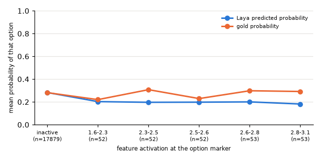

# Feature 1156

Critérios em que aparece: corr_error_stratified

**Interpretação (preencher):** 

---

## Maiores ativações

**tr_customer_service_000279 / action** (choice, customer_service) | ativação 9.875 em `opção` | opções ['answer_directly', 'close_no_action', 'escalate_to_human', 'execute_refund', 'request_information'] | Laya: **close_no_action** [0.234, 0.298, 0.153, 0.102, 0.214] | gabarito: **answer_directly**

```
[CLS]choice question: What should the assistant do next with this conversation?[SEP]
▸ [MASK] answer⟦_⟧directly: The assistant can resolve this itself with information it already has.
▸ [MASK] close_no_action: No further action is warranted; the matter is settled.
▸ [MASK] escalate_to_human: Hand off to a human agent with the appropriate authority.
▸ [MASK] execute_refund: Issue the refund or credit the customer is owed.
▸ [MASK] request_information: More detail is needed from the customer before anything can be done.

[SEP]

{"account": {"lifetime_value_usd": 2237, "prior_tickets_90d": 2, "seats": 1, "tenure_months": 33, "tier": "free"}, "thread": [{"role": "customer", "text": "Hi there, I’ve been using the free plan for 33 months now and I’m hoping to download my full data history. Could you let me know the steps to initiate an export?"}, {"role": "agent", "text": "Hello, thank you for reaching out. I see you've been with us for quite a while now. Could you please clarify if you are looking to export a specific date range or your entire account archive?"}, {"role": "customer", "text": "I would like to pull everything from the very beginning if that is possible."}]}[SEP]
```

**tr_customer_service_000111 / action** (choice, customer_service) | ativação 9.875 em `opção` | opções ['answer_directly', 'close_no_action', 'escalate_to_human', 'execute_refund', 'request_information'] | Laya: **request_information** [0.252, 0.225, 0.114, 0.142, 0.267] | gabarito: **answer_directly**

```
[CLS]choice question: What should the assistant do next with this conversation?[SEP]
▸ [MASK] answer⟦_⟧directly: The assistant can resolve this itself with information it already has.
▸ [MASK] close_no_action: No further action is warranted; the matter is settled.
▸ [MASK] escalate_to_human: Hand off to a human agent with the appropriate authority.
▸ [MASK] execute_refund: Issue the refund or credit the customer is owed.
▸ [MASK] request_information: More detail is needed from the customer before anything can be done.

[SEP]

{"account": {"lifetime_value_usd": 181, "prior_tickets_90d": 0, "seats": 1, "tenure_months": 2, "tier": "free"}, "thread": [{"role": "customer", "text": "We have to add three more seats to our team right now, or we can't meet our client deadline tomorrow. If this isn't sorted immediately, we'll have to look for another service."}, {"role": "agent", "text": "Got it. Can you provide the account ID and let me know which usernames need the new seats?"}, {"role": "customer", "text": "We're on the free plan, account ID 98765. Please tell me what I need to do to get those seats added before 5 pm today."}]}[SEP]
```

**tr_customer_service_000172 / action** (choice, customer_service) | ativação 9.859 em `opção` | opções ['answer_directly', 'close_no_action', 'escalate_to_human', 'execute_refund', 'request_information'] | Laya: **escalate_to_human** [0.222, 0.228, 0.248, 0.104, 0.197] | gabarito: **escalate_to_human**

```
[CLS]choice question: What should the assistant do next with this conversation?[SEP]
▸ [MASK] answer⟦_⟧directly: The assistant can resolve this itself with information it already has.
▸ [MASK] close_no_action: No further action is warranted; the matter is settled.
▸ [MASK] escalate_to_human: Hand off to a human agent with the appropriate authority.
▸ [MASK] execute_refund: Issue the refund or credit the customer is owed.
▸ [MASK] request_information: More detail is needed from the customer before anything can be done.

[SEP]

{"account": {"lifetime_value_usd": 131, "prior_tickets_90d": 0, "seats": 5, "tenure_months": 5, "tier": "premium"}, "thread": [{"role": "customer", "text": "Hi, I'm really scratching my head here. My package says it was delivered yesterday, but I've been checking my porch all morning and there's absolutely nothing. I've been with you for five months on the premium plan and this has never happened."}, {"role": "agent", "text": "I’m sorry to hear that you haven't received your package yet. Could you please confirm the tracking number you are referring to so I can take a look?"}, {"role": "customer", "text": "The tracking number is 94001000. I'm just so confused because the status hasn't updated since yesterday morning. I really need this by tomorrow afternoon for a presentation."}, {"role": "agent", "text": "Thank you for providing that number. I am pulling up your account details now. Could you tell me if you have checked with any neighbors or a building manager in the meantime?"}, {"role": "customer", "text": "I did check with my neighbor, but they didn't see anything. I'm worried because I'm on a tight timeline here. Is there any way to see exactly where the driver left it?"}, {"role": "agent", "text": "I understand your concern given your upcoming deadline. I need to reach out to our logistics partner to get more information on the delivery scan; could you confirm the exact address on file?"}, {"role": "customer", "text": "It's 442 Maple Drive. I just hope this gets sorted out quickly because I really can't miss this deadline."}]}[SEP]
```

**tr_customer_service_000032 / action** (choice, customer_service) | ativação 9.812 em `opção` | opções ['answer_directly', 'close_no_action', 'escalate_to_human', 'execute_refund', 'request_information'] | Laya: **execute_refund** [0.143, 0.231, 0.244, 0.312, 0.07] | gabarito: **escalate_to_human**

```
[CLS]choice question: What should the assistant do next with this conversation?[SEP]
▸ [MASK] answer⟦_⟧directly: The assistant can resolve this itself with information it already has.
▸ [MASK] close_no_action: No further action is warranted; the matter is settled.
▸ [MASK] escalate_to_human: Hand off to a human agent with the appropriate authority.
▸ [MASK] execute_refund: Issue the refund or credit the customer is owed.
▸ [MASK] request_information: More detail is needed from the customer before anything can be done.

[SEP]

{"account": {"lifetime_value_usd": 380, "prior_tickets_90d": 1, "seats": 1, "tenure_months": 5, "tier": "standard"}, "orders": [{"amount_usd": 598, "date": "2026-02-19", "id": "A-24938", "status": "pending"}, {"amount_usd": 598, "date": "2026-03-04", "id": "A-58038", "status": "refunded"}, {"amount_usd": 598, "date": "2026-03-13", "id": "A-45299", "status": "settled"}], "thread": [{"role": "customer", "text": "I am beyond finished with this service. I've poured nearly six hundred dollars into this account over the last five months and my previous ticket is still sitting there completely ignored. Just cancel my entire account immediately."}, {"role": "agent", "text": "I understand you're looking to close your account today. To ensure I have the right context, could you please clarify if the lack of response on your previous ticket is the primary reason for your decision to leave the standard plan?"}, {"role": "customer", "text": "It's the fact that I'm paying for a premium tier and getting treated like I don't exist while you keep my $598. I'm not here to talk it out or wait for a fix that isn't coming—I want the cancellation processed now."}]}[SEP]
```

**tr_customer_service_000234 / action** (choice, customer_service) | ativação 9.742 em `opção` | opções ['answer_directly', 'close_no_action', 'escalate_to_human', 'execute_refund', 'request_information'] | Laya: **close_no_action** [0.192, 0.47, 0.13, 0.1, 0.108] | gabarito: **request_information**

```
[CLS]choice question: What should the assistant do next with this conversation?[SEP]
▸ [MASK] answer⟦_⟧directly: The assistant can resolve this itself with information it already has.
▸ [MASK] close_no_action: No further action is warranted; the matter is settled.
▸ [MASK] escalate_to_human: Hand off to a human agent with the appropriate authority.
▸ [MASK] execute_refund: Issue the refund or credit the customer is owed.
▸ [MASK] request_information: More detail is needed from the customer before anything can be done.

[SEP]

{"account": {"lifetime_value_usd": 1458, "prior_tickets_90d": 0, "seats": 3, "tenure_months": 33, "tier": "premium"}, "thread": [{"role": "customer", "text": "I’ve been paying for this premium plan for 33 months without a single hitch, but now I’m completely locked out and I have a hard deadline in two hours. Why is the login screen just spinning?"}, {"role": "agent", "text": "I’m sorry to hear you're experiencing this frustration right now. Could you please confirm the exact error message or code you are seeing when the page hangs?"}, {"role": "customer", "text": "There is no code! It’s just a blank page after I enter my credentials. I have a massive report due for my firm by noon and I can’t get in to export the data. This is ridiculous."}, {"role": "agent", "text": "I understand the urgency of this report. To help me narrow down the cause, are you accessing the portal through a browser or our desktop application?"}, {"role": "customer", "text": "I’m using Chrome on my desktop. I’ve already cleared my cache and tried an incognito window, so don't even suggest that. Fix this now."}]}[SEP]
```

## Ativações medianas (faixa 40-60%, mediana 3.078)

**tr_customer_service_000228 / action** (choice, customer_service) | ativação 3.010 em `marcador` | opções ['answer_directly', 'close_no_action', 'escalate_to_human', 'execute_refund', 'request_information'] | Laya: **close_no_action** [0.106, 0.734, 0.052, 0.054, 0.054] | gabarito: **escalate_to_human**

```
[CLS]choice question: What should the assistant do next with this conversation?[SEP]
▸ ⟦[MASK]⟧ answer_directly: The assistant can resolve this itself with information it already has.
▸ [MASK] close_no_action: No further action is warranted; the matter is settled.
▸ [MASK] escalate_to_human: Hand off to a human agent with the appropriate authority.
▸ [MASK] execute_refund: Issue the refund or credit the customer is owed.
▸ [MASK] request_information: More detail is needed from the customer before anything can be done.

[SEP]

{"account": {"lifetime_value_usd": 1521, "prior_tickets_90d": 1, "seats": 1, "tenure_months": 26, "tier": "standard"}, "thread": [{"role": "customer", "text": "I've been with the standard plan for over two years now, and I think it's time to close my account. Please go ahead and cancel it."}, {"role": "agent", "text": "I’m sorry to hear you’d like to cancel. Could you confirm the email address associated with the account so I can pull up the details?"}, {"role": "customer", "text": "Sure, it's jane.doe@example.com. I’ve already tried this before; the last ticket was closed but the issue kept coming back."}]}[SEP]
```

**tr_customer_service_000175 / action** (choice, customer_service) | ativação 2.756 em `marcador` | opções ['answer_directly', 'close_no_action', 'escalate_to_human', 'execute_refund', 'request_information'] | Laya: **close_no_action** [0.184, 0.325, 0.079, 0.282, 0.13] | gabarito: **escalate_to_human**

```
[CLS]choice question: What should the assistant do next with this conversation?[SEP]
▸ ⟦[MASK]⟧ answer_directly: The assistant can resolve this itself with information it already has.
▸ [MASK] close_no_action: No further action is warranted; the matter is settled.
▸ [MASK] escalate_to_human: Hand off to a human agent with the appropriate authority.
▸ [MASK] execute_refund: Issue the refund or credit the customer is owed.
▸ [MASK] request_information: More detail is needed from the customer before anything can be done.

[SEP]

{"account": {"lifetime_value_usd": 133, "prior_tickets_90d": 1, "seats": 40, "tenure_months": 8, "tier": "enterprise"}, "orders": [{"amount_usd": 149, "date": "2026-01-04", "id": "A-23809", "status": "settled"}, {"amount_usd": 149, "date": "2026-01-20", "id": "A-52054", "status": "refunded"}], "thread": [{"role": "customer", "text": "I just opened my enterprise delivery and it is the completely wrong item. After the last issue with the missing shipment, I guess I shouldn't be surprised that this is happening again."}, {"role": "agent", "text": "I am very sorry to hear that you received the incorrect item. Could you please provide the order number and describe the item you received instead?"}, {"role": "customer", "text": "The order number is #88291. It was supposed to be the $149 hardware kit, but I got a box of cables instead. I need the correct items by Friday morning at the latest."}, {"role": "agent", "text": "Thank you for those details. I've noted the discrepancy regarding the hardware kit. Could you please send over a photo of the packing slip that was included in the box?"}, {"role": "customer", "text": "I've attached the photo to this message. I really hope we can get this resolved before my event starts."}]}[SEP]
```

**tr_customer_service_000013 / action** (choice, customer_service) | ativação 8.336 em `opção` | opções ['answer_directly', 'close_no_action', 'escalate_to_human', 'execute_refund', 'request_information'] | Laya: **close_no_action** [0.206, 0.31, 0.144, 0.183, 0.157] | gabarito: **request_information**

```
[CLS]choice question: What should the assistant do next with this conversation?[SEP]
▸ [MASK] answer⟦_⟧directly: The assistant can resolve this itself with information it already has.
▸ [MASK] close_no_action: No further action is warranted; the matter is settled.
▸ [MASK] escalate_to_human: Hand off to a human agent with the appropriate authority.
▸ [MASK] execute_refund: Issue the refund or credit the customer is owed.
▸ [MASK] request_information: More detail is needed from the customer before anything can be done.

[SEP]

{"account": {"lifetime_value_usd": 148, "prior_tickets_90d": 0, "seats": 40, "tenure_months": 3, "tier": "enterprise"}, "orders": [{"amount_usd": 198, "date": "2026-03-15", "id": "A-40361", "status": "failed"}, {"amount_usd": 198, "date": "2026-01-06", "id": "A-31584", "status": "settled"}, {"amount_usd": 198, "date": "2026-03-27", "id": "A-12899", "status": "pending"}], "thread": [{"role": "customer", "text": "Our latest invoice shows $198 for the enterprise plan, but my contract says $149. This discrepancy needs fixing, or I’ll have to look elsewhere; I need this resolved by the 15th."}, {"role": "agent", "text": "I understand the pricing concern. Can you confirm the billing period the invoice covers and attach the invoice file?"}, {"role": "customer", "text": "It covers March to May, and I’ve attached the PDF. I’m also considering canceling if we can’t sort it out quickly."}, {"role": "agent", "text": "Thanks for the details. Do you have a copy of the original agreement or any previous invoices for comparison?"}, {"role": "customer", "text": "Yes, the original agreement is in the email from January; I’ll forward it. I need a clear answer before the 15th deadline we discussed."}, {"role": "agent", "text": "Got it. I’ll review the documents. In the meantime, could you tell me if any discounts were applied that you’re aware of?"}, {"role": "customer", "text": "No discounts that I know of. I’m waiting for your clarification so I can decide whether to stay or move on."}]}[SEP]
```

**tr_customer_service_000065 / action** (choice, customer_service) | ativação 2.754 em `marcador` | opções ['answer_directly', 'close_no_action', 'escalate_to_human', 'execute_refund', 'request_information'] | Laya: **close_no_action** [0.149, 0.367, 0.127, 0.213, 0.144] | gabarito: **answer_directly**

```
[CLS]choice question: What should the assistant do next with this conversation?[SEP]
▸ ⟦[MASK]⟧ answer_directly: The assistant can resolve this itself with information it already has.
▸ [MASK] close_no_action: No further action is warranted; the matter is settled.
▸ [MASK] escalate_to_human: Hand off to a human agent with the appropriate authority.
▸ [MASK] execute_refund: Issue the refund or credit the customer is owed.
▸ [MASK] request_information: More detail is needed from the customer before anything can be done.

[SEP]

{"account": {"lifetime_value_usd": 586, "prior_tickets_90d": 0, "seats": 1, "tenure_months": 19, "tier": "standard"}, "orders": [{"amount_usd": 99, "date": "2026-02-21", "id": "A-35676", "status": "settled"}, {"amount_usd": 99, "date": "2026-02-28", "id": "A-65097", "status": "failed"}, {"amount_usd": 99, "date": "2026-03-26", "id": "A-82387", "status": "refunded"}], "thread": [{"role": "customer", "text": "I'm trying to export my data and I can't find any option to do it. This is confusing, and if I can't get it sorted by Friday, I'm going to have to look elsewhere."}, {"role": "agent", "text": "Sorry for the trouble. Could you let me know which data set you're after and whether you need it in CSV or JSON format?"}, {"role": "customer", "text": "I need the full activity log for the past six months in CSV. It's critical for my reporting deadline this Friday."}]}[SEP]
```

**tr_customer_service_000119 / action** (choice, customer_service) | ativação 2.811 em `marcador` | opções ['answer_directly', 'close_no_action', 'escalate_to_human', 'execute_refund', 'request_information'] | Laya: **close_no_action** [0.226, 0.428, 0.159, 0.061, 0.127] | gabarito: **escalate_to_human**

```
[CLS]choice question: What should the assistant do next with this conversation?[SEP]
▸ ⟦[MASK]⟧ answer_directly: The assistant can resolve this itself with information it already has.
▸ [MASK] close_no_action: No further action is warranted; the matter is settled.
▸ [MASK] escalate_to_human: Hand off to a human agent with the appropriate authority.
▸ [MASK] execute_refund: Issue the refund or credit the customer is owed.
▸ [MASK] request_information: More detail is needed from the customer before anything can be done.

[SEP]

{"account": {"lifetime_value_usd": 613, "prior_tickets_90d": 1, "seats": 1, "tenure_months": 11, "tier": "standard"}, "orders": [{"amount_usd": 299, "date": "2026-01-13", "id": "A-16098", "status": "failed"}], "thread": [{"role": "customer", "text": "I just received my delivery and it's completely wrong. I paid $299 for the standard plan upgrade equipment, but what arrived in the box is the basic version. I’m seriously considering canceling my subscription over this."}, {"role": "agent", "text": "I am very sorry to hear that the incorrect item was delivered. Could you please provide your order number and a photo of the item you received so I can review this?"}, {"role": "customer", "text": "I’ve attached the photo to this ticket. This is the second time I've had issues like this, and frankly, my patience is wearing thin."}]}[SEP]
```

## Estatísticas (conjunto de descoberta, dev e teste)

**pred / error**

| split | decisões | ativas | ativas e Laya errou | taxa | lift | q (BH) | OR (CMH) | q (CMH) |
|---|---|---|---|---|---|---|---|---|
| discovery | 5100 | 6 | 3 | 0.500 | 0.79 | nan | nan | nan |
| dev | 900 | 2 | 1 | 0.500 | 0.76 | nan | nan | nan |
| test | 2000 | 3 | 3 | 1.000 | 1.57 | nan | nan | nan |

**corr / error**

| split | decisões | ativas | ativas e Laya errou | taxa | lift | q (BH) | OR (CMH) | q (CMH) |
|---|---|---|---|---|---|---|---|---|
| discovery | 5100 | 53 | 50 | 0.943 | 1.48 | 6.88e-07 | inf | 3.94e-15 |
| dev | 900 | 12 | 11 | 0.917 | 1.40 | nan | nan | nan |
| test | 2000 | 17 | 17 | 1.000 | 1.57 | nan | nan | nan |

**state / error**

| split | decisões | ativas | ativas e Laya errou | taxa | lift | q (BH) | OR (CMH) | q (CMH) |
|---|---|---|---|---|---|---|---|---|
| discovery | 5100 | 0 | 0 | nan | nan | nan | nan | nan |
| dev | 900 | 0 | 0 | nan | nan | nan | nan | nan |
| test | 2000 | 0 | 0 | nan | nan | nan | nan | nan |

Confusão mais sobre-representada (pred): `action|0>2` (n=3, lift 22.97, p=nan). Formato `pergunta|índice previsto>índice correto`.

Confusão mais sobre-representada (corr): `action|1>0` (n=41, lift 96.23, p=0). Formato `pergunta|índice previsto>índice correto`.



