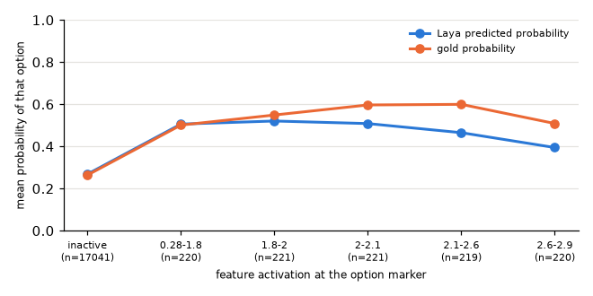

# Feature 1172

Critérios em que aparece: attribution_toward_wrong

**Interpretação (preencher):** 

---

## Maiores ativações

**tr_security_incidents_000168 / credential_compromise** (noul, security_incidents) | ativação 11.625 em `opção` | opções ['false', 'true'] | Laya: **true** [0.201, 0.799] | gabarito: **false**

```
[CLS]noul question: The evidence indicates a credential or account has been compromised.[SEP]
▸ [MASK] false: no, the statement does not hold
▸ [MASK] true: yes⟦,⟧ the statement holds

[SEP]

{"alert": {"description": "an account granted itself or received elevated permissions", "evidence": "At 2026-09-15 14:23 UTC, employee account jdoe@example.com was added to the privileged Domain Admins group via the AzureAD PowerShell cmdlet Add-ADGroupMember. The operation originated from internal IP 10.2.5.12, which is listed in the allowlist, and occurred within the scheduled change window (14:00‑16:00 UTC). Credential rotation for the account was logged three days earlier.", "rule": "privilege_escalation"}, "context": {"asset_criticality": "medium", "change_window_active": true, "source_on_allowlist": true}, "history": {"credential_rotation_days_ago": 3, "distinct_countries_30d": 3, "logins_30d": 80, "prior_alerts_90d": 0}, "principal": {"mfa_enrolled": true, "name": "adm-infra-497", "privileges": ["deploy:production", "secrets:read"], "type": "employee"}}[SEP]
```

**tr_security_incidents_000132 / credential_compromise** (noul, security_incidents) | ativação 11.547 em `opção` | opções ['false', 'true'] | Laya: **true** [0.19, 0.81] | gabarito: **false**

```
[CLS]noul question: The evidence indicates a credential or account has been compromised.[SEP]
▸ [MASK] false: no, the statement does not hold
▸ [MASK] true: yes⟦,⟧ the statement holds

[SEP]

{"alert": {"description": "a security group was opened to the public internet", "evidence": "At 2026-09-15 03:12 UTC, security group sg-0a1b2c3d4e was altered to include an inbound rule allowing 0.0.0.0/0 on TCP port 22. The change was performed by employee jdoe@example.com, a privileged account with MFA enabled, during an open change window. The source IP (203.0.113.45) is not on the trusted list and the account's credentials were last rotated 14 days prior.", "rule": "config_drift"}, "context": {"asset_criticality": "low", "change_window_active": true, "source_on_allowlist": false}, "history": {"credential_rotation_days_ago": 14, "distinct_countries_30d": 3, "logins_30d": 1115, "prior_alerts_90d": 0}, "principal": {"mfa_enrolled": true, "name": "usr-analytics-746", "privileges": ["deploy:production", "secrets:read"], "type": "employee"}}[SEP]
```

**tr_security_incidents_000045 / credential_compromise** (noul, security_incidents) | ativação 11.523 em `opção` | opções ['false', 'true'] | Laya: **true** [0.158, 0.842] | gabarito: **false**

```
[CLS]noul question: The evidence indicates a credential or account has been compromised.[SEP]
▸ [MASK] false: no, the statement does not hold
▸ [MASK] true: yes⟦,⟧ the statement holds

[SEP]

{"alert": {"description": "an unusual volume of files read in a short window", "evidence": "At 2026-09-15 02:07:14 UTC, the admin account \"ADM_Jenkins\" invoked the process \"cmd.exe\" to open 417 distinct files on the UNC path \\\\fileshare01\\project\\data within a 4‑minute interval. The source host (10.12.34.78) is listed in the allowlist and the account's MFA setting is disabled, with the password last rotated 180 days prior.", "rule": "mass_download"}, "context": {"asset_criticality": "high", "change_window_active": false, "source_on_allowlist": true}, "history": {"credential_rotation_days_ago": 180, "distinct_countries_30d": 1, "logins_30d": 1479, "prior_alerts_90d": 0}, "principal": {"mfa_enrolled": false, "name": "ci-infra-731", "privileges": ["deploy:production", "secrets:read"], "type": "admin"}}[SEP]
```

**tr_security_incidents_000266 / credential_compromise** (noul, security_incidents) | ativação 11.523 em `opção` | opções ['false', 'true'] | Laya: **true** [0.281, 0.719] | gabarito: **true**

```
[CLS]noul question: The evidence indicates a credential or account has been compromised.[SEP]
▸ [MASK] false: no, the statement does not hold
▸ [MASK] true: yes⟦,⟧ the statement holds

[SEP]

{"alert": {"description": "a session token was presented from a second address", "evidence": "A session token issued to an unprivileged employee was observed being utilized from a secondary, unrecognized IP address at 16:30 UTC. The underlying credentials for this account were last rotated 412 days ago, and this concurrent token usage occurred outside of any established change window.", "rule": "token_reuse"}, "context": {"asset_criticality": "medium", "change_window_active": false, "source_on_allowlist": false}, "history": {"credential_rotation_days_ago": 412, "distinct_countries_30d": 4, "logins_30d": 772, "prior_alerts_90d": 0}, "principal": {"mfa_enrolled": true, "name": "adm-infra-890", "privileges": ["repo:read"], "type": "employee"}}[SEP]
```

**tr_security_incidents_000061 / credential_compromise** (noul, security_incidents) | ativação 11.500 em `opção` | opções ['false', 'true'] | Laya: **true** [0.408, 0.592] | gabarito: **false**

```
[CLS]noul question: The evidence indicates a credential or account has been compromised.[SEP]
▸ [MASK] false: no, the statement does not hold
▸ [MASK] true: yes⟦,⟧ the statement holds

[SEP]

{"alert": {"description": "a large transfer to an external destination", "evidence": "On 2026-09-15 11:45:23 UTC a data transfer of 12.4 GB was observed from the internal server 10.2.5.8 to external IP 203.0.113.45 over HTTPS (port 443). The operation was performed by service account \"svc-data-export\" that is privileged, has MFA enabled, and its credentials were last rotated 180 days ago. The originating IP (10.2.5.8) is on the approved allowlist.", "rule": "data_egress"}, "context": {"asset_criticality": "low", "change_window_active": false, "source_on_allowlist": true}, "history": {"credential_rotation_days_ago": 180, "distinct_countries_30d": 3, "logins_30d": 1451, "prior_alerts_90d": 25}, "principal": {"mfa_enrolled": true, "name": "ci-infra-832", "privileges": ["deploy:production", "secrets:read"], "type": "service_account"}}[SEP]
```

## Ativações medianas (faixa 40-60%, mediana 2.043)

**tr_security_incidents_000209 / credential_compromise** (noul, security_incidents) | ativação 2.311 em `opção` | opções ['false', 'true'] | Laya: **true** [0.106, 0.894] | gabarito: **false**

```
[CLS]noul question: The evidence indicates a credential or account has been compromised.[SEP]
▸ [MASK] false: no, the statement⟦ does⟧ not hold
▸ [MASK] true: yes, the statement holds

[SEP]

{"alert": {"description": "a long-unused account became active", "evidence": "On 2026-09-13 at 09:45 UTC, the shared mailbox account finance_reports (last login 700 days prior) accessed the mailbox via Outlook.exe from source IP 192.0.2.55. This marked the first successful authentication for the account since its last activity. The login happened while a change window was in effect.", "rule": "dormant_account_use"}, "context": {"asset_criticality": "crown_jewel", "change_window_active": true, "source_on_allowlist": false}, "history": {"credential_rotation_days_ago": 700, "distinct_countries_30d": 4, "logins_30d": 1257, "prior_alerts_90d": 0}, "principal": {"mfa_enrolled": true, "name": "svc-billing-676", "privileges": ["deploy:production", "secrets:read"], "type": "shared_mailbox"}}[SEP]
```

**tr_invoice_processing_000237 / duplicate** (noul, invoice_processing) | ativação 2.057 em `opção` | opções ['false', 'true'] | Laya: **true** [0.34, 0.66] | gabarito: **false**

```
[CLS]noul question: This invoice appears to duplicate an invoice already submitted.[SEP]
▸ [MASK] false: no, the statement⟦ does⟧ not hold
▸ [MASK] true: yes, the statement holds

[SEP]

{"delivery": {"condition": "accepted", "date": "2026-03-02", "received_qty": 10}, "invoice": {"currency": "USD", "id": "INV-2026-3240", "lines": [{"qty": 10, "sku": "SKU-941", "total_usd": 2014.1, "unit_usd": 201.41}, {"qty": 1, "sku": "FREIGHT", "total_usd": 908.75, "unit_usd": 908.75}], "total_usd": 2922.85, "vendor": "Vantage Materials"}, "payment": {"days_until_due": 44, "discount_expires_in_days": null, "early_payment_discount_pct": null, "status": "scheduled", "terms": "net 15"}, "purchase_order": {"freight_terms": "freight prepaid by vendor, not separately billable", "id": "PO-5065", "lines": [{"qty": 10, "unit_usd": 201.41}], "total_usd": 2014.1}, "vendor_history": {"disputes_12m": 5, "invoices_12m": 5, "prior_invoice_ids": ["INV-2026-6503"]}}[SEP]
```

**tr_invoice_processing_000272 / duplicate** (noul, invoice_processing) | ativação 2.047 em `opção` | opções ['false', 'true'] | Laya: **true** [0.151, 0.849] | gabarito: **false**

```
[CLS]noul question: This invoice appears to duplicate an invoice already submitted.[SEP]
▸ [MASK] false: no, the statement⟦ does⟧ not hold
▸ [MASK] true: yes, the statement holds

[SEP]

{"delivery": {"condition": "accepted", "date": "2026-03-07", "received_qty": 250}, "invoice": {"currency": "USD", "id": "INV-2026-5875", "lines": [{"qty": 250, "sku": "SKU-795", "total_usd": 100097.5, "unit_usd": 400.39}], "total_usd": 100097.5, "vendor": "Pallas Industrial"}, "payment": {"days_until_due": -9, "discount_expires_in_days": null, "early_payment_discount_pct": null, "status": "overdue", "terms": "net 30"}, "purchase_order": {"freight_terms": "freight prepaid by vendor, not separately billable", "id": null, "lines": [{"qty": 250, "unit_usd": 400.39}], "total_usd": 100097.5}, "vendor_history": {"disputes_12m": 1, "invoices_12m": 52, "prior_invoice_ids": ["INV-2026-4654", "INV-2026-2939", "INV-2026-8442", "INV-2026-8594"]}}[SEP]
```

**tr_security_incidents_000215 / credential_compromise** (noul, security_incidents) | ativação 2.324 em `opção` | opções ['false', 'true'] | Laya: **true** [0.209, 0.791] | gabarito: **true**

```
[CLS]noul question: The evidence indicates a credential or account has been compromised.[SEP]
▸ [MASK] false⟦:⟧ no, the statement does not hold
▸ [MASK] true: yes, the statement holds

[SEP]

{"alert": {"description": "audit logging was turned off on a host", "evidence": "System audit logging was deactivated on server PROD-DB-01 at 23:10 by a privileged administrator account. The action was performed from an unrecognized source using an account with a password age of 700 days during a period with no active change windows.", "rule": "disabled_logging"}, "context": {"asset_criticality": "low", "change_window_active": false, "source_on_allowlist": false}, "history": {"credential_rotation_days_ago": 700, "distinct_countries_30d": 2, "logins_30d": 633, "prior_alerts_90d": 0}, "principal": {"mfa_enrolled": true, "name": "usr-infra-797", "privileges": ["deploy:production", "secrets:read"], "type": "admin"}}[SEP]
```

**tr_customer_service_000244 / needs_human** (noul, customer_service) | ativação 2.035 em `marcador` | opções ['false', 'true'] | Laya: **true** [0.48, 0.52] | gabarito: **true**

```
[CLS]noul question: This conversation requires a human agent rather than automated handling.[SEP]
▸ [MASK] false: Automation can carry this to resolution.
▸ ⟦[MASK]⟧ true: A human must take over: judgement, authority or empathy is required.

[SEP]

{"account": {"lifetime_value_usd": 91, "prior_tickets_90d": 0, "seats": 1, "tenure_months": 1, "tier": "standard"}, "thread": [{"role": "customer", "text": "Hi there! I just opened my package and noticed that I received the standard kit instead of the deluxe version I had ordered. I hate to be a pain, but I'm actually on a very tight schedule and need the specific components from the deluxe kit for a project deadline on Tuesday. Could you help me figure out how to get the right items sent out?"}]}[SEP]
```

## Estatísticas (conjunto de descoberta, dev e teste)

**pred / error**

| split | decisões | ativas | ativas e Laya errou | taxa | lift | q (BH) | OR (CMH) | q (CMH) |
|---|---|---|---|---|---|---|---|---|
| discovery | 5100 | 551 | 202 | 0.367 | 0.58 | 3.23e-40 | 2.33 | 0.634 |
| dev | 900 | 101 | 48 | 0.475 | 0.72 | 0.00252 | 0.00 | 0.619 |
| test | 2000 | 222 | 78 | 0.351 | 0.55 | 4.53e-18 | 0.00 | 0.268 |

**corr / error**

| split | decisões | ativas | ativas e Laya errou | taxa | lift | q (BH) | OR (CMH) | q (CMH) |
|---|---|---|---|---|---|---|---|---|
| discovery | 5100 | 640 | 291 | 0.455 | 0.71 | 1.08e-22 | 1.80 | 0.669 |
| dev | 900 | 106 | 53 | 0.500 | 0.76 | 0.00125 | 0.90 | 0.963 |
| test | 2000 | 252 | 108 | 0.429 | 0.67 | 4.38e-12 | 0.38 | 0.736 |

**state / error**

| split | decisões | ativas | ativas e Laya errou | taxa | lift | q (BH) | OR (CMH) | q (CMH) |
|---|---|---|---|---|---|---|---|---|
| discovery | 5100 | 88 | 49 | 0.557 | 0.88 | 0.424 | 1.12 | 0.766 |
| dev | 900 | 14 | 11 | 0.786 | 1.20 | nan | nan | nan |
| test | 2000 | 25 | 14 | 0.560 | 0.88 | 0.928 | 0.97 | 0.981 |

Confusão mais sobre-representada (pred): `matches_order|1>0` (n=110, lift 9.26, p=0). Formato `pergunta|índice previsto>índice correto`.

Confusão mais sobre-representada (corr): `needs_review|0>1` (n=121, lift 7.97, p=0). Formato `pergunta|índice previsto>índice correto`.

Confusão mais sobre-representada (state): `needs_human|1>0` (n=8, lift 7.24, p=1.15e-05). Formato `pergunta|índice previsto>índice correto`.



