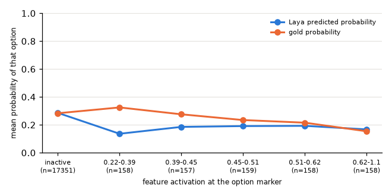

# Feature 1337

Critérios em que aparece: corr_error_stratified

**Interpretação (preencher):** 

---

## Maiores ativações

**tr_customer_service_000290 / action** (choice, customer_service) | ativação 2.715 em `estado` | opções ['answer_directly', 'close_no_action', 'escalate_to_human', 'execute_refund', 'request_information'] | Laya: **close_no_action** [0.242, 0.288, 0.216, 0.124, 0.129] | gabarito: **escalate_to_human**

```
[CLS]choice question: What should the assistant do next with this conversation?[SEP]
▸ [MASK] answer_directly: The assistant can resolve this itself with information it already has.
▸ [MASK] close_no_action: No further action is warranted; the matter is settled.
▸ [MASK] escalate_to_human: Hand off to a human agent with the appropriate authority.
▸ [MASK] execute_refund: Issue the refund or credit the customer is owed.
▸ [MASK] request_information: More detail is needed from the customer before anything can be done.

[SEP]

{"account": {"lifetime_value_usd": 2430, "prior_tickets_90d": 1, "seats": 1, "tenure_months": 60, "tier": "free"}, "thread": [{"role": "customer", "text": "I've been using this free plan for five years and it’s ridiculous that I still can't manage my team seats without the interface freezing, especially after I was told this was fixed in my last ticket."}, {"role": "agent", "text": "I'm sorry to hear you're still experiencing issues with seat assignments. Could you describe exactly what happens when you try to add a new team member?"}, {"role": "customer", "text": "The 'Invite' button just stays grayed out and the page stops responding, which is exactly the same problem I reported before that your team never actually resolved."}, {"role": "agent", "text": "I've located your previous ticket to review the history of this issue. To help me investigate, are you currently accessing the site through a desktop browser⟦ or⟧ the mobile app?"}, {"role": "customer", "text": "I'm on a desktop using the latest version of Chrome, and if this isn't handled correctly this time, I’m going to have to move our team to a different platform entirely."}]}[SEP]
```

**tr_customer_service_000290 / category** (choice, customer_service) | ativação 2.654 em `estado` | opções ['account', 'billing', 'delivery', 'refund', 'technical'] | Laya: **account** [0.361, 0.086, 0.054, 0.159, 0.339] | gabarito: **technical**

```
[CLS]choice question: What is this customer conversation primarily about?[SEP]
▸ [MASK] account: Login, plan changes, profile or access management.
▸ [MASK] billing: A charge, invoice, subscription or payment problem.
▸ [MASK] delivery: Shipping, fulfilment or delivery of a physical item.
▸ [MASK] refund: The customer is explicitly asking for money back.
▸ [MASK] technical: The product or service is not working as expected.

[SEP]

{"account": {"lifetime_value_usd": 2430, "prior_tickets_90d": 1, "seats": 1, "tenure_months": 60, "tier": "free"}, "thread": [{"role": "customer", "text": "I've been using this free plan for five years and it’s ridiculous that I still can't manage my team seats without the interface freezing, especially after I was told this was fixed in my last ticket."}, {"role": "agent", "text": "I'm sorry to hear you're still experiencing issues with seat assignments. Could you describe exactly what happens when you try to add a new team member?"}, {"role": "customer", "text": "The 'Invite' button just stays grayed out and the page stops responding, which is exactly the same problem I reported before that your team never actually resolved."}, {"role": "agent", "text": "I've located your previous ticket to review the history of this issue. To help me investigate, are you currently accessing the site through a desktop browser⟦ or⟧ the mobile app?"}, {"role": "customer", "text": "I'm on a desktop using the latest version of Chrome, and if this isn't handled correctly this time, I’m going to have to move our team to a different platform entirely."}]}[SEP]
```

**tr_customer_service_000290 / churn_risk** (score, customer_service) | ativação 2.615 em `estado` | opções ['0', '1', '2', '3'] | Laya: **2** [0.094, 0.211, 0.388, 0.306] | gabarito: **3**

```
[CLS]score question: How likely is this customer to stop doing business with us because of this interaction?[SEP]
▸ [MASK] level 0: No sign of dissatisfaction.
▸ [MASK] level 1: Mild frustration, but the relationship is intact.
▸ [MASK] level 2: Clearly unhappy; repeat problems or explicit complaints.
▸ [MASK] level 3: Imminent: threatening to cancel, dispute or leave.

[SEP]

{"account": {"lifetime_value_usd": 2430, "prior_tickets_90d": 1, "seats": 1, "tenure_months": 60, "tier": "free"}, "thread": [{"role": "customer", "text": "I've been using this free plan for five years and it’s ridiculous that I still can't manage my team seats without the interface freezing, especially after I was told this was fixed in my last ticket."}, {"role": "agent", "text": "I'm sorry to hear you're still experiencing issues with seat assignments. Could you describe exactly what happens when you try to add a new team member?"}, {"role": "customer", "text": "The 'Invite' button just stays grayed out and the page stops responding, which is exactly the same problem I reported before that your team never actually resolved."}, {"role": "agent", "text": "I've located your previous ticket to review the history of this issue. To help me investigate, are you currently accessing the site through a desktop browser⟦ or⟧ the mobile app?"}, {"role": "customer", "text": "I'm on a desktop using the latest version of Chrome, and if this isn't handled correctly this time, I’m going to have to move our team to a different platform entirely."}]}[SEP]
```

**tr_customer_service_000290 / urgency** (score, customer_service) | ativação 2.590 em `estado` | opções ['0', '1', '2', '3'] | Laya: **3** [0.206, 0.31, 0.152, 0.332] | gabarito: **2**

```
[CLS]score question: How time-sensitive is this conversation?[SEP]
▸ [MASK] level 0: No time pressure; can wait indefinitely.
▸ [MASK] level 1: Routine; handle within the normal queue.
▸ [MASK] level 2: Elevated; should be handled within the same week.
▸ [MASK] level 3: Critical; requires action within the same day.

[SEP]

{"account": {"lifetime_value_usd": 2430, "prior_tickets_90d": 1, "seats": 1, "tenure_months": 60, "tier": "free"}, "thread": [{"role": "customer", "text": "I've been using this free plan for five years and it’s ridiculous that I still can't manage my team seats without the interface freezing, especially after I was told this was fixed in my last ticket."}, {"role": "agent", "text": "I'm sorry to hear you're still experiencing issues with seat assignments. Could you describe exactly what happens when you try to add a new team member?"}, {"role": "customer", "text": "The 'Invite' button just stays grayed out and the page stops responding, which is exactly the same problem I reported before that your team never actually resolved."}, {"role": "agent", "text": "I've located your previous ticket to review the history of this issue. To help me investigate, are you currently accessing the site through a desktop browser⟦ or⟧ the mobile app?"}, {"role": "customer", "text": "I'm on a desktop using the latest version of Chrome, and if this isn't handled correctly this time, I’m going to have to move our team to a different platform entirely."}]}[SEP]
```

**tr_customer_service_000290 / needs_human** (noul, customer_service) | ativação 2.080 em `estado` | opções ['false', 'true'] | Laya: **true** [0.267, 0.733] | gabarito: **true**

```
[CLS]noul question: This conversation requires a human agent rather than automated handling.[SEP]
▸ [MASK] false: Automation can carry this to resolution.
▸ [MASK] true: A human must take over: judgement, authority or empathy is required.

[SEP]

{"account": {"lifetime_value_usd": 2430, "prior_tickets_90d": 1, "seats": 1, "tenure_months": 60, "tier": "free"}, "thread": [{"role": "customer", "text": "I've been using this free plan for five years and it’s ridiculous that I still can't manage my team seats without the interface freezing, especially after I was told this was fixed in my last ticket."}, {"role": "agent", "text": "I'm sorry to hear you're still experiencing issues with seat assignments. Could you describe exactly what happens when you try to add a new team member?"}, {"role": "customer", "text": "The 'Invite' button just stays grayed out and the page stops responding, which is exactly the same problem I reported before that your team never actually resolved."}, {"role": "agent", "text": "I've located your previous ticket to review the history of this issue. To help me investigate, are you currently accessing the site through a desktop browser⟦ or⟧ the mobile app?"}, {"role": "customer", "text": "I'm on a desktop using the latest version of Chrome, and if this isn't handled correctly this time, I’m going to have to move our team to a different platform entirely."}]}[SEP]
```

## Ativações medianas (faixa 40-60%, mediana 0.560)

**tr_security_incidents_000244 / disposition** (choice, security_incidents) | ativação 0.531 em `opção` | opções ['close_benign', 'contain', 'investigate', 'monitor'] | Laya: **monitor** [0.318, 0.153, 0.165, 0.363] | gabarito: **close_benign**

```
[CLS]choice question: How should this security alert be dispositioned?[SEP]
▸ [MASK] close_benign: Expected, explainable activity⟦;⟧ close without analyst time.
▸ [MASK] contain: Contain the host or account immediately; do not wait for triage.
▸ [MASK] investigate: Warrants an analyst opening an investigation.
▸ [MASK] monitor: Not clearly malicious, but worth watching for recurrence.

[SEP]

{"alert": {"description": "a session token was presented from a second address", "evidence": "The authentication system recorded a reuse of session token \"f1e2d3c4b5a6\" at 2026-09-16 08:41:12 UTC from IP 198.51.100.22 after the token had previously been used from IP 198.51.100.7; both source IPs are on the allowlist. The token was presented by the admin user \"admin_user@contoso.com\" (MFA enabled, unprivileged) and the account's credentials were last rotated 14 days prior.", "rule": "token_reuse"}, "context": {"asset_criticality": "crown_jewel", "change_window_active": false, "source_on_allowlist": true}, "history": {"credential_rotation_days_ago": 14, "distinct_countries_30d": 3, "logins_30d": 1356, "prior_alerts_90d": 0}, "principal": {"mfa_enrolled": true, "name": "adm-billing-855", "privileges": ["repo:read"], "type": "admin"}}[SEP]
```

**tr_customer_service_000006 / category** (choice, customer_service) | ativação 0.524 em `opção` | opções ['account', 'billing', 'delivery', 'refund', 'technical'] | Laya: **technical** [0.197, 0.107, 0.038, 0.114, 0.544] | gabarito: **technical**

```
[CLS]choice question: What is this customer conversation primarily about?[SEP]
▸ [MASK] account: Login, plan changes, profile or access management.
▸ [MASK] billing: A charge, invoice, subscription or payment problem⟦.⟧
▸ [MASK] delivery: Shipping, fulfilment or delivery of a physical item.
▸ [MASK] refund: The customer is explicitly asking for money back.
▸ [MASK] technical: The product or service is not working as expected.

[SEP]

{"account": {"lifetime_value_usd": 1556, "prior_tickets_90d": 0, "seats": 1, "tenure_months": 49, "tier": "standard"}, "orders": [{"amount_usd": 49, "date": "2026-01-27", "id": "A-87881", "status": "pending"}, {"amount_usd": 49, "date": "2026-01-07", "id": "A-73934", "status": "settled"}, {"amount_usd": 49, "date": "2026-03-13", "id": "A-93118", "status": "pending"}], "thread": [{"role": "customer", "text": "I've been a member for years and suddenly everything is taking forever to load, but I haven't changed my internet or anything, so I'm not sure what's going on."}, {"role": "agent", "text": "That sounds frustrating. To help me narrow this down, is the slowness happening across the whole site or just when you try to save your work?"}, {"role": "customer", "text": "It's everywhere, even the main dashboard is crawling, and I just don't know why it's behaving this way all of a sudden."}]}[SEP]
```

**tr_customer_service_000223 / category** (choice, customer_service) | ativação 0.516 em `opção` | opções ['account', 'billing', 'delivery', 'refund', 'technical'] | Laya: **refund** [0.232, 0.15, 0.083, 0.291, 0.244] | gabarito: **account**

```
[CLS]choice question: What is this customer conversation primarily about?[SEP]
▸ [MASK] account: Login, plan changes⟦,⟧ profile or access management.
▸ [MASK] billing: A charge, invoice, subscription or payment problem.
▸ [MASK] delivery: Shipping, fulfilment or delivery of a physical item.
▸ [MASK] refund: The customer is explicitly asking for money back.
▸ [MASK] technical: The product or service is not working as expected.

[SEP]

{"account": {"lifetime_value_usd": 1585, "prior_tickets_90d": 0, "seats": 1, "tenure_months": 26, "tier": "free"}, "orders": [{"amount_usd": 27, "date": "2026-02-25", "id": "A-40562", "status": "pending"}, {"amount_usd": 27, "date": "2026-02-03", "id": "A-21524", "status": "pending"}], "thread": [{"role": "customer", "text": "Hello, I’ve been a user for a long time but I would like to request the cancellation of my account. Could you please assist me with the process?"}, {"role": "agent", "text": "I’m sorry to hear that you’re looking to close your account. Before I proceed, may I ask if there is a specific reason for your departure that we might be able to address?"}, {"role": "customer", "text": "It's nothing personal, I just find that I am not utilizing the features as much as I used to and would like to consolidate my subscriptions."}, {"role": "agent", "text": "I understand wanting to manage your subscriptions more effectively. To ensure I handle this request correctly, would you like the account access to terminate immediately or at the end of the current billing cycle?"}, {"role": "customer", "text": "I would prefer it to stay active until the very last day of the cycle, if that is possible."}]}[SEP]
```

**tr_customer_service_000183 / action** (choice, customer_service) | ativação 0.534 em `estado` | opções ['answer_directly', 'close_no_action', 'escalate_to_human', 'execute_refund', 'request_information'] | Laya: **close_no_action** [0.221, 0.25, 0.174, 0.185, 0.169] | gabarito: **answer_directly**

```
[CLS]choice question: What should the assistant do next with this conversation?[SEP]
▸ [MASK] answer_directly: The assistant can resolve this itself with information it already has.
▸ [MASK] close_no_action: No further action is warranted; the matter is settled.
▸ [MASK] escalate_to_human: Hand off to a human agent with the appropriate authority.
▸ [MASK] execute_refund: Issue the refund or credit the customer is owed.
▸ [MASK] request_information: More detail is needed from the customer before anything can be done.

[SEP]

{"account": {"lifetime_value_usd": 455, "prior_tickets_90d": 0, "seats": 1, "tenure_months": 5⟦,⟧ "tier": "free"}, "orders": [{"amount_usd": 98, "date": "2026-03-24", "id": "A-16754", "status": "settled"}], "thread": [{"role": "customer", "text": "My payment just failed again and I have a hard deadline tomorrow to keep my account active – this is getting ridiculous."}, {"role": "agent", "text": "I’m really sorry you’re experiencing this. Could you tell me which payment method you’re trying to use?"}, {"role": "customer", "text": "I’m using the Visa ending in 4321. Every time I hit submit I get an error code 502 and the charge never goes through."}, {"role": "agent", "text": "Got it, thank you. Do you see any additional message on the screen besides the error code, like a declined notice or a timeout?"}, {"role": "customer", "text": "Just the generic “payment could not be processed” line. I need a solution right now, otherwise my free‑plan account will be suspended."}, {"role": "agent", "text": "I understand the urgency. Do you have an alternative payment option available, such as a different card or PayPal?"}, {"role": "customer", "text": "Yes, I have a PayPal account I can use. How do I switch to that quickly?"}]}[SEP]
```

**tr_customer_service_000205 / urgency** (score, customer_service) | ativação 0.587 em `estado` | opções ['0', '1', '2', '3'] | Laya: **1** [0.081, 0.586, 0.172, 0.161] | gabarito: **2**

```
[CLS]score question: How time-sensitive is this conversation?[SEP]
▸ [MASK] level 0: No time pressure; can wait indefinitely.
▸ [MASK] level 1: Routine; handle within the normal queue.
▸ [MASK] level 2: Elevated; should be handled within the same week.
▸ [MASK] level 3: Critical; requires action within the same day.

[SEP]

{"account": {"lifetime_value_usd": 264, "prior_tickets_90d": 5,⟦ "⟧seats": 1, "tenure_months": 3, "tier": "free"}, "orders": [{"amount_usd": 897, "date": "2026-02-17", "id": "A-64161", "status": "refunded"}, {"amount_usd": 897, "date": "2026-02-28", "id": "A-55118", "status": "settled"}], "thread": [{"role": "customer", "text": "I'm looking for the invoice for the $897 charge again. It isn't in my inbox or the dashboard, which seems to happen every time there is a billing cycle."}, {"role": "agent", "text": "I understand you're looking for a missing invoice. To ensure I'm looking at the right record, could you confirm the date the transaction appeared on your statement?"}, {"role": "customer", "text": "It was processed on the 12th. This is the fifth time I've had to reach out for the same basic document, and I just don't know why the automated system won't send it to me."}, {"role": "agent", "text": "I see the history of your previous inquiries regarding this. When you check your billing tab, does the invoice show as 'Paid' or is the entry missing entirely from the list?"}, {"role": "customer", "text": "The entry is there and says paid, but when I click the link to download the PDF, it just opens a blank page and nothing happens."}]}[SEP]
```

## Estatísticas (conjunto de descoberta, dev e teste)

**pred / error**

| split | decisões | ativas | ativas e Laya errou | taxa | lift | q (BH) | OR (CMH) | q (CMH) |
|---|---|---|---|---|---|---|---|---|
| discovery | 5100 | 100 | 76 | 0.760 | 1.19 | 0.0204 | 1.86 | 0.164 |
| dev | 900 | 21 | 19 | 0.905 | 1.38 | 0.0907 | 4.57 | 0.275 |
| test | 2000 | 43 | 33 | 0.767 | 1.20 | 0.151 | 1.95 | 0.518 |

**corr / error**

| split | decisões | ativas | ativas e Laya errou | taxa | lift | q (BH) | OR (CMH) | q (CMH) |
|---|---|---|---|---|---|---|---|---|
| discovery | 5100 | 197 | 173 | 0.878 | 1.38 | 4.42e-14 | 7.23 | 0.000574 |
| dev | 900 | 35 | 33 | 0.943 | 1.44 | 0.000281 | 1.49 | 0.851 |
| test | 2000 | 81 | 71 | 0.877 | 1.38 | 3.93e-06 | 2.26 | 0.445 |

**state / error**

| split | decisões | ativas | ativas e Laya errou | taxa | lift | q (BH) | OR (CMH) | q (CMH) |
|---|---|---|---|---|---|---|---|---|
| discovery | 5100 | 2359 | 1494 | 0.633 | 1.00 | 0.907 | 1.14 | 0.12 |
| dev | 900 | 392 | 261 | 0.666 | 1.01 | 1 | 1.24 | 0.446 |
| test | 2000 | 949 | 593 | 0.625 | 0.98 | 0.786 | 1.09 | 0.637 |

Confusão mais sobre-representada (pred): `disposition|0>2` (n=27, lift 5.76, p=2.83e-14). Formato `pergunta|índice previsto>índice correto`.

Confusão mais sobre-representada (corr): `urgency|1>3` (n=43, lift 3.81, p=4.34e-15). Formato `pergunta|índice previsto>índice correto`.

Confusão mais sobre-representada (state): `outcome|0>1` (n=55, lift 2.09, p=1.32e-16). Formato `pergunta|índice previsto>índice correto`.



