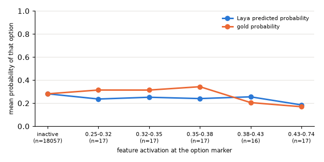

# Feature 1377

Critérios em que aparece: corr_error

**Interpretação (preencher):** 

---

## Maiores ativações

**tr_security_incidents_000280 / disposition** (choice, security_incidents) | ativação 4.125 em `estado` | opções ['close_benign', 'contain', 'investigate', 'monitor'] | Laya: **monitor** [0.333, 0.211, 0.121, 0.335] | gabarito: **monitor**

```
[CLS]choice question: How should this security alert be dispositioned?[SEP]
▸ [MASK] close_benign: Expected, explainable activity; close without analyst time.
▸ [MASK] contain: Contain the host or account immediately; do not wait for triage.
▸ [MASK] investigate: Warrants an analyst opening an investigation.
▸ [MASK] monitor: Not clearly malicious, but worth watching for recurrence.

[SEP]

{"alert": {"description": "a session token was presented from a second address", "evidence": "Session token \"f9d2a1c3\" associated with shared_mailbox@example.com was first used from IP 198.51.100.22 at 2026-09-16 02:11 UTC and then presented again from IP 198.⟦51⟧.100.55 at 2026-09-16 02:13 UTC. Both source IPs are on the allowlist; the token holder's credentials were last rotated 412 days ago and no change window was active.", "rule": "token_reuse"}, "context": {"asset_criticality": "low", "change_window_active": false, "source_on_allowlist": true}, "history": {"credential_rotation_days_ago": 412, "distinct_countries_30d": 4, "logins_30d": 1529, "prior_alerts_90d": 3}, "principal": {"mfa_enrolled": true, "name": "ci-analytics-679", "privileges": ["repo:read"], "type": "shared_mailbox"}}[SEP]
```

**tr_security_incidents_000280 / credential_compromise** (noul, security_incidents) | ativação 4.082 em `estado` | opções ['false', 'true'] | Laya: **true** [0.089, 0.911] | gabarito: **false**

```
[CLS]noul question: The evidence indicates a credential or account has been compromised.[SEP]
▸ [MASK] false: no, the statement does not hold
▸ [MASK] true: yes, the statement holds

[SEP]

{"alert": {"description": "a session token was presented from a second address", "evidence": "Session token \"f9d2a1c3\" associated with shared_mailbox@example.com was first used from IP 198.51.100.22 at 2026-09-16 02:11 UTC and then presented again from IP 198.⟦51⟧.100.55 at 2026-09-16 02:13 UTC. Both source IPs are on the allowlist; the token holder's credentials were last rotated 412 days ago and no change window was active.", "rule": "token_reuse"}, "context": {"asset_criticality": "low", "change_window_active": false, "source_on_allowlist": true}, "history": {"credential_rotation_days_ago": 412, "distinct_countries_30d": 4, "logins_30d": 1529, "prior_alerts_90d": 3}, "principal": {"mfa_enrolled": true, "name": "ci-analytics-679", "privileges": ["repo:read"], "type": "shared_mailbox"}}[SEP]
```

**tr_security_incidents_000280 / true_positive** (noul, security_incidents) | ativação 3.895 em `estado` | opções ['false', 'true'] | Laya: **false** [0.67, 0.33] | gabarito: **false**

```
[CLS]noul question: This alert reflects genuinely malicious or unauthorised activity.[SEP]
▸ [MASK] false: Benign activity, a misconfiguration, or a known false positive.
▸ [MASK] true: The underlying behaviour is malicious or unauthorised.

[SEP]

{"alert": {"description": "a session token was presented from a second address", "evidence": "Session token \"f9d2a1c3\" associated with shared_mailbox@example.com was first used from IP 198.51.100.22 at 2026-09-16 02:11 UTC and then presented again from IP 198.⟦51⟧.100.55 at 2026-09-16 02:13 UTC. Both source IPs are on the allowlist; the token holder's credentials were last rotated 412 days ago and no change window was active.", "rule": "token_reuse"}, "context": {"asset_criticality": "low", "change_window_active": false, "source_on_allowlist": true}, "history": {"credential_rotation_days_ago": 412, "distinct_countries_30d": 4, "logins_30d": 1529, "prior_alerts_90d": 3}, "principal": {"mfa_enrolled": true, "name": "ci-analytics-679", "privileges": ["repo:read"], "type": "shared_mailbox"}}[SEP]
```

**tr_security_incidents_000280 / urgency** (score, security_incidents) | ativação 3.512 em `estado` | opções ['0', '1', '2', '3'] | Laya: **1** [0.108, 0.624, 0.149, 0.12] | gabarito: **1**

```
[CLS]score question: How quickly must a responder act on this alert?[SEP]
▸ [MASK] level 0: No time pressure; can wait indefinitely.
▸ [MASK] level 1: Routine; handle within the normal queue.
▸ [MASK] level 2: Elevated; should be handled within the same week.
▸ [MASK] level 3: Critical; requires action within the same day.

[SEP]

{"alert": {"description": "a session token was presented from a second address", "evidence": "Session token \"f9d2a1c3\" associated with shared_mailbox@example.com was first used from IP 198.51.100.22 at 2026-09-16 02:11 UTC and then presented again from IP 198.51.100.55 at 2026-09-⟦16⟧ 02:13 UTC. Both source IPs are on the allowlist; the token holder's credentials were last rotated 412 days ago and no change window was active.", "rule": "token_reuse"}, "context": {"asset_criticality": "low", "change_window_active": false, "source_on_allowlist": true}, "history": {"credential_rotation_days_ago": 412, "distinct_countries_30d": 4, "logins_30d": 1529, "prior_alerts_90d": 3}, "principal": {"mfa_enrolled": true, "name": "ci-analytics-679", "privileges": ["repo:read"], "type": "shared_mailbox"}}[SEP]
```

**tr_security_incidents_000280 / severity** (score, security_incidents) | ativação 3.426 em `estado` | opções ['0', '1', '2', '3', '4'] | Laya: **1** [0.033, 0.423, 0.332, 0.173, 0.039] | gabarito: **1**

```
[CLS]score question: How severe is the potential impact if this alert is real?[SEP]
▸ [MASK] level 0: Negligible: no access to anything sensitive.
▸ [MASK] level 1: Low: limited access, easily reversed.
▸ [MASK] level 2: Moderate: access to internal systems or non-public data.
▸ [MASK] level 3: High: access to production, secrets or customer data.
▸ [MASK] level 4: Critical: active compromise of crown-jewel systems.

[SEP]

{"alert": {"description": "a session token was presented from a second address", "evidence": "Session token \"f9d2a1c3\" associated with shared_mailbox@example.com was first used from IP 198.51.100.22 at 2026-09-16 02:11 UTC and then presented again from IP 198.51.100.55 at 2026-09-⟦16⟧ 02:13 UTC. Both source IPs are on the allowlist; the token holder's credentials were last rotated 412 days ago and no change window was active.", "rule": "token_reuse"}, "context": {"asset_criticality": "low", "change_window_active": false, "source_on_allowlist": true}, "history": {"credential_rotation_days_ago": 412, "distinct_countries_30d": 4, "logins_30d": 1529, "prior_alerts_90d": 3}, "principal": {"mfa_enrolled": true, "name": "ci-analytics-679", "privileges": ["repo:read"], "type": "shared_mailbox"}}[SEP]
```

## Ativações medianas (faixa 40-60%, mediana 0.729)

**tr_security_incidents_000042 / true_positive** (noul, security_incidents) | ativação 0.789 em `estado` | opções ['false', 'true'] | Laya: **false** [0.731, 0.269] | gabarito: **false**

```
[CLS]noul question: This alert reflects genuinely malicious or unauthorised activity.[SEP]
▸ [MASK] false: Benign activity, a misconfiguration, or a known false positive.
▸ [MASK] true: The underlying behaviour is malicious or unauthorised.

[SEP]

{"alert": {"description": "many failed authentications followed by a success", "evidence": "Between 02:13:05 and 02:14:57 UTC on 2026‑09‑15, 27 failed login attempts were recorded for the admin account \"alice_admin\" from source IP 198.51.100.23, followed by a successful authentication at 02:15:12 using MFA. The source IP is listed in the allowed‑list, the account’s password was last rotated on 2026‑08‑16 (30 days ago), and a change window was active at the time of the events.", "rule": "brute_force"}, "context": {"asset_criticality": "medium", "change_window_active": true, "source_on_allowlist": true}, "history": {"credential_rotation_days_ago": 30, "distinct_countries_30d": 4, "logins_30d": 1098, "prior_alerts_90d": 1}, "principal": {"mfa_enrolled": true, "name": "adm-billing-243", "⟦priv⟧ileges": ["deploy:production", "secrets:read"], "type": "admin"}}[SEP]
```

**tr_invoice_processing_000128 / duplicate** (noul, invoice_processing) | ativação 0.722 em `estado` | opções ['false', 'true'] | Laya: **true** [0.3, 0.7] | gabarito: **false**

```
[CLS]noul question: This invoice appears to duplicate an invoice already submitted.[SEP]
▸ [MASK] false: no, the statement does not hold
▸ [MASK] true: yes, the statement holds

[SEP]

{"delivery": {"condition": "accepted", "date": "2026-03-03", "received_qty": 10}, "invoice": {"currency": "USD", "id": "INV-2026-1573", "lines": [{"qty": 10, "sku": "SKU-688", "total_usd": 4081.5, "unit_usd": 408.15}], "total⟦_⟧usd": 4081.5, "vendor": "Acme Fabrication"}, "payment": {"days_until_due": -9, "discount_expires_in_days": null, "early_payment_discount_pct": null, "status": "overdue", "terms": "net 45"}, "purchase_order": {"freight_terms": "freight prepaid by vendor, not separately billable", "id": "PO-6996", "lines": [{"qty": 10, "unit_usd": 408.15}], "total_usd": 4081.5}, "vendor_history": {"disputes_12m": 0, "invoices_12m": 27, "prior_invoice_ids": ["INV-2026-1107", "INV-2026-4586", "INV-2026-5918"]}}[SEP]
```

**tr_security_incidents_000267 / disposition** (choice, security_incidents) | ativação 0.787 em `estado` | opções ['close_benign', 'contain', 'investigate', 'monitor'] | Laya: **close_benign** [0.388, 0.256, 0.187, 0.169] | gabarito: **investigate**

```
[CLS]choice question: How should this security alert be dispositioned?[SEP]
▸ [MASK] close_benign: Expected, explainable activity; close without analyst time.
▸ [MASK] contain: Contain the host or account immediately; do not wait for triage.
▸ [MASK] investigate: Warrants an analyst opening an investigation.
▸ [MASK] monitor: Not clearly malicious, but worth watching for recurrence.

[SEP]

{"alert": {"description": "an unrecognised binary executed on a server", "evidence": "At 2026-09-16 01:45:12 UTC, an executable located at /usr/local/bin/unknown_service (SHA256 = 3f7a9c2e…) was launched on server 172.16.45.22. The process was started by the admin account \"admin1\" under an MFA‑authenticated session, and the account’s credentials were last rotated on 2026-09-13.", "rule": "suspicious_process"}, "context": {"asset_criticality": "medium", "change_window_active": false, "source_on_allowlist": true}, "history": {"credential_rotation_days_ago": 3, "distinct_countries_30d": 4, "logins_30d": 1334, "prior_alerts_90d": 1}, "principal": {"mfa_enrolled": true, "name": "adm-deploy-493", "⟦priv⟧ileges": ["deploy:production", "secrets:read"], "type": "admin"}}[SEP]
```

**tr_customer_service_000291 / action** (choice, customer_service) | ativação 0.762 em `estado` | opções ['answer_directly', 'close_no_action', 'escalate_to_human', 'execute_refund', 'request_information'] | Laya: **close_no_action** [0.26, 0.336, 0.065, 0.054, 0.285] | gabarito: **escalate_to_human**

```
[CLS]choice question: What should the assistant do next with this conversation?[SEP]
▸ [MASK] answer_directly: The assistant can resolve this itself with information it already has.
▸ [MASK] close_no_action: No further action is warranted; the matter is settled.
▸ [MASK] escalate_to_human: Hand off to a human agent with the appropriate authority.
▸ [MASK] execute_refund: Issue the refund or credit the customer is owed.
▸ [MASK] request_information: More detail is needed from the customer before anything can be done.

[SEP]

{"account": {"lifetime_value_usd": 403, "prior_tickets_90d": 1, "seats": 1, "tenure_months": 5, "tier": "standard"}, "thread": [{"role": "customer", "text": "My recent order, number 992-BX, has not arrived by the scheduled date of Tuesday and the tracking hasn't updated."}, {"role": "agent", "text": "I can look into that for you. Could you please provide the email address associated with your standard plan account?"}, {"role": "customer", "text": "The email is j.smith@example.com. I'm checking back because when I had a delay last month, the ticket was only partially addressed and I still haven't seen the full resolution."}, {"⟦role⟧": "agent", "text": "I see that prior ticket in our records. To help me narrow this down, has the tracking status changed at all in the last 24 hours?"}, {"role": "customer", "text": "The tracking has stayed at 'Processing' since Monday morning, so I would like to know the current location of the package."}]}[SEP]
```

**tr_invoice_processing_000132 / matches_order** (noul, invoice_processing) | ativação 0.785 em `estado` | opções ['false', 'true'] | Laya: **true** [0.493, 0.507] | gabarito: **true**

```
[CLS]noul question: The invoice reconciles with the purchase order and the recorded delivery.[SEP]
▸ [MASK] false: There is a discrepancy against the order or the delivery.
▸ [MASK] true: Line items, quantities and amounts reconcile.

[SEP]

{"delivery": {"condition": "accepted", "date": "2026-03-01", "received_qty": 400}, "invoice": {"currency": "USD", "id": "INV-2026-1617", "lines": [{"qty": 400, "sku": "SKU-194", "total_usd": 157176.0, "⟦unit⟧_usd": 392.94}], "total_usd": 157176.0, "vendor": "Northwind Components"}, "payment": {"days_until_due": 18, "discount_expires_in_days": null, "early_payment_discount_pct": null, "status": "scheduled", "terms": "net 30"}, "purchase_order": {"freight_terms": "freight prepaid by vendor, not separately billable", "id": null, "lines": [{"qty": 400, "unit_usd": 392.94}], "total_usd": 157176.0}, "vendor_history": {"disputes_12m": 2, "invoices_12m": 31, "prior_invoice_ids": ["INV-2026-2668"]}}[SEP]
```

## Estatísticas (conjunto de descoberta, dev e teste)

**pred / error**

| split | decisões | ativas | ativas e Laya errou | taxa | lift | q (BH) | OR (CMH) | q (CMH) |
|---|---|---|---|---|---|---|---|---|
| discovery | 5100 | 1 | 1 | 1.000 | 1.57 | nan | nan | nan |
| dev | 900 | 0 | 0 | nan | nan | nan | nan | nan |
| test | 2000 | 1 | 0 | 0.000 | 0.00 | nan | nan | nan |

**corr / error**

| split | decisões | ativas | ativas e Laya errou | taxa | lift | q (BH) | OR (CMH) | q (CMH) |
|---|---|---|---|---|---|---|---|---|
| discovery | 5100 | 24 | 24 | 1.000 | 1.57 | 6.33e-05 | inf | 0.511 |
| dev | 900 | 3 | 3 | 1.000 | 1.52 | nan | nan | nan |
| test | 2000 | 9 | 8 | 0.889 | 1.40 | nan | nan | nan |

**state / error**

| split | decisões | ativas | ativas e Laya errou | taxa | lift | q (BH) | OR (CMH) | q (CMH) |
|---|---|---|---|---|---|---|---|---|
| discovery | 5100 | 1805 | 1140 | 0.632 | 0.99 | 0.862 | 0.86 | 0.0949 |
| dev | 900 | 358 | 226 | 0.631 | 0.96 | 0.993 | 0.64 | 0.0937 |
| test | 2000 | 659 | 420 | 0.637 | 1.00 | 1 | 0.83 | 0.307 |

Confusão mais sobre-representada (pred): `action|1>0` (n=1, lift 124.39, p=nan). Formato `pergunta|índice previsto>índice correto`.

Confusão mais sobre-representada (corr): `action|0>2` (n=23, lift 44.03, p=1.25e-38). Formato `pergunta|índice previsto>índice correto`.

Confusão mais sobre-representada (state): `duplicate|1>0` (n=186, lift 2.43, p=0). Formato `pergunta|índice previsto>índice correto`.



