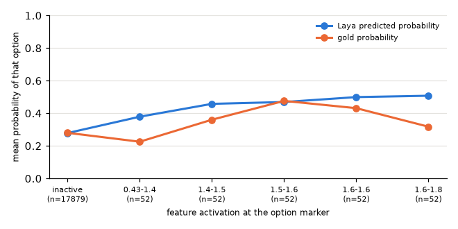

# Feature 1487

Critérios em que aparece: attribution_toward_wrong

**Interpretação (preencher):** 

---

## Maiores ativações

**tr_invoice_processing_000141 / duplicate** (noul, invoice_processing) | ativação 4.418 em `estado` | opções ['false', 'true'] | Laya: **true** [0.172, 0.828] | gabarito: **false**

```
[CLS]noul question: This invoice appears to duplicate an invoice already submitted.[SEP]
▸ [MASK] false: no, the statement does not hold
▸ [MASK] true: yes, the statement holds

[SEP]

{"delivery": {"condition": "accepted", "date": "2026-03-04", "received_qty": 400}, "invoice": {"currency": "USD", "id": "INV-2026-9876", "lines": [{"qty": 400, "sku": "SKU-665", "total_usd": 40408.0, "unit_usd": 101.02}, {"qty": 1, "sku": "FREIGHT", "total_usd": 1975.55, "unit_usd": 1975.55}], "total_usd": 42383.55, "vendor": "Kestrel Supply"}, "payment": {"days_until_due": -9, "discount_expires_in_days": null, "early_payment⟦_⟧discount_pct": null, "status": "overdue", "terms": "net 60"}, "purchase_order": {"freight_terms": "freight prepaid by vendor, not separately billable", "id": "PO-5110", "lines": [{"qty": 400, "unit_usd": 101.02}], "total_usd": 40408.0}, "vendor_history": {"disputes_12m": 0, "invoices_12m": 12, "prior_invoice_ids": ["INV-2026-3144", "INV-2026-2282", "INV-2026-7894", "INV-2026-6333"]}}[SEP]
```

**tr_invoice_processing_000141 / duplicate** (noul, invoice_processing) | ativação 4.070 em `estado` | opções ['false', 'true'] | Laya: **true** [0.172, 0.828] | gabarito: **false**

```
[CLS]noul question: This invoice appears to duplicate an invoice already submitted.[SEP]
▸ [MASK] false: no, the statement does not hold
▸ [MASK] true: yes, the statement holds

[SEP]

{"delivery": {"condition": "accepted", "date": "2026-03-04", "received_qty": 400}, "invoice": {"currency": "USD", "id": "INV-2026-9876", "lines": [{"qty": 400, "sku": "SKU-665", "total_usd": 40408.0, "unit_usd": 101.02}, {"qty": 1, "sku": "FREIGHT", "total_usd": 1975.55, "unit_usd": 1975.55}], "total_usd": 42383.55, "vendor": "Kestrel Supply"}, "payment": {"days_until_due": -9, "discount_expires_in_days": null, "early⟦_⟧payment_discount_pct": null, "status": "overdue", "terms": "net 60"}, "purchase_order": {"freight_terms": "freight prepaid by vendor, not separately billable", "id": "PO-5110", "lines": [{"qty": 400, "unit_usd": 101.02}], "total_usd": 40408.0}, "vendor_history": {"disputes_12m": 0, "invoices_12m": 12, "prior_invoice_ids": ["INV-2026-3144", "INV-2026-2282", "INV-2026-7894", "INV-2026-6333"]}}[SEP]
```

**tr_invoice_processing_000286 / matches_order** (noul, invoice_processing) | ativação 4.008 em `estado` | opções ['false', 'true'] | Laya: **true** [0.492, 0.508] | gabarito: **false**

```
[CLS]noul question: The invoice reconciles with the purchase order and the recorded delivery.[SEP]
▸ [MASK] false: There is a discrepancy against the order or the delivery.
▸ [MASK] true: Line items, quantities and amounts reconcile.

[SEP]

{"delivery": {"condition": "accepted", "date": "2026-03-01", "received_qty": 250}, "invoice": {"currency": "USD", "id": "INV-2026-8786", "lines": [{"qty": 250, "sku": "SKU-448", "total_usd": 7165.0, "unit_usd": 28.66}, {"qty": 1, "sku": "FREIGHT", "total_usd": 401.46, "unit_usd": 401.46}], "total_usd": 7566.46, "vendor": "Northwind Components"}, "payment": {"days_until_due": 2, "discount_expires⟦_⟧in_days": 1, "early_payment_discount_pct": 2.0, "status": "scheduled", "terms": "net 60"}, "purchase_order": {"freight_terms": "freight prepaid by vendor, not separately billable", "id": "PO-7457", "lines": [{"qty": 250, "unit_usd": 28.66}], "total_usd": 7165.0}, "vendor_history": {"disputes_12m": 0, "invoices_12m": 13, "prior_invoice_ids": ["INV-2026-4234", "INV-2026-5783", "INV-2026-1864"]}}[SEP]
```

**tr_invoice_processing_000141 / duplicate** (noul, invoice_processing) | ativação 3.908 em `estado` | opções ['false', 'true'] | Laya: **true** [0.172, 0.828] | gabarito: **false**

```
[CLS]noul question: This invoice appears to duplicate an invoice already submitted.[SEP]
▸ [MASK] false: no, the statement does not hold
▸ [MASK] true: yes, the statement holds

[SEP]

{"delivery": {"condition": "accepted", "date": "2026-03-04", "received_qty": 400}, "invoice": {"currency": "USD", "id": "INV-2026-9876", "lines": [{"qty": 400, "sku": "SKU-665", "total_usd": 40408.0, "unit_usd": 101.02}, {"qty": 1, "sku": "FREIGHT", "total_usd": 1975.55, "unit_usd": 1975.55}], "total_usd": 42383.55, "vendor": "Kestrel Supply"}, "payment": {"days_until_due": -9, "discount_expires⟦_⟧in_days": null, "early_payment_discount_pct": null, "status": "overdue", "terms": "net 60"}, "purchase_order": {"freight_terms": "freight prepaid by vendor, not separately billable", "id": "PO-5110", "lines": [{"qty": 400, "unit_usd": 101.02}], "total_usd": 40408.0}, "vendor_history": {"disputes_12m": 0, "invoices_12m": 12, "prior_invoice_ids": ["INV-2026-3144", "INV-2026-2282", "INV-2026-7894", "INV-2026-6333"]}}[SEP]
```

**tr_invoice_processing_000147 / matches_order** (noul, invoice_processing) | ativação 3.891 em `estado` | opções ['false', 'true'] | Laya: **true** [0.491, 0.509] | gabarito: **false**

```
[CLS]noul question: The invoice reconciles with the purchase order and the recorded delivery.[SEP]
▸ [MASK] false: There is a discrepancy against the order or the delivery.
▸ [MASK] true: Line items, quantities and amounts reconcile.

[SEP]

{"delivery": {"condition": "accepted", "date": "2026-03-01", "received_qty": 10}, "invoice": {"currency": "USD", "id": "INV-2026-5821", "lines": [{"qty": 10, "sku": "SKU-582", "total_usd": 1289.7, "unit_usd": 128.97}, {"qty": 1, "sku": "FREIGHT", "total_usd": 789.37, "unit_usd": 789.37}], "total_usd": 2079.07, "vendor": "Orbit Logistics"}, "payment": {"days_until_due": 11, "discount_expires⟦_⟧in_days": null, "early_payment_discount_pct": null, "status": "scheduled", "terms": "net 45"}, "purchase_order": {"freight_terms": "freight prepaid by vendor, not separately billable", "id": "PO-6078", "lines": [{"qty": 10, "unit_usd": 128.97}], "total_usd": 1289.7}, "vendor_history": {"disputes_12m": 0, "invoices_12m": 17, "prior_invoice_ids": ["INV-2026-8531", "INV-2026-5603", "INV-2026-2834", "INV-2026-2338"]}}[SEP]
```

## Ativações medianas (faixa 40-60%, mediana 0.739)

**tr_invoice_processing_000275 / urgency** (score, invoice_processing) | ativação 0.756 em `estado` | opções ['0', '1', '2', '3'] | Laya: **1** [0.216, 0.512, 0.167, 0.105] | gabarito: **2**

```
[CLS]score question: How time-sensitive is processing this invoice?[SEP]
▸ [MASK] level 0: No time pressure; can wait indefinitely.
▸ [MASK] level 1: Routine; handle within the normal queue.
▸ [MASK] level 2: Elevated; should be handled within the same week.
▸ [MASK] level 3: Critical; requires action within the same day.

[SEP]

{"delivery": {"condition": "accepted", "date": "2026-03-18", "received⟦_⟧qty": 10}, "invoice": {"currency": "USD", "id": "INV-2026-9822", "lines": [{"qty": 30, "sku": "SKU-895", "total_usd": 4659.9, "unit_usd": 155.33}], "total_usd": 4659.9, "vendor": "Orbit Logistics"}, "payment": {"days_until_due": 18, "discount_expires_in_days": null, "early_payment_discount_pct": null, "status": "scheduled", "terms": "net 45"}, "purchase_order": {"freight_terms": "freight prepaid by vendor, not separately billable", "id": "PO-1770", "lines": [{"qty": 10, "unit_usd": 155.33}], "total_usd": 1553.3}, "vendor_history": {"disputes_12m": 0, "invoices_12m": 30, "prior_invoice_ids": ["INV-2026-8011", "INV-2026-6467", "INV-2026-9516", "INV-2026-3771"]}}[SEP]
```

**tr_invoice_processing_000289 / urgency** (score, invoice_processing) | ativação 0.848 em `estado` | opções ['0', '1', '2', '3'] | Laya: **1** [0.185, 0.565, 0.14, 0.11] | gabarito: **2**

```
[CLS]score question: How time-sensitive is processing this invoice?[SEP]
▸ [MASK] level 0: No time pressure; can wait indefinitely.
▸ [MASK] level 1: Routine; handle within the normal queue.
▸ [MASK] level 2: Elevated; should be handled within the same week.
▸ [MASK] level 3: Critical; requires action within the same day.

[SEP]

{"delivery": {"condition": "accepted with exceptions", "date": "2026-03-27", "received_qty": 100}, "invoice":⟦ {"⟧currency": "USD", "id": "INV-2026-8801", "lines": [{"qty": 100, "sku": "SKU-986", "total_usd": 27049.0, "unit_usd": 270.49}], "total_usd": 27049.0, "vendor": "Orbit Logistics"}, "payment": {"days_until_due": 18, "discount_expires_in_days": 4, "early_payment_discount_pct": 2.0, "status": "scheduled", "terms": "net 30"}, "purchase_order": {"freight_terms": "freight prepaid by vendor, not separately billable", "id": "PO-5260", "lines": [{"qty": 100, "unit_usd": 270.49}], "total_usd": 27049.0}, "vendor_history": {"disputes_12m": 5, "invoices_12m": 52, "prior_invoice_ids": ["INV-2026-2893", "INV-2026-9152", "INV-2026-3271", "INV-2026-5562"]}}[SEP]
```

**tr_security_incidents_000191 / true_positive** (noul, security_incidents) | ativação 0.812 em `estado` | opções ['false', 'true'] | Laya: **true** [0.467, 0.533] | gabarito: **true**

```
[CLS]noul question: This alert reflects genuinely malicious or unauthorised activity.[SEP]
▸ [MASK] false: Benign activity, a misconfiguration, or a known false positive.
▸ [MASK] true: The underlying behaviour is malicious or unauthorised.

[SEP]

{"alert": {"description": "an unrecognised binary executed on a server", "evidence": "A binary named \"/tmp/xdg-setup\" was launched on host \"mail-srv-03\" at 2026-09-15 05:48:03 UTC under the shared_mailbox user, which has MFA enabled. The file’s SHA256 hash is a1b2c3d4e5f6… and it was fetched from source IP 192.0.2.55.", "rule": "suspicious_process"}, "context": {"asset_criticality": "low", "change_window_active": false, "source_on_allowlist": false}, "history": {"credential_rotation_days_ago": 3, "distinct_countries_30d": 2, "logins_30d": 1521, "prior_alert⟦s⟧_90d": 1}, "principal": {"mfa_enrolled": true, "name": "adm-analytics-202", "privileges": ["repo:read"], "type": "shared_mailbox"}}[SEP]
```

**tr_security_incidents_000206 / severity** (score, security_incidents) | ativação 0.780 em `estado` | opções ['0', '1', '2', '3', '4'] | Laya: **2** [0.03, 0.184, 0.433, 0.305, 0.047] | gabarito: **2**

```
[CLS]score question: How severe is the potential impact if this alert is real?[SEP]
▸ [MASK] level 0: Negligible: no access to anything sensitive.
▸ [MASK] level 1: Low: limited access, easily reversed.
▸ [MASK] level 2: Moderate: access to internal systems or non-public data.
▸ [MASK] level 3: High: access to production, secrets or customer data.
▸ [MASK] level 4: Critical: active compromise of crown-jewel systems.

[SEP]

{"alert": {"description": "a large transfer to an external destination", "evidence": "A data transfer of 4.8 TB was observed at 2026-09-16 08:15:02 UTC from the internal server DB‑APP-01 to external IP 52.23.45.67, which is on the allow‑list for outbound connections. The operation was initiated by an admin account (privileged) that successfully completed MFA and whose password was rotated on 2026-09-13. No change window was specified for this activity.", "rule": "data_egress"}, "context": {"asset_criticality": "low", "change_window_active": false, "source⟦_⟧on_allowlist": true}, "history": {"credential_rotation_days_ago": 3, "distinct_countries_30d": 1, "logins_30d": 722, "prior_alerts_90d": 0}, "principal": {"mfa_enrolled": true, "name": "svc-support-965", "privileges": ["deploy:production", "secrets:read"], "type": "admin"}}[SEP]
```

**tr_invoice_processing_000284 / duplicate** (noul, invoice_processing) | ativação 0.704 em `estado` | opções ['false', 'true'] | Laya: **true** [0.163, 0.837] | gabarito: **false**

```
[CLS]noul question: This invoice appears to duplicate an invoice already submitted.[SEP]
▸ [MASK] false: no, the statement does not hold
▸ [MASK] true: yes, the statement holds

[SEP]

{"delivery": {"condition": "accepted", "date": "2026-03-20", "received_qty": 1000}, "invoice": {"currency": "USD", "id": "INV-2026-7786", "lines": [{"qty": 1000, "sku": "SKU-874", "total_usd": 320730.0, "unit_usd": 320.73}], "total_usd": 320730.0, "vendor": "Kestrel Supply"}, "payment": {"days_until_due": 11, "discount_expires_in_days": null, "early_payment_discount_pct": null, "status": "scheduled", "terms": "net 15"}, "purchase_order": {"freight_terms": "freight prepaid by vendor, not separately billable", "id": "PO-7733", "lines": [{"qty": 1000, "unit_usd": 320.73}], "total_usd": 320730.0}, "vendor_history": {"disputes_12m": 1, "invoices_12m": 31, "prior_invoice⟦_⟧ids": ["INV-2026-3295", "INV-2026-5889", "INV-2026-7594"]}}[SEP]
```

## Estatísticas (conjunto de descoberta, dev e teste)

**pred / error**

| split | decisões | ativas | ativas e Laya errou | taxa | lift | q (BH) | OR (CMH) | q (CMH) |
|---|---|---|---|---|---|---|---|---|
| discovery | 5100 | 247 | 151 | 0.611 | 0.96 | 0.525 | 0.17 | 2.7e-11 |
| dev | 900 | 61 | 38 | 0.623 | 0.95 | 0.87 | 0.22 | 0.0854 |
| test | 2000 | 95 | 51 | 0.537 | 0.84 | 0.0874 | 0.04 | 1.29e-08 |

**corr / error**

| split | decisões | ativas | ativas e Laya errou | taxa | lift | q (BH) | OR (CMH) | q (CMH) |
|---|---|---|---|---|---|---|---|---|
| discovery | 5100 | 100 | 4 | 0.040 | 0.06 | 2.46e-36 | 0.38 | 0.26 |
| dev | 900 | 23 | 0 | 0.000 | 0.00 | 3.15e-10 | 0.00 | 0.685 |
| test | 2000 | 45 | 1 | 0.022 | 0.03 | 1.42e-17 | inf | 0.883 |

**state / error**

| split | decisões | ativas | ativas e Laya errou | taxa | lift | q (BH) | OR (CMH) | q (CMH) |
|---|---|---|---|---|---|---|---|---|
| discovery | 5100 | 2615 | 1666 | 0.637 | 1.00 | 1 | 0.99 | 0.953 |
| dev | 900 | 512 | 332 | 0.648 | 0.99 | 1 | 0.72 | 0.302 |
| test | 2000 | 1002 | 652 | 0.651 | 1.02 | 0.699 | 0.87 | 0.538 |

Confusão mais sobre-representada (pred): `disposition|0>2` (n=84, lift 7.26, p=0). Formato `pergunta|índice previsto>índice correto`.

Confusão mais sobre-representada (corr): `disposition|3>0` (n=2, lift 20.40, p=0.00366). Formato `pergunta|índice previsto>índice correto`.

Confusão mais sobre-representada (state): `duplicate|1>0` (n=215, lift 1.94, p=0). Formato `pergunta|índice previsto>índice correto`.



