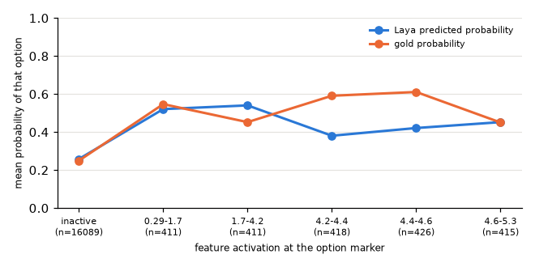

# Feature 1752

Critérios em que aparece: attribution_toward_wrong

**Interpretação (preencher):** 

---

## Maiores ativações

**tr_customer_service_000158 / needs_human** (noul, customer_service) | ativação 5.277 em `marcador` | opções ['false', 'true'] | Laya: **false** [0.542, 0.458] | gabarito: **false**

```
[CLS]noul question: This conversation requires a human agent rather than automated handling.[SEP]
▸ ⟦[MASK]⟧ false: Automation can carry this to resolution.
▸ [MASK] true: A human must take over: judgement, authority or empathy is required.

[SEP]

{"account": {"lifetime_value_usd": 134, "prior_tickets_90d": 5, "seats": 5, "tenure_months": 3, "tier": "enterprise"}, "orders": [{"amount_usd": 49, "date": "2026-02-16", "id": "A-54178", "status": "settled"}, {"amount_usd": 49, "date": "2026-02-18", "id": "A-29578", "status": "settled"}, {"amount_usd": 49, "date": "2026-01-24", "id": "A-46676", "status": "refunded"}], "thread": [{"role": "customer", "text": "The bulk‑upload feature stopped accepting CSV files; it returns a generic error as soon as I click Submit."}]}[SEP]
```

**tr_customer_service_000006 / needs_human** (noul, customer_service) | ativação 5.266 em `marcador` | opções ['false', 'true'] | Laya: **true** [0.44, 0.56] | gabarito: **false**

```
[CLS]noul question: This conversation requires a human agent rather than automated handling.[SEP]
▸ ⟦[MASK]⟧ false: Automation can carry this to resolution.
▸ [MASK] true: A human must take over: judgement, authority or empathy is required.

[SEP]

{"account": {"lifetime_value_usd": 1556, "prior_tickets_90d": 0, "seats": 1, "tenure_months": 49, "tier": "standard"}, "orders": [{"amount_usd": 49, "date": "2026-01-27", "id": "A-87881", "status": "pending"}, {"amount_usd": 49, "date": "2026-01-07", "id": "A-73934", "status": "settled"}, {"amount_usd": 49, "date": "2026-03-13", "id": "A-93118", "status": "pending"}], "thread": [{"role": "customer", "text": "I've been a member for years and suddenly everything is taking forever to load, but I haven't changed my internet or anything, so I'm not sure what's going on."}, {"role": "agent", "text": "That sounds frustrating. To help me narrow this down, is the slowness happening across the whole site or just when you try to save your work?"}, {"role": "customer", "text": "It's everywhere, even the main dashboard is crawling, and I just don't know why it's behaving this way all of a sudden."}]}[SEP]
```

**tr_customer_service_000012 / needs_human** (noul, customer_service) | ativação 5.246 em `marcador` | opções ['false', 'true'] | Laya: **true** [0.335, 0.665] | gabarito: **false**

```
[CLS]noul question: This conversation requires a human agent rather than automated handling.[SEP]
▸ ⟦[MASK]⟧ false: Automation can carry this to resolution.
▸ [MASK] true: A human must take over: judgement, authority or empathy is required.

[SEP]

{"account": {"lifetime_value_usd": 916, "prior_tickets_90d": 0, "seats": 1, "tenure_months": 11, "tier": "free"}, "orders": [{"amount_usd": 299, "date": "2026-02-20", "id": "A-54343", "status": "settled"}, {"amount_usd": 299, "date": "2026-03-22", "id": "A-86923", "status": "pending"}, {"amount_usd": 299, "date": "2026-03-03", "id": "A-84166", "status": "failed"}], "thread": [{"role": "customer", "text": "I just opened the box and the device is cracked. I've been with the free plan for almost a year now, paying the $299 when I upgraded, and this is disappointing."}, {"role": "agent", "text": "I'm sorry to hear the item arrived damaged. Could you let me know the model number and whether you have a photo of the damage?"}, {"role": "customer", "text": "Sure, it's model X200 and I can snap a picture, but I need to know what you can do about it before I send anything back."}]}[SEP]
```

**tr_customer_service_000032 / needs_human** (noul, customer_service) | ativação 5.223 em `marcador` | opções ['false', 'true'] | Laya: **true** [0.433, 0.567] | gabarito: **true**

```
[CLS]noul question: This conversation requires a human agent rather than automated handling.[SEP]
▸ ⟦[MASK]⟧ false: Automation can carry this to resolution.
▸ [MASK] true: A human must take over: judgement, authority or empathy is required.

[SEP]

{"account": {"lifetime_value_usd": 380, "prior_tickets_90d": 1, "seats": 1, "tenure_months": 5, "tier": "standard"}, "orders": [{"amount_usd": 598, "date": "2026-02-19", "id": "A-24938", "status": "pending"}, {"amount_usd": 598, "date": "2026-03-04", "id": "A-58038", "status": "refunded"}, {"amount_usd": 598, "date": "2026-03-13", "id": "A-45299", "status": "settled"}], "thread": [{"role": "customer", "text": "I am beyond finished with this service. I've poured nearly six hundred dollars into this account over the last five months and my previous ticket is still sitting there completely ignored. Just cancel my entire account immediately."}, {"role": "agent", "text": "I understand you're looking to close your account today. To ensure I have the right context, could you please clarify if the lack of response on your previous ticket is the primary reason for your decision to leave the standard plan?"}, {"role": "customer", "text": "It's the fact that I'm paying for a premium tier and getting treated like I don't exist while you keep my $598. I'm not here to talk it out or wait for a fix that isn't coming—I want the cancellation processed now."}]}[SEP]
```

**tr_customer_service_000037 / needs_human** (noul, customer_service) | ativação 5.211 em `marcador` | opções ['false', 'true'] | Laya: **true** [0.445, 0.555] | gabarito: **true**

```
[CLS]noul question: This conversation requires a human agent rather than automated handling.[SEP]
▸ ⟦[MASK]⟧ false: Automation can carry this to resolution.
▸ [MASK] true: A human must take over: judgement, authority or empathy is required.

[SEP]

{"account": {"lifetime_value_usd": 4631, "prior_tickets_90d": 5, "seats": 1, "tenure_months": 72, "tier": "standard"}, "orders": [{"amount_usd": 99, "date": "2026-03-22", "id": "A-19833", "status": "settled"}, {"amount_usd": 99, "date": "2026-03-28", "id": "A-80963", "status": "settled"}, {"amount_usd": 99, "date": "2026-03-25", "id": "A-38277", "status": "refunded"}], "thread": [{"role": "customer", "text": "My $99 order just arrived but it's completely wrong. I need the correct items by tomorrow morning for an event—please help!"}, {"role": "agent", "text": "I am sorry to hear you received the incorrect items. Could you please send over your order number and a photo of what was delivered?"}, {"role": "customer", "text": "The order number is #998877. I've attached the photo. Can you tell me if the right ones can be overnighted immediately?"}]}[SEP]
```

## Ativações medianas (faixa 40-60%, mediana 1.714)

**tr_security_incidents_000272 / credential_compromise** (noul, security_incidents) | ativação 1.915 em `pergunta` | opções ['false', 'true'] | Laya: **false** [0.508, 0.492] | gabarito: **true**

```
[CLS]noul question: The evidence indicates a credential or account has been compromised.⟦[SEP]⟧
▸ [MASK] false: no, the statement does not hold
▸ [MASK] true: yes, the statement holds

[SEP]

{"alert": {"description": "an account granted itself or received elevated permissions", "evidence": "The CI runner named gitlab-runner-12 added its own token to the local Administrators group on host build-agent-07 at 2026-09-15 23:58:12 UTC, using the net.exe command. This privilege change occurred while a change window was active, and the runner’s credentials had not been rotated for 700 days.", "rule": "privilege_escalation"}, "context": {"asset_criticality": "medium", "change_window_active": true, "source_on_allowlist": false}, "history": {"credential_rotation_days_ago": 700, "distinct_countries_30d": 2, "logins_30d": 501, "prior_alerts_90d": 0}, "principal": {"mfa_enrolled": true, "name": "svc-support-708", "privileges": ["repo:read"], "type": "ci_runner"}}[SEP]
```

**tr_customer_service_000123 / needs_human** (noul, customer_service) | ativação 1.676 em `marcador` | opções ['false', 'true'] | Laya: **true** [0.456, 0.544] | gabarito: **true**

```
[CLS]noul question: This conversation requires a human agent rather than automated handling.[SEP]
▸ [MASK] false: Automation can carry this to resolution.
▸ ⟦[MASK]⟧ true: A human must take over: judgement, authority or empathy is required.

[SEP]

{"account": {"lifetime_value_usd": 154, "prior_tickets_90d": 1, "seats": 5, "tenure_months": 2, "tier": "premium"}, "thread": [{"role": "customer", "text": "Hello there. I'm having a bit of a problem logging into my Premium account this morning. It keeps telling me my credentials aren't recognized, even though I haven't changed them."}, {"role": "agent", "text": "I'd be happy to help you with that. Are you seeing a specific error code, or is it just the standard 'invalid password' notification?"}, {"role": "customer", "text": "It says 'User not found.' I had a ticket open last week about account syncing and the agent promised it would be fixed by now, but it seems I'm still locked out."}, {"role": "agent", "text": "I see. Since you mentioned the previous ticket, did you receive a confirmation email or a link to verify your identity after that interaction?"}, {"role": "customer", "text": "No, I never received any follow-up email at all, which is why I'm reaching out again. I've only been using the service for two months and I really like it, but I can't use what I can't access."}, {"role": "agent", "text": "I appreciate your patience while we work through this. Could you please confirm the primary email address associated with your account so I can check the status of your profile?"}, {"role": "customer", "text": "Of course, it's j.smith@example.com. I have a hard deadline for a project presentation at 1:00 PM today that requires the data in that account, so if you could check on that for me, I'd appreciate it."}]}[SEP]
```

**tr_security_incidents_000127 / true_positive** (noul, security_incidents) | ativação 2.074 em `pergunta` | opções ['false', 'true'] | Laya: **false** [0.705, 0.295] | gabarito: **true**

```
[CLS]noul question: This alert reflects genuinely malicious or unauthorised activity.⟦[SEP]⟧
▸ [MASK] false: Benign activity, a misconfiguration, or a known false positive.
▸ [MASK] true: The underlying behaviour is malicious or unauthorised.

[SEP]

{"alert": {"description": "a security group was opened to the public internet", "evidence": "On 2026‑09‑14 at 10:07 UTC, security group sg-0a1b2c3d was modified to allow inbound traffic from 0.0.0.0/0, exposing the associated resources publicly. The change was applied by an admin account with privileged access, MFA enabled, from an unknown source IP, and the account’s password last rotation occurred 180 days ago.", "rule": "config_drift"}, "context": {"asset_criticality": "low", "change_window_active": false, "source_on_allowlist": false}, "history": {"credential_rotation_days_ago": 180, "distinct_countries_30d": 1, "logins_30d": 1581, "prior_alerts_90d": 0}, "principal": {"mfa_enrolled": true, "name": "adm-analytics-822", "privileges": ["deploy:production", "secrets:read"], "type": "admin"}}[SEP]
```

**tr_customer_service_000260 / category** (choice, customer_service) | ativação 1.356 em `pergunta` | opções ['account', 'billing', 'delivery', 'refund', 'technical'] | Laya: **refund** [0.23, 0.231, 0.054, 0.318, 0.166] | gabarito: **billing**

```
[CLS]⟦choice⟧ question: What is this customer conversation primarily about?[SEP]
▸ [MASK] account: Login, plan changes, profile or access management.
▸ [MASK] billing: A charge, invoice, subscription or payment problem.
▸ [MASK] delivery: Shipping, fulfilment or delivery of a physical item.
▸ [MASK] refund: The customer is explicitly asking for money back.
▸ [MASK] technical: The product or service is not working as expected.

[SEP]

{"account": {"lifetime_value_usd": 708, "prior_tickets_90d": 0, "seats": 1, "tenure_months": 14, "tier": "free"}, "thread": [{"role": "customer", "text": "My latest invoice shows a $45 fee that I didn’t expect; my plan is still the free tier."}, {"role": "agent", "text": "I see. Could you tell me the invoice number or the date it was issued so I can review the line items?"}, {"role": "customer", "text": "It’s invoice #2026‑08‑15‑001, dated August 15. I need an explanation before the 30th, otherwise I’ll have to reconsider using the service."}, {"role": "agent", "text": "Got it, thank you. I’ll examine the charges and see why that amount appeared. May I also confirm the email address on the account?"}, {"role": "customer", "text": "The account uses sarah.l@example.com. Please get back to me with details before the 30th; I can’t wait indefinitely."}]}[SEP]
```

**tr_security_incidents_000254 / true_positive** (noul, security_incidents) | ativação 2.090 em `pergunta` | opções ['false', 'true'] | Laya: **false** [0.752, 0.248] | gabarito: **true**

```
[CLS]noul question: This alert reflects genuinely malicious or unauthorised activity.⟦[SEP]⟧
▸ [MASK] false: Benign activity, a misconfiguration, or a known false positive.
▸ [MASK] true: The underlying behaviour is malicious or unauthorised.

[SEP]

{"alert": {"description": "a security group was opened to the public internet", "evidence": "At 10:45:23 UTC on 2026‑09‑16, the security group \"Finance_Users\" was modified to include an inbound rule allowing 0.0.0.0/0 on TCP port 3389. The change was performed by employee \"alice.smith\" without MFA, outside any scheduled change window, and the employee’s password was last changed 30 days ago.", "rule": "config_drift"}, "context": {"asset_criticality": "medium", "change_window_active": false, "source_on_allowlist": false}, "history": {"credential_rotation_days_ago": 30, "distinct_countries_30d": 4, "logins_30d": 1904, "prior_alerts_90d": 8}, "principal": {"mfa_enrolled": false, "name": "svc-infra-326", "privileges": ["repo:read"], "type": "employee"}}[SEP]
```

## Estatísticas (conjunto de descoberta, dev e teste)

**pred / error**

| split | decisões | ativas | ativas e Laya errou | taxa | lift | q (BH) | OR (CMH) | q (CMH) |
|---|---|---|---|---|---|---|---|---|
| discovery | 5100 | 984 | 464 | 0.472 | 0.74 | 3.94e-30 | 7.44 | 0.308 |
| dev | 900 | 170 | 93 | 0.547 | 0.83 | 0.0154 | nan | nan |
| test | 2000 | 383 | 178 | 0.465 | 0.73 | 5.19e-13 | 3.38 | 0.632 |

**corr / error**

| split | decisões | ativas | ativas e Laya errou | taxa | lift | q (BH) | OR (CMH) | q (CMH) |
|---|---|---|---|---|---|---|---|---|
| discovery | 5100 | 1062 | 542 | 0.510 | 0.80 | 1.96e-20 | 4.08 | 0.077 |
| dev | 900 | 209 | 132 | 0.632 | 0.96 | 0.496 | inf | 0.749 |
| test | 2000 | 421 | 216 | 0.513 | 0.81 | 1.92e-08 | 0.99 | 0.99 |

**state / error**

| split | decisões | ativas | ativas e Laya errou | taxa | lift | q (BH) | OR (CMH) | q (CMH) |
|---|---|---|---|---|---|---|---|---|
| discovery | 5100 | 188 | 123 | 0.654 | 1.03 | 0.882 | 1.39 | 0.147 |
| dev | 900 | 38 | 25 | 0.658 | 1.00 | 1 | 1.25 | 0.792 |
| test | 2000 | 75 | 47 | 0.627 | 0.98 | 1 | 1.05 | 0.938 |

Confusão mais sobre-representada (pred): `matches_order|1>0` (n=110, lift 5.18, p=0). Formato `pergunta|índice previsto>índice correto`.

Confusão mais sobre-representada (corr): `credential_compromise|1>0` (n=88, lift 4.80, p=0). Formato `pergunta|índice previsto>índice correto`.

Confusão mais sobre-representada (state): `credential_compromise|1>0` (n=14, lift 4.32, p=3.08e-06). Formato `pergunta|índice previsto>índice correto`.



