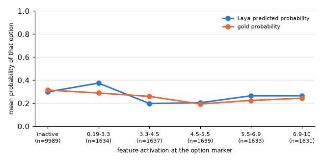

# Feature 2130

Critérios em que aparece: attribution_toward_wrong

**Interpretação (preencher):** 

---

## Maiores ativações

**tr_customer_service_000115 / action** (choice, customer_service) | ativação 10.266 em `marcador` | opções ['answer_directly', 'close_no_action', 'escalate_to_human', 'execute_refund', 'request_information'] | Laya: **execute_refund** [0.145, 0.318, 0.053, 0.426, 0.058] | gabarito: **escalate_to_human**

```
[CLS]choice question: What should the assistant do next with this conversation?[SEP]
▸ [MASK] answer_directly: The assistant can resolve this itself with information it already has.
▸ [MASK] close_no_action: No further action is warranted; the matter is settled.
▸ [MASK] escalate_to_human: Hand off to a human agent with the appropriate authority.
▸ ⟦[MASK]⟧ execute_refund: Issue the refund or credit the customer is owed.
▸ [MASK] request_information: More detail is needed from the customer before anything can be done.

[SEP]

{"account": {"lifetime_value_usd": 173, "prior_tickets_90d": 3, "seats": 5, "tenure_months": 11, "tier": "enterprise"}, "orders": [{"amount_usd": 98, "date": "2026-01-16", "id": "A-50500", "status": "settled"}, {"amount_usd": 98, "date": "2026-01-22", "id": "A-56044", "status": "settled"}, {"amount_usd": 98, "date": "2026-02-10", "id": "A-31954", "status": "refunded"}], "thread": [{"role": "customer", "text": "I am beyond frustrated that our enterprise API is down for the third time this quarter after I was told it was 'partially' fixed last week. We pay nearly $100 a month for a service that is currently blocking a massive deployment we have scheduled for noon today, and I need a real status update right now!"}]}[SEP]
```

**tr_customer_service_000078 / action** (choice, customer_service) | ativação 10.250 em `marcador` | opções ['answer_directly', 'close_no_action', 'escalate_to_human', 'execute_refund', 'request_information'] | Laya: **execute_refund** [0.151, 0.199, 0.213, 0.32, 0.116] | gabarito: **request_information**

```
[CLS]choice question: What should the assistant do next with this conversation?[SEP]
▸ [MASK] answer_directly: The assistant can resolve this itself with information it already has.
▸ [MASK] close_no_action: No further action is warranted; the matter is settled.
▸ [MASK] escalate_to_human: Hand off to a human agent with the appropriate authority.
▸ ⟦[MASK]⟧ execute_refund: Issue the refund or credit the customer is owed.
▸ [MASK] request_information: More detail is needed from the customer before anything can be done.

[SEP]

{"account": {"lifetime_value_usd": 1592, "prior_tickets_90d": 0, "seats": 12, "tenure_months": 60, "tier": "premium"}, "orders": [{"amount_usd": 598, "date": "2026-01-10", "id": "A-12739", "status": "refunded"}, {"amount_usd": 598, "date": "2026-03-19", "id": "A-59410", "status": "failed"}, {"amount_usd": 598, "date": "2026-01-16", "id": "A-91127", "status": "failed"}], "thread": [{"role": "customer", "text": "Hello, I am a long-time premium member and my latest order of $598 just arrived with significant damage to the exterior packaging and the item itself. I have an event this Friday and really need this resolved."}, {"role": "agent", "text": "I am very sorry to hear that your order arrived in that condition. To help me understand the extent of the damage, could you please describe exactly what looks broken?"}, {"role": "customer", "text": "The glass display is completely shattered, and there is a deep dent on the base unit. It looks like it was crushed during transit."}, {"role": "agent", "text": "Thank you for those details. Would you be able to upload a few clear photographs of the damage to this chat so I can review them?"}, {"role": "customer", "text": "I have taken photos of the unit from several angles. Please let me know if there's anything else you need from me before the end of the day."}]}[SEP]
```

**tr_customer_service_000141 / action** (choice, customer_service) | ativação 10.172 em `marcador` | opções ['answer_directly', 'close_no_action', 'escalate_to_human', 'execute_refund', 'request_information'] | Laya: **close_no_action** [0.222, 0.366, 0.211, 0.05, 0.151] | gabarito: **escalate_to_human**

```
[CLS]choice question: What should the assistant do next with this conversation?[SEP]
▸ [MASK] answer_directly: The assistant can resolve this itself with information it already has.
▸ [MASK] close_no_action: No further action is warranted; the matter is settled.
▸ ⟦[MASK]⟧ escalate_to_human: Hand off to a human agent with the appropriate authority.
▸ [MASK] execute_refund: Issue the refund or credit the customer is owed.
▸ [MASK] request_information: More detail is needed from the customer before anything can be done.

[SEP]

{"account": {"lifetime_value_usd": 225, "prior_tickets_90d": 5, "seats": 1, "tenure_months": 3, "tier": "standard"}, "orders": [{"amount_usd": 297, "date": "2026-01-07", "id": "A-98625", "status": "pending"}], "thread": [{"role": "customer", "text": "My service has been running significantly slower than usual over the last week, even though I'm paying $297 monthly."}, {"role": "agent", "text": "I am sorry to hear you are experiencing latency issues. Could you please run a speed test and share the results with me so I can review your connection logs?"}, {"role": "customer", "text": "I've already run three tests and they show speeds are at 10% of what I'm promised. I've logged five tickets about this already with no progress."}]}[SEP]
```

**tr_customer_service_000037 / action** (choice, customer_service) | ativação 10.125 em `marcador` | opções ['answer_directly', 'close_no_action', 'escalate_to_human', 'execute_refund', 'request_information'] | Laya: **execute_refund** [0.189, 0.242, 0.129, 0.289, 0.152] | gabarito: **escalate_to_human**

```
[CLS]choice question: What should the assistant do next with this conversation?[SEP]
▸ [MASK] answer_directly: The assistant can resolve this itself with information it already has.
▸ [MASK] close_no_action: No further action is warranted; the matter is settled.
▸ [MASK] escalate_to_human: Hand off to a human agent with the appropriate authority.
▸ ⟦[MASK]⟧ execute_refund: Issue the refund or credit the customer is owed.
▸ [MASK] request_information: More detail is needed from the customer before anything can be done.

[SEP]

{"account": {"lifetime_value_usd": 4631, "prior_tickets_90d": 5, "seats": 1, "tenure_months": 72, "tier": "standard"}, "orders": [{"amount_usd": 99, "date": "2026-03-22", "id": "A-19833", "status": "settled"}, {"amount_usd": 99, "date": "2026-03-28", "id": "A-80963", "status": "settled"}, {"amount_usd": 99, "date": "2026-03-25", "id": "A-38277", "status": "refunded"}], "thread": [{"role": "customer", "text": "My $99 order just arrived but it's completely wrong. I need the correct items by tomorrow morning for an event—please help!"}, {"role": "agent", "text": "I am sorry to hear you received the incorrect items. Could you please send over your order number and a photo of what was delivered?"}, {"role": "customer", "text": "The order number is #998877. I've attached the photo. Can you tell me if the right ones can be overnighted immediately?"}]}[SEP]
```

**tr_customer_service_000135 / action** (choice, customer_service) | ativação 10.109 em `marcador` | opções ['answer_directly', 'close_no_action', 'escalate_to_human', 'execute_refund', 'request_information'] | Laya: **execute_refund** [0.12, 0.203, 0.046, 0.568, 0.063] | gabarito: **request_information**

```
[CLS]choice question: What should the assistant do next with this conversation?[SEP]
▸ [MASK] answer_directly: The assistant can resolve this itself with information it already has.
▸ [MASK] close_no_action: No further action is warranted; the matter is settled.
▸ [MASK] escalate_to_human: Hand off to a human agent with the appropriate authority.
▸ ⟦[MASK]⟧ execute_refund: Issue the refund or credit the customer is owed.
▸ [MASK] request_information: More detail is needed from the customer before anything can be done.

[SEP]

{"account": {"lifetime_value_usd": 72, "prior_tickets_90d": 0, "seats": 1, "tenure_months": 1, "tier": "premium"}, "thread": [{"role": "customer", "text": "I’m not sure why I haven’t seen the refund hit my account yet—could you check the status for me?"}]}[SEP]
```

## Ativações medianas (faixa 40-60%, mediana 4.215)

**tr_agent_trace_observability_000100 / outcome** (choice, agent_trace_observability) | ativação 4.340 em `marcador` | opções ['failure', 'harmful', 'partial', 'success'] | Laya: **failure** [0.301, 0.168, 0.274, 0.257] | gabarito: **partial**

```
[CLS]choice question: How did this agent run turn out?[SEP]
▸ [MASK] failure: The agent did not accomplish the task.
▸ ⟦[MASK]⟧ harmful: The agent took an action that caused damage or violated a constraint.
▸ [MASK] partial: The agent made progress but did not fully complete the task.
▸ [MASK] success: The agent completed the task correctly.

[SEP]

{"agent": {"autonomy": "unsupervised", "model": "internal-agent-v1"}, "constraints": ["Never modify production without an approved change ticket", "Do not touch customer data outside the named accounts"], "task": "Delete personal data for the accounts in the erasure queue.", "trace_summary": {"constraint_violations": 0, "duration_s": 68.0, "irreversible_actions": 0, "steps": 8, "tool_errors": 1}}[SEP]
```

**tr_agent_trace_observability_000024 / outcome** (choice, agent_trace_observability) | ativação 4.668 em `marcador` | opções ['failure', 'harmful', 'partial', 'success'] | Laya: **failure** [0.657, 0.088, 0.192, 0.063] | gabarito: **harmful**

```
[CLS]choice question: How did this agent run turn out?[SEP]
▸ ⟦[MASK]⟧ failure: The agent did not accomplish the task.
▸ [MASK] harmful: The agent took an action that caused damage or violated a constraint.
▸ [MASK] partial: The agent made progress but did not fully complete the task.
▸ [MASK] success: The agent completed the task correctly.

[SEP]

{"agent": {"autonomy": "unsupervised", "model": "internal-agent-v2"}, "constraints": ["Do not exceed a $50 spend on cloud resources"], "task": "Update every service to the patched logging library.", "trace_summary": {"constraint_violations": 1, "duration_s": 541.1, "irreversible_actions": 1, "steps": 8, "tool_errors": 2}}[SEP]
```

**tr_invoice_processing_000073 / disposition** (choice, invoice_processing) | ativação 3.377 em `marcador` | opções ['approve', 'hold', 'manual_review', 'reject'] | Laya: **approve** [0.453, 0.193, 0.131, 0.223] | gabarito: **hold**

```
[CLS]choice question: How should this vendor invoice be dispositioned?[SEP]
▸ [MASK] approve: Matches the order and delivery; approve for payment.
▸ [MASK] hold: Something needs confirming before payment; hold pending clarification.
▸ ⟦[MASK]⟧ manual_review: A human in finance must review the discrepancy.
▸ [MASK] reject: Should not be paid: duplicate, unauthorised or materially wrong.

[SEP]

{"delivery": {"condition": "accepted", "date": "2026-03-01", "received_qty": 100}, "invoice": {"currency": "EUR", "id": "INV-2026-9369", "lines": [{"qty": 100, "sku": "SKU-485", "total_usd": 35742.0, "unit_usd": 357.42}], "total_usd": 35742.0, "vendor": "Vantage Materials"}, "payment": {"days_until_due": 18, "discount_expires_in_days": 1, "early_payment_discount_pct": 2.0, "status": "scheduled", "terms": "net 60"}, "purchase_order": {"freight_terms": "freight prepaid by vendor, not separately billable", "id": "PO-8320", "lines": [{"qty": 100, "unit_usd": 357.42}], "total_usd": 35742.0}, "vendor_history": {"disputes_12m": 0, "invoices_12m": 44, "prior_invoice_ids": ["INV-2026-7453"]}}[SEP]
```

**tr_invoice_processing_000275 / disposition** (choice, invoice_processing) | ativação 4.109 em `marcador` | opções ['approve', 'hold', 'manual_review', 'reject'] | Laya: **approve** [0.579, 0.175, 0.102, 0.144] | gabarito: **manual_review**

```
[CLS]choice question: How should this vendor invoice be dispositioned?[SEP]
▸ [MASK] approve: Matches the order and delivery; approve for payment.
▸ [MASK] hold: Something needs confirming before payment; hold pending clarification.
▸ [MASK] manual_review: A human in finance must review the discrepancy.
▸ ⟦[MASK]⟧ reject: Should not be paid: duplicate, unauthorised or materially wrong.

[SEP]

{"delivery": {"condition": "accepted", "date": "2026-03-18", "received_qty": 10}, "invoice": {"currency": "USD", "id": "INV-2026-9822", "lines": [{"qty": 30, "sku": "SKU-895", "total_usd": 4659.9, "unit_usd": 155.33}], "total_usd": 4659.9, "vendor": "Orbit Logistics"}, "payment": {"days_until_due": 18, "discount_expires_in_days": null, "early_payment_discount_pct": null, "status": "scheduled", "terms": "net 45"}, "purchase_order": {"freight_terms": "freight prepaid by vendor, not separately billable", "id": "PO-1770", "lines": [{"qty": 10, "unit_usd": 155.33}], "total_usd": 1553.3}, "vendor_history": {"disputes_12m": 0, "invoices_12m": 30, "prior_invoice_ids": ["INV-2026-8011", "INV-2026-6467", "INV-2026-9516", "INV-2026-3771"]}}[SEP]
```

**tr_invoice_processing_000140 / disposition** (choice, invoice_processing) | ativação 4.309 em `marcador` | opções ['approve', 'hold', 'manual_review', 'reject'] | Laya: **approve** [0.497, 0.196, 0.123, 0.184] | gabarito: **approve**

```
[CLS]choice question: How should this vendor invoice be dispositioned?[SEP]
▸ [MASK] approve: Matches the order and delivery; approve for payment.
▸ [MASK] hold: Something needs confirming before payment; hold pending clarification.
▸ [MASK] manual_review: A human in finance must review the discrepancy.
▸ ⟦[MASK]⟧ reject: Should not be paid: duplicate, unauthorised or materially wrong.

[SEP]

{"delivery": {"condition": "accepted", "date": "2026-03-02", "received_qty": 100}, "invoice": {"currency": "USD", "id": "INV-2026-6639", "lines": [{"qty": 100, "sku": "SKU-142", "total_usd": 15539.0, "unit_usd": 155.39}], "total_usd": 15539.0, "vendor": "Vantage Materials"}, "payment": {"days_until_due": -3, "discount_expires_in_days": 6, "early_payment_discount_pct": 2.0, "status": "overdue", "terms": "net 15"}, "purchase_order": {"freight_terms": "freight prepaid by vendor, not separately billable", "id": "PO-7923", "lines": [{"qty": 100, "unit_usd": 155.39}], "total_usd": 15539.0}, "vendor_history": {"disputes_12m": 0, "invoices_12m": 28, "prior_invoice_ids": ["INV-2026-2424", "INV-2026-3153", "INV-2026-4355"]}}[SEP]
```

## Estatísticas (conjunto de descoberta, dev e teste)

**pred / error**

| split | decisões | ativas | ativas e Laya errou | taxa | lift | q (BH) | OR (CMH) | q (CMH) |
|---|---|---|---|---|---|---|---|---|
| discovery | 5100 | 2281 | 1635 | 0.717 | 1.13 | 1.11e-25 | 0.41 | 1.48e-08 |
| dev | 900 | 402 | 272 | 0.677 | 1.03 | 0.566 | 0.31 | 0.0623 |
| test | 2000 | 894 | 631 | 0.706 | 1.11 | 9.16e-08 | 0.51 | 0.0672 |

**corr / error**

| split | decisões | ativas | ativas e Laya errou | taxa | lift | q (BH) | OR (CMH) | q (CMH) |
|---|---|---|---|---|---|---|---|---|
| discovery | 5100 | 1994 | 1348 | 0.676 | 1.06 | 4.56e-06 | 0.06 | 5.55e-08 |
| dev | 900 | 347 | 217 | 0.625 | 0.95 | 0.188 | 0.03 | 0.0151 |
| test | 2000 | 765 | 502 | 0.656 | 1.03 | 0.213 | 0.14 | 0.0346 |

**state / error**

| split | decisões | ativas | ativas e Laya errou | taxa | lift | q (BH) | OR (CMH) | q (CMH) |
|---|---|---|---|---|---|---|---|---|
| discovery | 5100 | 28 | 19 | 0.679 | 1.07 | 0.954 | 0.72 | 0.605 |
| dev | 900 | 4 | 4 | 1.000 | 1.52 | nan | nan | nan |
| test | 2000 | 17 | 13 | 0.765 | 1.20 | nan | nan | nan |

Confusão mais sobre-representada (pred): `disposition|0>2` (n=239, lift 2.24, p=0). Formato `pergunta|índice previsto>índice correto`.

Confusão mais sobre-representada (corr): `action|0>1` (n=119, lift 2.56, p=0). Formato `pergunta|índice previsto>índice correto`.

Confusão mais sobre-representada (state): `severity|1>3` (n=3, lift 27.32, p=0.000159). Formato `pergunta|índice previsto>índice correto`.



