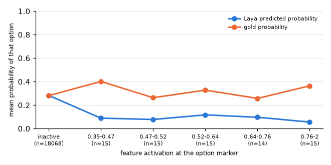

# Feature 2150

Critérios em que aparece: corr_error

**Interpretação (preencher):** 

---

## Maiores ativações

**tr_customer_service_000128 / action** (choice, customer_service) | ativação 10.242 em `estado` | opções ['answer_directly', 'close_no_action', 'escalate_to_human', 'execute_refund', 'request_information'] | Laya: **close_no_action** [0.295, 0.43, 0.092, 0.049, 0.134] | gabarito: **escalate_to_human**

```
[CLS]choice question: What should the assistant do next with this conversation?[SEP]
▸ [MASK] answer_directly: The assistant can resolve this itself with information it already has.
▸ [MASK] close_no_action: No further action is warranted; the matter is settled.
▸ [MASK] escalate_to_human: Hand off to a human agent with the appropriate authority.
▸ [MASK] execute_refund: Issue the refund or credit the customer is owed.
▸ [MASK] request_information: More detail is needed from the customer before anything can be done.

[SEP]

{"account": {"lifetime_value_usd": 820, "prior_tickets_90d": 5, "seats": 12, "tenure_months": 11, "tier": "enterprise"}, "thread": [{"role": "customer", "text": "Hello, I'm reaching out because the analytics dashboard we rely on has stopped updating. We've been on the enterprise plan for about 11 months, and I've already opened several tickets (five in total) where the issue was only partially resolved."}, {"role": "agent", "text": "I’m sorry to hear the dashboard isn’t updating. Could you let me know when you first noticed the problem and whether any error messages appear?"}, {"role": "customer", "text": "It started this morning; the page loads but the charts stay blank, and the console shows a 502 error. I’ve tried⟦ clearing⟧ caches and restarting the service, but nothing changes."}]}[SEP]
```

**tr_customer_service_000128 / churn_risk** (score, customer_service) | ativação 10.227 em `estado` | opções ['0', '1', '2', '3'] | Laya: **2** [0.082, 0.292, 0.531, 0.095] | gabarito: **2**

```
[CLS]score question: How likely is this customer to stop doing business with us because of this interaction?[SEP]
▸ [MASK] level 0: No sign of dissatisfaction.
▸ [MASK] level 1: Mild frustration, but the relationship is intact.
▸ [MASK] level 2: Clearly unhappy; repeat problems or explicit complaints.
▸ [MASK] level 3: Imminent: threatening to cancel, dispute or leave.

[SEP]

{"account": {"lifetime_value_usd": 820, "prior_tickets_90d": 5, "seats": 12, "tenure_months": 11, "tier": "enterprise"}, "thread": [{"role": "customer", "text": "Hello, I'm reaching out because the analytics dashboard we rely on has stopped updating. We've been on the enterprise plan for about 11 months, and I've already opened several tickets (five in total) where the issue was only partially resolved."}, {"role": "agent", "text": "I’m sorry to hear the dashboard isn’t updating. Could you let me know when you first noticed the problem and whether any error messages appear?"}, {"role": "customer", "text": "It started this morning; the page loads but the charts stay blank, and the console shows a 502 error. I’ve tried⟦ clearing⟧ caches and restarting the service, but nothing changes."}]}[SEP]
```

**tr_customer_service_000128 / category** (choice, customer_service) | ativação 10.047 em `estado` | opções ['account', 'billing', 'delivery', 'refund', 'technical'] | Laya: **technical** [0.078, 0.036, 0.025, 0.054, 0.808] | gabarito: **technical**

```
[CLS]choice question: What is this customer conversation primarily about?[SEP]
▸ [MASK] account: Login, plan changes, profile or access management.
▸ [MASK] billing: A charge, invoice, subscription or payment problem.
▸ [MASK] delivery: Shipping, fulfilment or delivery of a physical item.
▸ [MASK] refund: The customer is explicitly asking for money back.
▸ [MASK] technical: The product or service is not working as expected.

[SEP]

{"account": {"lifetime_value_usd": 820, "prior_tickets_90d": 5, "seats": 12, "tenure_months": 11, "tier": "enterprise"}, "thread": [{"role": "customer", "text": "Hello, I'm reaching out because the analytics dashboard we rely on has stopped updating. We've been on the enterprise plan for about 11 months, and I've already opened several tickets (five in total) where the issue was only partially resolved."}, {"role": "agent", "text": "I’m sorry to hear the dashboard isn’t updating. Could you let me know when you first noticed the problem and whether any error messages appear?"}, {"role": "customer", "text": "It started this morning; the page loads but the charts stay blank, and the console shows a 502 error. I’ve tried⟦ clearing⟧ caches and restarting the service, but nothing changes."}]}[SEP]
```

**tr_customer_service_000128 / action** (choice, customer_service) | ativação 9.969 em `estado` | opções ['answer_directly', 'close_no_action', 'escalate_to_human', 'execute_refund', 'request_information'] | Laya: **close_no_action** [0.295, 0.43, 0.092, 0.049, 0.134] | gabarito: **escalate_to_human**

```
[CLS]choice question: What should the assistant do next with this conversation?[SEP]
▸ [MASK] answer_directly: The assistant can resolve this itself with information it already has.
▸ [MASK] close_no_action: No further action is warranted; the matter is settled.
▸ [MASK] escalate_to_human: Hand off to a human agent with the appropriate authority.
▸ [MASK] execute_refund: Issue the refund or credit the customer is owed.
▸ [MASK] request_information: More detail is needed from the customer before anything can be done.

[SEP]

{"account": {"lifetime_value_usd": 820, "prior_tickets_90d": 5, "seats": 12, "tenure_months": 11, "tier": "enterprise"}, "thread": [{"role": "customer", "text": "Hello, I'm reaching out because the analytics dashboard we rely on has stopped updating. We've been on the enterprise plan for about 11 months, and I've already opened several tickets (five in total) where the issue was only partially resolved."}, {"role": "agent", "text": "I’m sorry to hear the dashboard isn’t updating. Could you let me know when you first noticed the problem and whether any error messages appear?"}, {"role": "customer", "text": "It started this morning; the page loads but the charts stay blank, and the console shows a 502 error. I’ve⟦ tried⟧ clearing caches and restarting the service, but nothing changes."}]}[SEP]
```

**tr_customer_service_000128 / urgency** (score, customer_service) | ativação 9.867 em `estado` | opções ['0', '1', '2', '3'] | Laya: **1** [0.057, 0.576, 0.154, 0.214] | gabarito: **3**

```
[CLS]score question: How time-sensitive is this conversation?[SEP]
▸ [MASK] level 0: No time pressure; can wait indefinitely.
▸ [MASK] level 1: Routine; handle within the normal queue.
▸ [MASK] level 2: Elevated; should be handled within the same week.
▸ [MASK] level 3: Critical; requires action within the same day.

[SEP]

{"account": {"lifetime_value_usd": 820, "prior_tickets_90d": 5, "seats": 12, "tenure_months": 11, "tier": "enterprise"}, "thread": [{"role": "customer", "text": "Hello, I'm reaching out because the analytics dashboard we rely on has stopped updating. We've been on the enterprise plan for about 11 months, and I've already opened several tickets (five in total) where the issue was only partially resolved."}, {"role": "agent", "text": "I’m sorry to hear the dashboard isn’t updating. Could you let me know when you first noticed the problem and whether any error messages appear?"}, {"role": "customer", "text": "It started this morning; the page loads but the charts stay blank, and the console shows a 502 error. I’ve⟦ tried⟧ clearing caches and restarting the service, but nothing changes."}]}[SEP]
```

## Ativações medianas (faixa 40-60%, mediana 1.293)

**tr_security_incidents_000002 / disposition** (choice, security_incidents) | ativação 1.271 em `estado` | opções ['close_benign', 'contain', 'investigate', 'monitor'] | Laya: **close_benign** [0.376, 0.23, 0.114, 0.28] | gabarito: **investigate**

```
[CLS]choice question: How should this security alert be dispositioned?[SEP]
▸ [MASK] close_benign: Expected, explainable activity; close without analyst time.
▸ [MASK] contain: Contain the host or account immediately; do not wait for triage.
▸ [MASK] investigate: Warrants an analyst opening an investigation.
▸ [MASK] monitor: Not clearly malicious, but worth watching for recurrence.

[SEP]

{"alert": {"description": "many failed authentications followed by a success", "evidence": "A sequence of⟦ 95⟧ failed login attempts followed by a single successful authentication was recorded for the privileged `admin-shared-inbox` from an unknown source. The successful access utilized MFA-protected credentials that were last rotated 14 days prior to the event.", "rule": "brute_force"}, "context": {"asset_criticality": "medium", "change_window_active": false, "source_on_allowlist": false}, "history": {"credential_rotation_days_ago": 14, "distinct_countries_30d": 4, "logins_30d": 581, "prior_alerts_90d": 1}, "principal": {"mfa_enrolled": true, "name": "usr-support-225", "privileges": ["deploy:production", "secrets:read"], "type": "shared_mailbox"}}[SEP]
```

**tr_customer_service_000157 / needs_human** (noul, customer_service) | ativação 1.374 em `estado` | opções ['false', 'true'] | Laya: **true** [0.383, 0.616] | gabarito: **true**

```
[CLS]noul question: This conversation requires a human agent rather than automated handling.[SEP]
▸ [MASK] false: Automation can carry this to resolution.
▸ [MASK] true: A human must take over: judgement, authority or empathy is required.

[SEP]

{"account": {"lifetime_value_usd": 3086, "prior_tickets_90d": 3, "seats": 1, "tenure_months": 49, "tier": "standard"}, "thread": [{"role": "customer", "text": "I need to get into my account right now – the login page just keeps looping back⟦ to⟧ the password screen and I can’t access anything."}, {"role": "agent", "text": "I understand the urgency. Could you share the exact error message you’re seeing, or let me know if you’ve tried resetting the password?"}, {"role": "customer", "text": "The message says “authentication failed” after I enter my credentials, and I’ve already tried the password reset twice with no luck."}]}[SEP]
```

**tr_customer_service_000051 / action** (choice, customer_service) | ativação 1.305 em `estado` | opções ['answer_directly', 'close_no_action', 'escalate_to_human', 'execute_refund', 'request_information'] | Laya: **close_no_action** [0.169, 0.423, 0.166, 0.082, 0.161] | gabarito: **escalate_to_human**

```
[CLS]choice question: What should the assistant do next with this conversation?[SEP]
▸ [MASK] answer_directly: The assistant can resolve this itself with information it already has.
▸ [MASK] close_no_action: No further action is warranted; the matter is settled.
▸ [MASK] escalate_to_human: Hand off to a human agent with the appropriate authority.
▸ [MASK] execute_refund: Issue the refund or credit the customer is owed.
▸ [MASK] request_information: More detail is needed from the customer before anything can be done.

[SEP]

{"account": {"lifetime_value_usd": 2213, "prior_tickets_90d": 1, "seats": 1, "tenure_months": 60, "tier": "standard"}, "thread": [{"role": "customer", "text": "My bill is higher than expected again. This is the second time I've had⟦ to⟧ bring this up, and I'm honestly fed up. If this isn't fixed before my 2 PM deadline, I am canceling my account for good."}, {"role": "agent", "text": "I understand your frustration regarding the recurring billing concerns. Would you be able to provide the invoice number in question so I can review the charges?"}, {"role": "customer", "text": "It’s the most recent one. Can you please check your system instead of making me jump through these hoops while my deadline approaches?"}]}[SEP]
```

**tr_customer_service_000006 / action** (choice, customer_service) | ativação 1.255 em `estado` | opções ['answer_directly', 'close_no_action', 'escalate_to_human', 'execute_refund', 'request_information'] | Laya: **close_no_action** [0.17, 0.537, 0.095, 0.071, 0.127] | gabarito: **request_information**

```
[CLS]choice question: What should the assistant do next with this conversation?[SEP]
▸ [MASK] answer_directly: The assistant can resolve this itself with information it already has.
▸ [MASK] close_no_action: No further action is warranted; the matter is settled.
▸ [MASK] escalate_to_human: Hand off to a human agent with the appropriate authority.
▸ [MASK] execute_refund: Issue the refund or credit the customer is owed.
▸ [MASK] request_information: More detail is needed from the customer before anything can be done.

[SEP]

{"account": {"lifetime_value_usd": 1556, "prior_tickets_90d": 0, "seats": 1, "tenure_months": 49, "tier": "standard"}, "orders": [{"amount_usd": 49, "date": "2026-01-27", "id": "A-87881", "status": "pending"}, {"amount_usd": 49, "date": "2026-01-07", "id": "A-73934", "status": "settled"}, {"amount_usd": 49, "date": "2026-03-13", "id": "A-93118", "status": "pending"}], "thread": [{"role": "customer", "text": "I've been a member for years and suddenly everything is taking forever to load, but I haven't changed my internet or anything, so I'm not sure what's going on."}, {"role": "agent", "text": "That sounds frustrating. To help me narrow this down, is the slowness happening across the whole site or just when you try to save your work?"}, {"role": "customer", "text": "It's everywhere, even the main⟦ dashboard⟧ is crawling, and I just don't know why it's behaving this way all of a sudden."}]}[SEP]
```

**tr_invoice_processing_000156 / matches_order** (noul, invoice_processing) | ativação 1.448 em `estado` | opções ['false', 'true'] | Laya: **true** [0.472, 0.528] | gabarito: **false**

```
[CLS]noul question: The invoice reconciles with the purchase order and the recorded delivery.[SEP]
▸ [MASK] false: There is a discrepancy against the order or the delivery.
▸ [MASK] true: Line items, quantities and amounts reconcile.

[SEP]

{"delivery": {"condition": "accepted with exceptions", "date": "2026-03-01", "received_qty": 250}, "invoice": {"currency": "EUR", "id": "INV-2026-5851", "lines": [{"qty": 250, "sku": "SKU-433", "total_usd": 74385.0, "unit_usd": 297.54}], "total_usd": 74385.0, "vendor": "Northwind Components"}, "payment": {"days_until_due": 11, "discount_expires_in_days": null, "early_payment_discount_pct": null, "status": "scheduled", "terms": "net 15"}, "purchase_order": {"freight_terms": "freight prepaid by vendor, not separately billable", "id": "PO-4585", "lines": [{"qty": 250, "unit_usd": 297.54}], "total_usd": 74385.0}, "vendor_history": {"disputes_12m": 0, "invoices_12m": 25, "prior_invoice_ids": ["INV-2026-84⟦61⟧", "INV-2026-6033", "INV-2026-1820"]}}[SEP]
```

## Estatísticas (conjunto de descoberta, dev e teste)

**pred / error**

| split | decisões | ativas | ativas e Laya errou | taxa | lift | q (BH) | OR (CMH) | q (CMH) |
|---|---|---|---|---|---|---|---|---|
| discovery | 5100 | 0 | 0 | nan | nan | nan | nan | nan |
| dev | 900 | 0 | 0 | nan | nan | nan | nan | nan |
| test | 2000 | 0 | 0 | nan | nan | nan | nan | nan |

**corr / error**

| split | decisões | ativas | ativas e Laya errou | taxa | lift | q (BH) | OR (CMH) | q (CMH) |
|---|---|---|---|---|---|---|---|---|
| discovery | 5100 | 27 | 27 | 1.000 | 1.57 | 1.73e-05 | inf | 0.739 |
| dev | 900 | 3 | 3 | 1.000 | 1.52 | nan | nan | nan |
| test | 2000 | 10 | 10 | 1.000 | 1.57 | nan | nan | nan |

**state / error**

| split | decisões | ativas | ativas e Laya errou | taxa | lift | q (BH) | OR (CMH) | q (CMH) |
|---|---|---|---|---|---|---|---|---|
| discovery | 5100 | 2531 | 1551 | 0.613 | 0.96 | 0.0139 | 0.87 | 0.0813 |
| dev | 900 | 457 | 306 | 0.670 | 1.02 | 1 | 1.25 | 0.413 |
| test | 2000 | 1019 | 635 | 0.623 | 0.98 | 0.683 | 0.91 | 0.58 |

Confusão mais sobre-representada (corr): `action|1>2` (n=24, lift 36.27, p=6.07e-37). Formato `pergunta|índice previsto>índice correto`.

Confusão mais sobre-representada (state): `action|1>2` (n=88, lift 1.42, p=1.5e-06). Formato `pergunta|índice previsto>índice correto`.



