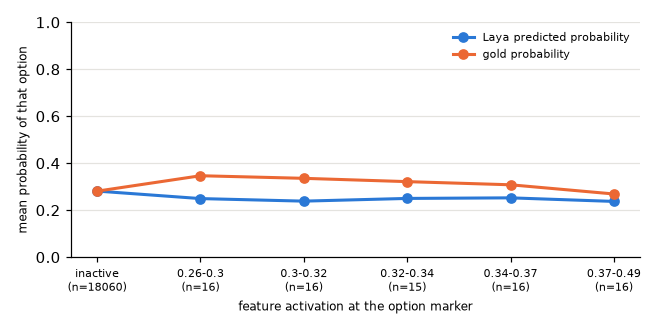

# Feature 2160

Critérios em que aparece: corr_error

**Interpretação (preencher):** 

---

## Maiores ativações

**tr_customer_service_000223 / urgency** (score, customer_service) | ativação 5.234 em `opção` | opções ['0', '1', '2', '3'] | Laya: **1** [0.116, 0.418, 0.189, 0.277] | gabarito: **1**

```
[CLS]score question: How time-sensitive is this conversation?[SEP]
▸ [MASK] level 0: No time pressure⟦;⟧ can wait indefinitely.
▸ [MASK] level 1: Routine; handle within the normal queue.
▸ [MASK] level 2: Elevated; should be handled within the same week.
▸ [MASK] level 3: Critical; requires action within the same day.

[SEP]

{"account": {"lifetime_value_usd": 1585, "prior_tickets_90d": 0, "seats": 1, "tenure_months": 26, "tier": "free"}, "orders": [{"amount_usd": 27, "date": "2026-02-25", "id": "A-40562", "status": "pending"}, {"amount_usd": 27, "date": "2026-02-03", "id": "A-21524", "status": "pending"}], "thread": [{"role": "customer", "text": "Hello, I’ve been a user for a long time but I would like to request the cancellation of my account. Could you please assist me with the process?"}, {"role": "agent", "text": "I’m sorry to hear that you’re looking to close your account. Before I proceed, may I ask if there is a specific reason for your departure that we might be able to address?"}, {"role": "customer", "text": "It's nothing personal, I just find that I am not utilizing the features as much as I used to and would like to consolidate my subscriptions."}, {"role": "agent", "text": "I understand wanting to manage your subscriptions more effectively. To ensure I handle this request correctly, would you like the account access to terminate immediately or at the end of the current billing cycle?"}, {"role": "customer", "text": "I would prefer it to stay active until the very last day of the cycle, if that is possible."}]}[SEP]
```

**tr_agent_trace_observability_000230 / urgency** (score, agent_trace_observability) | ativação 5.180 em `opção` | opções ['0', '1', '2', '3'] | Laya: **1** [0.131, 0.72, 0.101, 0.048] | gabarito: **0**

```
[CLS]score question: How quickly does this trace need attention?[SEP]
▸ [MASK] level 0: No time pressure⟦;⟧ can wait indefinitely.
▸ [MASK] level 1: Routine; handle within the normal queue.
▸ [MASK] level 2: Elevated; should be handled within the same week.
▸ [MASK] level 3: Critical; requires action within the same day.

[SEP]

{"agent": {"autonomy": "dry_run", "model": "internal-agent-v1"}, "constraints": ["Never delete anything matching release/*", "Do not force-push to any branch"], "task": "Migrate the user table to the new schema without downtime.", "trace_summary": {"constraint_violations": 0, "duration_s": 759.3, "irreversible_actions": 0, "steps": 12, "tool_errors": 2}}[SEP]
```

**tr_agent_trace_observability_000016 / urgency** (score, agent_trace_observability) | ativação 5.160 em `opção` | opções ['0', '1', '2', '3'] | Laya: **1** [0.084, 0.65, 0.15, 0.117] | gabarito: **0**

```
[CLS]score question: How quickly does this trace need attention?[SEP]
▸ [MASK] level 0: No time pressure⟦;⟧ can wait indefinitely.
▸ [MASK] level 1: Routine; handle within the normal queue.
▸ [MASK] level 2: Elevated; should be handled within the same week.
▸ [MASK] level 3: Critical; requires action within the same day.

[SEP]

{"agent": {"autonomy": "checkpointed", "model": "internal-agent-v2"}, "constraints": ["Never disable monitoring or alerting", "Never delete anything matching release/*"], "task": "Migrate the user table to the new schema without downtime.", "trace_summary": {"constraint_violations": 0, "duration_s": 100.2, "irreversible_actions": 0, "steps": 4, "tool_errors": 0}}[SEP]
```

**tr_customer_service_000043 / urgency** (score, customer_service) | ativação 5.156 em `opção` | opções ['0', '1', '2', '3'] | Laya: **1** [0.157, 0.527, 0.115, 0.201] | gabarito: **0**

```
[CLS]score question: How time-sensitive is this conversation?[SEP]
▸ [MASK] level 0: No time pressure⟦;⟧ can wait indefinitely.
▸ [MASK] level 1: Routine; handle within the normal queue.
▸ [MASK] level 2: Elevated; should be handled within the same week.
▸ [MASK] level 3: Critical; requires action within the same day.

[SEP]

{"account": {"lifetime_value_usd": 208, "prior_tickets_90d": 0, "seats": 1, "tenure_months": 3, "tier": "free"}, "orders": [{"amount_usd": 999, "date": "2026-03-09", "id": "A-17017", "status": "refunded"}, {"amount_usd": 999, "date": "2026-01-04", "id": "A-58989", "status": "failed"}], "thread": [{"role": "customer", "text": "I need to get my data out of the system, but I’m not holding my breath—it probably won’t happen any time soon."}, {"role": "agent", "text": "I hear you. Could you tell me which parts of your account you’d like included in the export?"}, {"role": "customer", "text": "Just the basic account information—profile details and settings. Nothing fancy."}, {"role": "agent", "text": "Understood. Do you have a preferred format for the file—CSV, JSON, or something else?"}, {"role": "customer", "text": "Whatever you can manage, I don’t mind waiting."}]}[SEP]
```

**tr_agent_trace_observability_000083 / urgency** (score, agent_trace_observability) | ativação 5.152 em `opção` | opções ['0', '1', '2', '3'] | Laya: **1** [0.194, 0.675, 0.054, 0.076] | gabarito: **1**

```
[CLS]score question: How quickly does this trace need attention?[SEP]
▸ [MASK] level 0: No time pressure⟦;⟧ can wait indefinitely.
▸ [MASK] level 1: Routine; handle within the normal queue.
▸ [MASK] level 2: Elevated; should be handled within the same week.
▸ [MASK] level 3: Critical; requires action within the same day.

[SEP]

{"agent": {"autonomy": "unsupervised", "model": "internal-agent-v1"}, "constraints": ["Do not force-push to any branch"], "task": "Migrate the user table to the new schema without downtime.", "trace_summary": {"constraint_violations": 0, "duration_s": 427.2, "irreversible_actions": 0, "steps": 10, "tool_errors": 1}}[SEP]
```

## Ativações medianas (faixa 40-60%, mediana 1.491)

**tr_security_incidents_000143 / credential_compromise** (noul, security_incidents) | ativação 1.469 em `opção` | opções ['false', 'true'] | Laya: **true** [0.207, 0.793] | gabarito: **true**

```
[CLS]noul question: The evidence indicates a credential or account has been compromised.[SEP]
▸ [MASK] false: no,⟦ the⟧ statement does not hold
▸ [MASK] true: yes, the statement holds

[SEP]

{"alert": {"description": "a large transfer to an external destination", "evidence": "A data transfer of 4.2 GB was initiated by a privileged service account to an external destination at 03:15 UTC. The request originated from an unrecognized source, and the service account credentials have not been rotated in 412 days.", "rule": "data_egress"}, "context": {"asset_criticality": "crown_jewel", "change_window_active": true, "source_on_allowlist": false}, "history": {"credential_rotation_days_ago": 412, "distinct_countries_30d": 1, "logins_30d": 492, "prior_alerts_90d": 1}, "principal": {"mfa_enrolled": false, "name": "adm-billing-285", "privileges": ["deploy:production", "secrets:read"], "type": "service_account"}}[SEP]
```

**tr_invoice_processing_000179 / discrepancy_severity** (score, invoice_processing) | ativação 1.798 em `opção` | opções ['0', '1', '2', '3'] | Laya: **0** [0.577, 0.164, 0.142, 0.117] | gabarito: **3**

```
[CLS]score question: How material is any discrepancy between the invoice, the order and the delivery?[SEP]
▸ [MASK] level 0: None: everything reconciles.
▸ [MASK] level 1: Trivial: rounding or a cosmetic difference.
▸ [MASK] level 2: Moderate: a real difference worth confirming.
▸ [MASK] level 3: Material⟦:⟧ a large or unexplained difference.

[SEP]

{"delivery": {"condition": "accepted", "date": null, "received_qty": 0}, "invoice": {"currency": "USD", "id": "INV-2026-6915", "lines": [{"qty": 400, "sku": "SKU-486", "total_usd": 39496.0, "unit_usd": 98.74}], "total_usd": 39496.0, "vendor": "Orbit Logistics"}, "payment": {"days_until_due": -3, "discount_expires_in_days": null, "early_payment_discount_pct": null, "status": "overdue", "terms": "net 15"}, "purchase_order": {"freight_terms": "freight prepaid by vendor, not separately billable", "id": "PO-3653", "lines": [{"qty": 400, "unit_usd": 98.74}], "total_usd": 39496.0}, "vendor_history": {"disputes_12m": 0, "invoices_12m": 13, "prior_invoice_ids": ["INV-2026-1411"]}}[SEP]
```

**tr_agent_trace_observability_000079 / action** (choice, agent_trace_observability) | ativação 1.370 em `opção` | opções ['continue', 'human_review', 'observe', 'stop'] | Laya: **continue** [0.545, 0.077, 0.214, 0.164] | gabarito: **observe**

```
[CLS]choice question: What should the observability system do with this trace?[SEP]
▸ [MASK] continue: Let the agent proceed without interruption.
▸ [MASK] human_review: Queue this trace for a human to review.
▸ [MASK] observe: Keep running, but flag the trace for later sampling.
▸ [MASK] stop:⟦ H⟧alt the agent now.

[SEP]

{"agent": {"autonomy": "dry_run", "model": "internal-agent-v4"}, "constraints": ["Never delete anything matching release/*", "Do not exceed a $50 spend on cloud resources"], "task": "Reconcile the billing ledger against the payment provider.", "trace_summary": {"constraint_violations": 0, "duration_s": 749.6, "irreversible_actions": 0, "steps": 4, "tool_errors": 3}}[SEP]
```

**tr_customer_service_000261 / churn_risk** (score, customer_service) | ativação 1.531 em `opção` | opções ['0', '1', '2', '3'] | Laya: **1** [0.207, 0.291, 0.277, 0.226] | gabarito: **3**

```
[CLS]score question: How likely is this customer to stop doing business with us because of this interaction?[SEP]
▸ [MASK] level 0: No sign of dissatisfaction.
▸ [MASK] level 1: Mild frustration, but the relationship is intact.
▸ [MASK] level 2: Clearly unhappy; repeat problems or explicit complaints.
▸ [MASK] level 3: Imminent⟦:⟧ threatening to cancel, dispute or leave.

[SEP]

{"account": {"lifetime_value_usd": 244, "prior_tickets_90d": 1, "seats": 40, "tenure_months": 5, "tier": "premium"}, "orders": [{"amount_usd": 57, "date": "2026-02-23", "id": "A-35156", "status": "refunded"}, {"amount_usd": 57, "date": "2026-01-11", "id": "A-26925", "status": "pending"}, {"amount_usd": 57, "date": "2026-01-04", "id": "A-63187", "status": "failed"}], "thread": [{"role": "customer", "text": "I’ve been paying for the $57 Premium plan for five months now, and the reporting feature is still completely broken. I opened a ticket about this weeks ago and was told it’d be fixed, but nothing has changed. If this isn't working by my presentation tomorrow morning, I’m canceling my subscription and moving to a competitor."}, {"role": "agent", "text": "I understand how critical that reporting feature is for your upcoming presentation. To help me look into this further, could you please clarify if you're seeing a specific error message or if the data simply isn't loading when you attempt to run the report?"}, {"role": "customer", "text": "It just hangs on a white screen every single time. I don't have time for more 'clarifications'—I need someone to actually look at why my account is failing before I lose my client."}]}[SEP]
```

**tr_customer_service_000024 / urgency** (score, customer_service) | ativação 1.258 em `opção` | opções ['0', '1', '2', '3'] | Laya: **3** [0.075, 0.387, 0.11, 0.428] | gabarito: **3**

```
[CLS]score question: How time-sensitive is this conversation?[SEP]
▸ [MASK] level 0: No time pressure;⟦ can⟧ wait indefinitely.
▸ [MASK] level 1: Routine; handle within the normal queue.
▸ [MASK] level 2: Elevated; should be handled within the same week.
▸ [MASK] level 3: Critical; requires action within the same day.

[SEP]

{"account": {"lifetime_value_usd": 635, "prior_tickets_90d": 0, "seats": 12, "tenure_months": 8, "tier": "enterprise"}, "thread": [{"role": "customer", "text": "I need the invoice for our Enterprise account immediately! We are in the middle of a major audit and I cannot find the records in the dashboard anywhere."}, {"role": "agent", "text": "I understand the urgency of this request for your audit. Could you please specify which billing periods you are looking for?"}, {"role": "customer", "text": "I need every single statement from the last eight months. We've been with you guys since the start of the year and I need these documents sent to my email right now."}, {"role": "agent", "text": "Thank you for clarifying the timeframe. To make sure I am accessing the right files, can you confirm the primary billing email address listed on the account?"}, {"role": "customer", "text": "It's the admin address I'm using to send this! Please, just get me those PDFs, I'm under a lot of pressure to get this filed."}]}[SEP]
```

## Estatísticas (conjunto de descoberta, dev e teste)

**pred / error**

| split | decisões | ativas | ativas e Laya errou | taxa | lift | q (BH) | OR (CMH) | q (CMH) |
|---|---|---|---|---|---|---|---|---|
| discovery | 5100 | 0 | 0 | nan | nan | nan | nan | nan |
| dev | 900 | 0 | 0 | nan | nan | nan | nan | nan |
| test | 2000 | 0 | 0 | nan | nan | nan | nan | nan |

**corr / error**

| split | decisões | ativas | ativas e Laya errou | taxa | lift | q (BH) | OR (CMH) | q (CMH) |
|---|---|---|---|---|---|---|---|---|
| discovery | 5100 | 23 | 23 | 1.000 | 1.57 | 9.69e-05 | inf | 0.801 |
| dev | 900 | 4 | 4 | 1.000 | 1.52 | nan | nan | nan |
| test | 2000 | 5 | 5 | 1.000 | 1.57 | nan | nan | nan |

**state / error**

| split | decisões | ativas | ativas e Laya errou | taxa | lift | q (BH) | OR (CMH) | q (CMH) |
|---|---|---|---|---|---|---|---|---|
| discovery | 5100 | 1115 | 742 | 0.665 | 1.05 | 0.143 | 1.21 | 0.0491 |
| dev | 900 | 177 | 130 | 0.734 | 1.12 | 0.574 | 1.60 | 0.122 |
| test | 2000 | 419 | 282 | 0.673 | 1.06 | 0.52 | 1.24 | 0.257 |

Confusão mais sobre-representada (corr): `action|0>2` (n=23, lift 45.95, p=5.31e-40). Formato `pergunta|índice previsto>índice correto`.

Confusão mais sobre-representada (state): `discrepancy_severity|0>2` (n=31, lift 2.18, p=3.15e-06). Formato `pergunta|índice previsto>índice correto`.



