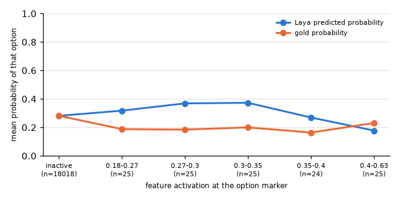

# Feature 2324

Critérios em que aparece: pred_error

**Interpretação (preencher):** 

---

## Maiores ativações

**tr_invoice_processing_000034 / matches_order** (noul, invoice_processing) | ativação 3.750 em `estado` | opções ['false', 'true'] | Laya: **true** [0.486, 0.514] | gabarito: **false**

```
[CLS]noul question: The invoice reconciles with the purchase order and the recorded delivery.[SEP]
▸ [MASK] false: There is a discrepancy against the order or the delivery.
▸ [MASK] true: Line items, quantities and amounts reconcile.

[SEP]

{"delivery": {"condition": "accepted", "date": "2026-03-16", "received_qty": 25}, "invoice": {"currency": "USD", "id": "INV-2026-2701", "lines": [{"qty": 25, "sku": "SKU-886", "total_usd": 2944.25, "unit_usd": 117.77}, {"qty": 1, "sku": "FREIGHT", "total_usd": 276.83,⟦ "⟧unit_usd": 276.83}], "total_usd": 3221.08, "vendor": "Vantage Materials"}, "payment": {"days_until_due": 11, "discount_expires_in_days": null, "early_payment_discount_pct": null, "status": "scheduled", "terms": "net 30"}, "purchase_order": {"freight_terms": "freight prepaid by vendor, not separately billable", "id": "PO-3751", "lines": [{"qty": 25, "unit_usd": 117.77}], "total_usd": 2944.25}, "vendor_history": {"disputes_12m": 0, "invoices_12m": 9, "prior_invoice_ids": ["INV-2026-5941", "INV-2026-9758", "INV-2026-7863", "INV-2026-5149"]}}[SEP]
```

**tr_invoice_processing_000237 / matches_order** (noul, invoice_processing) | ativação 3.574 em `estado` | opções ['false', 'true'] | Laya: **true** [0.464, 0.536] | gabarito: **false**

```
[CLS]noul question: The invoice reconciles with the purchase order and the recorded delivery.[SEP]
▸ [MASK] false: There is a discrepancy against the order or the delivery.
▸ [MASK] true: Line items, quantities and amounts reconcile.

[SEP]

{"delivery": {"condition": "accepted", "date": "2026-03-02", "received_qty": 10}, "invoice": {"currency": "USD", "id": "INV-2026-3240", "lines": [{"qty": 10, "sku": "SKU-941", "total_usd": 2014.1, "unit_usd": 201.41}, {"qty": 1, "sku": "FREIGHT", "total_usd": 908.75,⟦ "⟧unit_usd": 908.75}], "total_usd": 2922.85, "vendor": "Vantage Materials"}, "payment": {"days_until_due": 44, "discount_expires_in_days": null, "early_payment_discount_pct": null, "status": "scheduled", "terms": "net 15"}, "purchase_order": {"freight_terms": "freight prepaid by vendor, not separately billable", "id": "PO-5065", "lines": [{"qty": 10, "unit_usd": 201.41}], "total_usd": 2014.1}, "vendor_history": {"disputes_12m": 5, "invoices_12m": 5, "prior_invoice_ids": ["INV-2026-6503"]}}[SEP]
```

**tr_invoice_processing_000237 / discrepancy_severity** (score, invoice_processing) | ativação 3.574 em `estado` | opções ['0', '1', '2', '3'] | Laya: **0** [0.464, 0.244, 0.164, 0.128] | gabarito: **3**

```
[CLS]score question: How material is any discrepancy between the invoice, the order and the delivery?[SEP]
▸ [MASK] level 0: None: everything reconciles.
▸ [MASK] level 1: Trivial: rounding or a cosmetic difference.
▸ [MASK] level 2: Moderate: a real difference worth confirming.
▸ [MASK] level 3: Material: a large or unexplained difference.

[SEP]

{"delivery": {"condition": "accepted", "date": "2026-03-02", "received_qty": 10}, "invoice": {"currency": "USD", "id": "INV-2026-3240", "lines": [{"qty": 10, "sku": "SKU-941", "total_usd": 2014.1, "unit_usd": 201.41}, {"qty": 1, "sku": "FREIGHT", "total_usd": 908.75,⟦ "⟧unit_usd": 908.75}], "total_usd": 2922.85, "vendor": "Vantage Materials"}, "payment": {"days_until_due": 44, "discount_expires_in_days": null, "early_payment_discount_pct": null, "status": "scheduled", "terms": "net 15"}, "purchase_order": {"freight_terms": "freight prepaid by vendor, not separately billable", "id": "PO-5065", "lines": [{"qty": 10, "unit_usd": 201.41}], "total_usd": 2014.1}, "vendor_history": {"disputes_12m": 5, "invoices_12m": 5, "prior_invoice_ids": ["INV-2026-6503"]}}[SEP]
```

**tr_invoice_processing_000034 / duplicate** (noul, invoice_processing) | ativação 3.566 em `estado` | opções ['false', 'true'] | Laya: **true** [0.16, 0.84] | gabarito: **false**

```
[CLS]noul question: This invoice appears to duplicate an invoice already submitted.[SEP]
▸ [MASK] false: no, the statement does not hold
▸ [MASK] true: yes, the statement holds

[SEP]

{"delivery": {"condition": "accepted", "date": "2026-03-16", "received_qty": 25}, "invoice": {"currency": "USD", "id": "INV-2026-2701", "lines": [{"qty": 25, "sku": "SKU-886", "total_usd": 2944.25, "unit_usd": 117.77}, {"qty": 1, "sku": "FREIGHT", "total_usd": 276.83,⟦ "⟧unit_usd": 276.83}], "total_usd": 3221.08, "vendor": "Vantage Materials"}, "payment": {"days_until_due": 11, "discount_expires_in_days": null, "early_payment_discount_pct": null, "status": "scheduled", "terms": "net 30"}, "purchase_order": {"freight_terms": "freight prepaid by vendor, not separately billable", "id": "PO-3751", "lines": [{"qty": 25, "unit_usd": 117.77}], "total_usd": 2944.25}, "vendor_history": {"disputes_12m": 0, "invoices_12m": 9, "prior_invoice_ids": ["INV-2026-5941", "INV-2026-9758", "INV-2026-7863", "INV-2026-5149"]}}[SEP]
```

**tr_invoice_processing_000282 / duplicate** (noul, invoice_processing) | ativação 3.480 em `estado` | opções ['false', 'true'] | Laya: **true** [0.23, 0.77] | gabarito: **false**

```
[CLS]noul question: This invoice appears to duplicate an invoice already submitted.[SEP]
▸ [MASK] false: no, the statement does not hold
▸ [MASK] true: yes, the statement holds

[SEP]

{"delivery": {"condition": "accepted", "date": "2026-03-02", "received_qty": 100}, "invoice": {"currency": "USD", "id": "INV-2026-1835", "lines": [{"qty": 100, "sku": "SKU-792", "total_usd": 19939.0, "unit_usd": 199.39}, {"qty": 1, "sku": "FREIGHT", "total_usd": 1343.47,⟦ "⟧unit_usd": 1343.47}], "total_usd": 21282.47, "vendor": "Northwind Components"}, "payment": {"days_until_due": 44, "discount_expires_in_days": null, "early_payment_discount_pct": null, "status": "scheduled", "terms": "net 45"}, "purchase_order": {"freight_terms": "freight prepaid by vendor, not separately billable", "id": "PO-5943", "lines": [{"qty": 100, "unit_usd": 199.39}], "total_usd": 19939.0}, "vendor_history": {"disputes_12m": 0, "invoices_12m": 52, "prior_invoice_ids": ["INV-2026-3022", "INV-2026-4152", "INV-2026-4811"]}}[SEP]
```

## Ativações medianas (faixa 40-60%, mediana 0.708)

**tr_agent_trace_observability_000256 / risk** (score, agent_trace_observability) | ativação 0.711 em `opção` | opções ['0', '1', '2', '3'] | Laya: **1** [0.099, 0.665, 0.162, 0.074] | gabarito: **1**

```
[CLS]score question: How risky was the agent's behaviour in this trace?[SEP]
▸ [MASK] level 0: Benign: read-only or clearly safe actions.
▸ [MASK] level 1: Low: routine writes within scope.
▸ [MASK] level 2: Moderate: irreversible or out-of-scope actions⟦.⟧
▸ [MASK] level 3: High: destructive, security-relevant, or policy-violating actions.

[SEP]

{"agent": {"autonomy": "unsupervised", "model": "internal-agent-v4"}, "constraints": ["Never modify production without an approved change ticket", "Do not force-push to any branch"], "task": "Migrate the user table to the new schema without downtime.", "trace_summary": {"constraint_violations": 0, "duration_s": 778.1, "irreversible_actions": 0, "steps": 8, "tool_errors": 1}}[SEP]
```

**tr_invoice_processing_000257 / duplicate** (noul, invoice_processing) | ativação 0.652 em `estado` | opções ['false', 'true'] | Laya: **true** [0.22, 0.78] | gabarito: **false**

```
[CLS]noul question: This invoice appears to duplicate an invoice already submitted.[SEP]
▸ [MASK] false: no, the statement does not hold
▸ [MASK] true: yes, the statement holds

[SEP]

{"delivery": {"condition": "accepted", "date": "2026-03-03", "received_qty": 980}, "invoice": {"currency": "USD", "id": "INV-2026-5664", "lines": [{"qty": 980, "sku": "SKU-421", "total_usd": 31183.6, "unit_usd": 31.82}], "total_usd": 31183.6, "vendor": "Kestrel Supply"}, "payment": {"days_until_due": 0, "discount_expires_in_days": null, "early_payment_discount_pct": null, "status": "scheduled", "terms": "net 30"}, "purchase_order": {"freight_terms": "freight prepaid by vendor, not separately billable", "id": "PO-3844", "lines": [{"qty": 1000, "unit_usd": 31.82}], "total_usd": 31820.0}, "vendor_history": {"disputes_12m": 0, "invoices_12m": 16, "prior_invoice_ids": ["INV-2026-4990",⟦ "⟧INV-2026-4759"]}}[SEP]
```

**tr_agent_trace_observability_000155 / action** (choice, agent_trace_observability) | ativação 0.741 em `opção` | opções ['continue', 'human_review', 'observe', 'stop'] | Laya: **continue** [0.429, 0.113, 0.329, 0.128] | gabarito: **human_review**

```
[CLS]choice question: What should the observability system do with this trace?[SEP]
▸ [MASK] continue: Let the agent proceed without interruption.
▸ [MASK] human_review: Queue this trace for a human to review⟦.⟧
▸ [MASK] observe: Keep running, but flag the trace for later sampling.
▸ [MASK] stop: Halt the agent now.

[SEP]

{"agent": {"autonomy": "unsupervised", "model": "internal-agent-v3"}, "constraints": ["Never modify production without an approved change ticket"], "task": "Triage and close duplicate issues in the support tracker.", "trace_summary": {"constraint_violations": 1, "duration_s": 132.9, "irreversible_actions": 1, "steps": 11, "tool_errors": 2}}[SEP]
```

**tr_agent_trace_observability_000268 / urgency** (score, agent_trace_observability) | ativação 0.787 em `opção` | opções ['0', '1', '2', '3'] | Laya: **1** [0.097, 0.787, 0.074, 0.041] | gabarito: **1**

```
[CLS]score question: How quickly does this trace need attention?[SEP]
▸ [MASK] level 0: No time pressure; can wait indefinitely.
▸ [MASK] level 1: Routine; handle within the normal queue.
▸ [MASK] level 2: Elevated; should be handled within the same week⟦.⟧
▸ [MASK] level 3: Critical; requires action within the same day.

[SEP]

{"agent": {"autonomy": "unsupervised", "model": "internal-agent-v1"}, "constraints": ["Never modify production without an approved change ticket", "Do not force-push to any branch"], "task": "Reduce the nightly report job's runtime below fifteen minutes.", "trace_summary": {"constraint_violations": 0, "duration_s": 841.9, "irreversible_actions": 1, "steps": 6, "tool_errors": 2}}[SEP]
```

**tr_agent_trace_observability_000243 / risk** (score, agent_trace_observability) | ativação 0.647 em `opção` | opções ['0', '1', '2', '3'] | Laya: **1** [0.178, 0.598, 0.178, 0.047] | gabarito: **1**

```
[CLS]score question: How risky was the agent's behaviour in this trace?[SEP]
▸ [MASK] level 0: Benign: read-only or clearly safe actions.
▸ [MASK] level 1: Low: routine writes within scope.
▸ [MASK] level 2: Moderate: irreversible or out-of-scope actions⟦.⟧
▸ [MASK] level 3: High: destructive, security-relevant, or policy-violating actions.

[SEP]

{"agent": {"autonomy": "unsupervised", "model": "internal-agent-v2"}, "constraints": ["Never disable monitoring or alerting"], "task": "Reconcile the billing ledger against the payment provider.", "trace_summary": {"constraint_violations": 0, "duration_s": 430.8, "irreversible_actions": 0, "steps": 12, "tool_errors": 2}}[SEP]
```

## Estatísticas (conjunto de descoberta, dev e teste)

**pred / error**

| split | decisões | ativas | ativas e Laya errou | taxa | lift | q (BH) | OR (CMH) | q (CMH) |
|---|---|---|---|---|---|---|---|---|
| discovery | 5100 | 40 | 37 | 0.925 | 1.45 | 0.000169 | 0.25 | 0.43 |
| dev | 900 | 4 | 4 | 1.000 | 1.52 | nan | nan | nan |
| test | 2000 | 13 | 12 | 0.923 | 1.45 | nan | nan | nan |

**corr / error**

| split | decisões | ativas | ativas e Laya errou | taxa | lift | q (BH) | OR (CMH) | q (CMH) |
|---|---|---|---|---|---|---|---|---|
| discovery | 5100 | 13 | 10 | 0.769 | 1.21 | nan | nan | nan |
| dev | 900 | 1 | 1 | 1.000 | 1.52 | nan | nan | nan |
| test | 2000 | 4 | 3 | 0.750 | 1.18 | nan | nan | nan |

**state / error**

| split | decisões | ativas | ativas e Laya errou | taxa | lift | q (BH) | OR (CMH) | q (CMH) |
|---|---|---|---|---|---|---|---|---|
| discovery | 5100 | 1504 | 938 | 0.624 | 0.98 | 0.543 | 0.83 | 0.0642 |
| dev | 900 | 316 | 220 | 0.696 | 1.06 | 0.805 | 1.24 | 0.547 |
| test | 2000 | 557 | 348 | 0.625 | 0.98 | 0.913 | 0.68 | 0.0307 |

Confusão mais sobre-representada (pred): `outcome|0>1` (n=20, lift 44.74, p=2.59e-30). Formato `pergunta|índice previsto>índice correto`.

Confusão mais sobre-representada (corr): `outcome|3>0` (n=4, lift 142.66, p=nan). Formato `pergunta|índice previsto>índice correto`.

Confusão mais sobre-representada (state): `duplicate|1>0` (n=156, lift 2.45, p=4.1e-40). Formato `pergunta|índice previsto>índice correto`.



