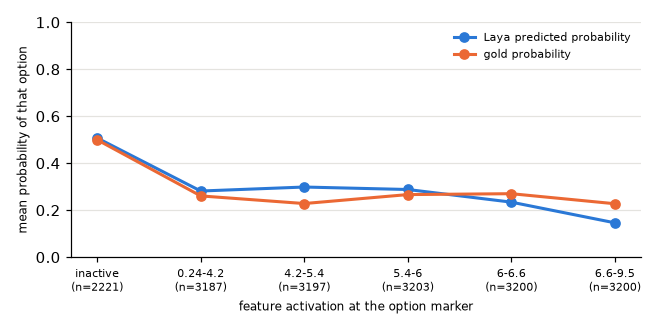

# Feature 2351

Critérios em que aparece: attribution_toward_correct

**Interpretação (preencher):** 

---

## Maiores ativações

**tr_customer_service_000157 / category** (choice, customer_service) | ativação 9.492 em `marcador` | opções ['account', 'billing', 'delivery', 'refund', 'technical'] | Laya: **account** [0.816, 0.019, 0.011, 0.072, 0.082] | gabarito: **account**

```
[CLS]choice question: What is this customer conversation primarily about?[SEP]
▸ [MASK] account: Login, plan changes, profile or access management.
▸ [MASK] billing: A charge, invoice, subscription or payment problem.
▸ ⟦[MASK]⟧ delivery: Shipping, fulfilment or delivery of a physical item.
▸ [MASK] refund: The customer is explicitly asking for money back.
▸ [MASK] technical: The product or service is not working as expected.

[SEP]

{"account": {"lifetime_value_usd": 3086, "prior_tickets_90d": 3, "seats": 1, "tenure_months": 49, "tier": "standard"}, "thread": [{"role": "customer", "text": "I need to get into my account right now – the login page just keeps looping back to the password screen and I can’t access anything."}, {"role": "agent", "text": "I understand the urgency. Could you share the exact error message you’re seeing, or let me know if you’ve tried resetting the password?"}, {"role": "customer", "text": "The message says “authentication failed” after I enter my credentials, and I’ve already tried the password reset twice with no luck."}]}[SEP]
```

**tr_customer_service_000158 / category** (choice, customer_service) | ativação 9.336 em `marcador` | opções ['account', 'billing', 'delivery', 'refund', 'technical'] | Laya: **technical** [0.092, 0.076, 0.02, 0.322, 0.489] | gabarito: **technical**

```
[CLS]choice question: What is this customer conversation primarily about?[SEP]
▸ [MASK] account: Login, plan changes, profile or access management.
▸ [MASK] billing: A charge, invoice, subscription or payment problem.
▸ ⟦[MASK]⟧ delivery: Shipping, fulfilment or delivery of a physical item.
▸ [MASK] refund: The customer is explicitly asking for money back.
▸ [MASK] technical: The product or service is not working as expected.

[SEP]

{"account": {"lifetime_value_usd": 134, "prior_tickets_90d": 5, "seats": 5, "tenure_months": 3, "tier": "enterprise"}, "orders": [{"amount_usd": 49, "date": "2026-02-16", "id": "A-54178", "status": "settled"}, {"amount_usd": 49, "date": "2026-02-18", "id": "A-29578", "status": "settled"}, {"amount_usd": 49, "date": "2026-01-24", "id": "A-46676", "status": "refunded"}], "thread": [{"role": "customer", "text": "The bulk‑upload feature stopped accepting CSV files; it returns a generic error as soon as I click Submit."}]}[SEP]
```

**tr_customer_service_000057 / category** (choice, customer_service) | ativação 9.312 em `marcador` | opções ['account', 'billing', 'delivery', 'refund', 'technical'] | Laya: **technical** [0.289, 0.114, 0.07, 0.19, 0.338] | gabarito: **technical**

```
[CLS]choice question: What is this customer conversation primarily about?[SEP]
▸ [MASK] account: Login, plan changes, profile or access management.
▸ [MASK] billing: A charge, invoice, subscription or payment problem.
▸ ⟦[MASK]⟧ delivery: Shipping, fulfilment or delivery of a physical item.
▸ [MASK] refund: The customer is explicitly asking for money back.
▸ [MASK] technical: The product or service is not working as expected.

[SEP]

{"account": {"lifetime_value_usd": 1386, "prior_tickets_90d": 1, "seats": 1, "tenure_months": 72, "tier": "free"}, "thread": [{"role": "customer", "text": "Your service is crawling at a snail’s pace and I’ve been on the free plan for six years – this is unacceptable."}, {"role": "agent", "text": "I’m sorry you’re experiencing slowness. Could you let me know which device and browser you’re using?"}, {"role": "customer", "text": "Ticket #6789 was supposed to fix this weeks ago, but nothing changed. It’s the same lag every time I log in."}, {"role": "agent", "text": "Got it. When did the slowdown start, and are you seeing any error messages on the screen?"}, {"role": "customer", "text": "It started yesterday, no error messages, just endless loading. My work is getting held up and I need an update."}]}[SEP]
```

**tr_customer_service_000154 / category** (choice, customer_service) | ativação 9.281 em `marcador` | opções ['account', 'billing', 'delivery', 'refund', 'technical'] | Laya: **refund** [0.179, 0.122, 0.04, 0.442, 0.217] | gabarito: **technical**

```
[CLS]choice question: What is this customer conversation primarily about?[SEP]
▸ [MASK] account: Login, plan changes, profile or access management.
▸ [MASK] billing: A charge, invoice, subscription or payment problem.
▸ ⟦[MASK]⟧ delivery: Shipping, fulfilment or delivery of a physical item.
▸ [MASK] refund: The customer is explicitly asking for money back.
▸ [MASK] technical: The product or service is not working as expected.

[SEP]

{"account": {"lifetime_value_usd": 1803, "prior_tickets_90d": 0, "seats": 1, "tenure_months": 19, "tier": "free"}, "orders": [{"amount_usd": 198, "date": "2026-02-24", "id": "A-56491", "status": "refunded"}, {"amount_usd": 198, "date": "2026-02-25", "id": "A-17184", "status": "settled"}], "thread": [{"role": "customer", "text": "My attempt to upload a PDF to the project folder keeps timing out after a few seconds."}, {"role": "agent", "text": "Understood. Are you seeing any error messages, or does the process simply stop?"}, {"role": "customer", "text": "It just stops; the spinner spins forever, no error text appears."}, {"role": "agent", "text": "Thanks for clarifying. Have you tried clearing your browser cache or using a different browser?"}, {"role": "customer", "text": "I tried Chrome incognito and it behaved the same way."}]}[SEP]
```

**tr_customer_service_000007 / category** (choice, customer_service) | ativação 9.102 em `marcador` | opções ['account', 'billing', 'delivery', 'refund', 'technical'] | Laya: **technical** [0.182, 0.131, 0.044, 0.098, 0.546] | gabarito: **technical**

```
[CLS]choice question: What is this customer conversation primarily about?[SEP]
▸ [MASK] account: Login, plan changes, profile or access management.
▸ [MASK] billing: A charge, invoice, subscription or payment problem.
▸ ⟦[MASK]⟧ delivery: Shipping, fulfilment or delivery of a physical item.
▸ [MASK] refund: The customer is explicitly asking for money back.
▸ [MASK] technical: The product or service is not working as expected.

[SEP]

{"account": {"lifetime_value_usd": 46, "prior_tickets_90d": 0, "seats": 1, "tenure_months": 1, "tier": "premium"}, "thread": [{"role": "customer", "text": "I'm trying to use the new collaboration feature I just paid for, but the invite link doesn't seem to do anything when my partner clicks it, am I missing a step?"}, {"role": "agent", "text": "I'd like to help you get that working. When your partner clicks the link, what exactly do they see on their screen?"}, {"role": "customer", "text": "They just see a blank white page, and I thought this was supposed to be a simple process for premium users."}, {"role": "agent", "text": "I see. Have you tried generating a new link to see if the same issue persists, or does it happen with every invite you send?"}, {"role": "customer", "text": "I tried creating three different links and they all lead to the same blank page, so I'm really confused about what the problem is."}]}[SEP]
```

## Ativações medianas (faixa 40-60%, mediana 2.069)

**tr_security_incidents_000093 / disposition** (choice, security_incidents) | ativação 2.285 em `opção` | opções ['close_benign', 'contain', 'investigate', 'monitor'] | Laya: **contain** [0.322, 0.377, 0.077, 0.224] | gabarito: **investigate**

```
[CLS]choice question: How should this security alert be dispositioned?[SEP]
▸ [MASK] close_benign: Expected, explainable activity; close without analyst time.
▸ [MASK] contain: Contain the host or account immediately; do not wait for triage.
▸ [MASK] investigate: Warrants an analyst opening an investigation⟦.⟧
▸ [MASK] monitor: Not clearly malicious, but worth watching for recurrence.

[SEP]

{"alert": {"description": "audit logging was turned off on a host", "evidence": "At 14:22 UTC, the audit logging service on host PROD-SRV-04 was disabled by the shared_mailbox principal from allowlisted IP 192.168.1.55. This action occurred outside of any scheduled maintenance window using an account that last rotated its credentials 14 days ago. The session was established via a multi-factor authenticated login.", "rule": "disabled_logging"}, "context": {"asset_criticality": "high", "change_window_active": false, "source_on_allowlist": true}, "history": {"credential_rotation_days_ago": 14, "distinct_countries_30d": 4, "logins_30d": 583, "prior_alerts_90d": 0}, "principal": {"mfa_enrolled": true, "name": "adm-support-897", "privileges": ["repo:read"], "type": "shared_mailbox"}}[SEP]
```

**tr_security_incidents_000133 / urgency** (score, security_incidents) | ativação 1.853 em `opção` | opções ['0', '1', '2', '3'] | Laya: **1** [0.043, 0.772, 0.085, 0.099] | gabarito: **3**

```
[CLS]score question: How quickly must a responder act on this alert?[SEP]
▸ [MASK] level 0: No time pressure; can wait indefinitely.
▸ [MASK] level 1⟦:⟧ Routine; handle within the normal queue.
▸ [MASK] level 2: Elevated; should be handled within the same week.
▸ [MASK] level 3: Critical; requires action within the same day.

[SEP]

{"alert": {"description": "audit logging was turned off on a host", "evidence": "Audit logging was disabled on host build-runner-07 at 2026-09-15 11:47 UTC, as evidenced by the removal of the journald.conf entry that enables persistent storage. The action originated from CI runner account ci-runner-42, which lacks elevated privileges but has MFA active, and occurred outside any scheduled change window. The initiating source (10.2.0.15) matches an allow‑listed IP range, and the runner's credentials were refreshed three days ago.", "rule": "disabled_logging"}, "context": {"asset_criticality": "crown_jewel", "change_window_active": false, "source_on_allowlist": true}, "history": {"credential_rotation_days_ago": 3, "distinct_countries_30d": 3, "logins_30d": 902, "prior_alerts_90d": 3}, "principal": {"mfa_enrolled": true, "name": "adm-support-681", "privileges": ["repo:read"], "type": "ci_runner"}}[SEP]
```

**tr_security_incidents_000173 / urgency** (score, security_incidents) | ativação 1.787 em `opção` | opções ['0', '1', '2', '3'] | Laya: **1** [0.061, 0.715, 0.152, 0.071] | gabarito: **0**

```
[CLS]score question: How quickly must a responder act on this alert?[SEP]
▸ [MASK] level 0: No time pressure; can wait indefinitely.
▸ [MASK] level 1: Routine; handle within the normal queue.
▸ [MASK] level⟦ 2⟧: Elevated; should be handled within the same week.
▸ [MASK] level 3: Critical; requires action within the same day.

[SEP]

{"alert": {"description": "a session token was presented from a second address", "evidence": "An active session token belonging to an unprivileged employee was observed being utilized by a second allowlisted network address during an open change window. The account involved has MFA active and reached a credential age of 90 days at the time of the duplicate session presentation.", "rule": "token_reuse"}, "context": {"asset_criticality": "low", "change_window_active": true, "source_on_allowlist": true}, "history": {"credential_rotation_days_ago": 90, "distinct_countries_30d": 4, "logins_30d": 474, "prior_alerts_90d": 0}, "principal": {"mfa_enrolled": true, "name": "svc-analytics-220", "privileges": ["repo:read"], "type": "employee"}}[SEP]
```

**tr_invoice_processing_000124 / discrepancy_severity** (score, invoice_processing) | ativação 1.796 em `opção` | opções ['0', '1', '2', '3'] | Laya: **0** [0.371, 0.241, 0.217, 0.172] | gabarito: **2**

```
[CLS]score question: How material is any discrepancy between the invoice, the order and the delivery?[SEP]
▸ [MASK] level 0: None: everything reconciles.
▸ [MASK] level 1: Trivial: rounding or a cosmetic difference.
▸ [MASK] level⟦ 2⟧: Moderate: a real difference worth confirming.
▸ [MASK] level 3: Material: a large or unexplained difference.

[SEP]

{"delivery": {"condition": "accepted", "date": "2026-03-17", "received_qty": 10}, "invoice": {"currency": "USD", "id": "INV-2026-6789", "lines": [{"qty": 10, "sku": "SKU-692", "total_usd": 2272.9, "unit_usd": 227.29}], "total_usd": 2272.9, "vendor": "Orbit Logistics"}, "payment": {"days_until_due": 5, "discount_expires_in_days": null, "early_payment_discount_pct": null, "status": "scheduled", "terms": "net 30"}, "purchase_order": {"freight_terms": "freight prepaid by vendor, not separately billable", "id": "PO-2113", "lines": [{"qty": 10, "unit_usd": 220.67}], "total_usd": 2206.7}, "vendor_history": {"disputes_12m": 0, "invoices_12m": 1, "prior_invoice_ids": ["INV-2026-5780", "INV-2026-1144"]}}[SEP]
```

**tr_invoice_processing_000185 / discrepancy_severity** (score, invoice_processing) | ativação 2.592 em `opção` | opções ['0', '1', '2', '3'] | Laya: **0** [0.398, 0.237, 0.205, 0.161] | gabarito: **0**

```
[CLS]score question: How material is any discrepancy between the invoice, the order and the delivery?[SEP]
▸ [MASK] level 0⟦:⟧ None: everything reconciles.
▸ [MASK] level 1: Trivial: rounding or a cosmetic difference.
▸ [MASK] level 2: Moderate: a real difference worth confirming.
▸ [MASK] level 3: Material: a large or unexplained difference.

[SEP]

{"delivery": {"condition": "accepted", "date": "2026-03-11", "received_qty": 100}, "invoice": {"currency": "USD", "id": "INV-2026-5921", "lines": [{"qty": 100, "sku": "SKU-796", "total_usd": 32023.0, "unit_usd": 320.23}], "total_usd": 32023.0, "vendor": "Acme Fabrication"}, "payment": {"days_until_due": 18, "discount_expires_in_days": 8, "early_payment_discount_pct": 2.0, "status": "scheduled", "terms": "net 30"}, "purchase_order": {"freight_terms": "freight prepaid by vendor, not separately billable", "id": "PO-9122", "lines": [{"qty": 100, "unit_usd": 320.23}], "total_usd": 32023.0}, "vendor_history": {"disputes_12m": 0, "invoices_12m": 31, "prior_invoice_ids": ["INV-2026-2674", "INV-2026-5172"]}}[SEP]
```

## Estatísticas (conjunto de descoberta, dev e teste)

**pred / error**

| split | decisões | ativas | ativas e Laya errou | taxa | lift | q (BH) | OR (CMH) | q (CMH) |
|---|---|---|---|---|---|---|---|---|
| discovery | 5100 | 3941 | 2638 | 0.669 | 1.05 | 7.13e-18 | 1.16 | 0.66 |
| dev | 900 | 672 | 446 | 0.664 | 1.01 | 0.78 | 0.31 | 0.697 |
| test | 2000 | 1549 | 1036 | 0.669 | 1.05 | 6.11e-07 | 0.76 | 0.878 |

**corr / error**

| split | decisões | ativas | ativas e Laya errou | taxa | lift | q (BH) | OR (CMH) | q (CMH) |
|---|---|---|---|---|---|---|---|---|
| discovery | 5100 | 3984 | 2681 | 0.673 | 1.06 | 2.64e-23 | 1.51 | 0.418 |
| dev | 900 | 688 | 462 | 0.672 | 1.02 | 0.156 | 0.12 | 0.394 |
| test | 2000 | 1566 | 1053 | 0.672 | 1.06 | 3.34e-09 | 0.36 | 0.405 |

**state / error**

| split | decisões | ativas | ativas e Laya errou | taxa | lift | q (BH) | OR (CMH) | q (CMH) |
|---|---|---|---|---|---|---|---|---|
| discovery | 5100 | 3957 | 2501 | 0.632 | 0.99 | 0.561 | 0.94 | 0.599 |
| dev | 900 | 722 | 470 | 0.651 | 0.99 | 1 | 0.89 | 0.79 |
| test | 2000 | 1587 | 1032 | 0.650 | 1.02 | 0.273 | 1.20 | 0.34 |

Confusão mais sobre-representada (pred): `urgency|1>3` (n=292, lift 1.29, p=1.56e-34). Formato `pergunta|índice previsto>índice correto`.

Confusão mais sobre-representada (corr): `urgency|1>3` (n=292, lift 1.28, p=4.2e-33). Formato `pergunta|índice previsto>índice correto`.

Confusão mais sobre-representada (state): `duplicate|1>0` (n=195, lift 1.16, p=5.63e-07). Formato `pergunta|índice previsto>índice correto`.



