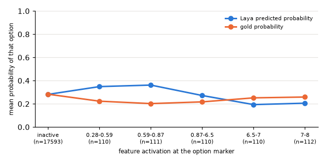

# Feature 2633

Critérios em que aparece: corr_error_stratified

**Interpretação (preencher):** 

---

## Maiores ativações

**tr_customer_service_000082 / action** (choice, customer_service) | ativação 7.992 em `marcador` | opções ['answer_directly', 'close_no_action', 'escalate_to_human', 'execute_refund', 'request_information'] | Laya: **execute_refund** [0.212, 0.166, 0.145, 0.358, 0.118] | gabarito: **escalate_to_human**

```
[CLS]choice question: What should the assistant do next with this conversation?[SEP]
▸ ⟦[MASK]⟧ answer_directly: The assistant can resolve this itself with information it already has.
▸ [MASK] close_no_action: No further action is warranted; the matter is settled.
▸ [MASK] escalate_to_human: Hand off to a human agent with the appropriate authority.
▸ [MASK] execute_refund: Issue the refund or credit the customer is owed.
▸ [MASK] request_information: More detail is needed from the customer before anything can be done.

[SEP]

{"account": {"lifetime_value_usd": 2703, "prior_tickets_90d": 2, "seats": 40, "tenure_months": 49, "tier": "premium"}, "thread": [{"role": "customer", "text": "I need an update on my refund now! You promised it after my last ticket and it’s been weeks—this is urgent."}, {"role": "agent", "text": "I’m sorry for the delay. Could you provide the transaction date or reference number so I can locate the refund request?"}, {"role": "customer", "text": "The purchase was on February 14th, reference #A1B2C3. I’ve been waiting far too long and need the money back immediately."}, {"role": "agent", "text": "Thank you for the details. I’ll check the status right away and get back to you as soon as I have more information."}, {"role": "customer", "text": "Please expedite this – I expect a resolution today."}]}[SEP]
```

**tr_customer_service_000067 / action** (choice, customer_service) | ativação 7.988 em `marcador` | opções ['answer_directly', 'close_no_action', 'escalate_to_human', 'execute_refund', 'request_information'] | Laya: **answer_directly** [0.269, 0.259, 0.104, 0.187, 0.181] | gabarito: **escalate_to_human**

```
[CLS]choice question: What should the assistant do next with this conversation?[SEP]
▸ ⟦[MASK]⟧ answer_directly: The assistant can resolve this itself with information it already has.
▸ [MASK] close_no_action: No further action is warranted; the matter is settled.
▸ [MASK] escalate_to_human: Hand off to a human agent with the appropriate authority.
▸ [MASK] execute_refund: Issue the refund or credit the customer is owed.
▸ [MASK] request_information: More detail is needed from the customer before anything can be done.

[SEP]

{"account": {"lifetime_value_usd": 81, "prior_tickets_90d": 0, "seats": 12, "tenure_months": 2, "tier": "premium"}, "thread": [{"role": "customer", "text": "I was promised a refund last week for my premium subscription, but nothing has shown up yet. I need that money in my account by the end of day tomorrow."}, {"role": "agent", "text": "Understood, that’s frustrating. Could you provide the order ID or refund reference you received?"}, {"role": "customer", "text": "The order number is #PX-8429. I've been waiting and this delay is really disappointing."}, {"role": "agent", "text": "Thanks for the details. I’ll check the status on my end. Is there any other information, like the payment method you used, that could help speed this up?"}, {"role": "customer", "text": "I paid with the card ending 1234, and I’m counting on the refund being processed before tomorrow’s deadline."}]}[SEP]
```

**tr_customer_service_000172 / action** (choice, customer_service) | ativação 7.973 em `marcador` | opções ['answer_directly', 'close_no_action', 'escalate_to_human', 'execute_refund', 'request_information'] | Laya: **escalate_to_human** [0.222, 0.228, 0.248, 0.104, 0.197] | gabarito: **escalate_to_human**

```
[CLS]choice question: What should the assistant do next with this conversation?[SEP]
▸ ⟦[MASK]⟧ answer_directly: The assistant can resolve this itself with information it already has.
▸ [MASK] close_no_action: No further action is warranted; the matter is settled.
▸ [MASK] escalate_to_human: Hand off to a human agent with the appropriate authority.
▸ [MASK] execute_refund: Issue the refund or credit the customer is owed.
▸ [MASK] request_information: More detail is needed from the customer before anything can be done.

[SEP]

{"account": {"lifetime_value_usd": 131, "prior_tickets_90d": 0, "seats": 5, "tenure_months": 5, "tier": "premium"}, "thread": [{"role": "customer", "text": "Hi, I'm really scratching my head here. My package says it was delivered yesterday, but I've been checking my porch all morning and there's absolutely nothing. I've been with you for five months on the premium plan and this has never happened."}, {"role": "agent", "text": "I’m sorry to hear that you haven't received your package yet. Could you please confirm the tracking number you are referring to so I can take a look?"}, {"role": "customer", "text": "The tracking number is 94001000. I'm just so confused because the status hasn't updated since yesterday morning. I really need this by tomorrow afternoon for a presentation."}, {"role": "agent", "text": "Thank you for providing that number. I am pulling up your account details now. Could you tell me if you have checked with any neighbors or a building manager in the meantime?"}, {"role": "customer", "text": "I did check with my neighbor, but they didn't see anything. I'm worried because I'm on a tight timeline here. Is there any way to see exactly where the driver left it?"}, {"role": "agent", "text": "I understand your concern given your upcoming deadline. I need to reach out to our logistics partner to get more information on the delivery scan; could you confirm the exact address on file?"}, {"role": "customer", "text": "It's 442 Maple Drive. I just hope this gets sorted out quickly because I really can't miss this deadline."}]}[SEP]
```

**tr_customer_service_000274 / action** (choice, customer_service) | ativação 7.867 em `marcador` | opções ['answer_directly', 'close_no_action', 'escalate_to_human', 'execute_refund', 'request_information'] | Laya: **close_no_action** [0.177, 0.426, 0.169, 0.098, 0.131] | gabarito: **answer_directly**

```
[CLS]choice question: What should the assistant do next with this conversation?[SEP]
▸ ⟦[MASK]⟧ answer_directly: The assistant can resolve this itself with information it already has.
▸ [MASK] close_no_action: No further action is warranted; the matter is settled.
▸ [MASK] escalate_to_human: Hand off to a human agent with the appropriate authority.
▸ [MASK] execute_refund: Issue the refund or credit the customer is owed.
▸ [MASK] request_information: More detail is needed from the customer before anything can be done.

[SEP]

{"account": {"lifetime_value_usd": 2198, "prior_tickets_90d": 0, "seats": 1, "tenure_months": 72, "tier": "free"}, "thread": [{"role": "customer", "text": "I need to export the data from my account. I’ve been on the free plan for seventy-two months, and I can’t keep hoping the export button works."}, {"role": "agent", "text": "I’m sorry that’s been so difficult. Can you tell me what you see when you open the export option?"}, {"role": "customer", "text": "Nothing. It looks the same as it has for days. I haven’t submitted a ticket before, so there’s no earlier trail."}, {"role": "agent", "text": "Thank you. Are you trying to export all records, or a specific collection?"}, {"role": "customer", "text": "All of it, if I can. I’m not asking for much, just a way out that doesn’t require more waiting."}]}[SEP]
```

**tr_customer_service_000260 / action** (choice, customer_service) | ativação 7.863 em `marcador` | opções ['answer_directly', 'close_no_action', 'escalate_to_human', 'execute_refund', 'request_information'] | Laya: **request_information** [0.211, 0.229, 0.146, 0.14, 0.274] | gabarito: **escalate_to_human**

```
[CLS]choice question: What should the assistant do next with this conversation?[SEP]
▸ ⟦[MASK]⟧ answer_directly: The assistant can resolve this itself with information it already has.
▸ [MASK] close_no_action: No further action is warranted; the matter is settled.
▸ [MASK] escalate_to_human: Hand off to a human agent with the appropriate authority.
▸ [MASK] execute_refund: Issue the refund or credit the customer is owed.
▸ [MASK] request_information: More detail is needed from the customer before anything can be done.

[SEP]

{"account": {"lifetime_value_usd": 708, "prior_tickets_90d": 0, "seats": 1, "tenure_months": 14, "tier": "free"}, "thread": [{"role": "customer", "text": "My latest invoice shows a $45 fee that I didn’t expect; my plan is still the free tier."}, {"role": "agent", "text": "I see. Could you tell me the invoice number or the date it was issued so I can review the line items?"}, {"role": "customer", "text": "It’s invoice #2026‑08‑15‑001, dated August 15. I need an explanation before the 30th, otherwise I’ll have to reconsider using the service."}, {"role": "agent", "text": "Got it, thank you. I’ll examine the charges and see why that amount appeared. May I also confirm the email address on the account?"}, {"role": "customer", "text": "The account uses sarah.l@example.com. Please get back to me with details before the 30th; I can’t wait indefinitely."}]}[SEP]
```

## Ativações medianas (faixa 40-60%, mediana 1.644)

**tr_customer_service_000145 / action** (choice, customer_service) | ativação 1.821 em `pergunta` | opções ['answer_directly', 'close_no_action', 'escalate_to_human', 'execute_refund', 'request_information'] | Laya: **close_no_action** [0.231, 0.276, 0.18, 0.125, 0.19] | gabarito: **escalate_to_human**

```
[CLS]choice question: What should the assistant do next with this conversation⟦?⟧[SEP]
▸ [MASK] answer_directly: The assistant can resolve this itself with information it already has.
▸ [MASK] close_no_action: No further action is warranted; the matter is settled.
▸ [MASK] escalate_to_human: Hand off to a human agent with the appropriate authority.
▸ [MASK] execute_refund: Issue the refund or credit the customer is owed.
▸ [MASK] request_information: More detail is needed from the customer before anything can be done.

[SEP]

{"account": {"lifetime_value_usd": 1881, "prior_tickets_90d": 1, "seats": 1, "tenure_months": 41, "tier": "free"}, "orders": [{"amount_usd": 29, "date": "2026-03-03", "id": "A-31049", "status": "settled"}, {"amount_usd": 29, "date": "2026-03-09", "id": "A-25889", "status": "settled"}, {"amount_usd": 29, "date": "2026-03-23", "id": "A-16677", "status": "settled"}], "thread": [{"role": "customer", "text": "Hi, I’m writing again because the “Export to CSV” button on my dashboard has been broken for a few days now. I’ve been on the Free plan for 41 months, paying about $29 annually, and I already opened Ticket #2098 which never got resolved. If this can’t be fixed soon, I’ll have to look elsewhere."}, {"role": "agent", "text": "I understand how frustrating that must be, especially after waiting on Ticket #2098. Could you tell me exactly what happens when you click the export button—any error messages or just no response?"}, {"role": "customer", "text": "When I click it, the page just spins for a while and then nothing happens. There’s no error pop‑up, just silence."}, {"role": "agent", "text": "Thanks for the detail. Are you seeing this issue on all browsers, or have you tried a different one to see if the behavior changes?"}, {"role": "customer", "text": "I tried Chrome and Firefox, same result on both. I also cleared my cache, but the button still does nothing."}]}[SEP]
```

**tr_customer_service_000131 / action** (choice, customer_service) | ativação 1.755 em `pergunta` | opções ['answer_directly', 'close_no_action', 'escalate_to_human', 'execute_refund', 'request_information'] | Laya: **close_no_action** [0.19, 0.421, 0.153, 0.13, 0.105] | gabarito: **request_information**

```
[CLS]choice question: What should the assistant do next with this conversation⟦?⟧[SEP]
▸ [MASK] answer_directly: The assistant can resolve this itself with information it already has.
▸ [MASK] close_no_action: No further action is warranted; the matter is settled.
▸ [MASK] escalate_to_human: Hand off to a human agent with the appropriate authority.
▸ [MASK] execute_refund: Issue the refund or credit the customer is owed.
▸ [MASK] request_information: More detail is needed from the customer before anything can be done.

[SEP]

{"account": {"lifetime_value_usd": 1583, "prior_tickets_90d": 2, "seats": 1, "tenure_months": 72, "tier": "standard"}, "orders": [{"amount_usd": 299, "date": "2026-02-13", "id": "A-60442", "status": "failed"}], "thread": [{"role": "customer", "text": "Good afternoon, I’ve noticed that my recent payment for the standard plan didn’t go through. I’ve been subscribed for six years now, and I’ve previously raised two tickets about billing that were only partially resolved."}, {"role": "agent", "text": "I’m sorry for the inconvenience. Could you provide the date of the attempted transaction and any reference number you received?"}, {"role": "customer", "text": "The payment attempt was on August 10, and the reference number shown on my bank statement is TXN‑20230810‑001. Please advise what steps we should take next."}]}[SEP]
```

**tr_customer_service_000248 / action** (choice, customer_service) | ativação 1.528 em `pergunta` | opções ['answer_directly', 'close_no_action', 'escalate_to_human', 'execute_refund', 'request_information'] | Laya: **close_no_action** [0.269, 0.278, 0.108, 0.127, 0.218] | gabarito: **escalate_to_human**

```
[CLS]choice question: What should the assistant do next with this conversation⟦?⟧[SEP]
▸ [MASK] answer_directly: The assistant can resolve this itself with information it already has.
▸ [MASK] close_no_action: No further action is warranted; the matter is settled.
▸ [MASK] escalate_to_human: Hand off to a human agent with the appropriate authority.
▸ [MASK] execute_refund: Issue the refund or credit the customer is owed.
▸ [MASK] request_information: More detail is needed from the customer before anything can be done.

[SEP]

{"account": {"lifetime_value_usd": 5956, "prior_tickets_90d": 0, "seats": 1, "tenure_months": 72, "tier": "standard"}, "orders": [{"amount_usd": 19, "date": "2026-02-20", "id": "A-97410", "status": "pending"}], "thread": [{"role": "customer", "text": "I just opened my package and I'm quite puzzled, I ordered the matte black frame but the one in the box is a very bright glossy silver."}, {"role": "agent", "text": "I appreciate you reaching out about this discrepancy. Could you let me know if the SKU number printed on the external packaging matches your order confirmation?"}, {"role": "customer", "text": "Let's see... the box says SKU-992, but I'm looking at the email I got when I ordered it and that says I should have received SKU-995."}, {"role": "agent", "text": "Thank you for checking that. Besides the color being incorrect, does the frame appear to be the correct size that you requested, or is that different as well?"}, {"role": "customer", "text": "The size seems to be the 11x14 I wanted, it's just the finish that's totally wrong and won't work for where I wanted to hang it."}, {"role": "agent", "text": "I understand. To help me document this correctly for our warehouse team, could you describe any other labels or markings you see on the inner protective wrapping?"}, {"role": "customer", "text": "There aren't really any other labels on the inside, just the clear plastic sleeve, so I'm still trying to figure out how I ended up with silver instead of black."}]}[SEP]
```

**tr_customer_service_000155 / action** (choice, customer_service) | ativação 1.575 em `opção` | opções ['answer_directly', 'close_no_action', 'escalate_to_human', 'execute_refund', 'request_information'] | Laya: **close_no_action** [0.139, 0.523, 0.164, 0.082, 0.093] | gabarito: **escalate_to_human**

```
[CLS]choice question: What should the assistant do next with this conversation?[SEP]
▸ [MASK] answer_directly⟦:⟧ The assistant can resolve this itself with information it already has.
▸ [MASK] close_no_action: No further action is warranted; the matter is settled.
▸ [MASK] escalate_to_human: Hand off to a human agent with the appropriate authority.
▸ [MASK] execute_refund: Issue the refund or credit the customer is owed.
▸ [MASK] request_information: More detail is needed from the customer before anything can be done.

[SEP]

{"account": {"lifetime_value_usd": 351, "prior_tickets_90d": 1, "seats": 1, "tenure_months": 8, "tier": "standard"}, "thread": [{"role": "customer", "text": "I need the CSV export of last month's transaction data right now; the system is still processing and it's holding up my audit."}, {"role": "agent", "text": "I understand the urgency. Could you tell me which account ID you’re exporting from?"}, {"role": "customer", "text": "It's account 45219; please expedite the export."}]}[SEP]
```

**tr_customer_service_000243 / action** (choice, customer_service) | ativação 1.771 em `pergunta` | opções ['answer_directly', 'close_no_action', 'escalate_to_human', 'execute_refund', 'request_information'] | Laya: **close_no_action** [0.204, 0.27, 0.257, 0.095, 0.173] | gabarito: **escalate_to_human**

```
[CLS]choice question: What should the assistant do next with this conversation⟦?⟧[SEP]
▸ [MASK] answer_directly: The assistant can resolve this itself with information it already has.
▸ [MASK] close_no_action: No further action is warranted; the matter is settled.
▸ [MASK] escalate_to_human: Hand off to a human agent with the appropriate authority.
▸ [MASK] execute_refund: Issue the refund or credit the customer is owed.
▸ [MASK] request_information: More detail is needed from the customer before anything can be done.

[SEP]

{"account": {"lifetime_value_usd": 2942, "prior_tickets_90d": 0, "seats": 1, "tenure_months": 49, "tier": "standard"}, "orders": [{"amount_usd": 299, "date": "2026-01-20", "id": "A-16271", "status": "pending"}], "thread": [{"role": "customer", "text": "Look, I've been using this service for over four years now and I have never seen it this slow. Every time I try to load a report, the screen just hangs for nearly a minute. It’s making it impossible to get through my daily tasks."}, {"role": "agent", "text": "I understand how frustrating it is when the system isn't responsive. To better assist you, are you noticing this lag on all pages of the dashboard or just when running specific reports?"}, {"role": "customer", "text": "It’s pretty much everywhere, but the billing section is particularly painful. I spent almost $300 this month and I can't even view my own data without a massive delay. I've already tried restarting my router and it didn't help one bit."}, {"role": "agent", "text": "Thank you for that information. Could you please let me know if you are using a VPN or any specific browser extensions that might be active while you're accessing the site?"}, {"role": "customer", "text": "No VPN, just standard Chrome. I've even tried incognito mode and the performance is still abysmal. What are the next steps to get this actually looked at?"}]}[SEP]
```

## Estatísticas (conjunto de descoberta, dev e teste)

**pred / error**

| split | decisões | ativas | ativas e Laya errou | taxa | lift | q (BH) | OR (CMH) | q (CMH) |
|---|---|---|---|---|---|---|---|---|
| discovery | 5100 | 163 | 119 | 0.730 | 1.15 | 0.0243 | 1.43 | 0.275 |
| dev | 900 | 18 | 16 | 0.889 | 1.35 | nan | nan | nan |
| test | 2000 | 63 | 50 | 0.794 | 1.25 | 0.0202 | 1.83 | 0.369 |

**corr / error**

| split | decisões | ativas | ativas e Laya errou | taxa | lift | q (BH) | OR (CMH) | q (CMH) |
|---|---|---|---|---|---|---|---|---|
| discovery | 5100 | 103 | 59 | 0.573 | 0.90 | 0.247 | 8.86 | 4.3e-09 |
| dev | 900 | 14 | 12 | 0.857 | 1.31 | nan | nan | nan |
| test | 2000 | 33 | 20 | 0.606 | 0.95 | 0.874 | 17.48 | 3.43e-07 |

**state / error**

| split | decisões | ativas | ativas e Laya errou | taxa | lift | q (BH) | OR (CMH) | q (CMH) |
|---|---|---|---|---|---|---|---|---|
| discovery | 5100 | 1 | 0 | 0.000 | 0.00 | nan | nan | nan |
| dev | 900 | 1 | 1 | 1.000 | 1.52 | nan | nan | nan |
| test | 2000 | 0 | 0 | nan | nan | nan | nan | nan |

Confusão mais sobre-representada (pred): `action|1>2` (n=29, lift 7.26, p=5.78e-18). Formato `pergunta|índice previsto>índice correto`.

Confusão mais sobre-representada (corr): `action|1>0` (n=41, lift 49.51, p=0). Formato `pergunta|índice previsto>índice correto`.



