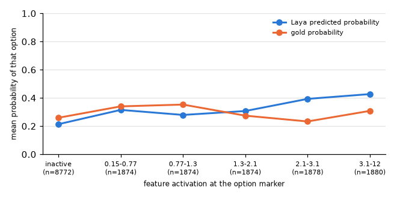

# Feature 2786

Critérios em que aparece: attribution_toward_wrong

**Interpretação (preencher):** 

---

## Maiores ativações

**tr_customer_service_000282 / category** (choice, customer_service) | ativação 11.625 em `marcador` | opções ['account', 'billing', 'delivery', 'refund', 'technical'] | Laya: **refund** [0.006, 0.015, 0.005, 0.963, 0.01] | gabarito: **refund**

```
[CLS]choice question: What is this customer conversation primarily about?[SEP]
▸ [MASK] account: Login, plan changes, profile or access management.
▸ [MASK] billing: A charge, invoice, subscription or payment problem.
▸ [MASK] delivery: Shipping, fulfilment or delivery of a physical item.
▸ ⟦[MASK]⟧ refund: The customer is explicitly asking for money back.
▸ [MASK] technical: The product or service is not working as expected.

[SEP]

{"account": {"lifetime_value_usd": 53, "prior_tickets_90d": 0, "seats": 3, "tenure_months": 1, "tier": "premium"}, "thread": [{"role": "customer", "text": "I've been waiting for my refund to hit my account for days now and there's still nothing showing up. I signed up for the Premium plan last month and it's been nothing but a headache."}, {"role": "agent", "text": "I understand how concerning it is when expected funds don't appear. Could you please confirm the date you initially requested the transaction reversal?"}, {"role": "customer", "text": "I did it last Tuesday! It's ridiculous that I'm even having to ask about this because the confirmation email said it was processed immediately."}, {"role": "agent", "text": "Thank you for that information. To help me look into the status on our end, are you able to provide the transaction ID from that confirmation email?"}, {"role": "customer", "text": "I'm looking for it now, but I shouldn't have to jump through hoops just to get my money back from a service I barely used for four weeks."}]}[SEP]
```

**tr_customer_service_000250 / category** (choice, customer_service) | ativação 11.594 em `marcador` | opções ['account', 'billing', 'delivery', 'refund', 'technical'] | Laya: **billing** [0.006, 0.969, 0.006, 0.012, 0.007] | gabarito: **billing**

```
[CLS]choice question: What is this customer conversation primarily about?[SEP]
▸ [MASK] account: Login, plan changes, profile or access management.
▸ ⟦[MASK]⟧ billing: A charge, invoice, subscription or payment problem.
▸ [MASK] delivery: Shipping, fulfilment or delivery of a physical item.
▸ [MASK] refund: The customer is explicitly asking for money back.
▸ [MASK] technical: The product or service is not working as expected.

[SEP]

{"account": {"lifetime_value_usd": 145, "prior_tickets_90d": 0, "seats": 1, "tenure_months": 2, "tier": "standard"}, "thread": [{"role": "customer", "text": "Could you please send me a copy of my latest invoice? Thank you!"}]}[SEP]
```

**tr_customer_service_000030 / category** (choice, customer_service) | ativação 11.133 em `marcador` | opções ['account', 'billing', 'delivery', 'refund', 'technical'] | Laya: **billing** [0.011, 0.931, 0.006, 0.027, 0.025] | gabarito: **billing**

```
[CLS]choice question: What is this customer conversation primarily about?[SEP]
▸ [MASK] account: Login, plan changes, profile or access management.
▸ ⟦[MASK]⟧ billing: A charge, invoice, subscription or payment problem.
▸ [MASK] delivery: Shipping, fulfilment or delivery of a physical item.
▸ [MASK] refund: The customer is explicitly asking for money back.
▸ [MASK] technical: The product or service is not working as expected.

[SEP]

{"account": {"lifetime_value_usd": 5295, "prior_tickets_90d": 1, "seats": 1, "tenure_months": 72, "tier": "premium"}, "thread": [{"role": "customer", "text": "Hello, I’ve been a loyal subscriber for six years now, but I’ve just noticed an unexpected change in my premium plan billing. I really need to get this sorted out before the end of the business day today, if possible."}, {"role": "agent", "text": "I see you’ve been with us for quite a while, and I understand you’re looking into an unexpected charge on your account. Could you please provide the billing date and the specific invoice number you are referencing?"}, {"role": "customer", "text": "Thank you for looking into this. The invoice number is #99283 and the date is from this morning. It seems higher than the usual amount for the premium tier; I just need to understand why this fluctuation occurred before my deadline arrives."}]}[SEP]
```

**tr_customer_service_000245 / category** (choice, customer_service) | ativação 10.891 em `marcador` | opções ['account', 'billing', 'delivery', 'refund', 'technical'] | Laya: **account** [0.9, 0.014, 0.008, 0.024, 0.053] | gabarito: **account**

```
[CLS]choice question: What is this customer conversation primarily about?[SEP]
▸ ⟦[MASK]⟧ account: Login, plan changes, profile or access management.
▸ [MASK] billing: A charge, invoice, subscription or payment problem.
▸ [MASK] delivery: Shipping, fulfilment or delivery of a physical item.
▸ [MASK] refund: The customer is explicitly asking for money back.
▸ [MASK] technical: The product or service is not working as expected.

[SEP]

{"account": {"lifetime_value_usd": 1250, "prior_tickets_90d": 0, "seats": 1, "tenure_months": 14, "tier": "enterprise"}, "thread": [{"role": "customer", "text": "I'm a bit lost—I've been trying to log into our enterprise portal for the last twenty minutes but it keeps saying my credentials aren't recognized. I haven't changed anything since yesterday, and I'm not seeing any emails about account updates even though I've used this login for over a year. Is there something special I need to do to get back in?"}]}[SEP]
```

**tr_customer_service_000197 / category** (choice, customer_service) | ativação 10.844 em `marcador` | opções ['account', 'billing', 'delivery', 'refund', 'technical'] | Laya: **delivery** [0.003, 0.003, 0.983, 0.004, 0.007] | gabarito: **delivery**

```
[CLS]choice question: What is this customer conversation primarily about?[SEP]
▸ [MASK] account: Login, plan changes, profile or access management.
▸ [MASK] billing: A charge, invoice, subscription or payment problem.
▸ ⟦[MASK]⟧ delivery: Shipping, fulfilment or delivery of a physical item.
▸ [MASK] refund: The customer is explicitly asking for money back.
▸ [MASK] technical: The product or service is not working as expected.

[SEP]

{"account": {"lifetime_value_usd": 1409, "prior_tickets_90d": 2, "seats": 1, "tenure_months": 49, "tier": "free"}, "thread": [{"role": "customer", "text": "I’ve been with you for over four years now, but I’m really lost as to why my delivery hasn't arrived yet. I've reached out twice before and was told it was on the way, but nothing ever shows up. It’s making it very hard to justify staying if this keeps happening."}]}[SEP]
```

## Ativações medianas (faixa 40-60%, mediana 0.983)

**tr_agent_trace_observability_000132 / action** (choice, agent_trace_observability) | ativação 0.917 em `estado` | opções ['continue', 'human_review', 'observe', 'stop'] | Laya: **continue** [0.613, 0.065, 0.201, 0.122] | gabarito: **human_review**

```
[CLS]choice question: What should the observability system do with this trace?[SEP]
▸ [MASK] continue: Let the agent proceed without interruption.
▸ [MASK] human_review: Queue this trace for a human to review.
▸ [MASK] observe: Keep running, but flag the trace for later sampling.
▸ [MASK] stop: Halt the agent now.

[SEP]

⟦{"⟧agent": {"autonomy": "unsupervised", "model": "internal-agent-v4"}, "constraints": ["Never delete anything matching release/*"], "task": "Delete personal data for the accounts in the erasure queue.", "trace_summary": {"constraint_violations": 0, "duration_s": 708.0, "irreversible_actions": 0, "steps": 11, "tool_errors": 3}}[SEP]
```

**tr_invoice_processing_000197 / discrepancy_severity** (score, invoice_processing) | ativação 0.886 em `opção` | opções ['0', '1', '2', '3'] | Laya: **0** [0.437, 0.183, 0.211, 0.169] | gabarito: **3**

```
[CLS]score question: How material is any discrepancy between the invoice, the order and the delivery?[SEP]
▸ [MASK] level 0: None⟦:⟧ everything reconciles.
▸ [MASK] level 1: Trivial: rounding or a cosmetic difference.
▸ [MASK] level 2: Moderate: a real difference worth confirming.
▸ [MASK] level 3: Material: a large or unexplained difference.

[SEP]

{"delivery": {"condition": "accepted with exceptions", "date": "2026-03-20", "received_qty": 100}, "invoice": {"currency": "USD", "id": "INV-2026-2449", "lines": [{"qty": 100, "sku": "SKU-717", "total_usd": 14417.0, "unit_usd": 144.17}], "total_usd": 14417.0, "vendor": "Vantage Materials"}, "payment": {"days_until_due": 18, "discount_expires_in_days": null, "early_payment_discount_pct": null, "status": "scheduled", "terms": "net 30"}, "purchase_order": {"freight_terms": "freight prepaid by vendor, not separately billable", "id": "PO-3796", "lines": [{"qty": 100, "unit_usd": 144.17}], "total_usd": 14417.0}, "vendor_history": {"disputes_12m": 2, "invoices_12m": 25, "prior_invoice_ids": ["INV-2026-2449", "INV-2026-9332", "INV-2026-7430", "INV-2026-9715"]}}[SEP]
```

**tr_invoice_processing_000125 / duplicate** (noul, invoice_processing) | ativação 1.026 em `CLS` | opções ['false', 'true'] | Laya: **true** [0.114, 0.886] | gabarito: **false**

```
⟦[CLS]⟧noul question: This invoice appears to duplicate an invoice already submitted.[SEP]
▸ [MASK] false: no, the statement does not hold
▸ [MASK] true: yes, the statement holds

[SEP]

{"delivery": {"condition": "accepted with exceptions", "date": null, "received_qty": 0}, "invoice": {"currency": "USD", "id": "INV-2026-9806", "lines": [{"qty": 50, "sku": "SKU-429", "total_usd": 7214.0, "unit_usd": 144.28}], "total_usd": 7214.0, "vendor": "Acme Fabrication"}, "payment": {"days_until_due": 27, "discount_expires_in_days": null, "early_payment_discount_pct": null, "status": "scheduled", "terms": "net 30"}, "purchase_order": {"freight_terms": "freight prepaid by vendor, not separately billable", "id": "PO-3759", "lines": [{"qty": 50, "unit_usd": 144.28}], "total_usd": 7214.0}, "vendor_history": {"disputes_12m": 0, "invoices_12m": 30, "prior_invoice_ids": ["INV-2026-3577", "INV-2026-6921", "INV-2026-4997"]}}[SEP]
```

**tr_customer_service_000067 / churn_risk** (score, customer_service) | ativação 1.028 em `opção` | opções ['0', '1', '2', '3'] | Laya: **1** [0.167, 0.411, 0.264, 0.158] | gabarito: **2**

```
[CLS]score question: How likely is this customer to stop doing business with us because of this interaction?[SEP]
▸ [MASK] level 0: No sign of dissatisfaction.
▸ [MASK] level 1: Mild frustration, but the relationship is intact.
▸ [MASK] level 2: Clearly unhappy; repeat problems or explicit complaints.
▸ [MASK] level 3: Imminent⟦:⟧ threatening to cancel, dispute or leave.

[SEP]

{"account": {"lifetime_value_usd": 81, "prior_tickets_90d": 0, "seats": 12, "tenure_months": 2, "tier": "premium"}, "thread": [{"role": "customer", "text": "I was promised a refund last week for my premium subscription, but nothing has shown up yet. I need that money in my account by the end of day tomorrow."}, {"role": "agent", "text": "Understood, that’s frustrating. Could you provide the order ID or refund reference you received?"}, {"role": "customer", "text": "The order number is #PX-8429. I've been waiting and this delay is really disappointing."}, {"role": "agent", "text": "Thanks for the details. I’ll check the status on my end. Is there any other information, like the payment method you used, that could help speed this up?"}, {"role": "customer", "text": "I paid with the card ending 1234, and I’m counting on the refund being processed before tomorrow’s deadline."}]}[SEP]
```

**tr_customer_service_000218 / needs_human** (noul, customer_service) | ativação 1.089 em `estado` | opções ['false', 'true'] | Laya: **true** [0.363, 0.637] | gabarito: **true**

```
[CLS]noul question: This conversation requires a human agent rather than automated handling.[SEP]
▸ [MASK] false: Automation can carry this to resolution.
▸ [MASK] true: A human must take over: judgement, authority or empathy is required.

[SEP]

{"account": {"lifetime_value_usd": 1493, "prior_tickets_90d": 0, "seats": 1, "tenure_months": 26, "tier": "enterprise"}, "orders": [{"amount_usd": 87, "date": "2026-02-14", "id": "A-33952", "status": "settled"}, {"amount_usd": 87, "date": "2026-02-17", "id": "A-46877", "status": "pending"}⟦],⟧ "thread": [{"role": "customer", "text": "I just looked at my statement and you've charged me twice for the same subscription! This is completely unacceptable for an enterprise account."}, {"role": "agent", "text": "I understand your concern regarding the duplicate billing. To help me investigate, could you clarify if both charges show the same transaction ID or different ones?"}, {"role": "customer", "text": "They are both for $87 and they hit my account on the same day. Fix this immediately, I don't have time to play detective for your billing errors."}, {"role": "agent", "text": "I see the two entries for $87 you're referring to. Are there any other unexpected line items on your recent invoice that I should be aware of?"}, {"role": "customer", "text": "No, just these two. It's ridiculous that a company of your size can't manage basic accounting. I want my money back now."}, {"role": "agent", "text": "I am currently reviewing the ledger for the past 26 months of your service. Could you confirm the date the charges first appeared on your bank statement?"}, {"role": "customer", "text": "It was the 14th. Just look at the records, it's clear as day that I've been overcharged and I shouldn't have to keep explaining this to you."}]}[SEP]
```

## Estatísticas (conjunto de descoberta, dev e teste)

**pred / error**

| split | decisões | ativas | ativas e Laya errou | taxa | lift | q (BH) | OR (CMH) | q (CMH) |
|---|---|---|---|---|---|---|---|---|
| discovery | 5100 | 4037 | 2613 | 0.647 | 1.02 | 0.00397 | 0.72 | 0.0462 |
| dev | 900 | 694 | 452 | 0.651 | 0.99 | 0.845 | 0.72 | 0.843 |
| test | 2000 | 1570 | 1024 | 0.652 | 1.02 | 0.0178 | 0.85 | 0.826 |

**corr / error**

| split | decisões | ativas | ativas e Laya errou | taxa | lift | q (BH) | OR (CMH) | q (CMH) |
|---|---|---|---|---|---|---|---|---|
| discovery | 5100 | 2791 | 1367 | 0.490 | 0.77 | 6.28e-129 | 0.22 | 2.92e-30 |
| dev | 900 | 506 | 264 | 0.522 | 0.79 | 8e-21 | 0.14 | 3.84e-06 |
| test | 2000 | 1064 | 518 | 0.487 | 0.76 | 2.88e-49 | 0.14 | 3.09e-17 |

**state / error**

| split | decisões | ativas | ativas e Laya errou | taxa | lift | q (BH) | OR (CMH) | q (CMH) |
|---|---|---|---|---|---|---|---|---|
| discovery | 5100 | 5096 | 3242 | 0.636 | 1.00 | 1 | 0.24 | 0.496 |
| dev | 900 | 900 | 591 | 0.657 | 1.00 | 1 | nan | nan |
| test | 2000 | 1998 | 1273 | 0.637 | 1.00 | 1 | 2.98 | 0.668 |

Confusão mais sobre-representada (pred): `urgency|1>3` (n=291, lift 1.26, p=1.93e-29). Formato `pergunta|índice previsto>índice correto`.

Confusão mais sobre-representada (corr): `duplicate|1>0` (n=216, lift 1.83, p=0). Formato `pergunta|índice previsto>índice correto`.

Confusão mais sobre-representada (state): `urgency|1>3` (n=292, lift 1.00, p=0.79). Formato `pergunta|índice previsto>índice correto`.



