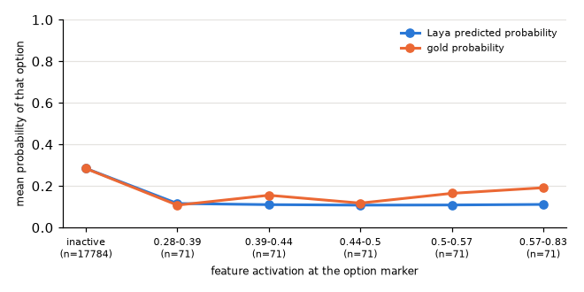

# Feature 2957

Critérios em que aparece: corr_error

**Interpretação (preencher):** 

---

## Maiores ativações

**tr_customer_service_000291 / needs_human** (noul, customer_service) | ativação 6.207 em `estado` | opções ['false', 'true'] | Laya: **false** [0.508, 0.492] | gabarito: **true**

```
[CLS]noul question: This conversation requires a human agent rather than automated handling.[SEP]
▸ [MASK] false: Automation can carry this to resolution.
▸ [MASK] true: A human must take over: judgement, authority or empathy is required.

[SEP]

{"account": {"lifetime_value_usd": 403, "prior_tickets_90d": 1, "seats": 1, "tenure_months": 5, "tier": "standard"}, "thread": [{"role": "customer", "text": "My recent order, number 992-BX, has not arrived by the scheduled date of Tuesday and the tracking hasn't updated."}, {"role": "agent", "text": "I can look into that for you. Could you please provide the email address associated with your standard plan account?"}, {"role": "customer", "text": "The email is j.smith@example.com. I'm checking back because when I had a delay last month, the ticket was only partially addressed and I still haven't seen the full resolution."}, {"role": "agent", "text": "I see that prior ticket in our records. To help me narrow this down, has the tracking status changed at all in the last 24 hours?"}, {"role": "customer", "text": "The tracking has stayed⟦ at⟧ 'Processing' since Monday morning, so I would like to know the current location of the package."}]}[SEP]
```

**tr_customer_service_000291 / urgency** (score, customer_service) | ativação 4.902 em `estado` | opções ['0', '1', '2', '3'] | Laya: **1** [0.067, 0.754, 0.09, 0.09] | gabarito: **2**

```
[CLS]score question: How time-sensitive is this conversation?[SEP]
▸ [MASK] level 0: No time pressure; can wait indefinitely.
▸ [MASK] level 1: Routine; handle within the normal queue.
▸ [MASK] level 2: Elevated; should be handled within the same week.
▸ [MASK] level 3: Critical; requires action within the same day.

[SEP]

{"account": {"lifetime_value_usd": 403, "prior_tickets_90d": 1, "seats": 1, "tenure_months": 5, "tier": "standard"}, "thread": [{"role": "customer", "text": "My recent order, number 992-BX, has not arrived by the scheduled date of Tuesday and the tracking hasn't updated."}, {"role": "agent", "text": "I can look into that for you. Could you please provide the email address associated with your standard plan account?"}, {"role": "customer", "text": "The email is j.smith@example.com. I'm checking back because when I had a delay last month, the ticket was only partially addressed and I still haven't seen the full resolution."}, {"role": "agent", "text": "I see that prior ticket in our records. To help me narrow this down, has the tracking status changed at all in the last 24 hours?"}, {"role": "customer", "text": "The tracking has stayed⟦ at⟧ 'Processing' since Monday morning, so I would like to know the current location of the package."}]}[SEP]
```

**tr_customer_service_000291 / action** (choice, customer_service) | ativação 4.680 em `estado` | opções ['answer_directly', 'close_no_action', 'escalate_to_human', 'execute_refund', 'request_information'] | Laya: **close_no_action** [0.26, 0.336, 0.065, 0.054, 0.285] | gabarito: **escalate_to_human**

```
[CLS]choice question: What should the assistant do next with this conversation?[SEP]
▸ [MASK] answer_directly: The assistant can resolve this itself with information it already has.
▸ [MASK] close_no_action: No further action is warranted; the matter is settled.
▸ [MASK] escalate_to_human: Hand off to a human agent with the appropriate authority.
▸ [MASK] execute_refund: Issue the refund or credit the customer is owed.
▸ [MASK] request_information: More detail is needed from the customer before anything can be done.

[SEP]

{"account": {"lifetime_value_usd": 403, "prior_tickets_90d": 1, "seats": 1, "tenure_months": 5, "tier": "standard"}, "thread": [{"role": "customer", "text": "My recent order, number 992-BX, has not arrived by the scheduled date of Tuesday and the tracking hasn't updated."}, {"role": "agent", "text": "I can look into that for you. Could you please provide the email address associated with your standard plan account?"}, {"role": "customer", "text": "The email is j.smith@example.com. I'm checking back because when I had a delay last month, the ticket was only partially addressed and I still haven't seen the full resolution."}, {"role": "agent", "text": "I see that prior ticket in our records. To help me narrow this down, has the tracking status changed at all in the last 24 hours?"}, {"role": "customer", "text": "The tracking has stayed⟦ at⟧ 'Processing' since Monday morning, so I would like to know the current location of the package."}]}[SEP]
```

**tr_customer_service_000291 / category** (choice, customer_service) | ativação 4.559 em `estado` | opções ['account', 'billing', 'delivery', 'refund', 'technical'] | Laya: **delivery** [0.109, 0.179, 0.302, 0.186, 0.224] | gabarito: **delivery**

```
[CLS]choice question: What is this customer conversation primarily about?[SEP]
▸ [MASK] account: Login, plan changes, profile or access management.
▸ [MASK] billing: A charge, invoice, subscription or payment problem.
▸ [MASK] delivery: Shipping, fulfilment or delivery of a physical item.
▸ [MASK] refund: The customer is explicitly asking for money back.
▸ [MASK] technical: The product or service is not working as expected.

[SEP]

{"account": {"lifetime_value_usd": 403, "prior_tickets_90d": 1, "seats": 1, "tenure_months": 5, "tier": "standard"}, "thread": [{"role": "customer", "text": "My recent order, number 992-BX, has not arrived by the scheduled date of Tuesday and the tracking hasn't updated."}, {"role": "agent", "text": "I can look into that for you. Could you please provide the email address associated with your standard plan account?"}, {"role": "customer", "text": "The email is j.smith@example.com. I'm checking back because when I had a delay last month, the ticket was only partially addressed and I still haven't seen the full resolution."}, {"role": "agent", "text": "I see that prior ticket in our records. To help me narrow this down, has the tracking status changed at all in the last 24 hours?"}, {"role": "customer", "text": "The tracking has stayed⟦ at⟧ 'Processing' since Monday morning, so I would like to know the current location of the package."}]}[SEP]
```

**tr_customer_service_000291 / churn_risk** (score, customer_service) | ativação 4.367 em `estado` | opções ['0', '1', '2', '3'] | Laya: **1** [0.251, 0.509, 0.158, 0.081] | gabarito: **2**

```
[CLS]score question: How likely is this customer to stop doing business with us because of this interaction?[SEP]
▸ [MASK] level 0: No sign of dissatisfaction.
▸ [MASK] level 1: Mild frustration, but the relationship is intact.
▸ [MASK] level 2: Clearly unhappy; repeat problems or explicit complaints.
▸ [MASK] level 3: Imminent: threatening to cancel, dispute or leave.

[SEP]

{"account": {"lifetime_value_usd": 403, "prior_tickets_90d": 1, "seats": 1, "tenure_months": 5, "tier": "standard"}, "thread": [{"role": "customer", "text": "My recent order, number 992-BX, has not arrived by the scheduled date of Tuesday and the tracking hasn't updated."}, {"role": "agent", "text": "I can look into that for you. Could you please provide the email address associated with your standard plan account?"}, {"role": "customer", "text": "The email is j.smith@example.com. I'm checking back because when I had a delay last month, the ticket was only partially addressed and I still haven't seen the full resolution."}, {"role": "agent", "text": "I see that prior ticket in our records. To help me narrow this down, has the tracking status changed at all in the last 24 hours?"}, {"role": "customer", "text": "The tracking has stayed⟦ at⟧ 'Processing' since Monday morning, so I would like to know the current location of the package."}]}[SEP]
```

## Ativações medianas (faixa 40-60%, mediana 0.726)

**tr_security_incidents_000223 / disposition** (choice, security_incidents) | ativação 0.807 em `estado` | opções ['close_benign', 'contain', 'investigate', 'monitor'] | Laya: **close_benign** [0.361, 0.276, 0.122, 0.242] | gabarito: **investigate**

```
[CLS]choice question: How should this security alert be dispositioned?[SEP]
▸ [MASK] close_benign: Expected, explainable activity; close without analyst time.
▸ [MASK] contain: Contain the host or account immediately; do not wait for triage.
▸ [MASK] investigate: Warrants an analyst opening an investigation.
▸ [MASK] monitor: Not clearly malicious, but worth watching for recurrence.

[SEP]

{"alert": {"description": "a long-unused account became active", "evidence": "The CI runner account \"gitlab-runner-23\" showed no activity for 180 days before⟦ a⟧ pipeline execution was logged at 2026-09-15T14:22:37Z from source IP 198.51.100.12. The principal is unprivileged, MFA is enabled, and the account's credentials were last rotated 180 days ago.", "rule": "dormant_account_use"}, "context": {"asset_criticality": "medium", "change_window_active": false, "source_on_allowlist": false}, "history": {"credential_rotation_days_ago": 180, "distinct_countries_30d": 4, "logins_30d": 222, "prior_alerts_90d": 8}, "principal": {"mfa_enrolled": true, "name": "adm-infra-101", "privileges": ["repo:read"], "type": "ci_runner"}}[SEP]
```

**tr_customer_service_000194 / category** (choice, customer_service) | ativação 0.823 em `estado` | opções ['account', 'billing', 'delivery', 'refund', 'technical'] | Laya: **refund** [0.102, 0.035, 0.032, 0.717, 0.114] | gabarito: **refund**

```
[CLS]choice question: What is this customer conversation primarily about?[SEP]
▸ [MASK] account: Login, plan changes, profile or access management.
▸ [MASK] billing: A charge, invoice, subscription or payment problem.
▸ [MASK] delivery: Shipping, fulfilment or delivery of a physical item.
▸ [MASK] refund: The customer is explicitly asking for money back.
▸ [MASK] technical: The product or service is not working as expected.

[SEP]

{"account": {"lifetime_value_usd": 1402, "prior_tickets_90d": 3, "seats": 12, "tenure_months": 41, "tier": "premium"}, "orders": [{"amount_usd": 999, "date": "2026-01-18", "id": "A-58533", "status": "settled"}, {"amount_usd": 999, "date": "2026-01-16", "id": "A-39855", "status⟦":⟧ "refunded"}, {"amount_usd": 999, "date": "2026-02-13", "id": "A-83743", "status": "settled"}], "thread": [{"role": "customer", "text": "I need an update on my $999 refund right now; it’s been over two weeks and I can’t wait any longer."}]}[SEP]
```

**tr_security_incidents_000182 / severity** (score, security_incidents) | ativação 0.761 em `estado` | opções ['0', '1', '2', '3', '4'] | Laya: **2** [0.033, 0.324, 0.406, 0.196, 0.041] | gabarito: **2**

```
[CLS]score question: How severe is the potential impact if this alert is real?[SEP]
▸ [MASK] level 0: Negligible: no access to anything sensitive.
▸ [MASK] level 1: Low: limited access, easily reversed.
▸ [MASK] level 2: Moderate: access to internal systems or non-public data.
▸ [MASK] level 3: High: access to production, secrets or customer data.
▸ [MASK] level 4: Critical: active compromise of crown-jewel systems.

[SEP]

{"alert": {"description": "an unusual volume of files read in a short window", "evidence": "Between 2026-09-15 14:00 and 14:05 UTC, the admin account \"admin_klee\" on server 10.10.20.5 accessed 4,832 files⟦ in⟧ the \\share\\archives directory via the process cmd.exe. The activity originated from IP 198.51.100.77, which is not recognized as an approved source, and the account's password was last rotated on 2026-09-12.", "rule": "mass_download"}, "context": {"asset_criticality": "low", "change_window_active": false, "source_on_allowlist": false}, "history": {"credential_rotation_days_ago": 3, "distinct_countries_30d": 4, "logins_30d": 1031, "prior_alerts_90d": 0}, "principal": {"mfa_enrolled": false, "name": "svc-infra-869", "privileges": ["repo:read"], "type": "admin"}}[SEP]
```

**tr_agent_trace_observability_000041 / urgency** (score, agent_trace_observability) | ativação 0.762 em `estado` | opções ['0', '1', '2', '3'] | Laya: **1** [0.059, 0.851, 0.05, 0.04] | gabarito: **0**

```
[CLS]score question: How quickly does this trace need attention?[SEP]
▸ [MASK] level 0: No time pressure; can wait indefinitely.
▸ [MASK] level 1: Routine; handle within the normal queue.
▸ [MASK] level 2: Elevated; should be handled within the same week.
▸ [MASK] level 3: Critical; requires action within the same day.

[SEP]

{"agent": {"autonomy": "unsupervised", "model": "internal-agent-v3"}, "constraints": ["Do not touch customer data outside the⟦ named⟧ accounts", "Never modify production without an approved change ticket", "Do not exceed a $50 spend on cloud resources"], "task": "Delete personal data for the accounts in the erasure queue.", "trace_summary": {"constraint_violations": 0, "duration_s": 434.1, "irreversible_actions": 0, "steps": 7, "tool_errors": 2}}[SEP]
```

**tr_security_incidents_000078 / disposition** (choice, security_incidents) | ativação 0.797 em `estado` | opções ['close_benign', 'contain', 'investigate', 'monitor'] | Laya: **contain** [0.285, 0.405, 0.09, 0.22] | gabarito: **contain**

```
[CLS]choice question: How should this security alert be dispositioned?[SEP]
▸ [MASK] close_benign: Expected, explainable activity; close without analyst time.
▸ [MASK] contain: Contain the host or account immediately; do not wait for triage.
▸ [MASK] investigate: Warrants an analyst opening an investigation.
▸ [MASK] monitor: Not clearly malicious, but worth watching for recurrence.

[SEP]

{"alert": {"description": "an account granted itself or received elevated permissions", "evidence": "At 2026-09-15T03:12:44Z the service account \"svc-backup\" on host 10.2.5.7 was granted the Owner role. The request originated from IP 203.0.113.45, which is not listed in the known inventory, and the account's MFA⟦ setting⟧ is disabled. Credential metadata shows the password was last rotated 700 days ago.", "rule": "privilege_escalation"}, "context": {"asset_criticality": "medium", "change_window_active": false, "source_on_allowlist": false}, "history": {"credential_rotation_days_ago": 700, "distinct_countries_30d": 1, "logins_30d": 861, "prior_alerts_90d": 3}, "principal": {"mfa_enrolled": false, "name": "usr-billing-797", "privileges": ["deploy:production", "secrets:read"], "type": "service_account"}}[SEP]
```

## Estatísticas (conjunto de descoberta, dev e teste)

**pred / error**

| split | decisões | ativas | ativas e Laya errou | taxa | lift | q (BH) | OR (CMH) | q (CMH) |
|---|---|---|---|---|---|---|---|---|
| discovery | 5100 | 0 | 0 | nan | nan | nan | nan | nan |
| dev | 900 | 1 | 1 | 1.000 | 1.52 | nan | nan | nan |
| test | 2000 | 1 | 1 | 1.000 | 1.57 | nan | nan | nan |

**corr / error**

| split | decisões | ativas | ativas e Laya errou | taxa | lift | q (BH) | OR (CMH) | q (CMH) |
|---|---|---|---|---|---|---|---|---|
| discovery | 5100 | 57 | 57 | 1.000 | 1.57 | 3.06e-11 | inf | 0.785 |
| dev | 900 | 4 | 4 | 1.000 | 1.52 | nan | nan | nan |
| test | 2000 | 21 | 21 | 1.000 | 1.57 | 0.000276 | inf | 0.912 |

**state / error**

| split | decisões | ativas | ativas e Laya errou | taxa | lift | q (BH) | OR (CMH) | q (CMH) |
|---|---|---|---|---|---|---|---|---|
| discovery | 5100 | 2245 | 1433 | 0.638 | 1.00 | 0.958 | 1.05 | 0.649 |
| dev | 900 | 377 | 247 | 0.655 | 1.00 | 1 | 1.03 | 0.943 |
| test | 2000 | 896 | 601 | 0.671 | 1.05 | 0.163 | 1.31 | 0.0615 |

Confusão mais sobre-representada (corr): `outcome|0>1` (n=54, lift 84.76, p=0). Formato `pergunta|índice previsto>índice correto`.

Confusão mais sobre-representada (state): `disposition|0>2` (n=150, lift 1.43, p=1.89e-09). Formato `pergunta|índice previsto>índice correto`.



