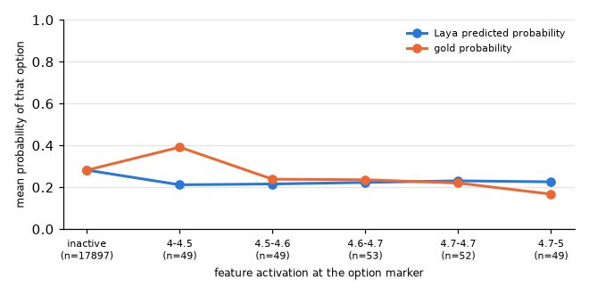

# Feature 2999

Critérios em que aparece: corr_error

**Interpretação (preencher):** 

---

## Maiores ativações

**tr_invoice_processing_000118 / discrepancy_severity** (score, invoice_processing) | ativação 8.562 em `opção` | opções ['0', '1', '2', '3'] | Laya: **0** [0.388, 0.204, 0.217, 0.192] | gabarito: **0**

```
[CLS]score question: How material is any discrepancy between the invoice, the order and the delivery?[SEP]
▸ [MASK] level 0: None: everything reconciles.
▸ [MASK] level 1: Trivial: rounding or a cosmetic difference.
▸ [MASK] level 2⟦:⟧ Moderate: a real difference worth confirming.
▸ [MASK] level 3: Material: a large or unexplained difference.

[SEP]

{"delivery": {"condition": "accepted", "date": "2026-03-06", "received_qty": 100}, "invoice": {"currency": "USD", "id": "INV-2026-4359", "lines": [{"qty": 100, "sku": "SKU-579", "total_usd": 44892.0, "unit_usd": 448.92}], "total_usd": 44892.0, "vendor": "Orbit Logistics"}, "payment": {"days_until_due": 18, "discount_expires_in_days": 3, "early_payment_discount_pct": 2.0, "status": "scheduled", "terms": "net 45"}, "purchase_order": {"freight_terms": "freight prepaid by vendor, not separately billable", "id": null, "lines": [{"qty": 100, "unit_usd": 448.92}], "total_usd": 44892.0}, "vendor_history": {"disputes_12m": 5, "invoices_12m": 6, "prior_invoice_ids": ["INV-2026-6501", "INV-2026-9349", "INV-2026-2429", "INV-2026-9623"]}}[SEP]
```

**tr_invoice_processing_000185 / discrepancy_severity** (score, invoice_processing) | ativação 8.508 em `opção` | opções ['0', '1', '2', '3'] | Laya: **0** [0.398, 0.237, 0.205, 0.161] | gabarito: **0**

```
[CLS]score question: How material is any discrepancy between the invoice, the order and the delivery?[SEP]
▸ [MASK] level 0: None: everything reconciles.
▸ [MASK] level 1: Trivial: rounding or a cosmetic difference.
▸ [MASK] level 2⟦:⟧ Moderate: a real difference worth confirming.
▸ [MASK] level 3: Material: a large or unexplained difference.

[SEP]

{"delivery": {"condition": "accepted", "date": "2026-03-11", "received_qty": 100}, "invoice": {"currency": "USD", "id": "INV-2026-5921", "lines": [{"qty": 100, "sku": "SKU-796", "total_usd": 32023.0, "unit_usd": 320.23}], "total_usd": 32023.0, "vendor": "Acme Fabrication"}, "payment": {"days_until_due": 18, "discount_expires_in_days": 8, "early_payment_discount_pct": 2.0, "status": "scheduled", "terms": "net 30"}, "purchase_order": {"freight_terms": "freight prepaid by vendor, not separately billable", "id": "PO-9122", "lines": [{"qty": 100, "unit_usd": 320.23}], "total_usd": 32023.0}, "vendor_history": {"disputes_12m": 0, "invoices_12m": 31, "prior_invoice_ids": ["INV-2026-2674", "INV-2026-5172"]}}[SEP]
```

**tr_invoice_processing_000004 / discrepancy_severity** (score, invoice_processing) | ativação 8.469 em `opção` | opções ['0', '1', '2', '3'] | Laya: **0** [0.406, 0.25, 0.207, 0.138] | gabarito: **3**

```
[CLS]score question: How material is any discrepancy between the invoice, the order and the delivery?[SEP]
▸ [MASK] level 0: None: everything reconciles.
▸ [MASK] level 1: Trivial: rounding or a cosmetic difference.
▸ [MASK] level 2⟦:⟧ Moderate: a real difference worth confirming.
▸ [MASK] level 3: Material: a large or unexplained difference.

[SEP]

{"delivery": {"condition": "accepted", "date": "2026-03-05", "received_qty": 1000}, "invoice": {"currency": "USD", "id": "INV-2026-1815", "lines": [{"qty": 1005, "sku": "SKU-949", "total_usd": 242797.95, "unit_usd": 241.59}], "total_usd": 242797.95, "vendor": "Kestrel Supply"}, "payment": {"days_until_due": 0, "discount_expires_in_days": null, "early_payment_discount_pct": null, "status": "scheduled", "terms": "net 45"}, "purchase_order": {"freight_terms": "freight prepaid by vendor, not separately billable", "id": "PO-1289", "lines": [{"qty": 1000, "unit_usd": 241.59}], "total_usd": 241590.0}, "vendor_history": {"disputes_12m": 0, "invoices_12m": 19, "prior_invoice_ids": ["INV-2026-9801", "INV-2026-7713", "INV-2026-7561", "INV-2026-3366"]}}[SEP]
```

**tr_invoice_processing_000256 / discrepancy_severity** (score, invoice_processing) | ativação 8.469 em `opção` | opções ['0', '1', '2', '3'] | Laya: **0** [0.409, 0.212, 0.22, 0.159] | gabarito: **0**

```
[CLS]score question: How material is any discrepancy between the invoice, the order and the delivery?[SEP]
▸ [MASK] level 0: None: everything reconciles.
▸ [MASK] level 1: Trivial: rounding or a cosmetic difference.
▸ [MASK] level 2⟦:⟧ Moderate: a real difference worth confirming.
▸ [MASK] level 3: Material: a large or unexplained difference.

[SEP]

{"delivery": {"condition": "accepted", "date": "2026-03-11", "received_qty": 1000}, "invoice": {"currency": "USD", "id": "INV-2026-3080", "lines": [{"qty": 1000, "sku": "SKU-121", "total_usd": 21200.0, "unit_usd": 21.2}], "total_usd": 21200.0, "vendor": "Acme Fabrication"}, "payment": {"days_until_due": 0, "discount_expires_in_days": null, "early_payment_discount_pct": null, "status": "scheduled", "terms": "net 30"}, "purchase_order": {"freight_terms": "freight prepaid by vendor, not separately billable", "id": "PO-1628", "lines": [{"qty": 1000, "unit_usd": 21.2}], "total_usd": 21200.0}, "vendor_history": {"disputes_12m": 0, "invoices_12m": 36, "prior_invoice_ids": ["INV-2026-3080", "INV-2026-9683", "INV-2026-4712", "INV-2026-8075"]}}[SEP]
```

**tr_invoice_processing_000255 / discrepancy_severity** (score, invoice_processing) | ativação 8.469 em `opção` | opções ['0', '1', '2', '3'] | Laya: **0** [0.383, 0.238, 0.228, 0.15] | gabarito: **0**

```
[CLS]score question: How material is any discrepancy between the invoice, the order and the delivery?[SEP]
▸ [MASK] level 0: None: everything reconciles.
▸ [MASK] level 1: Trivial: rounding or a cosmetic difference.
▸ [MASK] level 2⟦:⟧ Moderate: a real difference worth confirming.
▸ [MASK] level 3: Material: a large or unexplained difference.

[SEP]

{"delivery": {"condition": "accepted", "date": "2026-03-19", "received_qty": 400}, "invoice": {"currency": "USD", "id": "INV-2026-5757", "lines": [{"qty": 400, "sku": "SKU-104", "total_usd": 88336.0, "unit_usd": 220.84}], "total_usd": 88336.0, "vendor": "Orbit Logistics"}, "payment": {"days_until_due": 18, "discount_expires_in_days": null, "early_payment_discount_pct": null, "status": "scheduled", "terms": "net 30"}, "purchase_order": {"freight_terms": "freight prepaid by vendor, not separately billable", "id": "PO-3080", "lines": [{"qty": 400, "unit_usd": 220.84}], "total_usd": 88336.0}, "vendor_history": {"disputes_12m": 0, "invoices_12m": 47, "prior_invoice_ids": ["INV-2026-8572", "INV-2026-1556"]}}[SEP]
```

## Ativações medianas (faixa 40-60%, mediana 4.070)

**tr_invoice_processing_000016 / discrepancy_severity** (score, invoice_processing) | ativação 4.188 em `opção` | opções ['0', '1', '2', '3'] | Laya: **0** [0.412, 0.216, 0.207, 0.165] | gabarito: **0**

```
[CLS]score question: How material is any discrepancy between the invoice, the order and the delivery?[SEP]
▸ [MASK] level 0: None: everything reconciles.
▸ [MASK] level 1: Trivial: rounding or a cosmetic difference⟦.⟧
▸ [MASK] level 2: Moderate: a real difference worth confirming.
▸ [MASK] level 3: Material: a large or unexplained difference.

[SEP]

{"delivery": {"condition": "accepted with exceptions", "date": "2026-03-28", "received_qty": 1000}, "invoice": {"currency": "USD", "id": "INV-2026-8778", "lines": [{"qty": 1000, "sku": "SKU-775", "total_usd": 127100.0, "unit_usd": 127.1}], "total_usd": 127100.0, "vendor": "Orbit Logistics"}, "payment": {"days_until_due": -3, "discount_expires_in_days": 7, "early_payment_discount_pct": 2.0, "status": "overdue", "terms": "net 45"}, "purchase_order": {"freight_terms": "freight prepaid by vendor, not separately billable", "id": "PO-6321", "lines": [{"qty": 1000, "unit_usd": 127.1}], "total_usd": 127100.0}, "vendor_history": {"disputes_12m": 1, "invoices_12m": 42, "prior_invoice_ids": ["INV-2026-3448", "INV-2026-4066", "INV-2026-6920", "INV-2026-6288"]}}[SEP]
```

**tr_invoice_processing_000035 / discrepancy_severity** (score, invoice_processing) | ativação 3.934 em `opção` | opções ['0', '1', '2', '3'] | Laya: **0** [0.35, 0.241, 0.23, 0.179] | gabarito: **0**

```
[CLS]score question: How material is any discrepancy between the invoice, the order and the delivery?[SEP]
▸ [MASK] level 0: None: everything reconciles.
▸ [MASK] level 1: Trivial: rounding or a cosmetic difference.
▸ [MASK] level⟦ 2⟧: Moderate: a real difference worth confirming.
▸ [MASK] level 3: Material: a large or unexplained difference.

[SEP]

{"delivery": {"condition": "accepted", "date": "2026-03-03", "received_qty": 400}, "invoice": {"currency": "USD", "id": "INV-2026-5138", "lines": [{"qty": 400, "sku": "SKU-564", "total_usd": 107000.0, "unit_usd": 267.5}], "total_usd": 107000.0, "vendor": "Acme Fabrication"}, "payment": {"days_until_due": -3, "discount_expires_in_days": null, "early_payment_discount_pct": null, "status": "overdue", "terms": "net 60"}, "purchase_order": {"freight_terms": "freight prepaid by vendor, not separately billable", "id": "PO-4223", "lines": [{"qty": 400, "unit_usd": 267.5}], "total_usd": 107000.0}, "vendor_history": {"disputes_12m": 5, "invoices_12m": 22, "prior_invoice_ids": ["INV-2026-5241", "INV-2026-9263", "INV-2026-3455", "INV-2026-4358"]}}[SEP]
```

**tr_invoice_processing_000117 / discrepancy_severity** (score, invoice_processing) | ativação 3.896 em `opção` | opções ['0', '1', '2', '3'] | Laya: **0** [0.412, 0.239, 0.207, 0.142] | gabarito: **1**

```
[CLS]score question: How material is any discrepancy between the invoice, the order and the delivery?[SEP]
▸ [MASK] level 0: None: everything reconciles.
▸ [MASK] level 1: Trivial: rounding or a cosmetic difference.
▸ [MASK] level⟦ 2⟧: Moderate: a real difference worth confirming.
▸ [MASK] level 3: Material: a large or unexplained difference.

[SEP]

{"delivery": {"condition": "accepted with exceptions", "date": "2026-03-17", "received_qty": 50}, "invoice": {"currency": "USD", "id": "INV-2026-4861", "lines": [{"qty": 50, "sku": "SKU-282", "total_usd": 15800.5, "unit_usd": 316.01}], "total_usd": 15800.5, "vendor": "Orbit Logistics"}, "payment": {"days_until_due": -3, "discount_expires_in_days": null, "early_payment_discount_pct": null, "status": "overdue", "terms": "net 45"}, "purchase_order": {"freight_terms": "freight prepaid by vendor, not separately billable", "id": "PO-1105", "lines": [{"qty": 50, "unit_usd": 316.01}], "total_usd": 15800.5}, "vendor_history": {"disputes_12m": 0, "invoices_12m": 12, "prior_invoice_ids": ["INV-2026-9359", "INV-2026-7417", "INV-2026-1162"]}}[SEP]
```

**tr_invoice_processing_000010 / discrepancy_severity** (score, invoice_processing) | ativação 4.008 em `opção` | opções ['0', '1', '2', '3'] | Laya: **2** [0.267, 0.238, 0.268, 0.227] | gabarito: **0**

```
[CLS]score question: How material is any discrepancy between the invoice, the order and the delivery?[SEP]
▸ [MASK] level 0: None: everything reconciles.
▸ [MASK] level 1: Trivial: rounding or a cosmetic difference.
▸ [MASK] level⟦ 2⟧: Moderate: a real difference worth confirming.
▸ [MASK] level 3: Material: a large or unexplained difference.

[SEP]

{"delivery": {"condition": "accepted", "date": "2026-03-03", "received_qty": 25}, "invoice": {"currency": "USD", "id": "INV-2026-2741", "lines": [{"qty": 25, "sku": "SKU-184", "total_usd": 8079.5, "unit_usd": 323.18}], "total_usd": 8079.5, "vendor": "Northwind Components"}, "payment": {"days_until_due": 11, "discount_expires_in_days": null, "early_payment_discount_pct": null, "status": "scheduled", "terms": "net 45"}, "purchase_order": {"freight_terms": "freight prepaid by vendor, not separately billable", "id": "PO-1829", "lines": [{"qty": 25, "unit_usd": 323.18}], "total_usd": 8079.5}, "vendor_history": {"disputes_12m": 2, "invoices_12m": 52, "prior_invoice_ids": ["INV-2026-7791", "INV-2026-6320", "INV-2026-2697"]}}[SEP]
```

**tr_invoice_processing_000257 / discrepancy_severity** (score, invoice_processing) | ativação 4.176 em `opção` | opções ['0', '1', '2', '3'] | Laya: **0** [0.292, 0.253, 0.25, 0.205] | gabarito: **2**

```
[CLS]score question: How material is any discrepancy between the invoice, the order and the delivery?[SEP]
▸ [MASK] level 0: None: everything reconciles.
▸ [MASK] level 1: Trivial: rounding or a cosmetic difference⟦.⟧
▸ [MASK] level 2: Moderate: a real difference worth confirming.
▸ [MASK] level 3: Material: a large or unexplained difference.

[SEP]

{"delivery": {"condition": "accepted", "date": "2026-03-03", "received_qty": 980}, "invoice": {"currency": "USD", "id": "INV-2026-5664", "lines": [{"qty": 980, "sku": "SKU-421", "total_usd": 31183.6, "unit_usd": 31.82}], "total_usd": 31183.6, "vendor": "Kestrel Supply"}, "payment": {"days_until_due": 0, "discount_expires_in_days": null, "early_payment_discount_pct": null, "status": "scheduled", "terms": "net 30"}, "purchase_order": {"freight_terms": "freight prepaid by vendor, not separately billable", "id": "PO-3844", "lines": [{"qty": 1000, "unit_usd": 31.82}], "total_usd": 31820.0}, "vendor_history": {"disputes_12m": 0, "invoices_12m": 16, "prior_invoice_ids": ["INV-2026-4990", "INV-2026-4759"]}}[SEP]
```

## Estatísticas (conjunto de descoberta, dev e teste)

**pred / error**

| split | decisões | ativas | ativas e Laya errou | taxa | lift | q (BH) | OR (CMH) | q (CMH) |
|---|---|---|---|---|---|---|---|---|
| discovery | 5100 | 5 | 5 | 1.000 | 1.57 | nan | nan | nan |
| dev | 900 | 2 | 2 | 1.000 | 1.52 | nan | nan | nan |
| test | 2000 | 4 | 4 | 1.000 | 1.57 | nan | nan | nan |

**corr / error**

| split | decisões | ativas | ativas e Laya errou | taxa | lift | q (BH) | OR (CMH) | q (CMH) |
|---|---|---|---|---|---|---|---|---|
| discovery | 5100 | 66 | 66 | 1.000 | 1.57 | 5.62e-13 | nan | nan |
| dev | 900 | 14 | 14 | 1.000 | 1.52 | nan | nan | nan |
| test | 2000 | 16 | 16 | 1.000 | 1.57 | nan | nan | nan |

**state / error**

| split | decisões | ativas | ativas e Laya errou | taxa | lift | q (BH) | OR (CMH) | q (CMH) |
|---|---|---|---|---|---|---|---|---|
| discovery | 5100 | 1 | 1 | 1.000 | 1.57 | nan | nan | nan |
| dev | 900 | 0 | 0 | nan | nan | nan | nan | nan |
| test | 2000 | 0 | 0 | nan | nan | nan | nan | nan |

Confusão mais sobre-representada (pred): `discrepancy_severity|2>0` (n=5, lift 1020.00, p=nan). Formato `pergunta|índice previsto>índice correto`.

Confusão mais sobre-representada (corr): `discrepancy_severity|0>2` (n=65, lift 77.27, p=0). Formato `pergunta|índice previsto>índice correto`.

Confusão mais sobre-representada (state): `duplicate|1>0` (n=1, lift 23.61, p=nan). Formato `pergunta|índice previsto>índice correto`.



