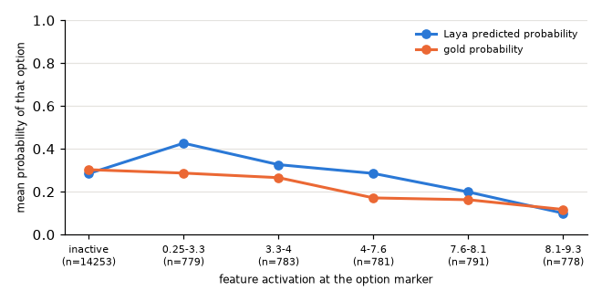

# Feature 3314

Critérios em que aparece: attribution_toward_correct

**Interpretação (preencher):** 

---

## Maiores ativações

**tr_customer_service_000095 / churn_risk** (score, customer_service) | ativação 9.344 em `marcador` | opções ['0', '1', '2', '3'] | Laya: **2** [0.018, 0.209, 0.56, 0.213] | gabarito: **2**

```
[CLS]score question: How likely is this customer to stop doing business with us because of this interaction?[SEP]
▸ ⟦[MASK]⟧ level 0: No sign of dissatisfaction.
▸ [MASK] level 1: Mild frustration, but the relationship is intact.
▸ [MASK] level 2: Clearly unhappy; repeat problems or explicit complaints.
▸ [MASK] level 3: Imminent: threatening to cancel, dispute or leave.

[SEP]

{"account": {"lifetime_value_usd": 2044, "prior_tickets_90d": 1, "seats": 12, "tenure_months": 60, "tier": "premium"}, "thread": [{"role": "customer", "text": "I am beyond frustrated. I’ve been a loyal premium customer for five years, and the item I just received is already damaged. This is unacceptable, especially since my previous ticket about the shipping quality is still just sitting there ignored."}, {"role": "agent", "text": "I truly apologize for the frustration caused by the state of your delivery. To better assist you, could you please provide a few photos of the damage so I can document the issue?"}, {"role": "customer", "text": "I shouldn't have to jump through hoops to prove this arrived broken when your company has a history of these failures. My time is being wasted."}]}[SEP]
```

**tr_customer_service_000067 / churn_risk** (score, customer_service) | ativação 9.117 em `marcador` | opções ['0', '1', '2', '3'] | Laya: **1** [0.167, 0.411, 0.264, 0.158] | gabarito: **2**

```
[CLS]score question: How likely is this customer to stop doing business with us because of this interaction?[SEP]
▸ ⟦[MASK]⟧ level 0: No sign of dissatisfaction.
▸ [MASK] level 1: Mild frustration, but the relationship is intact.
▸ [MASK] level 2: Clearly unhappy; repeat problems or explicit complaints.
▸ [MASK] level 3: Imminent: threatening to cancel, dispute or leave.

[SEP]

{"account": {"lifetime_value_usd": 81, "prior_tickets_90d": 0, "seats": 12, "tenure_months": 2, "tier": "premium"}, "thread": [{"role": "customer", "text": "I was promised a refund last week for my premium subscription, but nothing has shown up yet. I need that money in my account by the end of day tomorrow."}, {"role": "agent", "text": "Understood, that’s frustrating. Could you provide the order ID or refund reference you received?"}, {"role": "customer", "text": "The order number is #PX-8429. I've been waiting and this delay is really disappointing."}, {"role": "agent", "text": "Thanks for the details. I’ll check the status on my end. Is there any other information, like the payment method you used, that could help speed this up?"}, {"role": "customer", "text": "I paid with the card ending 1234, and I’m counting on the refund being processed before tomorrow’s deadline."}]}[SEP]
```

**tr_customer_service_000212 / churn_risk** (score, customer_service) | ativação 9.031 em `marcador` | opções ['0', '1', '2', '3'] | Laya: **3** [0.008, 0.049, 0.39, 0.553] | gabarito: **3**

```
[CLS]score question: How likely is this customer to stop doing business with us because of this interaction?[SEP]
▸ ⟦[MASK]⟧ level 0: No sign of dissatisfaction.
▸ [MASK] level 1: Mild frustration, but the relationship is intact.
▸ [MASK] level 2: Clearly unhappy; repeat problems or explicit complaints.
▸ [MASK] level 3: Imminent: threatening to cancel, dispute or leave.

[SEP]

{"account": {"lifetime_value_usd": 553, "prior_tickets_90d": 1, "seats": 5, "tenure_months": 19, "tier": "enterprise"}, "thread": [{"role": "customer", "text": "I've had enough—please cancel my enterprise account immediately. I've been with you for 19 months and the same issue keeps popping up. Stop any further charges."}]}[SEP]
```

**tr_customer_service_000215 / churn_risk** (score, customer_service) | ativação 8.961 em `marcador` | opções ['0', '1', '2', '3'] | Laya: **2** [0.123, 0.273, 0.405, 0.199] | gabarito: **1**

```
[CLS]score question: How likely is this customer to stop doing business with us because of this interaction?[SEP]
▸ ⟦[MASK]⟧ level 0: No sign of dissatisfaction.
▸ [MASK] level 1: Mild frustration, but the relationship is intact.
▸ [MASK] level 2: Clearly unhappy; repeat problems or explicit complaints.
▸ [MASK] level 3: Imminent: threatening to cancel, dispute or leave.

[SEP]

{"account": {"lifetime_value_usd": 182, "prior_tickets_90d": 1, "seats": 1, "tenure_months": 8, "tier": "free"}, "thread": [{"role": "customer", "text": "Managing seats on the free tier is a nightmare—every time I try to add or remove a user, the UI freezes and I lose my changes."}, {"role": "agent", "text": "That definitely isn’t the experience we want you to have. Could you let me know exactly where in the seat management page the freeze occurs?"}, {"role": "customer", "text": "It happens when I hit ‘Add new seat’ and also when I click the trash can icon to delete a user. The screen just spins and never updates."}, {"role": "agent", "text": "Thanks for the specifics. Are you seeing any error messages in the browser console, or does it just stay on the loading spinner?"}, {"role": "customer", "text": "No error pop‑ups, just the endless spinner. I’ve been on the free plan for eight months and this is the only time I’ve run into such a problem."}]}[SEP]
```

**tr_customer_service_000093 / churn_risk** (score, customer_service) | ativação 8.961 em `marcador` | opções ['0', '1', '2', '3'] | Laya: **2** [0.012, 0.097, 0.777, 0.114] | gabarito: **3**

```
[CLS]score question: How likely is this customer to stop doing business with us because of this interaction?[SEP]
▸ ⟦[MASK]⟧ level 0: No sign of dissatisfaction.
▸ [MASK] level 1: Mild frustration, but the relationship is intact.
▸ [MASK] level 2: Clearly unhappy; repeat problems or explicit complaints.
▸ [MASK] level 3: Imminent: threatening to cancel, dispute or leave.

[SEP]

{"account": {"lifetime_value_usd": 2245, "prior_tickets_90d": 1, "seats": 1, "tenure_months": 26, "tier": "premium"}, "thread": [{"role": "customer", "text": "After 26 months of being a premium member, I’m sick of these quality issues. I dropped my device once and the casing shattered instantly. This is the same recurring garbage I complained about last time, and if this isn't handled properly, I'm taking my business elsewhere for good."}]}[SEP]
```

## Ativações medianas (faixa 40-60%, mediana 4.348)

**tr_customer_service_000089 / urgency** (score, customer_service) | ativação 7.402 em `marcador` | opções ['0', '1', '2', '3'] | Laya: **1** [0.144, 0.539, 0.089, 0.229] | gabarito: **1**

```
[CLS]score question: How time-sensitive is this conversation?[SEP]
▸ ⟦[MASK]⟧ level 0: No time pressure; can wait indefinitely.
▸ [MASK] level 1: Routine; handle within the normal queue.
▸ [MASK] level 2: Elevated; should be handled within the same week.
▸ [MASK] level 3: Critical; requires action within the same day.

[SEP]

{"account": {"lifetime_value_usd": 166, "prior_tickets_90d": 1, "seats": 1, "tenure_months": 2, "tier": "standard"}, "orders": [{"amount_usd": 57, "date": "2026-01-06", "id": "A-19796", "status": "settled"}, {"amount_usd": 57, "date": "2026-03-23", "id": "A-59627", "status": "settled"}, {"amount_usd": 57, "date": "2026-03-19", "id": "A-98751", "status": "settled"}], "thread": [{"role": "customer", "text": "I received the package today, but the item inside isn’t the one I ordered – I ordered the standard widget for $57, and I got the premium version instead."}, {"role": "agent", "text": "I understand. Could you share the order number so I can pull up the details?"}, {"role": "customer", "text": "Sure, the order number is 987654321. I’d like to know how we can get the correct item sent out."}]}[SEP]
```

**tr_invoice_processing_000229 / disposition** (choice, invoice_processing) | ativação 4.266 em `marcador` | opções ['approve', 'hold', 'manual_review', 'reject'] | Laya: **reject** [0.349, 0.165, 0.136, 0.35] | gabarito: **hold**

```
[CLS]choice question: How should this vendor invoice be dispositioned?[SEP]
▸ ⟦[MASK]⟧ approve: Matches the order and delivery; approve for payment.
▸ [MASK] hold: Something needs confirming before payment; hold pending clarification.
▸ [MASK] manual_review: A human in finance must review the discrepancy.
▸ [MASK] reject: Should not be paid: duplicate, unauthorised or materially wrong.

[SEP]

{"delivery": {"condition": "accepted with exceptions", "date": null, "received_qty": 0}, "invoice": {"currency": "USD", "id": "INV-2026-3885", "lines": [{"qty": 250, "sku": "SKU-557", "total_usd": 16032.5, "unit_usd": 64.13}], "total_usd": 16032.5, "vendor": "Pallas Industrial"}, "payment": {"days_until_due": 11, "discount_expires_in_days": null, "early_payment_discount_pct": null, "status": "scheduled", "terms": "net 45"}, "purchase_order": {"freight_terms": "freight prepaid by vendor, not separately billable", "id": "PO-6240", "lines": [{"qty": 250, "unit_usd": 64.13}], "total_usd": 16032.5}, "vendor_history": {"disputes_12m": 5, "invoices_12m": 31, "prior_invoice_ids": ["INV-2026-5043"]}}[SEP]
```

**tr_agent_trace_observability_000260 / action** (choice, agent_trace_observability) | ativação 4.191 em `marcador` | opções ['continue', 'human_review', 'observe', 'stop'] | Laya: **continue** [0.591, 0.062, 0.23, 0.118] | gabarito: **human_review**

```
[CLS]choice question: What should the observability system do with this trace?[SEP]
▸ ⟦[MASK]⟧ continue: Let the agent proceed without interruption.
▸ [MASK] human_review: Queue this trace for a human to review.
▸ [MASK] observe: Keep running, but flag the trace for later sampling.
▸ [MASK] stop: Halt the agent now.

[SEP]

{"agent": {"autonomy": "dry_run", "model": "internal-agent-v3"}, "constraints": ["Do not touch customer data outside the named accounts", "Do not force-push to any branch"], "task": "Reconcile the billing ledger against the payment provider.", "trace_summary": {"constraint_violations": 0, "duration_s": 763.8, "irreversible_actions": 1, "steps": 4, "tool_errors": 3}}[SEP]
```

**tr_invoice_processing_000191 / urgency** (score, invoice_processing) | ativação 7.512 em `marcador` | opções ['0', '1', '2', '3'] | Laya: **1** [0.214, 0.522, 0.168, 0.096] | gabarito: **2**

```
[CLS]score question: How time-sensitive is processing this invoice?[SEP]
▸ ⟦[MASK]⟧ level 0: No time pressure; can wait indefinitely.
▸ [MASK] level 1: Routine; handle within the normal queue.
▸ [MASK] level 2: Elevated; should be handled within the same week.
▸ [MASK] level 3: Critical; requires action within the same day.

[SEP]

{"delivery": {"condition": "accepted with exceptions", "date": "2026-03-02", "received_qty": 950}, "invoice": {"currency": "USD", "id": "INV-2026-7774", "lines": [{"qty": 950, "sku": "SKU-347", "total_usd": 393927.0, "unit_usd": 414.66}], "total_usd": 393927.0, "vendor": "Acme Fabrication"}, "payment": {"days_until_due": -9, "discount_expires_in_days": null, "early_payment_discount_pct": null, "status": "overdue", "terms": "net 30"}, "purchase_order": {"freight_terms": "freight prepaid by vendor, not separately billable", "id": "PO-1902", "lines": [{"qty": 1000, "unit_usd": 414.66}], "total_usd": 414660.0}, "vendor_history": {"disputes_12m": 0, "invoices_12m": 45, "prior_invoice_ids": ["INV-2026-8511"]}}[SEP]
```

**tr_agent_trace_observability_000133 / action** (choice, agent_trace_observability) | ativação 4.383 em `marcador` | opções ['continue', 'human_review', 'observe', 'stop'] | Laya: **continue** [0.568, 0.08, 0.222, 0.13] | gabarito: **continue**

```
[CLS]choice question: What should the observability system do with this trace?[SEP]
▸ ⟦[MASK]⟧ continue: Let the agent proceed without interruption.
▸ [MASK] human_review: Queue this trace for a human to review.
▸ [MASK] observe: Keep running, but flag the trace for later sampling.
▸ [MASK] stop: Halt the agent now.

[SEP]

{"agent": {"autonomy": "dry_run", "model": "internal-agent-v3"}, "constraints": ["Do not force-push to any branch", "Never delete anything matching release/*"], "task": "Backfill missing analytics events for the last seven days.", "trace_summary": {"constraint_violations": 0, "duration_s": 155.3, "irreversible_actions": 0, "steps": 7, "tool_errors": 0}}[SEP]
```

## Estatísticas (conjunto de descoberta, dev e teste)

**pred / error**

| split | decisões | ativas | ativas e Laya errou | taxa | lift | q (BH) | OR (CMH) | q (CMH) |
|---|---|---|---|---|---|---|---|---|
| discovery | 5100 | 1393 | 991 | 0.711 | 1.12 | 4.84e-11 | 1.18 | 0.696 |
| dev | 900 | 258 | 172 | 0.667 | 1.02 | 0.926 | 1.40 | 0.683 |
| test | 2000 | 547 | 360 | 0.658 | 1.03 | 0.342 | 1.21 | 0.65 |

**corr / error**

| split | decisões | ativas | ativas e Laya errou | taxa | lift | q (BH) | OR (CMH) | q (CMH) |
|---|---|---|---|---|---|---|---|---|
| discovery | 5100 | 670 | 268 | 0.400 | 0.63 | 3.04e-39 | 0.77 | 0.745 |
| dev | 900 | 136 | 50 | 0.368 | 0.56 | 2.57e-12 | 0.00 | 0.292 |
| test | 2000 | 301 | 114 | 0.379 | 0.59 | 1.63e-21 | 2.92 | 0.126 |

**state / error**

| split | decisões | ativas | ativas e Laya errou | taxa | lift | q (BH) | OR (CMH) | q (CMH) |
|---|---|---|---|---|---|---|---|---|
| discovery | 5100 | 9 | 4 | 0.444 | 0.70 | nan | nan | nan |
| dev | 900 | 3 | 2 | 0.667 | 1.02 | nan | nan | nan |
| test | 2000 | 1 | 0 | 0.000 | 0.00 | nan | nan | nan |

Confusão mais sobre-representada (pred): `action|0>1` (n=119, lift 3.66, p=0). Formato `pergunta|índice previsto>índice correto`.

Confusão mais sobre-representada (corr): `risk|1>0` (n=54, lift 7.61, p=0). Formato `pergunta|índice previsto>índice correto`.

Confusão mais sobre-representada (state): `severity|0>3` (n=1, lift 566.67, p=nan). Formato `pergunta|índice previsto>índice correto`.



