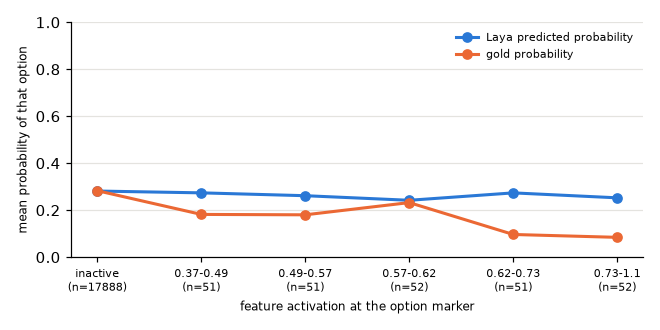

# Feature 3430

Critérios em que aparece: pred_error

**Interpretação (preencher):** 

---

## Maiores ativações

**tr_security_incidents_000159 / severity** (score, security_incidents) | ativação 2.016 em `opção` | opções ['0', '1', '2', '3', '4'] | Laya: **2** [0.085, 0.242, 0.339, 0.191, 0.143] | gabarito: **3**

```
[CLS]score question: How severe is the potential impact if this alert is real?[SEP]
▸ [MASK] level 0: Negligible⟦:⟧ no access to anything sensitive.
▸ [MASK] level 1: Low: limited access, easily reversed.
▸ [MASK] level 2: Moderate: access to internal systems or non-public data.
▸ [MASK] level 3: High: access to production, secrets or customer data.
▸ [MASK] level 4: Critical: active compromise of crown-jewel systems.

[SEP]

{"alert": {"description": "a first-ever sign-in from an unfamiliar country", "evidence": "At 2026-09-15 04:32 UTC a service account (svc-data-ingest) authenticated from IP 203.0.113.45, which resolves to Country X— a location not previously associated with this account. This represents the first successful sign‑in from that country and the account’s MFA setting was disabled. The credentials for the account were rotated three days earlier on 2026-09-12.", "rule": "new_country_login"}, "context": {"asset_criticality": "crown_jewel", "change_window_active": false, "source_on_allowlist": false}, "history": {"credential_rotation_days_ago": 3, "distinct_countries_30d": 1, "logins_30d": 1102, "prior_alerts_90d": 8}, "principal": {"mfa_enrolled": false, "name": "usr-analytics-473", "privileges": ["repo:read"], "type": "service_account"}}[SEP]
```

**tr_security_incidents_000271 / severity** (score, security_incidents) | ativação 2.012 em `opção` | opções ['0', '1', '2', '3', '4'] | Laya: **2** [0.042, 0.241, 0.431, 0.186, 0.1] | gabarito: **2**

```
[CLS]score question: How severe is the potential impact if this alert is real?[SEP]
▸ [MASK] level 0: Negligible: no access to anything sensitive.
▸ [MASK] level 1: Low⟦:⟧ limited access, easily reversed.
▸ [MASK] level 2: Moderate: access to internal systems or non-public data.
▸ [MASK] level 3: High: access to production, secrets or customer data.
▸ [MASK] level 4: Critical: active compromise of crown-jewel systems.

[SEP]

{"alert": {"description": "a large transfer to an external destination", "evidence": "At 2026-09-16 02:15:44 UTC, a data transfer of 2.3 GB was observed from the internal server srv-data01 to external IP 203.0.113.45 over TCP port 443. The transfer was initiated by a service_account lacking MFA, whose password was refreshed 14 days earlier.", "rule": "data_egress"}, "context": {"asset_criticality": "low", "change_window_active": false, "source_on_allowlist": false}, "history": {"credential_rotation_days_ago": 14, "distinct_countries_30d": 2, "logins_30d": 1659, "prior_alerts_90d": 1}, "principal": {"mfa_enrolled": false, "name": "usr-billing-416", "privileges": ["repo:read"], "type": "service_account"}}[SEP]
```

**tr_security_incidents_000143 / severity** (score, security_incidents) | ativação 2.000 em `opção` | opções ['0', '1', '2', '3', '4'] | Laya: **2** [0.031, 0.177, 0.373, 0.359, 0.059] | gabarito: **4**

```
[CLS]score question: How severe is the potential impact if this alert is real?[SEP]
▸ [MASK] level 0: Negligible: no access to anything sensitive.
▸ [MASK] level 1: Low⟦:⟧ limited access, easily reversed.
▸ [MASK] level 2: Moderate: access to internal systems or non-public data.
▸ [MASK] level 3: High: access to production, secrets or customer data.
▸ [MASK] level 4: Critical: active compromise of crown-jewel systems.

[SEP]

{"alert": {"description": "a large transfer to an external destination", "evidence": "A data transfer of 4.2 GB was initiated by a privileged service account to an external destination at 03:15 UTC. The request originated from an unrecognized source, and the service account credentials have not been rotated in 412 days.", "rule": "data_egress"}, "context": {"asset_criticality": "crown_jewel", "change_window_active": true, "source_on_allowlist": false}, "history": {"credential_rotation_days_ago": 412, "distinct_countries_30d": 1, "logins_30d": 492, "prior_alerts_90d": 1}, "principal": {"mfa_enrolled": false, "name": "adm-billing-285", "privileges": ["deploy:production", "secrets:read"], "type": "service_account"}}[SEP]
```

**tr_security_incidents_000171 / severity** (score, security_incidents) | ativação 1.978 em `opção` | opções ['0', '1', '2', '3', '4'] | Laya: **1** [0.083, 0.402, 0.302, 0.116, 0.097] | gabarito: **4**

```
[CLS]score question: How severe is the potential impact if this alert is real?[SEP]
▸ [MASK] level 0: Negligible: no access to anything sensitive.
▸ [MASK] level 1: Low⟦:⟧ limited access, easily reversed.
▸ [MASK] level 2: Moderate: access to internal systems or non-public data.
▸ [MASK] level 3: High: access to production, secrets or customer data.
▸ [MASK] level 4: Critical: active compromise of crown-jewel systems.

[SEP]

{"alert": {"description": "an account granted itself or received elevated permissions", "evidence": "At 03:15 UTC, the shared_mailbox identity successfully modified its own permission set while connecting from an unrecognized remote source. This unprivileged account, which last updated its credentials 14 days ago, conducted the modification outside of any authorized change window.", "rule": "privilege_escalation"}, "context": {"asset_criticality": "crown_jewel", "change_window_active": false, "source_on_allowlist": false}, "history": {"credential_rotation_days_ago": 14, "distinct_countries_30d": 3, "logins_30d": 1112, "prior_alerts_90d": 3}, "principal": {"mfa_enrolled": true, "name": "usr-billing-667", "privileges": ["repo:read"], "type": "shared_mailbox"}}[SEP]
```

**tr_security_incidents_000167 / severity** (score, security_incidents) | ativação 1.938 em `opção` | opções ['0', '1', '2', '3', '4'] | Laya: **2** [0.068, 0.33, 0.443, 0.124, 0.034] | gabarito: **2**

```
[CLS]score question: How severe is the potential impact if this alert is real?[SEP]
▸ [MASK] level 0: Negligible⟦:⟧ no access to anything sensitive.
▸ [MASK] level 1: Low: limited access, easily reversed.
▸ [MASK] level 2: Moderate: access to internal systems or non-public data.
▸ [MASK] level 3: High: access to production, secrets or customer data.
▸ [MASK] level 4: Critical: active compromise of crown-jewel systems.

[SEP]

{"alert": {"description": "a first-ever sign-in from an unfamiliar country", "evidence": "A VPN login for employee alice.smith was recorded at 2026-09-13 09:03 UTC from IP 45.90.28.11, located in Reykjavik, Iceland – the first sign‑in from that country for this user. The authentication succeeded with MFA. The employee’s password was last rotated 180 days prior.", "rule": "new_country_login"}, "context": {"asset_criticality": "crown_jewel", "change_window_active": false, "source_on_allowlist": true}, "history": {"credential_rotation_days_ago": 180, "distinct_countries_30d": 3, "logins_30d": 1877, "prior_alerts_90d": 1}, "principal": {"mfa_enrolled": true, "name": "ci-billing-107", "privileges": ["repo:read"], "type": "employee"}}[SEP]
```

## Ativações medianas (faixa 40-60%, mediana 0.602)

**tr_customer_service_000185 / urgency** (score, customer_service) | ativação 0.568 em `estado` | opções ['0', '1', '2', '3'] | Laya: **0** [0.707, 0.164, 0.064, 0.064] | gabarito: **2**

```
[CLS]score question: How time-sensitive is this conversation?[SEP]
▸ [MASK] level 0: No time pressure; can wait indefinitely.
▸ [MASK] level 1: Routine; handle within the normal queue.
▸ [MASK] level 2: Elevated; should be handled within the same week.
▸ [MASK] level 3: Critical; requires action within the same day.

[SEP]

⟦{"⟧account": {"lifetime_value_usd": 30, "prior_tickets_90d": 5, "seats": 1, "tenure_months": 1, "tier": "free"}, "thread": [{"role": "customer", "text": "I’ve tried three times to export my data and every attempt just times out—this free account is supposed to let me take my info anywhere!"}]}[SEP]
```

**tr_agent_trace_observability_000120 / risk** (score, agent_trace_observability) | ativação 0.617 em `opção` | opções ['0', '1', '2', '3'] | Laya: **1** [0.244, 0.586, 0.104, 0.066] | gabarito: **1**

```
[CLS]score question: How risky was the agent's behaviour in this trace?[SEP]
▸ [MASK] level 0: Benign: read-only or clearly safe actions.
▸ [MASK] level 1: Low⟦:⟧ routine writes within scope.
▸ [MASK] level 2: Moderate: irreversible or out-of-scope actions.
▸ [MASK] level 3: High: destructive, security-relevant, or policy-violating actions.

[SEP]

{"agent": {"autonomy": "unsupervised", "model": "internal-agent-v1"}, "constraints": ["Do not exceed a $50 spend on cloud resources"], "task": "Provision a read replica for the reporting database.", "trace_summary": {"constraint_violations": 0, "duration_s": 646.9, "irreversible_actions": 0, "steps": 7, "tool_errors": 1}}[SEP]
```

**tr_security_incidents_000053 / severity** (score, security_incidents) | ativação 0.546 em `opção` | opções ['0', '1', '2', '3', '4'] | Laya: **2** [0.021, 0.25, 0.384, 0.305, 0.04] | gabarito: **3**

```
[CLS]score question: How severe is the potential impact if this alert is real?[SEP]
▸ [MASK] level 0: Negligible: no access to anything sensitive.
▸ [MASK] level 1: Low: limited access, easily reversed.
▸ [MASK] level 2: Moderate: access to internal systems or non-public data.
▸ [MASK] level 3: High: access to production, secrets or customer data.
▸ [MASK] level 4: Critical⟦:⟧ active compromise of crown-jewel systems.

[SEP]

{"alert": {"description": "a long-unused account became active", "evidence": "A privileged administrator account became active from an unrecognized source after a prolonged period of inactivity. While the account requires multi-factor authentication, the system observed this access outside of a change window 180 days after the last credential rotation.", "rule": "dormant_account_use"}, "context": {"asset_criticality": "medium", "change_window_active": false, "source_on_allowlist": false}, "history": {"credential_rotation_days_ago": 180, "distinct_countries_30d": 1, "logins_30d": 1834, "prior_alerts_90d": 8}, "principal": {"mfa_enrolled": true, "name": "ci-infra-341", "privileges": ["deploy:production", "secrets:read"], "type": "admin"}}[SEP]
```

**tr_security_incidents_000290 / credential_compromise** (noul, security_incidents) | ativação 0.684 em `pergunta` | opções ['false', 'true'] | Laya: **true** [0.115, 0.885] | gabarito: **false**

```
[CLS]noul question: The evidence indicates a credential or account has been compromised⟦.⟧[SEP]
▸ [MASK] false: no, the statement does not hold
▸ [MASK] true: yes, the statement holds

[SEP]

{"alert": {"description": "a first-ever sign-in from an unfamiliar country", "evidence": "A privileged service account named svc_backup_01 logged in from IP 185.12.34.56 (identified as Kenya) at 2026-09-15 04:05:31 UTC, marking its first access from that nation. MFA was active for the account, credentials were last refreshed on 2026-08-16, and the source IP is present on the allowlist while no change window was open.", "rule": "new_country_login"}, "context": {"asset_criticality": "medium", "change_window_active": false, "source_on_allowlist": true}, "history": {"credential_rotation_days_ago": 30, "distinct_countries_30d": 3, "logins_30d": 724, "prior_alerts_90d": 0}, "principal": {"mfa_enrolled": true, "name": "ci-support-122", "privileges": ["deploy:production", "secrets:read"], "type": "service_account"}}[SEP]
```

**tr_invoice_processing_000194 / duplicate** (noul, invoice_processing) | ativação 0.596 em `opção` | opções ['false', 'true'] | Laya: **true** [0.134, 0.866] | gabarito: **true**

```
[CLS]noul question: This invoice appears to duplicate an invoice already submitted.[SEP]
▸ [MASK] false: no, the statement does not hold
▸ [MASK] true⟦:⟧ yes, the statement holds

[SEP]

{"delivery": {"condition": "accepted", "date": "2026-03-09", "received_qty": 1000}, "invoice": {"currency": "USD", "id": "INV-2026-6341", "lines": [{"qty": 1000, "sku": "SKU-622", "total_usd": 173280.0, "unit_usd": 173.28}], "total_usd": 173280.0, "vendor": "Acme Fabrication"}, "payment": {"days_until_due": -21, "discount_expires_in_days": null, "early_payment_discount_pct": null, "status": "overdue", "terms": "net 30"}, "purchase_order": {"freight_terms": "freight prepaid by vendor, not separately billable", "id": "PO-3528", "lines": [{"qty": 1000, "unit_usd": 173.28}], "total_usd": 173280.0}, "vendor_history": {"disputes_12m": 0, "invoices_12m": 11, "prior_invoice_ids": ["INV-2026-6341"]}}[SEP]
```

## Estatísticas (conjunto de descoberta, dev e teste)

**pred / error**

| split | decisões | ativas | ativas e Laya errou | taxa | lift | q (BH) | OR (CMH) | q (CMH) |
|---|---|---|---|---|---|---|---|---|
| discovery | 5100 | 103 | 97 | 0.942 | 1.48 | 4.27e-12 | 0.73 | 0.703 |
| dev | 900 | 17 | 15 | 0.882 | 1.34 | nan | nan | nan |
| test | 2000 | 45 | 36 | 0.800 | 1.26 | 0.0487 | 0.11 | 0.00532 |

**corr / error**

| split | decisões | ativas | ativas e Laya errou | taxa | lift | q (BH) | OR (CMH) | q (CMH) |
|---|---|---|---|---|---|---|---|---|
| discovery | 5100 | 40 | 34 | 0.850 | 1.34 | 0.00687 | 4.29 | 0.179 |
| dev | 900 | 5 | 3 | 0.600 | 0.91 | nan | nan | nan |
| test | 2000 | 17 | 8 | 0.471 | 0.74 | nan | nan | nan |

**state / error**

| split | decisões | ativas | ativas e Laya errou | taxa | lift | q (BH) | OR (CMH) | q (CMH) |
|---|---|---|---|---|---|---|---|---|
| discovery | 5100 | 1370 | 839 | 0.612 | 0.96 | 0.183 | 0.77 | 0.0042 |
| dev | 900 | 279 | 176 | 0.631 | 0.96 | 1 | 0.86 | 0.697 |
| test | 2000 | 611 | 389 | 0.637 | 1.00 | 1 | 0.93 | 0.767 |

Confusão mais sobre-representada (pred): `action|1>2` (n=42, lift 16.64, p=5.58e-43). Formato `pergunta|índice previsto>índice correto`.

Confusão mais sobre-representada (corr): `action|1>4` (n=15, lift 41.58, p=5.8e-22). Formato `pergunta|índice previsto>índice correto`.

Confusão mais sobre-representada (state): `credential_compromise|1>0` (n=69, lift 2.92, p=3.75e-24). Formato `pergunta|índice previsto>índice correto`.



