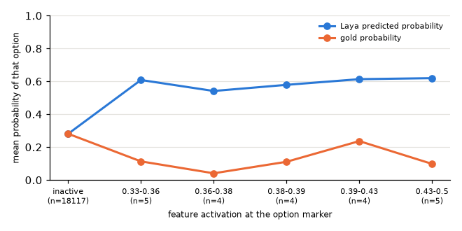

# Feature 3665

Critérios em que aparece: pred_error

**Interpretação (preencher):** 

---

## Maiores ativações

**tr_customer_service_000041 / needs_human** (noul, customer_service) | ativação 2.451 em `estado` | opções ['false', 'true'] | Laya: **true** [0.413, 0.587] | gabarito: **true**

```
[CLS]noul question: This conversation requires a human agent rather than automated handling.[SEP]
▸ [MASK] false: Automation can carry this to resolution.
▸ [MASK] true: A human must take over: judgement, authority or empathy is required.

[SEP]

{"account": {"lifetime_value_usd": 446, "prior_tickets_90d": 1, "seats": 1, "tenure_months": 5, "tier": "free"}, "orders": [{"amount_usd": 999, "date": "2026-01-24", "id": "A-86387", "status": "pending"}, {"amount_usd": 999, "date": "2026-03-10", "id": "A-88077", "status": "settled"}, {"amount_usd": 999, "date": "2026-01-19", "id": "A-21190", "status": "settled"}], "thread": [{"role": "customer", "text": "I⟦ thought⟧ my order was supposed to arrive last week, but nothing’s here yet. I need it for the event on Friday and I’m completely confused."}, {"role": "agent", "text": "I understand how frustrating that can be. Could you share the order number so I can look into the shipping status?"}, {"role": "customer", "text": "It’s #A12345. The tracking just says ‘in transit’ and I’ve got no idea where it is."}, {"role": "agent", "text": "Thanks for that. Do you know which carrier was selected for the shipment? That will help me pinpoint the delay."}, {"role": "customer", "text": "It was supposed to be UPS, but I’m not sure if they even have it. I really need it before Friday, can anything be done?"}]}[SEP]
```

**tr_customer_service_000078 / churn_risk** (score, customer_service) | ativação 2.264 em `estado` | opções ['0', '1', '2', '3'] | Laya: **2** [0.162, 0.311, 0.359, 0.168] | gabarito: **2**

```
[CLS]score question: How likely is this customer to stop doing business with us because of this interaction?[SEP]
▸ [MASK] level 0: No sign of dissatisfaction.
▸ [MASK] level 1: Mild frustration, but the relationship is intact.
▸ [MASK] level 2: Clearly unhappy; repeat problems or explicit complaints.
▸ [MASK] level 3: Imminent: threatening to cancel, dispute or leave.

[SEP]

{"account": {"lifetime_value_usd": 1592, "prior_tickets_90d": 0, "seats": 12, "tenure_months": 60, "tier": "premium"}, "orders": [{"amount_usd": 598, "date": "2026-01-10", "id": "A-12739", "status": "refunded"}, {"amount_usd": 598, "date": "2026-03-19", "id": "A-59410", "status": "failed"}, {"amount_usd": 598, "date": "2026-01-16", "id": "A-91127", "status": "failed"}], "thread": [{"role": "customer", "text": "Hello, I am a⟦ long⟧-time premium member and my latest order of $598 just arrived with significant damage to the exterior packaging and the item itself. I have an event this Friday and really need this resolved."}, {"role": "agent", "text": "I am very sorry to hear that your order arrived in that condition. To help me understand the extent of the damage, could you please describe exactly what looks broken?"}, {"role": "customer", "text": "The glass display is completely shattered, and there is a deep dent on the base unit. It looks like it was crushed during transit."}, {"role": "agent", "text": "Thank you for those details. Would you be able to upload a few clear photographs of the damage to this chat so I can review them?"}, {"role": "customer", "text": "I have taken photos of the unit from several angles. Please let me know if there's anything else you need from me before the end of the day."}]}[SEP]
```

**tr_customer_service_000078 / urgency** (score, customer_service) | ativação 2.264 em `estado` | opções ['0', '1', '2', '3'] | Laya: **1** [0.176, 0.545, 0.102, 0.177] | gabarito: **3**

```
[CLS]score question: How time-sensitive is this conversation?[SEP]
▸ [MASK] level 0: No time pressure; can wait indefinitely.
▸ [MASK] level 1: Routine; handle within the normal queue.
▸ [MASK] level 2: Elevated; should be handled within the same week.
▸ [MASK] level 3: Critical; requires action within the same day.

[SEP]

{"account": {"lifetime_value_usd": 1592, "prior_tickets_90d": 0, "seats": 12, "tenure_months": 60, "tier": "premium"}, "orders": [{"amount_usd": 598, "date": "2026-01-10", "id": "A-12739", "status": "refunded"}, {"amount_usd": 598, "date": "2026-03-19", "id": "A-59410", "status": "failed"}, {"amount_usd": 598, "date": "2026-01-16", "id": "A-91127", "status": "failed"}], "thread": [{"role": "customer", "text": "Hello, I am a⟦ long⟧-time premium member and my latest order of $598 just arrived with significant damage to the exterior packaging and the item itself. I have an event this Friday and really need this resolved."}, {"role": "agent", "text": "I am very sorry to hear that your order arrived in that condition. To help me understand the extent of the damage, could you please describe exactly what looks broken?"}, {"role": "customer", "text": "The glass display is completely shattered, and there is a deep dent on the base unit. It looks like it was crushed during transit."}, {"role": "agent", "text": "Thank you for those details. Would you be able to upload a few clear photographs of the damage to this chat so I can review them?"}, {"role": "customer", "text": "I have taken photos of the unit from several angles. Please let me know if there's anything else you need from me before the end of the day."}]}[SEP]
```

**tr_customer_service_000147 / needs_human** (noul, customer_service) | ativação 2.197 em `estado` | opções ['false', 'true'] | Laya: **true** [0.443, 0.557] | gabarito: **true**

```
[CLS]noul question: This conversation requires a human agent rather than automated handling.[SEP]
▸ [MASK] false: Automation can carry this to resolution.
▸ [MASK] true: A human must take over: judgement, authority or empathy is required.

[SEP]

{"account": {"lifetime_value_usd": 117, "prior_tickets_90d": 3, "seats": 1, "tenure_months": 5, "tier": "premium"}, "thread": [{"role": "customer", "text": "I’m writing to let you know I’d like to cancel my account. I’ve been on the Premium plan for five months, and after three unresolved tickets I’ve decided to move on."}, {"role": "⟦agent⟧", "text": "I’m sorry to hear you want to cancel. Can you confirm the email address associated with the account so I can pull up the correct details?"}, {"role": "customer", "text": "The account is registered to jane.doe@example.com. Please let me know what the next steps are for the cancellation."}]}[SEP]
```

**tr_customer_service_000037 / urgency** (score, customer_service) | ativação 2.188 em `estado` | opções ['0', '1', '2', '3'] | Laya: **1** [0.138, 0.435, 0.155, 0.272] | gabarito: **3**

```
[CLS]score question: How time-sensitive is this conversation?[SEP]
▸ [MASK] level 0: No time pressure; can wait indefinitely.
▸ [MASK] level 1: Routine; handle within the normal queue.
▸ [MASK] level 2: Elevated; should be handled within the same week.
▸ [MASK] level 3: Critical; requires action within the same day.

[SEP]

{"account": {"lifetime_value_usd": 4631, "prior_tickets_90d": 5, "seats": 1, "tenure_months": 72, "tier": "standard"}, "orders": [{"amount_usd": 99, "date": "2026-03-22", "id": "A-19833", "status": "settled"}, {"amount_usd": 99, "date": "2026-03-28", "id": "A-80963", "status": "settled"}, {"amount_usd": 99, "date": "2026-03-25", "id": "A-38277", "status": "refunded"}], "thread": [{"role": "customer", "text": "My $99 order just arrived but it's completely wrong. I need the correct items⟦ by⟧ tomorrow morning for an event—please help!"}, {"role": "agent", "text": "I am sorry to hear you received the incorrect items. Could you please send over your order number and a photo of what was delivered?"}, {"role": "customer", "text": "The order number is #998877. I've attached the photo. Can you tell me if the right ones can be overnighted immediately?"}]}[SEP]
```

## Ativações medianas (faixa 40-60%, mediana 0.868)

**tr_invoice_processing_000168 / urgency** (score, invoice_processing) | ativação 0.773 em `estado` | opções ['0', '1', '2', '3'] | Laya: **1** [0.29, 0.485, 0.132, 0.093] | gabarito: **2**

```
[CLS]score question: How time-sensitive is processing this invoice?[SEP]
▸ [MASK] level 0: No time pressure; can wait indefinitely.
▸ [MASK] level 1: Routine; handle within the normal queue.
▸ [MASK] level 2: Elevated; should be handled within the same week.
▸ [MASK] level 3: Critical; requires action within the same day.

[SEP]

{"delivery": {"condition": "accepted with exceptions", "date": "2026-03-02", "received_qty": 100}, "invoice": {"currency": "USD", "id": "INV-2026-6227", "lines": [{"qty": 100, "sku": "SKU-366", "total_usd": 21767.0, "unit_us⟦d⟧": 217.67}, {"qty": 1, "sku": "FREIGHT", "total_usd": 1816.75, "unit_usd": 1816.75}], "total_usd": 23583.75, "vendor": "Orbit Logistics"}, "payment": {"days_until_due": 5, "discount_expires_in_days": null, "early_payment_discount_pct": null, "status": "scheduled", "terms": "net 45"}, "purchase_order": {"freight_terms": "freight prepaid by vendor, not separately billable", "id": "PO-9134", "lines": [{"qty": 100, "unit_usd": 217.67}], "total_usd": 21767.0}, "vendor_history": {"disputes_12m": 1, "invoices_12m": 40, "prior_invoice_ids": ["INV-2026-9709"]}}[SEP]
```

**tr_customer_service_000053 / action** (choice, customer_service) | ativação 0.880 em `estado` | opções ['answer_directly', 'close_no_action', 'escalate_to_human', 'execute_refund', 'request_information'] | Laya: **close_no_action** [0.171, 0.588, 0.099, 0.06, 0.082] | gabarito: **answer_directly**

```
[CLS]choice question: What should the assistant do next with this conversation?[SEP]
▸ [MASK] answer_directly: The assistant can resolve this itself with information it already has.
▸ [MASK] close_no_action: No further action is warranted; the matter is settled.
▸ [MASK] escalate_to_human: Hand off to a human agent with the appropriate authority.
▸ [MASK] execute_refund: Issue the refund or credit the customer is owed.
▸ [MASK] request_information: More detail is needed from the customer before anything can be done.

[SEP]

{"account": {"lifetime_value_usd": 3557, "prior_tickets_90d": 0, "seats": 1, "tenure_months": 72, "tier": "standard"}, "orders": [{"amount_⟦us⟧d": 58, "date": "2026-02-03", "id": "A-39815", "status": "settled"}], "thread": [{"role": "customer", "text": "Looks like my payment didn't go through again. I've been on the standard plan for six years, paying about $58 each month. I'm not sure what's happening."}, {"role": "agent", "text": "I’m sorry to hear that. Could you tell me which payment method you attempted to use and the date of the failed transaction?"}, {"role": "customer", "text": "It was my Visa ending in 1234 on the 12th of this month. The charge just shows as declined. I’d appreciate any help you can give."}]}[SEP]
```

**tr_security_incidents_000080 / urgency** (score, security_incidents) | ativação 0.765 em `estado` | opções ['0', '1', '2', '3'] | Laya: **1** [0.109, 0.608, 0.143, 0.141] | gabarito: **2**

```
[CLS]score question: How quickly must a responder act on this alert?[SEP]
▸ [MASK] level 0: No time pressure; can wait indefinitely.
▸ [MASK] level 1: Routine; handle within the normal queue.
▸ [MASK] level 2: Elevated; should be handled within the same week.
▸ [MASK] level 3: Critical; requires action within the same day.

[SEP]

{"alert": {"description": "a first-ever sign-in from an unfamiliar country", "evidence": "A privileged shared mailbox \"admin@corp.com\" logged in from IP 200.150.10.77 (São Paulo, Brazil) at 2026-09-16T01:22:10Z, marking the first login from that country for this principal. MFA was enabled, and the credential's last rotation date is recorded as 700 days ago.", "rule": "new_country_login"}, "context": {"asset_criticality": "low", "change_window_active": false, "source_on_allowlist": false}, "history": {"credential_rotation_days_ago": 700, "distinct_countries_30d": 2, "logins_30d": 721, "prior_alerts_90d": 8}, "principal": {"mfa_⟦en⟧rolled": true, "name": "ci-analytics-358", "privileges": ["deploy:production", "secrets:read"], "type": "shared_mailbox"}}[SEP]
```

**tr_invoice_processing_000051 / urgency** (score, invoice_processing) | ativação 0.844 em `estado` | opções ['0', '1', '2', '3'] | Laya: **1** [0.244, 0.545, 0.111, 0.101] | gabarito: **2**

```
[CLS]score question: How time-sensitive is processing this invoice?[SEP]
▸ [MASK] level 0: No time pressure; can wait indefinitely.
▸ [MASK] level 1: Routine; handle within the normal queue.
▸ [MASK] level 2: Elevated; should be handled within the same week.
▸ [MASK] level 3: Critical; requires action within the same day.

[SEP]

{"delivery": {"condition": "accepted", "date": "2026-03-21", "received_qty": 50}, "invoice": {"currency": "USD", "id": "INV-⟦20⟧26-9184", "lines": [{"qty": 50, "sku": "SKU-942", "total_usd": 13431.0, "unit_usd": 268.62}, {"qty": 1, "sku": "FREIGHT", "total_usd": 826.36, "unit_usd": 826.36}], "total_usd": 14257.36, "vendor": "Vantage Materials"}, "payment": {"days_until_due": 2, "discount_expires_in_days": 5, "early_payment_discount_pct": 2.0, "status": "scheduled", "terms": "net 45"}, "purchase_order": {"freight_terms": "freight prepaid by vendor, not separately billable", "id": "PO-3229", "lines": [{"qty": 50, "unit_usd": 268.62}], "total_usd": 13431.0}, "vendor_history": {"disputes_12m": 1, "invoices_12m": 20, "prior_invoice_ids": ["INV-2026-5102", "INV-2026-3057"]}}[SEP]
```

**tr_customer_service_000163 / category** (choice, customer_service) | ativação 0.834 em `estado` | opções ['account', 'billing', 'delivery', 'refund', 'technical'] | Laya: **refund** [0.088, 0.047, 0.028, 0.733, 0.104] | gabarito: **refund**

```
[CLS]choice question: What is this customer conversation primarily about?[SEP]
▸ [MASK] account: Login, plan changes, profile or access management.
▸ [MASK] billing: A charge, invoice, subscription or payment problem.
▸ [MASK] delivery: Shipping, fulfilment or delivery of a physical item.
▸ [MASK] refund: The customer is explicitly asking for money back.
▸ [MASK] technical: The product or service is not working as expected.

[SEP]

{"account": {"lifetime_value_usd": 1046, "prior_tickets_90d": 1, "seats": 1, "tenure_months": 41, "tier": "standard"}, "orders": [{"amount_usd": 87, "date": "2026-01-23", "id": "A-89226", "status": "settled"}], "thread": [{"role": "customer", "text": "I’m fed up—my refund of $87 from about a month ago is still nowhere to be seen, despite the ticket I opened weeks back."}, {"role": "agent", "text": "I’m sorry you’re dealing with this; could you confirm the ticket reference so I can check the latest notes?"}, {"role": "customer", "text": "It’s ticket 98421. I was⟦ promised⟧ a response yesterday and got nothing."}, {"role": "agent", "text": "Understood. I’ll look into the activity on that ticket. Is there any additional documentation you’d like to attach?"}, {"role": "customer", "text": "No, I just want the refund processed—this back‑and‑forth is getting ridiculous."}]}[SEP]
```

## Estatísticas (conjunto de descoberta, dev e teste)

**pred / error**

| split | decisões | ativas | ativas e Laya errou | taxa | lift | q (BH) | OR (CMH) | q (CMH) |
|---|---|---|---|---|---|---|---|---|
| discovery | 5100 | 22 | 21 | 0.955 | 1.50 | 0.00297 | 3.27 | 0.454 |
| dev | 900 | 0 | 0 | nan | nan | nan | nan | nan |
| test | 2000 | 8 | 7 | 0.875 | 1.37 | nan | nan | nan |

**corr / error**

| split | decisões | ativas | ativas e Laya errou | taxa | lift | q (BH) | OR (CMH) | q (CMH) |
|---|---|---|---|---|---|---|---|---|
| discovery | 5100 | 1 | 0 | 0.000 | 0.00 | nan | nan | nan |
| dev | 900 | 0 | 0 | nan | nan | nan | nan | nan |
| test | 2000 | 1 | 0 | 0.000 | 0.00 | nan | nan | nan |

**state / error**

| split | decisões | ativas | ativas e Laya errou | taxa | lift | q (BH) | OR (CMH) | q (CMH) |
|---|---|---|---|---|---|---|---|---|
| discovery | 5100 | 1932 | 1200 | 0.621 | 0.98 | 0.308 | 0.99 | 0.951 |
| dev | 900 | 328 | 207 | 0.631 | 0.96 | 1 | 0.89 | 0.726 |
| test | 2000 | 784 | 490 | 0.625 | 0.98 | 0.846 | 0.96 | 0.862 |

Confusão mais sobre-representada (pred): `action|0>1` (n=13, lift 25.32, p=1.3e-16). Formato `pergunta|índice previsto>índice correto`.

Confusão mais sobre-representada (state): `action|1>2` (n=87, lift 1.84, p=3.46e-13). Formato `pergunta|índice previsto>índice correto`.



