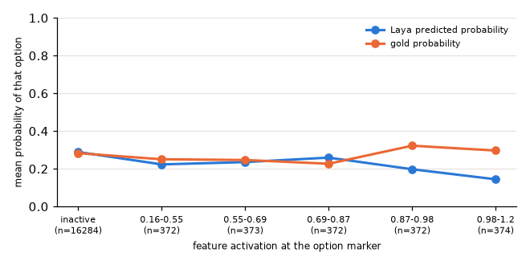

# Feature 3734

Critérios em que aparece: pred_error_stratified, corr_error_stratified, attribution_toward_wrong

**Interpretação (preencher):** 

---

## Maiores ativações

**tr_customer_service_000209 / action** (choice, customer_service) | ativação 2.193 em `estado` | opções ['answer_directly', 'close_no_action', 'escalate_to_human', 'execute_refund', 'request_information'] | Laya: **close_no_action** [0.187, 0.447, 0.153, 0.088, 0.124] | gabarito: **escalate_to_human**

```
[CLS]choice question: What should the assistant do next with this conversation?[SEP]
▸ [MASK] answer_directly: The assistant can resolve this itself with information it already has.
▸ [MASK] close_no_action: No further action is warranted; the matter is settled.
▸ [MASK] escalate_to_human: Hand off to a human agent with the appropriate authority.
▸ [MASK] execute_refund: Issue the refund or credit the customer is owed.
▸ [MASK] request_information: More detail is needed from the customer before anything can be done.

[SEP]

{"account": {"lifetime_value_usd": 77, "prior_tickets_90d": 0, "seats": 3, "tenure_months": 2, "tier": "enterprise"}, "orders": [{"amount_usd": 1998, "date": "2026-02-09", "id": "A-87995", "status": "settled"}], "thread": [{"role": "customer", "text": "I ordered the premium hardware kit with⟦ my⟧ $1,998 Enterprise purchase, but the box I got contains the basic accessories instead. This is completely unacceptable."}, {"role": "agent", "text": "I understand how frustrating that must be. Let me pull up your order details—can you provide the order number you received in the confirmation email?"}, {"role": "customer", "text": "It’s 8457‑B2, and I’ve already opened a ticket about this, which was never resolved."}, {"role": "agent", "text": "Thanks for the number. I see the mismatch now. Could you tell me if the packaging is still sealed, or if you’ve already inspected the contents?"}, {"role": "customer", "text": "The box is still sealed; I haven’t taken anything out because I need the correct items before I can even consider using them."}]}[SEP]
```

**tr_customer_service_000057 / churn_risk** (score, customer_service) | ativação 2.186 em `estado` | opções ['0', '1', '2', '3'] | Laya: **1** [0.199, 0.385, 0.191, 0.225] | gabarito: **2**

```
[CLS]score question: How likely is this customer to stop doing business with us because of this interaction?[SEP]
▸ [MASK] level 0: No sign of dissatisfaction.
▸ [MASK] level 1: Mild frustration, but the relationship is intact.
▸ [MASK] level 2: Clearly unhappy; repeat problems or explicit complaints.
▸ [MASK] level 3: Imminent: threatening to cancel, dispute or leave.

[SEP]

{"account": {"lifetime_value_usd": 1386, "prior_tickets_90d": 1, "seats": 1, "tenure_months": 72, "tier": "free"}, "thread": [{"role": "customer", "text": "Your service is crawling⟦ at⟧ a snail’s pace and I’ve been on the free plan for six years – this is unacceptable."}, {"role": "agent", "text": "I’m sorry you’re experiencing slowness. Could you let me know which device and browser you’re using?"}, {"role": "customer", "text": "Ticket #6789 was supposed to fix this weeks ago, but nothing changed. It’s the same lag every time I log in."}, {"role": "agent", "text": "Got it. When did the slowdown start, and are you seeing any error messages on the screen?"}, {"role": "customer", "text": "It started yesterday, no error messages, just endless loading. My work is getting held up and I need an update."}]}[SEP]
```

**tr_customer_service_000057 / urgency** (score, customer_service) | ativação 2.178 em `estado` | opções ['0', '1', '2', '3'] | Laya: **1** [0.228, 0.481, 0.172, 0.119] | gabarito: **3**

```
[CLS]score question: How time-sensitive is this conversation?[SEP]
▸ [MASK] level 0: No time pressure; can wait indefinitely.
▸ [MASK] level 1: Routine; handle within the normal queue.
▸ [MASK] level 2: Elevated; should be handled within the same week.
▸ [MASK] level 3: Critical; requires action within the same day.

[SEP]

{"account": {"lifetime_value_usd": 1386, "prior_tickets_90d": 1, "seats": 1, "tenure_months": 72, "tier": "free"}, "thread": [{"role": "customer", "text": "Your service is crawling⟦ at⟧ a snail’s pace and I’ve been on the free plan for six years – this is unacceptable."}, {"role": "agent", "text": "I’m sorry you’re experiencing slowness. Could you let me know which device and browser you’re using?"}, {"role": "customer", "text": "Ticket #6789 was supposed to fix this weeks ago, but nothing changed. It’s the same lag every time I log in."}, {"role": "agent", "text": "Got it. When did the slowdown start, and are you seeing any error messages on the screen?"}, {"role": "customer", "text": "It started yesterday, no error messages, just endless loading. My work is getting held up and I need an update."}]}[SEP]
```

**tr_customer_service_000057 / category** (choice, customer_service) | ativação 2.119 em `estado` | opções ['account', 'billing', 'delivery', 'refund', 'technical'] | Laya: **technical** [0.289, 0.114, 0.07, 0.19, 0.338] | gabarito: **technical**

```
[CLS]choice question: What is this customer conversation primarily about?[SEP]
▸ [MASK] account: Login, plan changes, profile or access management.
▸ [MASK] billing: A charge, invoice, subscription or payment problem.
▸ [MASK] delivery: Shipping, fulfilment or delivery of a physical item.
▸ [MASK] refund: The customer is explicitly asking for money back.
▸ [MASK] technical: The product or service is not working as expected.

[SEP]

{"account": {"lifetime_value_usd": 1386, "prior_tickets_90d": 1, "seats": 1, "tenure_months": 72, "tier": "free"}, "thread": [{"role": "customer", "text": "Your service is crawling⟦ at⟧ a snail’s pace and I’ve been on the free plan for six years – this is unacceptable."}, {"role": "agent", "text": "I’m sorry you’re experiencing slowness. Could you let me know which device and browser you’re using?"}, {"role": "customer", "text": "Ticket #6789 was supposed to fix this weeks ago, but nothing changed. It’s the same lag every time I log in."}, {"role": "agent", "text": "Got it. When did the slowdown start, and are you seeing any error messages on the screen?"}, {"role": "customer", "text": "It started yesterday, no error messages, just endless loading. My work is getting held up and I need an update."}]}[SEP]
```

**tr_customer_service_000057 / action** (choice, customer_service) | ativação 2.090 em `estado` | opções ['answer_directly', 'close_no_action', 'escalate_to_human', 'execute_refund', 'request_information'] | Laya: **close_no_action** [0.206, 0.353, 0.19, 0.09, 0.161] | gabarito: **escalate_to_human**

```
[CLS]choice question: What should the assistant do next with this conversation?[SEP]
▸ [MASK] answer_directly: The assistant can resolve this itself with information it already has.
▸ [MASK] close_no_action: No further action is warranted; the matter is settled.
▸ [MASK] escalate_to_human: Hand off to a human agent with the appropriate authority.
▸ [MASK] execute_refund: Issue the refund or credit the customer is owed.
▸ [MASK] request_information: More detail is needed from the customer before anything can be done.

[SEP]

{"account": {"lifetime_value_usd": 1386, "prior_tickets_90d": 1, "seats": 1, "tenure_months": 72, "tier": "free"}, "thread": [{"role": "customer", "text": "Your service is crawling⟦ at⟧ a snail’s pace and I’ve been on the free plan for six years – this is unacceptable."}, {"role": "agent", "text": "I’m sorry you’re experiencing slowness. Could you let me know which device and browser you’re using?"}, {"role": "customer", "text": "Ticket #6789 was supposed to fix this weeks ago, but nothing changed. It’s the same lag every time I log in."}, {"role": "agent", "text": "Got it. When did the slowdown start, and are you seeing any error messages on the screen?"}, {"role": "customer", "text": "It started yesterday, no error messages, just endless loading. My work is getting held up and I need an update."}]}[SEP]
```

## Ativações medianas (faixa 40-60%, mediana 0.776)

**tr_security_incidents_000116 / credential_compromise** (noul, security_incidents) | ativação 0.796 em `estado` | opções ['false', 'true'] | Laya: **true** [0.159, 0.84] | gabarito: **true**

```
[CLS]noul question: The evidence indicates a credential or account has been compromised.[SEP]
▸ [MASK] false: no, the statement does not hold
▸ [MASK] true: yes, the statement holds

[SEP]

{"alert": {"description": "a large transfer to an external destination", "evidence": "Between 2026-09-16 04:55:12 UTC and 04:57:03 UTC an admin account transferred 4.2 GB of data to external endpoint 185.53.177.22 over HTTPS (port 443) using⟦ the⟧ rsync process. The transfer occurred while a change window was open, the source host is unrecognised, and the admin’s credentials have not been rotated for 700 days.", "rule": "data_egress"}, "context": {"asset_criticality": "high", "change_window_active": true, "source_on_allowlist": false}, "history": {"credential_rotation_days_ago": 700, "distinct_countries_30d": 3, "logins_30d": 690, "prior_alerts_90d": 8}, "principal": {"mfa_enrolled": true, "name": "ci-infra-262", "privileges": ["repo:read"], "type": "admin"}}[SEP]
```

**tr_security_incidents_000061 / true_positive** (noul, security_incidents) | ativação 0.839 em `CLS` | opções ['false', 'true'] | Laya: **false** [0.585, 0.415] | gabarito: **false**

```
⟦[CLS]⟧noul question: This alert reflects genuinely malicious or unauthorised activity.[SEP]
▸ [MASK] false: Benign activity, a misconfiguration, or a known false positive.
▸ [MASK] true: The underlying behaviour is malicious or unauthorised.

[SEP]

{"alert": {"description": "a large transfer to an external destination", "evidence": "On 2026-09-15 11:45:23 UTC a data transfer of 12.4 GB was observed from the internal server 10.2.5.8 to external IP 203.0.113.45 over HTTPS (port 443). The operation was performed by service account \"svc-data-export\" that is privileged, has MFA enabled, and its credentials were last rotated 180 days ago. The originating IP (10.2.5.8) is on the approved allowlist.", "rule": "data_egress"}, "context": {"asset_criticality": "low", "change_window_active": false, "source_on_allowlist": true}, "history": {"credential_rotation_days_ago": 180, "distinct_countries_30d": 3, "logins_30d": 1451, "prior_alerts_90d": 25}, "principal": {"mfa_enrolled": true, "name": "ci-infra-832", "privileges": ["deploy:production", "secrets:read"], "type": "service_account"}}[SEP]
```

**tr_invoice_processing_000235 / matches_order** (noul, invoice_processing) | ativação 0.835 em `estado` | opções ['false', 'true'] | Laya: **false** [0.503, 0.497] | gabarito: **false**

```
[CLS]noul question: The invoice reconciles with the purchase order and the recorded delivery.[SEP]
▸ [MASK] false: There is a discrepancy against the order or the delivery.
▸ [MASK] true: Line items, quantities and amounts reconcile.

[SEP]

{"delivery": {"condition": "accepted", "date": "2026-03-02", "received_qty": 400}, "invoice": {"currency": "USD", "id": "INV-2026-5490", "lines": [{"qty": 400, "sku": "SKU-582", "total_usd": 38948.0, "unit⟦_⟧usd": 97.37}], "total_usd": 38948.0, "vendor": "Pallas Industrial"}, "payment": {"days_until_due": -3, "discount_expires_in_days": null, "early_payment_discount_pct": null, "status": "overdue", "terms": "net 30"}, "purchase_order": {"freight_terms": "freight prepaid by vendor, not separately billable", "id": "PO-1506", "lines": [{"qty": 400, "unit_usd": 94.53}], "total_usd": 37812.0}, "vendor_history": {"disputes_12m": 5, "invoices_12m": 1, "prior_invoice_ids": ["INV-2026-9347"]}}[SEP]
```

**tr_agent_trace_observability_000259 / needs_review** (noul, agent_trace_observability) | ativação 0.738 em `estado` | opções ['false', 'true'] | Laya: **false** [0.528, 0.472] | gabarito: **true**

```
[CLS]noul question: This trace requires human review.[SEP]
▸ [MASK] false: No human attention is warranted.
▸ [MASK] true: A human should inspect this run.

[SEP]

{"agent": {"autonomy": "checkpointed", "model": "internal-agent⟦-⟧v3"}, "constraints": ["Do not exceed a $50 spend on cloud resources"], "task": "Clean up stale feature branches merged more than 90 days ago.", "trace_summary": {"constraint_violations": 0, "duration_s": 777.6, "irreversible_actions": 1, "steps": 12, "tool_errors": 3}}[SEP]
```

**tr_security_incidents_000085 / true_positive** (noul, security_incidents) | ativação 0.842 em `opção` | opções ['false', 'true'] | Laya: **true** [0.433, 0.567] | gabarito: **true**

```
[CLS]noul question: This alert reflects genuinely malicious or unauthorised activity.[SEP]
▸ [MASK] false: Benign activity, a misconfiguration, or a known false positive.
▸ [MASK] true: The underlying behaviour is malicious⟦ or⟧ unauthorised.

[SEP]

{"alert": {"description": "an unrecognised binary executed on a server", "evidence": "A binary file named 'svchost_debug.exe' was executed on server-04 at 03:14 UTC, originating from an unknown external source. The executing user account has not performed a credential rotation in 365 days and was not associated with any active change management requests.", "rule": "suspicious_process"}, "context": {"asset_criticality": "medium", "change_window_active": false, "source_on_allowlist": false}, "history": {"credential_rotation_days_ago": 365, "distinct_countries_30d": 4, "logins_30d": 1334, "prior_alerts_90d": 0}, "principal": {"mfa_enrolled": true, "name": "ci-billing-513", "privileges": ["repo:read"], "type": "employee"}}[SEP]
```

## Estatísticas (conjunto de descoberta, dev e teste)

**pred / error**

| split | decisões | ativas | ativas e Laya errou | taxa | lift | q (BH) | OR (CMH) | q (CMH) |
|---|---|---|---|---|---|---|---|---|
| discovery | 5100 | 443 | 384 | 0.867 | 1.36 | 6.42e-28 | 2.62 | 4.75e-07 |
| dev | 900 | 80 | 68 | 0.850 | 1.29 | 0.00252 | 2.29 | 0.196 |
| test | 2000 | 178 | 160 | 0.899 | 1.41 | 6.13e-15 | 3.59 | 4.09e-05 |

**corr / error**

| split | decisões | ativas | ativas e Laya errou | taxa | lift | q (BH) | OR (CMH) | q (CMH) |
|---|---|---|---|---|---|---|---|---|
| discovery | 5100 | 523 | 464 | 0.887 | 1.39 | 8.28e-41 | 2.95 | 3.51e-05 |
| dev | 900 | 101 | 89 | 0.881 | 1.34 | 5.13e-07 | 3.52 | 0.143 |
| test | 2000 | 200 | 182 | 0.910 | 1.43 | 5.73e-19 | 4.15 | 0.000909 |

**state / error**

| split | decisões | ativas | ativas e Laya errou | taxa | lift | q (BH) | OR (CMH) | q (CMH) |
|---|---|---|---|---|---|---|---|---|
| discovery | 5100 | 3751 | 2370 | 0.632 | 0.99 | 0.591 | 0.93 | 0.551 |
| dev | 900 | 744 | 486 | 0.653 | 0.99 | 1 | 0.87 | 0.747 |
| test | 2000 | 1518 | 957 | 0.630 | 0.99 | 0.784 | 0.89 | 0.588 |

Confusão mais sobre-representada (pred): `action|1>2` (n=80, lift 7.37, p=0). Formato `pergunta|índice previsto>índice correto`.

Confusão mais sobre-representada (corr): `action|0>1` (n=119, lift 9.75, p=0). Formato `pergunta|índice previsto>índice correto`.

Confusão mais sobre-representada (state): `duplicate|1>0` (n=216, lift 1.36, p=2.79e-30). Formato `pergunta|índice previsto>índice correto`.



