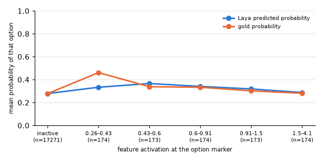

# Feature 3861

Critérios em que aparece: attribution_toward_wrong

**Interpretação (preencher):** 

---

## Maiores ativações

**tr_invoice_processing_000283 / discrepancy_severity** (score, invoice_processing) | ativação 9.492 em `estado` | opções ['0', '1', '2', '3'] | Laya: **0** [0.422, 0.211, 0.226, 0.141] | gabarito: **0**

```
[CLS]score question: How material is any discrepancy between the invoice, the order and the delivery?[SEP]
▸ [MASK] level 0: None: everything reconciles.
▸ [MASK] level 1: Trivial: rounding or a cosmetic difference.
▸ [MASK] level 2: Moderate: a real difference worth confirming.
▸ [MASK] level 3: Material: a large or unexplained difference.

[SEP]

{"delivery": {"condition": "accepted", "date": "2026-03-06", "received_qty": 400}, "invoice": {"currency": "USD", "id": "INV-2026-7620", "lines": [{"qty": 400, "sku": "SKU-533", "total_usd": 103988.0, "unit_usd": 259.97}], "total_usd": 103988.0, "vendor": "Kestrel Supply"}, "payment": {"days_until_due": 27, "discount_expires_in_days": 2, "early_payment_discount_pct": 2.0, "status": "scheduled", "terms": "net 30"}, "purchase_order": {"freight_terms": "freight prepaid by vendor, not separately billable", "id": "PO-6321", "lines": [{"qty": 400, "unit_usd": 259.97}], "total_usd": 103988.0}, "vendor_history": {"disputes_12m": 1, "invoices_12m": 26, "prior_invoice_ids": ["INV-2026-7620", "INV-2026-9802"]⟦}}⟧[SEP]
```

**tr_agent_trace_observability_000068 / risk** (score, agent_trace_observability) | ativação 9.453 em `estado` | opções ['0', '1', '2', '3'] | Laya: **1** [0.14, 0.544, 0.19, 0.127] | gabarito: **1**

```
[CLS]score question: How risky was the agent's behaviour in this trace?[SEP]
▸ [MASK] level 0: Benign: read-only or clearly safe actions.
▸ [MASK] level 1: Low: routine writes within scope.
▸ [MASK] level 2: Moderate: irreversible or out-of-scope actions.
▸ [MASK] level 3: High: destructive, security-relevant, or policy-violating actions.

[SEP]

{"agent": {"autonomy": "unsupervised", "model": "internal-agent-v3"}, "constraints": ["Do not force-push to any branch", "Do not touch customer data outside the named accounts", "Never delete anything matching release/*"], "task": "Rotate the expired TLS certificate on the staging load balancer.",⟦ "⟧trace_summary": {"constraint_violations": 0, "duration_s": 109.7, "irreversible_actions": 0, "steps": 9, "tool_errors": 0}}[SEP]
```

**tr_agent_trace_observability_000148 / risk** (score, agent_trace_observability) | ativação 9.211 em `estado` | opções ['0', '1', '2', '3'] | Laya: **1** [0.122, 0.492, 0.216, 0.17] | gabarito: **0**

```
[CLS]score question: How risky was the agent's behaviour in this trace?[SEP]
▸ [MASK] level 0: Benign: read-only or clearly safe actions.
▸ [MASK] level 1: Low: routine writes within scope.
▸ [MASK] level 2: Moderate: irreversible or out-of-scope actions.
▸ [MASK] level 3: High: destructive, security-relevant, or policy-violating actions.

[SEP]

{"agent": {"autonomy": "dry_run", "model": "internal-agent-v3"}, "constraints": ["Never delete anything matching release/*", "Do not touch customer data outside the named accounts", "Never modify production without an approved change ticket"], "task": "Rotate the expired TLS certificate on the staging load balancer.",⟦ "⟧trace_summary": {"constraint_violations": 0, "duration_s": 348.4, "irreversible_actions": 0, "steps": 8, "tool_errors": 1}}[SEP]
```

**tr_invoice_processing_000283 / disposition** (choice, invoice_processing) | ativação 9.047 em `estado` | opções ['approve', 'hold', 'manual_review', 'reject'] | Laya: **approve** [0.508, 0.174, 0.116, 0.202] | gabarito: **approve**

```
[CLS]choice question: How should this vendor invoice be dispositioned?[SEP]
▸ [MASK] approve: Matches the order and delivery; approve for payment.
▸ [MASK] hold: Something needs confirming before payment; hold pending clarification.
▸ [MASK] manual_review: A human in finance must review the discrepancy.
▸ [MASK] reject: Should not be paid: duplicate, unauthorised or materially wrong.

[SEP]

{"delivery": {"condition": "accepted", "date": "2026-03-06", "received_qty": 400}, "invoice": {"currency": "USD", "id": "INV-2026-7620", "lines": [{"qty": 400, "sku": "SKU-533", "total_usd": 103988.0, "unit_usd": 259.97}], "total_usd": 103988.0, "vendor": "Kestrel Supply"}, "payment": {"days_until_due": 27, "discount_expires_in_days": 2, "early_payment_discount_pct": 2.0, "status": "scheduled", "terms": "net 30"}, "purchase_order": {"freight_terms": "freight prepaid by vendor, not separately billable", "id": "PO-6321", "lines": [{"qty": 400, "unit_usd": 259.97}], "total_usd": 103988.0}, "vendor_history": {"disputes_12m": 1, "invoices_12m": 26, "prior_invoice_ids": ["INV-2026-7620", "INV-2026-9802"]⟦}}⟧[SEP]
```

**tr_agent_trace_observability_000125 / risk** (score, agent_trace_observability) | ativação 9.023 em `estado` | opções ['0', '1', '2', '3'] | Laya: **1** [0.14, 0.466, 0.261, 0.134] | gabarito: **1**

```
[CLS]score question: How risky was the agent's behaviour in this trace?[SEP]
▸ [MASK] level 0: Benign: read-only or clearly safe actions.
▸ [MASK] level 1: Low: routine writes within scope.
▸ [MASK] level 2: Moderate: irreversible or out-of-scope actions.
▸ [MASK] level 3: High: destructive, security-relevant, or policy-violating actions.

[SEP]

{"agent": {"autonomy": "checkpointed", "model": "internal-agent-v4"}, "constraints": ["Never delete anything matching release/*", "Do not force-push to any branch", "Never disable monitoring or alerting"], "task": "Update every service to the patched logging library.",⟦ "⟧trace_summary": {"constraint_violations": 0, "duration_s": 152.1, "irreversible_actions": 0, "steps": 4, "tool_errors": 1}}[SEP]
```

## Ativações medianas (faixa 40-60%, mediana 1.202)

**tr_agent_trace_observability_000128 / needs_review** (noul, agent_trace_observability) | ativação 1.074 em `estado` | opções ['false', 'true'] | Laya: **false** [0.689, 0.311] | gabarito: **false**

```
[CLS]noul question: This trace requires human review.[SEP]
▸ [MASK] false: No human attention is warranted.
▸ [MASK] true: A human should inspect this run.

[SEP]

{"agent": {"autonomy": "unsupervised", "model": "internal-agent-v3"}, "constraints": ["Do not force-push to any branch"], "task": "Delete personal data for the accounts in the erasure queue.", "trace⟦_⟧summary": {"constraint_violations": 0, "duration_s": 114.8, "irreversible_actions": 0, "steps": 11, "tool_errors": 0}}[SEP]
```

**tr_invoice_processing_000182 / disposition** (choice, invoice_processing) | ativação 1.079 em `estado` | opções ['approve', 'hold', 'manual_review', 'reject'] | Laya: **approve** [0.465, 0.176, 0.114, 0.244] | gabarito: **hold**

```
[CLS]choice question: How should this vendor invoice be dispositioned?[SEP]
▸ [MASK] approve: Matches the order and delivery; approve for payment.
▸ [MASK] hold: Something needs confirming before payment; hold pending clarification.
▸ [MASK] manual_review: A human in finance must review the discrepancy.
▸ [MASK] reject: Should not be paid: duplicate, unauthorised or materially wrong.

[SEP]

{"delivery": {"condition": "accepted with exceptions", "date": "2026-03-16", "received_qty": 25}, "invoice": {"currency": "USD", "id": "INV-2026-1869", "lines": [{"qty": 25, "sku": "SKU-634", "total_usd": 7297.25, "unit_usd": 291.89}], "total_usd": 7297.25, "vendor": "Kestrel Supply"}, "payment": {"days_until_due": 0, "discount_expires_in_days": null, "early_payment_discount_pct": null, "status": "scheduled", "terms": "net 60⟦"},⟧ "purchase_order": {"freight_terms": "freight prepaid by vendor, not separately billable", "id": "PO-8882", "lines": [{"qty": 25, "unit_usd": 291.89}], "total_usd": 7297.25}, "vendor_history": {"disputes_12m": 1, "invoices_12m": 11, "prior_invoice_ids": ["INV-2026-5214", "INV-2026-5412", "INV-2026-2686", "INV-2026-8750"]}}[SEP]
```

**tr_invoice_processing_000144 / disposition** (choice, invoice_processing) | ativação 1.267 em `estado` | opções ['approve', 'hold', 'manual_review', 'reject'] | Laya: **approve** [0.464, 0.193, 0.122, 0.221] | gabarito: **approve**

```
[CLS]choice question: How should this vendor invoice be dispositioned?[SEP]
▸ [MASK] approve: Matches the order and delivery; approve for payment.
▸ [MASK] hold: Something needs confirming before payment; hold pending clarification.
▸ [MASK] manual_review: A human in finance must review the discrepancy.
▸ [MASK] reject: Should not be paid: duplicate, unauthorised or materially wrong.

[SEP]

{"delivery": {"condition": "accepted", "date": "2026-03-03", "received_qty": 250}, "invoice": {"currency": "USD",⟦ "⟧id": "INV-2026-4721", "lines": [{"qty": 250, "sku": "SKU-840", "total_usd": 80237.5, "unit_usd": 320.95}], "total_usd": 80237.5, "vendor": "Pallas Industrial"}, "payment": {"days_until_due": -9, "discount_expires_in_days": null, "early_payment_discount_pct": null, "status": "overdue", "terms": "net 60"}, "purchase_order": {"freight_terms": "freight prepaid by vendor, not separately billable", "id": null, "lines": [{"qty": 250, "unit_usd": 320.95}], "total_usd": 80237.5}, "vendor_history": {"disputes_12m": 1, "invoices_12m": 56, "prior_invoice_ids": ["INV-2026-5685", "INV-2026-2769"]}}[SEP]
```

**tr_customer_service_000002 / urgency** (score, customer_service) | ativação 1.417 em `estado` | opções ['0', '1', '2', '3'] | Laya: **1** [0.123, 0.532, 0.059, 0.287] | gabarito: **2**

```
[CLS]score question: How time-sensitive is this conversation?[SEP]
▸ [MASK] level 0: No time pressure; can wait indefinitely.
▸ [MASK] level 1: Routine; handle within the normal queue.
▸ [MASK] level 2: Elevated; should be handled within the same week.
▸ [MASK] level 3: Critical; requires action within the same day.

[SEP]

{"account": {"lifetime_value_usd": 37, "prior_tickets_90d": 0, "seats": 1, "tenure_months": 1, "tier": "standard"}, "thread": [{"role": "customer", "text": "Good afternoon, could you please arrange for a full export of all my data from the Standard plan? I’d like it in CSV format."}, {"role": "agent", "text": "Certainly, I can help with that. May I confirm the email address on the account and whether you need the export within a particular timeframe?"}, {"role": "customer", "text": "The account is under michael.brown@example.com, and I’d like to receive the file by the end of the week if possible."⟦},⟧ {"role": "agent", "text": "Got it, thank you. I’ll queue the export and will need to verify your identity – could you provide the last four digits of the payment method on file?"}, {"role": "customer", "text": "The last four digits are 4321. Please let me know when the download link is ready."}]}[SEP]
```

**tr_security_incidents_000280 / disposition** (choice, security_incidents) | ativação 1.137 em `estado` | opções ['close_benign', 'contain', 'investigate', 'monitor'] | Laya: **monitor** [0.333, 0.211, 0.121, 0.335] | gabarito: **monitor**

```
[CLS]choice question: How should this security alert be dispositioned?[SEP]
▸ [MASK] close_benign: Expected, explainable activity; close without analyst time.
▸ [MASK] contain: Contain the host or account immediately; do not wait for triage.
▸ [MASK] investigate: Warrants an analyst opening an investigation.
▸ [MASK] monitor: Not clearly malicious, but worth watching for recurrence.

[SEP]

{"alert": {"description": "a session token was presented from a second address", "evidence": "Session token \"f9d2a1c3\" associated with shared_mailbox@example.com was first used from IP 198.51.100.22 at 2026-09-16 02:11 UTC and then presented again from IP 198.51.100.55 at 2026-09-16 02:13 UTC. Both source IPs are on the allowlist; the token holder's credentials were last rotated 412 days ago and no change window was active.", "rule": "token_reuse"}, "context": {"asset_criticality": "low", "change_window_active": false, "source_on_allowlist": true}, "history": {"credential_rotation_days_ago": 412, "distinct_countries_30d": 4, "logins_30d": 1529, "prior_alerts_90d": 3⟦},⟧ "principal": {"mfa_enrolled": true, "name": "ci-analytics-679", "privileges": ["repo:read"], "type": "shared_mailbox"}}[SEP]
```

## Estatísticas (conjunto de descoberta, dev e teste)

**pred / error**

| split | decisões | ativas | ativas e Laya errou | taxa | lift | q (BH) | OR (CMH) | q (CMH) |
|---|---|---|---|---|---|---|---|---|
| discovery | 5100 | 369 | 187 | 0.507 | 0.80 | 8.27e-07 | 0.50 | 7.27e-06 |
| dev | 900 | 68 | 40 | 0.588 | 0.90 | 0.55 | 1.06 | 0.897 |
| test | 2000 | 144 | 70 | 0.486 | 0.76 | 0.000608 | 0.44 | 0.00233 |

**corr / error**

| split | decisões | ativas | ativas e Laya errou | taxa | lift | q (BH) | OR (CMH) | q (CMH) |
|---|---|---|---|---|---|---|---|---|
| discovery | 5100 | 306 | 124 | 0.405 | 0.64 | 1.7e-16 | 0.21 | 8.74e-09 |
| dev | 900 | 50 | 22 | 0.440 | 0.67 | 0.00402 | 0.26 | 0.244 |
| test | 2000 | 115 | 41 | 0.357 | 0.56 | 2.18e-09 | 0.39 | 0.023 |

**state / error**

| split | decisões | ativas | ativas e Laya errou | taxa | lift | q (BH) | OR (CMH) | q (CMH) |
|---|---|---|---|---|---|---|---|---|
| discovery | 5100 | 5100 | 3245 | 0.636 | 1.00 | 1 | nan | nan |
| dev | 900 | 900 | 591 | 0.657 | 1.00 | 1 | nan | nan |
| test | 2000 | 2000 | 1274 | 0.637 | 1.00 | 1 | nan | nan |

Confusão mais sobre-representada (pred): `category|0>4` (n=19, lift 13.82, p=1.38e-22). Formato `pergunta|índice previsto>índice correto`.

Confusão mais sobre-representada (corr): `category|3>0` (n=26, lift 16.67, p=6.1e-33). Formato `pergunta|índice previsto>índice correto`.

Confusão mais sobre-representada (state): `action|0>1` (n=119, lift 1.00, p=1). Formato `pergunta|índice previsto>índice correto`.



