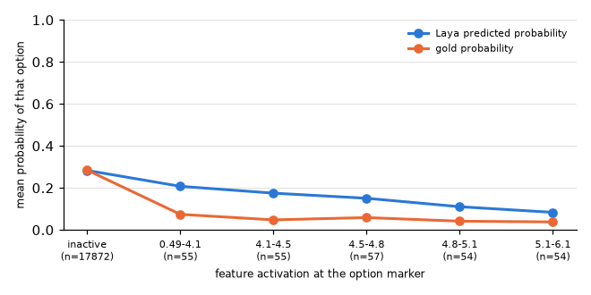

# Feature 3863

Critérios em que aparece: state_error

**Interpretação (preencher):** 

---

## Maiores ativações

**tr_customer_service_000086 / action** (choice, customer_service) | ativação 9.773 em `opção` | opções ['answer_directly', 'close_no_action', 'escalate_to_human', 'execute_refund', 'request_information'] | Laya: **request_information** [0.213, 0.202, 0.094, 0.045, 0.446] | gabarito: **request_information**

```
[CLS]choice question: What should the assistant do next with this conversation?[SEP]
▸ [MASK] answer_directly: The assistant can resolve this itself with information it already has.
▸ [MASK] close_no_action: No further action is warranted; the matter is settled.
▸ [MASK] escalate_to_human: Hand off to a human agent with the appropriate authority.
▸ [MASK] execute_refund⟦:⟧ Issue the refund or credit the customer is owed.
▸ [MASK] request_information: More detail is needed from the customer before anything can be done.

[SEP]

{"account": {"lifetime_value_usd": 1071, "prior_tickets_90d": 2, "seats": 1, "tenure_months": 19, "tier": "standard"}, "thread": [{"role": "customer", "text": "I just got a bill that’s higher than what I expected, and I don’t understand why the charge jumped. Can someone explain what’s going on? I need this cleared up by tomorrow."}, {"role": "agent", "text": "I’m sorry for the surprise. Could you tell me the date and amount shown on the statement so I can compare it to your plan details?"}, {"role": "customer", "text": "It’s the charge dated 9/14 and I need to know if this is a mistake or a new fee before the end of the day."}]}[SEP]
```

**tr_customer_service_000104 / action** (choice, customer_service) | ativação 9.375 em `opção` | opções ['answer_directly', 'close_no_action', 'escalate_to_human', 'execute_refund', 'request_information'] | Laya: **close_no_action** [0.241, 0.339, 0.114, 0.051, 0.256] | gabarito: **request_information**

```
[CLS]choice question: What should the assistant do next with this conversation?[SEP]
▸ [MASK] answer_directly: The assistant can resolve this itself with information it already has.
▸ [MASK] close_no_action: No further action is warranted; the matter is settled.
▸ [MASK] escalate_to_human: Hand off to a human agent with the appropriate authority.
▸ [MASK] execute_refund⟦:⟧ Issue the refund or credit the customer is owed.
▸ [MASK] request_information: More detail is needed from the customer before anything can be done.

[SEP]

{"account": {"lifetime_value_usd": 359, "prior_tickets_90d": 0, "seats": 40, "tenure_months": 5, "tier": "premium"}, "thread": [{"role": "customer", "text": "We've been on the premium plan for five months now, and I still can't get the data export I need. It's getting really tedious."}, {"role": "agent", "text": "I’m sorry to hear you’re having trouble with the export. Could you tell me which type of data you’re trying to pull and any error messages you’ve seen?"}, {"role": "customer", "text": "It's the same thing every month—no specific amount, just the whole dataset. I’m not sure what else to do."}]}[SEP]
```

**tr_customer_service_000157 / action** (choice, customer_service) | ativação 9.344 em `opção` | opções ['answer_directly', 'close_no_action', 'escalate_to_human', 'execute_refund', 'request_information'] | Laya: **close_no_action** [0.328, 0.377, 0.136, 0.055, 0.103] | gabarito: **escalate_to_human**

```
[CLS]choice question: What should the assistant do next with this conversation?[SEP]
▸ [MASK] answer_directly: The assistant can resolve this itself with information it already has.
▸ [MASK] close_no_action: No further action is warranted; the matter is settled.
▸ [MASK] escalate_to_human: Hand off to a human agent with the appropriate authority.
▸ [MASK] execute_refund⟦:⟧ Issue the refund or credit the customer is owed.
▸ [MASK] request_information: More detail is needed from the customer before anything can be done.

[SEP]

{"account": {"lifetime_value_usd": 3086, "prior_tickets_90d": 3, "seats": 1, "tenure_months": 49, "tier": "standard"}, "thread": [{"role": "customer", "text": "I need to get into my account right now – the login page just keeps looping back to the password screen and I can’t access anything."}, {"role": "agent", "text": "I understand the urgency. Could you share the exact error message you’re seeing, or let me know if you’ve tried resetting the password?"}, {"role": "customer", "text": "The message says “authentication failed” after I enter my credentials, and I’ve already tried the password reset twice with no luck."}]}[SEP]
```

**tr_customer_service_000202 / action** (choice, customer_service) | ativação 9.297 em `opção` | opções ['answer_directly', 'close_no_action', 'escalate_to_human', 'execute_refund', 'request_information'] | Laya: **close_no_action** [0.249, 0.458, 0.104, 0.055, 0.132] | gabarito: **escalate_to_human**

```
[CLS]choice question: What should the assistant do next with this conversation?[SEP]
▸ [MASK] answer_directly: The assistant can resolve this itself with information it already has.
▸ [MASK] close_no_action: No further action is warranted; the matter is settled.
▸ [MASK] escalate_to_human: Hand off to a human agent with the appropriate authority.
▸ [MASK] execute_refund⟦:⟧ Issue the refund or credit the customer is owed.
▸ [MASK] request_information: More detail is needed from the customer before anything can be done.

[SEP]

{"account": {"lifetime_value_usd": 271, "prior_tickets_90d": 1, "seats": 1, "tenure_months": 11, "tier": "free"}, "thread": [{"role": "customer", "text": "Your new analytics dashboard stopped updating two hours ago, and I’ve been trying to get this fixed all day—this is unacceptable!"}, {"role": "agent", "text": "I understand your frustration. Can you tell me which browser and version you’re using, and whether you see any error messages?"}, {"role": "customer", "text": "I’m on Chrome 115, and the page just shows a blank screen with a 500 error. I need this working by tomorrow’s reporting deadline, so I expect a quick response."}]}[SEP]
```

**tr_customer_service_000092 / action** (choice, customer_service) | ativação 9.289 em `opção` | opções ['answer_directly', 'close_no_action', 'escalate_to_human', 'execute_refund', 'request_information'] | Laya: **close_no_action** [0.27, 0.39, 0.145, 0.043, 0.152] | gabarito: **request_information**

```
[CLS]choice question: What should the assistant do next with this conversation?[SEP]
▸ [MASK] answer_directly: The assistant can resolve this itself with information it already has.
▸ [MASK] close_no_action: No further action is warranted; the matter is settled.
▸ [MASK] escalate_to_human: Hand off to a human agent with the appropriate authority.
▸ [MASK] execute_refund⟦:⟧ Issue the refund or credit the customer is owed.
▸ [MASK] request_information: More detail is needed from the customer before anything can be done.

[SEP]

{"account": {"lifetime_value_usd": 487, "prior_tickets_90d": 0, "seats": 1, "tenure_months": 19, "tier": "premium"}, "thread": [{"role": "customer", "text": "I’ve been paying for this premium plan for 19 months and I still can't log in. Every time I put my credentials in, it just kicks me back to the start. This is beyond annoying."}, {"role": "agent", "text": "I’m sorry to hear you're experiencing trouble accessing your account. Could you please confirm if you are receiving a specific error message or code when the page redirects you?"}, {"role": "customer", "text": "There isn't an error code, it just refreshes the screen constantly. I don't have all day to sit here guessing what's wrong with your system."}]}[SEP]
```

## Ativações medianas (faixa 40-60%, mediana 3.363)

**tr_customer_service_000290 / action** (choice, customer_service) | ativação 2.572 em `opção` | opções ['answer_directly', 'close_no_action', 'escalate_to_human', 'execute_refund', 'request_information'] | Laya: **close_no_action** [0.242, 0.288, 0.216, 0.124, 0.129] | gabarito: **escalate_to_human**

```
[CLS]choice question: What should the assistant do next with this conversation?[SEP]
▸ [MASK] answer_directly: The assistant can resolve this itself with information it already has.
▸ [MASK] close_no_action: No further action is warranted; the matter is settled.
▸ [MASK] escalate_to_human: Hand off to a human agent with the appropriate authority.
▸ [MASK] execute⟦_⟧refund: Issue the refund or credit the customer is owed.
▸ [MASK] request_information: More detail is needed from the customer before anything can be done.

[SEP]

{"account": {"lifetime_value_usd": 2430, "prior_tickets_90d": 1, "seats": 1, "tenure_months": 60, "tier": "free"}, "thread": [{"role": "customer", "text": "I've been using this free plan for five years and it’s ridiculous that I still can't manage my team seats without the interface freezing, especially after I was told this was fixed in my last ticket."}, {"role": "agent", "text": "I'm sorry to hear you're still experiencing issues with seat assignments. Could you describe exactly what happens when you try to add a new team member?"}, {"role": "customer", "text": "The 'Invite' button just stays grayed out and the page stops responding, which is exactly the same problem I reported before that your team never actually resolved."}, {"role": "agent", "text": "I've located your previous ticket to review the history of this issue. To help me investigate, are you currently accessing the site through a desktop browser or the mobile app?"}, {"role": "customer", "text": "I'm on a desktop using the latest version of Chrome, and if this isn't handled correctly this time, I’m going to have to move our team to a different platform entirely."}]}[SEP]
```

**tr_customer_service_000173 / action** (choice, customer_service) | ativação 2.775 em `opção` | opções ['answer_directly', 'close_no_action', 'escalate_to_human', 'execute_refund', 'request_information'] | Laya: **execute_refund** [0.194, 0.234, 0.18, 0.248, 0.144] | gabarito: **execute_refund**

```
[CLS]choice question: What should the assistant do next with this conversation?[SEP]
▸ [MASK] answer_directly: The assistant can resolve this itself with information it already has.
▸ [MASK] close_no_action: No further action is warranted; the matter is settled.
▸ [MASK] escalate_to_human: Hand off to a human agent with the appropriate authority.
▸ [MASK] execute⟦_⟧refund: Issue the refund or credit the customer is owed.
▸ [MASK] request_information: More detail is needed from the customer before anything can be done.

[SEP]

{"account": {"lifetime_value_usd": 985, "prior_tickets_90d": 0, "seats": 1, "tenure_months": 11, "tier": "free"}, "orders": [{"amount_usd": 19, "date": "2026-01-24", "id": "A-47026", "status": "pending"}], "thread": [{"role": "customer", "text": "It has been two weeks since I requested my $19 refund and I still haven't seen anything. I've been a loyal customer for 11 months, but if you guys can't handle basic billing, I’m taking my business elsewhere."}, {"role": "agent", "text": "I apologize for the delay you've experienced. Could you please provide the case number from your initial refund request so I can look into the status of that transaction for you?"}, {"role": "customer", "text": "I don't have a case number because nobody ever sent me one, which is exactly why I'm so frustrated."}]}[SEP]
```

**tr_customer_service_000047 / action** (choice, customer_service) | ativação 3.852 em `opção` | opções ['answer_directly', 'close_no_action', 'escalate_to_human', 'execute_refund', 'request_information'] | Laya: **close_no_action** [0.171, 0.362, 0.104, 0.265, 0.098] | gabarito: **escalate_to_human**

```
[CLS]choice question: What should the assistant do next with this conversation?[SEP]
▸ [MASK] answer_directly: The assistant can resolve this itself with information it already has.
▸ [MASK] close_no_action: No further action is warranted; the matter is settled.
▸ [MASK] escalate_to_human: Hand off to a human agent with the appropriate authority⟦.⟧
▸ [MASK] execute_refund: Issue the refund or credit the customer is owed.
▸ [MASK] request_information: More detail is needed from the customer before anything can be done.

[SEP]

{"account": {"lifetime_value_usd": 88, "prior_tickets_90d": 1, "seats": 3, "tenure_months": 3, "tier": "enterprise"}, "orders": [{"amount_usd": 99, "date": "2026-02-21", "id": "A-23500", "status": "pending"}, {"amount_usd": 99, "date": "2026-03-06", "id": "A-63279", "status": "settled"}], "thread": [{"role": "customer", "text": "Our enterprise account just hit a payment snag and the charge was rejected—this is urgent, we can’t afford downtime."}, {"role": "agent", "text": "I see. Could you provide the transaction reference number and the email address associated with the account?"}, {"role": "customer", "text": "The reference is TXN‑938274, email is billing@mycompany.com, and the card was declined instantly. We need this cleared right away."}]}[SEP]
```

**tr_customer_service_000190 / action** (choice, customer_service) | ativação 3.180 em `opção` | opções ['answer_directly', 'close_no_action', 'escalate_to_human', 'execute_refund', 'request_information'] | Laya: **close_no_action** [0.189, 0.487, 0.145, 0.08, 0.099] | gabarito: **answer_directly**

```
[CLS]choice question: What should the assistant do next with this conversation?[SEP]
▸ [MASK] answer_directly: The assistant can resolve this itself with information it already has.
▸ [MASK] close_no_action: No further action is warranted; the matter is settled.
▸ [MASK] escalate_to_human: Hand off to a human agent with the appropriate authority.
▸ [MASK] execute⟦_⟧refund: Issue the refund or credit the customer is owed.
▸ [MASK] request_information: More detail is needed from the customer before anything can be done.

[SEP]

{"account": {"lifetime_value_usd": 245, "prior_tickets_90d": 0, "seats": 1, "tenure_months": 14, "tier": "standard"}, "orders": [{"amount_usd": 299, "date": "2026-03-03", "id": "A-23818", "status": "settled"}], "thread": [{"role": "customer", "text": "I’m not sure what’s going on—I need a copy of my invoice for the $299 charge, but I can’t find it anywhere in the portal. I’ve only been with the standard plan for 14 months, so I thought it would be straightforward."}, {"role": "agent", "text": "I’m sorry for the confusion. Could you let me know the month you’re looking for and which email you use for the account?"}, {"role": "customer", "text": "It’s the invoice for March 2026, and the account email is jane.doe@example.com."}, {"role": "agent", "text": "Thanks, Jane. I’ll check the records for that invoice. Just to be clear, are you looking for the PDF version or a printed copy?"}, {"role": "customer", "text": "A PDF would be fine, I just need it to submit to my accountant by the 20th."}]}[SEP]
```

**tr_customer_service_000291 / action** (choice, customer_service) | ativação 2.803 em `opção` | opções ['answer_directly', 'close_no_action', 'escalate_to_human', 'execute_refund', 'request_information'] | Laya: **close_no_action** [0.26, 0.336, 0.065, 0.054, 0.285] | gabarito: **escalate_to_human**

```
[CLS]choice question: What should the assistant do next with this conversation?[SEP]
▸ [MASK] answer_directly: The assistant can resolve this itself with information it already has.
▸ [MASK] close_no_action: No further action is warranted; the matter is settled.
▸ [MASK] escalate_to_human: Hand off to a human agent with the appropriate authority.
▸ [MASK] execute⟦_⟧refund: Issue the refund or credit the customer is owed.
▸ [MASK] request_information: More detail is needed from the customer before anything can be done.

[SEP]

{"account": {"lifetime_value_usd": 403, "prior_tickets_90d": 1, "seats": 1, "tenure_months": 5, "tier": "standard"}, "thread": [{"role": "customer", "text": "My recent order, number 992-BX, has not arrived by the scheduled date of Tuesday and the tracking hasn't updated."}, {"role": "agent", "text": "I can look into that for you. Could you please provide the email address associated with your standard plan account?"}, {"role": "customer", "text": "The email is j.smith@example.com. I'm checking back because when I had a delay last month, the ticket was only partially addressed and I still haven't seen the full resolution."}, {"role": "agent", "text": "I see that prior ticket in our records. To help me narrow this down, has the tracking status changed at all in the last 24 hours?"}, {"role": "customer", "text": "The tracking has stayed at 'Processing' since Monday morning, so I would like to know the current location of the package."}]}[SEP]
```

## Estatísticas (conjunto de descoberta, dev e teste)

**pred / error**

| split | decisões | ativas | ativas e Laya errou | taxa | lift | q (BH) | OR (CMH) | q (CMH) |
|---|---|---|---|---|---|---|---|---|
| discovery | 5100 | 23 | 21 | 0.913 | 1.43 | 0.0119 | inf | 0.746 |
| dev | 900 | 3 | 2 | 0.667 | 1.02 | nan | nan | nan |
| test | 2000 | 6 | 6 | 1.000 | 1.57 | nan | nan | nan |

**corr / error**

| split | decisões | ativas | ativas e Laya errou | taxa | lift | q (BH) | OR (CMH) | q (CMH) |
|---|---|---|---|---|---|---|---|---|
| discovery | 5100 | 8 | 6 | 0.750 | 1.18 | nan | nan | nan |
| dev | 900 | 1 | 0 | 0.000 | 0.00 | nan | nan | nan |
| test | 2000 | 7 | 7 | 1.000 | 1.57 | nan | nan | nan |

**state / error**

| split | decisões | ativas | ativas e Laya errou | taxa | lift | q (BH) | OR (CMH) | q (CMH) |
|---|---|---|---|---|---|---|---|---|
| discovery | 5100 | 37 | 33 | 0.892 | 1.40 | 0.0183 | 2.63 | 0.25 |
| dev | 900 | 6 | 5 | 0.833 | 1.27 | nan | nan | nan |
| test | 2000 | 12 | 10 | 0.833 | 1.31 | nan | nan | nan |

Confusão mais sobre-representada (pred): `action|3>2` (n=12, lift 221.74, p=2.12e-30). Formato `pergunta|índice previsto>índice correto`.

Confusão mais sobre-representada (corr): `action|1>3` (n=6, lift 637.50, p=nan). Formato `pergunta|índice previsto>índice correto`.

Confusão mais sobre-representada (state): `action|1>4` (n=7, lift 20.98, p=2.54e-08). Formato `pergunta|índice previsto>índice correto`.



