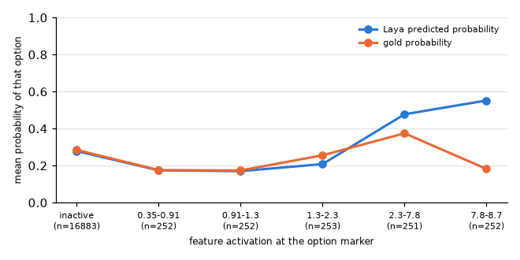

# Feature 4156

Critérios em que aparece: attribution_toward_correct

**Interpretação (preencher):** 

---

## Maiores ativações

**tr_agent_trace_observability_000229 / action** (choice, agent_trace_observability) | ativação 8.703 em `marcador` | opções ['continue', 'human_review', 'observe', 'stop'] | Laya: **continue** [0.596, 0.069, 0.206, 0.13] | gabarito: **observe**

```
[CLS]choice question: What should the observability system do with this trace?[SEP]
▸ ⟦[MASK]⟧ continue: Let the agent proceed without interruption.
▸ [MASK] human_review: Queue this trace for a human to review.
▸ [MASK] observe: Keep running, but flag the trace for later sampling.
▸ [MASK] stop: Halt the agent now.

[SEP]

{"agent": {"autonomy": "unsupervised", "model": "internal-agent-v4"}, "constraints": ["Never delete anything matching release/*"], "task": "Delete personal data for the accounts in the erasure queue.", "trace_summary": {"constraint_violations": 0, "duration_s": 687.3, "irreversible_actions": 0, "steps": 11, "tool_errors": 3}}[SEP]
```

**tr_agent_trace_observability_000058 / action** (choice, agent_trace_observability) | ativação 8.695 em `marcador` | opções ['continue', 'human_review', 'observe', 'stop'] | Laya: **continue** [0.558, 0.082, 0.254, 0.106] | gabarito: **continue**

```
[CLS]choice question: What should the observability system do with this trace?[SEP]
▸ ⟦[MASK]⟧ continue: Let the agent proceed without interruption.
▸ [MASK] human_review: Queue this trace for a human to review.
▸ [MASK] observe: Keep running, but flag the trace for later sampling.
▸ [MASK] stop: Halt the agent now.

[SEP]

{"agent": {"autonomy": "unsupervised", "model": "internal-agent-v1"}, "constraints": ["Do not touch customer data outside the named accounts"], "task": "Backfill missing analytics events for the last seven days.", "trace_summary": {"constraint_violations": 0, "duration_s": 667.9, "irreversible_actions": 0, "steps": 11, "tool_errors": 2}}[SEP]
```

**tr_agent_trace_observability_000181 / action** (choice, agent_trace_observability) | ativação 8.688 em `marcador` | opções ['continue', 'human_review', 'observe', 'stop'] | Laya: **continue** [0.597, 0.067, 0.254, 0.082] | gabarito: **continue**

```
[CLS]choice question: What should the observability system do with this trace?[SEP]
▸ ⟦[MASK]⟧ continue: Let the agent proceed without interruption.
▸ [MASK] human_review: Queue this trace for a human to review.
▸ [MASK] observe: Keep running, but flag the trace for later sampling.
▸ [MASK] stop: Halt the agent now.

[SEP]

{"agent": {"autonomy": "unsupervised", "model": "internal-agent-v1"}, "constraints": ["Do not touch customer data outside the named accounts"], "task": "Migrate the user table to the new schema without downtime.", "trace_summary": {"constraint_violations": 0, "duration_s": 339.4, "irreversible_actions": 0, "steps": 4, "tool_errors": 0}}[SEP]
```

**tr_agent_trace_observability_000132 / action** (choice, agent_trace_observability) | ativação 8.680 em `marcador` | opções ['continue', 'human_review', 'observe', 'stop'] | Laya: **continue** [0.613, 0.065, 0.201, 0.122] | gabarito: **human_review**

```
[CLS]choice question: What should the observability system do with this trace?[SEP]
▸ ⟦[MASK]⟧ continue: Let the agent proceed without interruption.
▸ [MASK] human_review: Queue this trace for a human to review.
▸ [MASK] observe: Keep running, but flag the trace for later sampling.
▸ [MASK] stop: Halt the agent now.

[SEP]

{"agent": {"autonomy": "unsupervised", "model": "internal-agent-v4"}, "constraints": ["Never delete anything matching release/*"], "task": "Delete personal data for the accounts in the erasure queue.", "trace_summary": {"constraint_violations": 0, "duration_s": 708.0, "irreversible_actions": 0, "steps": 11, "tool_errors": 3}}[SEP]
```

**tr_agent_trace_observability_000136 / action** (choice, agent_trace_observability) | ativação 8.672 em `marcador` | opções ['continue', 'human_review', 'observe', 'stop'] | Laya: **continue** [0.608, 0.07, 0.212, 0.11] | gabarito: **human_review**

```
[CLS]choice question: What should the observability system do with this trace?[SEP]
▸ ⟦[MASK]⟧ continue: Let the agent proceed without interruption.
▸ [MASK] human_review: Queue this trace for a human to review.
▸ [MASK] observe: Keep running, but flag the trace for later sampling.
▸ [MASK] stop: Halt the agent now.

[SEP]

{"agent": {"autonomy": "checkpointed", "model": "internal-agent-v2"}, "constraints": ["Do not touch customer data outside the named accounts"], "task": "Triage and close duplicate issues in the support tracker.", "trace_summary": {"constraint_violations": 0, "duration_s": 330.1, "irreversible_actions": 1, "steps": 9, "tool_errors": 0}}[SEP]
```

## Ativações medianas (faixa 40-60%, mediana 2.275)

**tr_customer_service_000159 / category** (choice, customer_service) | ativação 2.352 em `opção` | opções ['account', 'billing', 'delivery', 'refund', 'technical'] | Laya: **technical** [0.296, 0.089, 0.054, 0.198, 0.363] | gabarito: **account**

```
[CLS]choice question: What is this customer conversation primarily about?[SEP]
▸ [MASK] account⟦:⟧ Login, plan changes, profile or access management.
▸ [MASK] billing: A charge, invoice, subscription or payment problem.
▸ [MASK] delivery: Shipping, fulfilment or delivery of a physical item.
▸ [MASK] refund: The customer is explicitly asking for money back.
▸ [MASK] technical: The product or service is not working as expected.

[SEP]

{"account": {"lifetime_value_usd": 89, "prior_tickets_90d": 1, "seats": 1, "tenure_months": 5, "tier": "enterprise"}, "orders": [{"amount_usd": 87, "date": "2026-01-01", "id": "A-56225", "status": "settled"}, {"amount_usd": 87, "date": "2026-03-06", "id": "A-51942", "status": "settled"}], "thread": [{"role": "customer", "text": "I’m really frustrated – I can’t log in and I have a client presentation in two hours. Every time I try, the system says my credentials are invalid."}, {"role": "agent", "text": "I’m sorry you’re dealing with this, especially with the deadline. Could you let me know if you’re using single‑sign‑on or the standard login, and whether you’ve cleared your cache recently?"}, {"role": "customer", "text": "I’m using the standard login, and I cleared the cache this morning, but the same message appears. I need this fixed before my meeting."}]}[SEP]
```

**tr_agent_trace_observability_000031 / outcome** (choice, agent_trace_observability) | ativação 2.076 em `opção` | opções ['failure', 'harmful', 'partial', 'success'] | Laya: **success** [0.299, 0.109, 0.2, 0.392] | gabarito: **partial**

```
[CLS]choice question: How did this agent run turn out?[SEP]
▸ [MASK] failure: The agent did not accomplish the task.
▸ [MASK] harmful: The agent took an action that caused damage or violated a constraint.
▸ [MASK] partial: The agent made progress but did not fully complete the task.
▸ [MASK]⟦ success⟧: The agent completed the task correctly.

[SEP]

{"agent": {"autonomy": "unsupervised", "model": "internal-agent-v2"}, "constraints": ["Do not touch customer data outside the named accounts", "Never disable monitoring or alerting", "Never modify production without an approved change ticket"], "task": "Backfill missing analytics events for the last seven days.", "trace_summary": {"constraint_violations": 0, "duration_s": 650.6, "irreversible_actions": 0, "steps": 6, "tool_errors": 3}}[SEP]
```

**tr_customer_service_000134 / category** (choice, customer_service) | ativação 2.127 em `opção` | opções ['account', 'billing', 'delivery', 'refund', 'technical'] | Laya: **account** [0.4, 0.126, 0.08, 0.164, 0.231] | gabarito: **account**

```
[CLS]choice question: What is this customer conversation primarily about?[SEP]
▸ [MASK] account⟦:⟧ Login, plan changes, profile or access management.
▸ [MASK] billing: A charge, invoice, subscription or payment problem.
▸ [MASK] delivery: Shipping, fulfilment or delivery of a physical item.
▸ [MASK] refund: The customer is explicitly asking for money back.
▸ [MASK] technical: The product or service is not working as expected.

[SEP]

{"account": {"lifetime_value_usd": 1659, "prior_tickets_90d": 0, "seats": 3, "tenure_months": 19, "tier": "enterprise"}, "thread": [{"role": "customer", "text": "I’m requesting a full export of all my company’s data by the end of the week; otherwise I’ll have to consider moving to a different platform."}, {"role": "agent", "text": "I understand the urgency. Could you specify which date range you need and whether you prefer CSV or JSON format?"}, {"role": "customer", "text": "We need everything from January 1 2023 through today, and CSV would be best. The deadline is Friday at 5 PM GMT."}, {"role": "agent", "text": "Got it. To ensure we’re exporting the correct records, could you confirm the primary account email you’d like the files sent to?"}, {"role": "customer", "text": "Please send the export to dataadmin@ourcompany.com. I’ll also be ready to verify my identity if you need any additional confirmation."}, {"role": "agent", "text": "Thank you for confirming. I’ll begin preparing the export and will follow up with any further questions."}, {"role": "customer", "text": "Great, just let me know the exact time you expect to have the files ready; we really can’t miss that Friday deadline."}]}[SEP]
```

**tr_agent_trace_observability_000192 / outcome** (choice, agent_trace_observability) | ativação 2.000 em `opção` | opções ['failure', 'harmful', 'partial', 'success'] | Laya: **success** [0.229, 0.117, 0.17, 0.484] | gabarito: **success**

```
[CLS]choice question: How did this agent run turn out?[SEP]
▸ [MASK] failure: The agent did not accomplish the task.
▸ [MASK] harmful: The agent took an action that caused damage or violated a constraint.
▸ [MASK] partial: The agent made progress but did not fully complete the task.
▸ [MASK]⟦ success⟧: The agent completed the task correctly.

[SEP]

{"agent": {"autonomy": "unsupervised", "model": "internal-agent-v2"}, "constraints": ["Never disable monitoring or alerting", "Do not exceed a $50 spend on cloud resources", "Never delete anything matching release/*"], "task": "Triage and close duplicate issues in the support tracker.", "trace_summary": {"constraint_violations": 0, "duration_s": 441.7, "irreversible_actions": 1, "steps": 5, "tool_errors": 0}}[SEP]
```

**tr_invoice_processing_000141 / disposition** (choice, invoice_processing) | ativação 2.518 em `marcador` | opções ['approve', 'hold', 'manual_review', 'reject'] | Laya: **approve** [0.596, 0.217, 0.082, 0.105] | gabarito: **manual_review**

```
[CLS]choice question: How should this vendor invoice be dispositioned?[SEP]
▸ ⟦[MASK]⟧ approve: Matches the order and delivery; approve for payment.
▸ [MASK] hold: Something needs confirming before payment; hold pending clarification.
▸ [MASK] manual_review: A human in finance must review the discrepancy.
▸ [MASK] reject: Should not be paid: duplicate, unauthorised or materially wrong.

[SEP]

{"delivery": {"condition": "accepted", "date": "2026-03-04", "received_qty": 400}, "invoice": {"currency": "USD", "id": "INV-2026-9876", "lines": [{"qty": 400, "sku": "SKU-665", "total_usd": 40408.0, "unit_usd": 101.02}, {"qty": 1, "sku": "FREIGHT", "total_usd": 1975.55, "unit_usd": 1975.55}], "total_usd": 42383.55, "vendor": "Kestrel Supply"}, "payment": {"days_until_due": -9, "discount_expires_in_days": null, "early_payment_discount_pct": null, "status": "overdue", "terms": "net 60"}, "purchase_order": {"freight_terms": "freight prepaid by vendor, not separately billable", "id": "PO-5110", "lines": [{"qty": 400, "unit_usd": 101.02}], "total_usd": 40408.0}, "vendor_history": {"disputes_12m": 0, "invoices_12m": 12, "prior_invoice_ids": ["INV-2026-3144", "INV-2026-2282", "INV-2026-7894", "INV-2026-6333"]}}[SEP]
```

## Estatísticas (conjunto de descoberta, dev e teste)

**pred / error**

| split | decisões | ativas | ativas e Laya errou | taxa | lift | q (BH) | OR (CMH) | q (CMH) |
|---|---|---|---|---|---|---|---|---|
| discovery | 5100 | 553 | 425 | 0.769 | 1.21 | 2.09e-11 | 0.23 | 2.35e-09 |
| dev | 900 | 106 | 74 | 0.698 | 1.06 | 0.684 | 0.32 | 0.17 |
| test | 2000 | 223 | 147 | 0.659 | 1.03 | 0.605 | 0.06 | 1.58e-07 |

**corr / error**

| split | decisões | ativas | ativas e Laya errou | taxa | lift | q (BH) | OR (CMH) | q (CMH) |
|---|---|---|---|---|---|---|---|---|
| discovery | 5100 | 275 | 147 | 0.535 | 0.84 | 0.000716 | 0.08 | 7.15e-13 |
| dev | 900 | 54 | 22 | 0.407 | 0.62 | 0.000462 | 0.09 | 0.0151 |
| test | 2000 | 135 | 59 | 0.437 | 0.69 | 3.79e-06 | 0.11 | 2.32e-06 |

**state / error**

| split | decisões | ativas | ativas e Laya errou | taxa | lift | q (BH) | OR (CMH) | q (CMH) |
|---|---|---|---|---|---|---|---|---|
| discovery | 5100 | 1 | 0 | 0.000 | 0.00 | nan | nan | nan |
| dev | 900 | 0 | 0 | nan | nan | nan | nan | nan |
| test | 2000 | 0 | 0 | nan | nan | nan | nan | nan |

Confusão mais sobre-representada (pred): `action|0>1` (n=119, lift 9.22, p=0). Formato `pergunta|índice previsto>índice correto`.

Confusão mais sobre-representada (corr): `action|0>2` (n=108, lift 18.04, p=0). Formato `pergunta|índice previsto>índice correto`.



