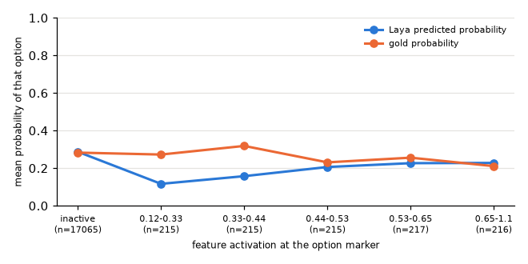

# Feature 4273

Critérios em que aparece: pred_error_stratified

**Interpretação (preencher):** 

---

## Maiores ativações

**tr_customer_service_000234 / urgency** (score, customer_service) | ativação 2.189 em `estado` | opções ['0', '1', '2', '3'] | Laya: **1** [0.182, 0.452, 0.16, 0.207] | gabarito: **3**

```
[CLS]score question: How time-sensitive is this conversation?[SEP]
▸ [MASK] level 0: No time pressure; can wait indefinitely.
▸ [MASK] level 1: Routine; handle within the normal queue.
▸ [MASK] level 2: Elevated; should be handled within the same week.
▸ [MASK] level 3: Critical; requires action within the same day.

[SEP]

{"account": {"lifetime_value_usd": 1458, "prior_tickets_90d": 0, "seats": 3, "tenure_months": 33, "tier": "premium"}, "thread": [{"role": "customer", "text": "I’ve been paying for this premium plan for 33 months without a single hitch, but now I’m completely locked out and I have a hard deadline in two hours. Why is the login screen just spinning?"}, {"role": "agent", "text": "I’m sorry to hear you're experiencing this frustration right now. Could you please confirm the exact error message or code you are seeing when the page hangs?"}, {"role": "customer", "text": "There is no code! It’s⟦ just⟧ a blank page after I enter my credentials. I have a massive report due for my firm by noon and I can’t get in to export the data. This is ridiculous."}, {"role": "agent", "text": "I understand the urgency of this report. To help me narrow down the cause, are you accessing the portal through a browser or our desktop application?"}, {"role": "customer", "text": "I’m using Chrome on my desktop. I’ve already cleared my cache and tried an incognito window, so don't even suggest that. Fix this now."}]}[SEP]
```

**tr_customer_service_000249 / needs_human** (noul, customer_service) | ativação 2.072 em `estado` | opções ['false', 'true'] | Laya: **true** [0.45, 0.55] | gabarito: **true**

```
[CLS]noul question: This conversation requires a human agent rather than automated handling.[SEP]
▸ [MASK] false: Automation can carry this to resolution.
▸ [MASK] true: A human must take over: judgement, authority or empathy is required.

[SEP]

{"account": {"lifetime_value_usd": 1754, "prior_tickets_90d": 0, "seats": 1, "tenure_months": 72, "tier": "enterprise"}, "orders": [{"amount_usd": 149, "date": "2026-03-28", "id": "A-39092", "status": "failed"}, {"amount_usd": 149, "date": "2026-03-23", "id": "A-25972", "status": "failed"}, {"amount_usd": 149, "date": "2026-01-10", "id": "A-78104", "status": "failed"}], "thread": [{"role": "customer", "text": "We've been trying to pull a full export of our account data for weeks now, and the portal keeps timing out—our deadline is this Friday and we can't afford any more delays."}, {"role": "agent", "text": "I’m sorry to hear you’re experiencing this; could you let me know which export format you selected and whether you’re using the bulk download option?"}, {"role": "customer", "text": "It’s the CSV export from the admin console, and I’ve tried both the single‑file and the zip‑bundle options, but each attempt aborts after about 10 minutes."}, {"role": "agent", "text": "Thanks for confirming that. Do you see any error codes or messages in the download dialog⟦ when⟧ it stops?"}, {"role": "customer", "text": "Just a generic “download failed” notice—no error code, and it happens regardless of browser or network, which is why I’m stuck."}]}[SEP]
```

**tr_customer_service_000274 / needs_human** (noul, customer_service) | ativação 2.029 em `estado` | opções ['false', 'true'] | Laya: **true** [0.37, 0.63] | gabarito: **false**

```
[CLS]noul question: This conversation requires a human agent rather than automated handling.[SEP]
▸ [MASK] false: Automation can carry this to resolution.
▸ [MASK] true: A human must take over: judgement, authority or empathy is required.

[SEP]

{"account": {"lifetime_value_usd": 2198, "prior_tickets_90d": 0, "seats": 1, "tenure_months": 72, "tier": "free"}, "thread": [{"role": "customer", "text": "I need to export the data from my account. I’ve been on the free plan for seventy-two months, and I can’t keep hoping the export button works."}, {"role": "agent", "text": "I’m sorry that’s been so difficult. Can you tell me what you see when you open the export option?"}, {"role": "customer", "text": "Nothing. It looks the same as it has for days. I haven’t submitted a ticket before, so there’s no earlier trail."}, {"role": "agent", "text": "Thank you. Are you trying to export all records, or a specific collection?"}, {"role": "customer", "text": "All of it, if I can. I’m not asking for much,⟦ just⟧ a way out that doesn’t require more waiting."}]}[SEP]
```

**tr_customer_service_000274 / churn_risk** (score, customer_service) | ativação 2.023 em `estado` | opções ['0', '1', '2', '3'] | Laya: **1** [0.215, 0.307, 0.25, 0.228] | gabarito: **1**

```
[CLS]score question: How likely is this customer to stop doing business with us because of this interaction?[SEP]
▸ [MASK] level 0: No sign of dissatisfaction.
▸ [MASK] level 1: Mild frustration, but the relationship is intact.
▸ [MASK] level 2: Clearly unhappy; repeat problems or explicit complaints.
▸ [MASK] level 3: Imminent: threatening to cancel, dispute or leave.

[SEP]

{"account": {"lifetime_value_usd": 2198, "prior_tickets_90d": 0, "seats": 1, "tenure_months": 72, "tier": "free"}, "thread": [{"role": "customer", "text": "I need to export the data from my account. I’ve been on the free plan for seventy-two months, and I can’t keep hoping the export button works."}, {"role": "agent", "text": "I’m sorry that’s been so difficult. Can you tell me what you see when you open the export option?"}, {"role": "customer", "text": "Nothing. It looks the same as it has for days. I haven’t submitted a ticket before, so there’s no earlier trail."}, {"role": "agent", "text": "Thank you. Are you trying to export all records, or a specific collection?"}, {"role": "customer", "text": "All of it, if I can. I’m not asking for much,⟦ just⟧ a way out that doesn’t require more waiting."}]}[SEP]
```

**tr_customer_service_000002 / category** (choice, customer_service) | ativação 2.023 em `estado` | opções ['account', 'billing', 'delivery', 'refund', 'technical'] | Laya: **account** [0.333, 0.138, 0.09, 0.163, 0.276] | gabarito: **account**

```
[CLS]choice question: What is this customer conversation primarily about?[SEP]
▸ [MASK] account: Login, plan changes, profile or access management.
▸ [MASK] billing: A charge, invoice, subscription or payment problem.
▸ [MASK] delivery: Shipping, fulfilment or delivery of a physical item.
▸ [MASK] refund: The customer is explicitly asking for money back.
▸ [MASK] technical: The product or service is not working as expected.

[SEP]

{"account": {"lifetime_value_usd": 37, "prior_tickets_90d": 0, "seats": 1, "tenure_months": 1, "tier": "standard"}, "thread": [{"role": "customer", "text": "Good afternoon, could you please arrange for a full export of all my data from the Standard plan? I’⟦d⟧ like it in CSV format."}, {"role": "agent", "text": "Certainly, I can help with that. May I confirm the email address on the account and whether you need the export within a particular timeframe?"}, {"role": "customer", "text": "The account is under michael.brown@example.com, and I’d like to receive the file by the end of the week if possible."}, {"role": "agent", "text": "Got it, thank you. I’ll queue the export and will need to verify your identity – could you provide the last four digits of the payment method on file?"}, {"role": "customer", "text": "The last four digits are 4321. Please let me know when the download link is ready."}]}[SEP]
```

## Ativações medianas (faixa 40-60%, mediana 0.637)

**tr_customer_service_000190 / needs_human** (noul, customer_service) | ativação 0.610 em `estado` | opções ['false', 'true'] | Laya: **true** [0.418, 0.582] | gabarito: **false**

```
[CLS]noul question: This conversation requires a human agent rather than automated handling.[SEP]
▸ [MASK] false: Automation can carry this to resolution.
▸ [MASK] true: A human must take over: judgement, authority or empathy is required.

[SEP]

{"account": {"lifetime_value_usd": 245, "prior_tickets_90d": 0, "seats": 1, "tenure_months": 14, "tier": "standard"}, "orders": [{"amount_usd": 299, "date": "2026-03-03", "id": "A-23818", "status": "settled"}], "thread": [{"role": "customer", "text": "I’m not sure what’s going on—I need a copy of my invoice for the $299 charge, but I can’t find it anywhere in the portal. I’ve only been with the standard plan for 14 months, so I thought it would be straightforward."}, {"role": "agent", "text": "I’m sorry for the confusion. Could you let me know the month you’re looking for and which email you use for the account?"}, {"role": "customer", "text": "It’s the invoice for March 2026, and the account email is jane.doe@example.com."}, {"role": "agent", "text": "Thanks, Jane. I’ll check the records for that invoice. Just to be clear, are you looking for the PDF version or a printed copy?"}, {"role": "customer", "text⟦":⟧ "A PDF would be fine, I just need it to submit to my accountant by the 20th."}]}[SEP]
```

**tr_security_incidents_000151 / disposition** (choice, security_incidents) | ativação 0.655 em `opção` | opções ['close_benign', 'contain', 'investigate', 'monitor'] | Laya: **close_benign** [0.351, 0.231, 0.207, 0.211] | gabarito: **investigate**

```
[CLS]choice question: How should this security alert be dispositioned?[SEP]
▸ [MASK] close_benign: Expected, explainable activity; close without analyst time.
▸ [MASK] contain: Contain the host or account⟦ immediately⟧; do not wait for triage.
▸ [MASK] investigate: Warrants an analyst opening an investigation.
▸ [MASK] monitor: Not clearly malicious, but worth watching for recurrence.

[SEP]

{"alert": {"description": "a long-unused account became active", "evidence": "At 2026-09-16 01:02 UTC, the privileged service account \"svc-data-export\" logged in from IP 203.0.113.45, a source not present on the allowlist, after having no successful logins since 2023‑09‑01. MFA was disabled for this session and the credential’s last rotation timestamp is 365 days old.", "rule": "dormant_account_use"}, "context": {"asset_criticality": "low", "change_window_active": false, "source_on_allowlist": false}, "history": {"credential_rotation_days_ago": 365, "distinct_countries_30d": 4, "logins_30d": 142, "prior_alerts_90d": 0}, "principal": {"mfa_enrolled": false, "name": "ci-infra-692", "privileges": ["deploy:production", "secrets:read"], "type": "service_account"}}[SEP]
```

**tr_customer_service_000082 / category** (choice, customer_service) | ativação 0.617 em `pergunta` | opções ['account', 'billing', 'delivery', 'refund', 'technical'] | Laya: **refund** [0.019, 0.015, 0.025, 0.889, 0.052] | gabarito: **refund**

```
[CLS]choice question: What is⟦ this⟧ customer conversation primarily about?[SEP]
▸ [MASK] account: Login, plan changes, profile or access management.
▸ [MASK] billing: A charge, invoice, subscription or payment problem.
▸ [MASK] delivery: Shipping, fulfilment or delivery of a physical item.
▸ [MASK] refund: The customer is explicitly asking for money back.
▸ [MASK] technical: The product or service is not working as expected.

[SEP]

{"account": {"lifetime_value_usd": 2703, "prior_tickets_90d": 2, "seats": 40, "tenure_months": 49, "tier": "premium"}, "thread": [{"role": "customer", "text": "I need an update on my refund now! You promised it after my last ticket and it’s been weeks—this is urgent."}, {"role": "agent", "text": "I’m sorry for the delay. Could you provide the transaction date or reference number so I can locate the refund request?"}, {"role": "customer", "text": "The purchase was on February 14th, reference #A1B2C3. I’ve been waiting far too long and need the money back immediately."}, {"role": "agent", "text": "Thank you for the details. I’ll check the status right away and get back to you as soon as I have more information."}, {"role": "customer", "text": "Please expedite this – I expect a resolution today."}]}[SEP]
```

**tr_security_incidents_000272 / severity** (score, security_incidents) | ativação 0.635 em `pergunta` | opções ['0', '1', '2', '3', '4'] | Laya: **2** [0.057, 0.327, 0.42, 0.139, 0.057] | gabarito: **3**

```
[CLS]score question⟦:⟧ How severe is the potential impact if this alert is real?[SEP]
▸ [MASK] level 0: Negligible: no access to anything sensitive.
▸ [MASK] level 1: Low: limited access, easily reversed.
▸ [MASK] level 2: Moderate: access to internal systems or non-public data.
▸ [MASK] level 3: High: access to production, secrets or customer data.
▸ [MASK] level 4: Critical: active compromise of crown-jewel systems.

[SEP]

{"alert": {"description": "an account granted itself or received elevated permissions", "evidence": "The CI runner named gitlab-runner-12 added its own token to the local Administrators group on host build-agent-07 at 2026-09-15 23:58:12 UTC, using the net.exe command. This privilege change occurred while a change window was active, and the runner’s credentials had not been rotated for 700 days.", "rule": "privilege_escalation"}, "context": {"asset_criticality": "medium", "change_window_active": true, "source_on_allowlist": false}, "history": {"credential_rotation_days_ago": 700, "distinct_countries_30d": 2, "logins_30d": 501, "prior_alerts_90d": 0}, "principal": {"mfa_enrolled": true, "name": "svc-support-708", "privileges": ["repo:read"], "type": "ci_runner"}}[SEP]
```

**tr_customer_service_000047 / churn_risk** (score, customer_service) | ativação 0.689 em `pergunta` | opções ['0', '1', '2', '3'] | Laya: **3** [0.171, 0.288, 0.188, 0.352] | gabarito: **2**

```
[CLS]score question: How likely is this customer to stop doing business with us⟦ because⟧ of this interaction?[SEP]
▸ [MASK] level 0: No sign of dissatisfaction.
▸ [MASK] level 1: Mild frustration, but the relationship is intact.
▸ [MASK] level 2: Clearly unhappy; repeat problems or explicit complaints.
▸ [MASK] level 3: Imminent: threatening to cancel, dispute or leave.

[SEP]

{"account": {"lifetime_value_usd": 88, "prior_tickets_90d": 1, "seats": 3, "tenure_months": 3, "tier": "enterprise"}, "orders": [{"amount_usd": 99, "date": "2026-02-21", "id": "A-23500", "status": "pending"}, {"amount_usd": 99, "date": "2026-03-06", "id": "A-63279", "status": "settled"}], "thread": [{"role": "customer", "text": "Our enterprise account just hit a payment snag and the charge was rejected—this is urgent, we can’t afford downtime."}, {"role": "agent", "text": "I see. Could you provide the transaction reference number and the email address associated with the account?"}, {"role": "customer", "text": "The reference is TXN‑938274, email is billing@mycompany.com, and the card was declined instantly. We need this cleared right away."}]}[SEP]
```

## Estatísticas (conjunto de descoberta, dev e teste)

**pred / error**

| split | decisões | ativas | ativas e Laya errou | taxa | lift | q (BH) | OR (CMH) | q (CMH) |
|---|---|---|---|---|---|---|---|---|
| discovery | 5100 | 138 | 123 | 0.891 | 1.40 | 8.91e-11 | 3.32 | 0.00121 |
| dev | 900 | 19 | 16 | 0.842 | 1.28 | nan | nan | nan |
| test | 2000 | 55 | 46 | 0.836 | 1.31 | 0.00447 | 2.27 | 0.366 |

**corr / error**

| split | decisões | ativas | ativas e Laya errou | taxa | lift | q (BH) | OR (CMH) | q (CMH) |
|---|---|---|---|---|---|---|---|---|
| discovery | 5100 | 268 | 253 | 0.944 | 1.48 | 7.62e-33 | 2.22 | 0.0382 |
| dev | 900 | 50 | 47 | 0.940 | 1.43 | 9.9e-06 | 3.70 | 0.173 |
| test | 2000 | 118 | 109 | 0.924 | 1.45 | 1.44e-12 | 2.60 | 0.0881 |

**state / error**

| split | decisões | ativas | ativas e Laya errou | taxa | lift | q (BH) | OR (CMH) | q (CMH) |
|---|---|---|---|---|---|---|---|---|
| discovery | 5100 | 1755 | 1093 | 0.623 | 0.98 | 0.435 | 1.21 | 0.0499 |
| dev | 900 | 278 | 189 | 0.680 | 1.04 | 1 | 1.55 | 0.158 |
| test | 2000 | 733 | 476 | 0.649 | 1.02 | 0.859 | 1.22 | 0.3 |

Confusão mais sobre-representada (pred): `action|1>2` (n=40, lift 11.83, p=6.81e-34). Formato `pergunta|índice previsto>índice correto`.

Confusão mais sobre-representada (corr): `urgency|1>3` (n=89, lift 5.80, p=0). Formato `pergunta|índice previsto>índice correto`.

Confusão mais sobre-representada (state): `severity|2>3` (n=73, lift 2.56, p=2.46e-24). Formato `pergunta|índice previsto>índice correto`.



