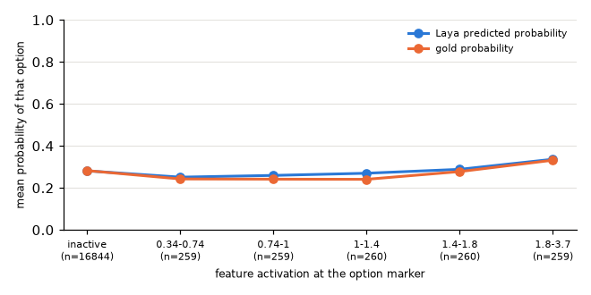

# Feature 4391

Critérios em que aparece: pred_error_stratified, corr_error_stratified

**Interpretação (preencher):** 

---

## Maiores ativações

**tr_customer_service_000080 / needs_human** (noul, customer_service) | ativação 5.918 em `pergunta` | opções ['false', 'true'] | Laya: **true** [0.419, 0.581] | gabarito: **true**

```
[CLS]noul question⟦:⟧ This conversation requires a human agent rather than automated handling.[SEP]
▸ [MASK] false: Automation can carry this to resolution.
▸ [MASK] true: A human must take over: judgement, authority or empathy is required.

[SEP]

{"account": {"lifetime_value_usd": 3438, "prior_tickets_90d": 2, "seats": 1, "tenure_months": 49, "tier": "standard"}, "orders": [{"amount_usd": 2997, "date": "2026-02-11", "id": "A-94735", "status": "settled"}, {"amount_usd": 2997, "date": "2026-02-27", "id": "A-74448", "status": "refunded"}], "thread": [{"role": "customer", "text": "I've been trying to get my full data export for over a month now and nothing's happened—this is unacceptable after 49 months on the standard plan and nearly $3,000 spent!"}, {"role": "agent", "text": "I’m sorry you’re experiencing this delay. Could you let me know which type of export you requested and the date you originally submitted the request?"}, {"role": "customer", "text": "It was the complete CSV export I asked for on March 3rd. I’ve opened two tickets already and they were left hanging, so I need this sorted right now."}, {"role": "agent", "text": "I understand how frustrating that is. Can you confirm the email address linked to your account so I can pull up the exact tickets?"}, {"role": "customer", "text": "It’s john.doe@example.com. I expect this to be fixed immediately; I’ll wait for your next message."}]}[SEP]
```

**tr_customer_service_000020 / needs_human** (noul, customer_service) | ativação 5.840 em `pergunta` | opções ['false', 'true'] | Laya: **true** [0.426, 0.574] | gabarito: **true**

```
[CLS]noul question⟦:⟧ This conversation requires a human agent rather than automated handling.[SEP]
▸ [MASK] false: Automation can carry this to resolution.
▸ [MASK] true: A human must take over: judgement, authority or empathy is required.

[SEP]

{"account": {"lifetime_value_usd": 2714, "prior_tickets_90d": 0, "seats": 1, "tenure_months": 49, "tier": "standard"}, "orders": [{"amount_usd": 299, "date": "2026-02-07", "id": "A-58056", "status": "settled"}, {"amount_usd": 299, "date": "2026-02-07", "id": "A-95377", "status": "settled"}, {"amount_usd": 299, "date": "2026-03-25", "id": "A-65291", "status": "settled"}], "thread": [{"role": "customer", "text": "I need the full data export right now—my audit is tomorrow and I can't wait any longer. I've been on the standard plan for 49 months and this is unacceptable."}, {"role": "agent", "text": "I understand the pressure you’re under. Could you tell me exactly which data set you’re looking to export and the date range you need?"}, {"role": "customer", "text": "I need a CSV of every transaction and user action up through June 30th. If I don’t have it by end of day, my whole audit falls apart."}, {"role": "agent", "text": "Got it, I’ll look into the export queue for you. Are you seeing any error messages when you try to start the export yourself?"}, {"role": "customer", "text": "No errors, just a perpetual loading spinner. I can’t miss this deadline, so please let me know what’s happening."}]}[SEP]
```

**tr_customer_service_000278 / needs_human** (noul, customer_service) | ativação 5.715 em `pergunta` | opções ['false', 'true'] | Laya: **true** [0.434, 0.566] | gabarito: **true**

```
[CLS]noul question⟦:⟧ This conversation requires a human agent rather than automated handling.[SEP]
▸ [MASK] false: Automation can carry this to resolution.
▸ [MASK] true: A human must take over: judgement, authority or empathy is required.

[SEP]

{"account": {"lifetime_value_usd": 15, "prior_tickets_90d": 5, "seats": 1, "tenure_months": 1, "tier": "standard"}, "orders": [{"amount_usd": 9, "date": "2026-02-06", "id": "A-62464", "status": "settled"}, {"amount_usd": 9, "date": "2026-02-03", "id": "A-26499", "status": "pending"}, {"amount_usd": 9, "date": "2026-03-25", "id": "A-56006", "status": "failed"}], "thread": [{"role": "customer", "text": "I’m incredibly frustrated. I’ve been trying to get my $9 refund for a month now and have opened five separate tickets with zero success. I need this cleared up before my deadline on Wednesday."}, {"role": "agent", "text": "I hear your frustration regarding the delay. I see you’ve reached out several times recently; could you confirm the date of your most recent correspondence regarding this charge?"}, {"role": "customer", "text": "I sent the last follow-up yesterday. This is my first month as a standard customer, and honestly, the lack of support is making this a terrible experience."}, {"role": "agent", "text": "I apologize for the lack of progress thus far. I am looking through the five tickets you mentioned to identify which department has the pending request; could you verify the email address associated with those specific submissions?"}, {"role": "customer", "text": "It’s the same email address I’m using right now. Please look into this; I really need that money back before my deadline."}]}[SEP]
```

**tr_customer_service_000080 / needs_human** (noul, customer_service) | ativação 5.406 em `opção` | opções ['false', 'true'] | Laya: **true** [0.419, 0.581] | gabarito: **true**

```
[CLS]noul question: This conversation requires a human agent rather than automated handling.[SEP]
▸ [MASK] false⟦:⟧ Automation can carry this to resolution.
▸ [MASK] true: A human must take over: judgement, authority or empathy is required.

[SEP]

{"account": {"lifetime_value_usd": 3438, "prior_tickets_90d": 2, "seats": 1, "tenure_months": 49, "tier": "standard"}, "orders": [{"amount_usd": 2997, "date": "2026-02-11", "id": "A-94735", "status": "settled"}, {"amount_usd": 2997, "date": "2026-02-27", "id": "A-74448", "status": "refunded"}], "thread": [{"role": "customer", "text": "I've been trying to get my full data export for over a month now and nothing's happened—this is unacceptable after 49 months on the standard plan and nearly $3,000 spent!"}, {"role": "agent", "text": "I’m sorry you’re experiencing this delay. Could you let me know which type of export you requested and the date you originally submitted the request?"}, {"role": "customer", "text": "It was the complete CSV export I asked for on March 3rd. I’ve opened two tickets already and they were left hanging, so I need this sorted right now."}, {"role": "agent", "text": "I understand how frustrating that is. Can you confirm the email address linked to your account so I can pull up the exact tickets?"}, {"role": "customer", "text": "It’s john.doe@example.com. I expect this to be fixed immediately; I’ll wait for your next message."}]}[SEP]
```

**tr_customer_service_000230 / needs_human** (noul, customer_service) | ativação 5.391 em `pergunta` | opções ['false', 'true'] | Laya: **true** [0.449, 0.551] | gabarito: **false**

```
[CLS]noul question⟦:⟧ This conversation requires a human agent rather than automated handling.[SEP]
▸ [MASK] false: Automation can carry this to resolution.
▸ [MASK] true: A human must take over: judgement, authority or empathy is required.

[SEP]

{"account": {"lifetime_value_usd": 284, "prior_tickets_90d": 1, "seats": 1, "tenure_months": 8, "tier": "free"}, "orders": [{"amount_usd": 18, "date": "2026-02-04", "id": "A-58579", "status": "refunded"}, {"amount_usd": 18, "date": "2026-02-26", "id": "A-36822", "status": "settled"}, {"amount_usd": 18, "date": "2026-02-07", "id": "A-33566", "status": "settled"}], "thread": [{"role": "customer", "text": "I’m furious that I still haven’t received the invoice copy for the $18 charge—this is the second time I’ve had to chase you about it!"}, {"role": "agent", "text": "I’m sorry you’ve had to follow up again. Could you tell me the date of the transaction or the invoice number you’re looking for?"}, {"role": "customer", "text": "It was on July 12, reference #FRE-2023-07-12. I opened a ticket about this last week and only got a vague reply, which didn’t include the document."}, {"role": "agent", "text": "Thank you for that information. Just to double‑check, is the email address jane.free@example.com still the best way to send the PDF?"}, {"role": "customer", "text": "Yes, that’s the address. Send me the proper invoice this time; I’m tired of being bounced around."}]}[SEP]
```

## Ativações medianas (faixa 40-60%, mediana 1.018)

**tr_customer_service_000169 / category** (choice, customer_service) | ativação 0.999 em `estado` | opções ['account', 'billing', 'delivery', 'refund', 'technical'] | Laya: **refund** [0.197, 0.082, 0.066, 0.42, 0.235] | gabarito: **refund**

```
[CLS]choice question: What is this customer conversation primarily about?[SEP]
▸ [MASK] account: Login, plan changes, profile or access management.
▸ [MASK] billing: A charge, invoice, subscription or payment problem.
▸ [MASK] delivery: Shipping, fulfilment or delivery of a physical item.
▸ [MASK] refund: The customer is explicitly asking for money back.
▸ [MASK] technical: The product or service is not working as expected.

[SEP]

{"account": {"lifetime_value_usd": 188, "prior_tickets_90d": 0, "seats": 1, "tenure_months": 2, "tier": "free"}, "thread": [{"role": "customer", "text": "I’m not sure what's happening with my refund. I thought I’d already got it, but I don’t see any money back yet."}, {"role": "agent", "text": "I understand the confusion. Could you let me know when you originally requested the refund?"}, {"role": "customer", "text": "I submitted the request about two weeks ago after I cancelled the free plan trial."}, {"role": "agent", "text": "Thanks for that. Do you have a transaction or reference number from the original request?"}, {"role": "customer", "text": "No, I don’t think I was given one—just the email I used to sign up."}, {"role": "agent", "text": "Alright, did you receive any confirmation email when you filed the refund request?"}, {"role": "customer", "text": "I didn’t get any confirmation,⟦ and⟧ I’m still unsure if it’s being processed. Can you check what’s going on?"}]}[SEP]
```

**tr_customer_service_000013 / category** (choice, customer_service) | ativação 0.904 em `marcador` | opções ['account', 'billing', 'delivery', 'refund', 'technical'] | Laya: **refund** [0.26, 0.155, 0.101, 0.263, 0.221] | gabarito: **billing**

```
[CLS]choice question: What is this customer conversation primarily about?[SEP]
▸ [MASK] account: Login, plan changes, profile or access management.
▸ [MASK] billing: A charge, invoice, subscription or payment problem.
▸ [MASK] delivery: Shipping, fulfilment or delivery of a physical item.
▸ ⟦[MASK]⟧ refund: The customer is explicitly asking for money back.
▸ [MASK] technical: The product or service is not working as expected.

[SEP]

{"account": {"lifetime_value_usd": 148, "prior_tickets_90d": 0, "seats": 40, "tenure_months": 3, "tier": "enterprise"}, "orders": [{"amount_usd": 198, "date": "2026-03-15", "id": "A-40361", "status": "failed"}, {"amount_usd": 198, "date": "2026-01-06", "id": "A-31584", "status": "settled"}, {"amount_usd": 198, "date": "2026-03-27", "id": "A-12899", "status": "pending"}], "thread": [{"role": "customer", "text": "Our latest invoice shows $198 for the enterprise plan, but my contract says $149. This discrepancy needs fixing, or I’ll have to look elsewhere; I need this resolved by the 15th."}, {"role": "agent", "text": "I understand the pricing concern. Can you confirm the billing period the invoice covers and attach the invoice file?"}, {"role": "customer", "text": "It covers March to May, and I’ve attached the PDF. I’m also considering canceling if we can’t sort it out quickly."}, {"role": "agent", "text": "Thanks for the details. Do you have a copy of the original agreement or any previous invoices for comparison?"}, {"role": "customer", "text": "Yes, the original agreement is in the email from January; I’ll forward it. I need a clear answer before the 15th deadline we discussed."}, {"role": "agent", "text": "Got it. I’ll review the documents. In the meantime, could you tell me if any discounts were applied that you’re aware of?"}, {"role": "customer", "text": "No discounts that I know of. I’m waiting for your clarification so I can decide whether to stay or move on."}]}[SEP]
```

**tr_security_incidents_000042 / urgency** (score, security_incidents) | ativação 1.040 em `opção` | opções ['0', '1', '2', '3'] | Laya: **1** [0.128, 0.569, 0.14, 0.163] | gabarito: **1**

```
[CLS]score question: How quickly must a responder act on this alert?[SEP]
▸ [MASK] level 0: No time pressure; can wait indefinitely.
▸ [MASK] level 1: Routine⟦;⟧ handle within the normal queue.
▸ [MASK] level 2: Elevated; should be handled within the same week.
▸ [MASK] level 3: Critical; requires action within the same day.

[SEP]

{"alert": {"description": "many failed authentications followed by a success", "evidence": "Between 02:13:05 and 02:14:57 UTC on 2026‑09‑15, 27 failed login attempts were recorded for the admin account \"alice_admin\" from source IP 198.51.100.23, followed by a successful authentication at 02:15:12 using MFA. The source IP is listed in the allowed‑list, the account’s password was last rotated on 2026‑08‑16 (30 days ago), and a change window was active at the time of the events.", "rule": "brute_force"}, "context": {"asset_criticality": "medium", "change_window_active": true, "source_on_allowlist": true}, "history": {"credential_rotation_days_ago": 30, "distinct_countries_30d": 4, "logins_30d": 1098, "prior_alerts_90d": 1}, "principal": {"mfa_enrolled": true, "name": "adm-billing-243", "privileges": ["deploy:production", "secrets:read"], "type": "admin"}}[SEP]
```

**tr_customer_service_000210 / churn_risk** (score, customer_service) | ativação 1.100 em `estado` | opções ['0', '1', '2', '3'] | Laya: **1** [0.22, 0.351, 0.178, 0.251] | gabarito: **2**

```
[CLS]score question: How likely is this customer to stop doing business with us because of this interaction?[SEP]
▸ [MASK] level 0: No sign of dissatisfaction.
▸ [MASK] level 1: Mild frustration, but the relationship is intact.
▸ [MASK] level 2: Clearly unhappy; repeat problems or explicit complaints.
▸ [MASK] level 3: Imminent: threatening to cancel, dispute or leave.

[SEP]

{"account": {"lifetime_value_usd": 459, "prior_tickets_90d": 5, "seats": 1⟦,⟧ "tenure_months": 14, "tier": "free"}, "orders": [{"amount_usd": 299, "date": "2026-03-18", "id": "A-97738", "status": "failed"}, {"amount_usd": 299, "date": "2026-02-26", "id": "A-91369", "status": "refunded"}, {"amount_usd": 299, "date": "2026-03-24", "id": "A-52614", "status": "settled"}], "thread": [{"role": "customer", "text": "Hello, I’d like to downgrade my account to the Free plan. I’ve been with you for over a year and have $299 worth of credits, but I need this change by the end of the month."}, {"role": "agent", "text": "Thank you for reaching out. Just to confirm, you’re currently on a paid tier and want to move to the Free plan. May I ask which features you rely on most so we can ensure the downgrade won’t impact your workflow?"}, {"role": "customer", "text": "I mainly use the analytics dashboard and the API access; I’m okay losing the advanced reporting, but I can’t lose API keys."}, {"role": "agent", "text": "Got it. Could you also let me know if there are any pending invoices or credit adjustments that need to be addressed before we proceed?"}, {"role": "customer", "text": "No pending invoices—just the $299 credit I’ve accumulated, which I’d like applied before the downgrade takes effect."}]}[SEP]
```

**tr_customer_service_000225 / action** (choice, customer_service) | ativação 1.050 em `opção` | opções ['answer_directly', 'close_no_action', 'escalate_to_human', 'execute_refund', 'request_information'] | Laya: **close_no_action** [0.213, 0.313, 0.143, 0.164, 0.167] | gabarito: **request_information**

```
[CLS]choice question: What should the assistant do next with this conversation?[SEP]
▸ [MASK] answer_directly: The assistant can resolve this itself with information it already has.
▸ [MASK] close_no_action: No further action is warranted; the matter is settled.
▸ [MASK] escalate_to_human: Hand off to a human agent with the appropriate authority.
▸ [MASK] execute⟦_⟧refund: Issue the refund or credit the customer is owed.
▸ [MASK] request_information: More detail is needed from the customer before anything can be done.

[SEP]

{"account": {"lifetime_value_usd": 419, "prior_tickets_90d": 1, "seats": 1, "tenure_months": 5, "tier": "standard"}, "orders": [{"amount_usd": 99, "date": "2026-01-07", "id": "A-67520", "status": "settled"}, {"amount_usd": 99, "date": "2026-03-11", "id": "A-78780", "status": "settled"}, {"amount_usd": 99, "date": "2026-02-08", "id": "A-39325", "status": "settled"}], "thread": [{"role": "customer", "text": "Hello, I’m writing because I accidentally dropped the $99 device I bought five months ago, and the screen is now completely cracked."}, {"role": "agent", "text": "I’m sorry to hear that your device was damaged. Could you please provide your order number and a brief description of the current display functionality?"}, {"role": "customer", "text": "The order number is #88291, and while the touch screen is unresponsive, the device still powers on."}, {"role": "agent", "text": "Thank you for providing those details. Just to ensure I have the full picture, could you tell me if there is any visible damage to the charging port or the frame?"}, {"role": "customer", "text": "No, the frame and charging port look perfectly fine, it is just the screen."}]}[SEP]
```

## Estatísticas (conjunto de descoberta, dev e teste)

**pred / error**

| split | decisões | ativas | ativas e Laya errou | taxa | lift | q (BH) | OR (CMH) | q (CMH) |
|---|---|---|---|---|---|---|---|---|
| discovery | 5100 | 349 | 216 | 0.619 | 0.97 | 0.6 | 1.96 | 0.000606 |
| dev | 900 | 68 | 47 | 0.691 | 1.05 | 0.87 | 1.53 | 0.516 |
| test | 2000 | 136 | 84 | 0.618 | 0.97 | 0.779 | 1.29 | 0.582 |

**corr / error**

| split | decisões | ativas | ativas e Laya errou | taxa | lift | q (BH) | OR (CMH) | q (CMH) |
|---|---|---|---|---|---|---|---|---|
| discovery | 5100 | 337 | 204 | 0.605 | 0.95 | 0.282 | 2.18 | 0.000948 |
| dev | 900 | 59 | 38 | 0.644 | 0.98 | 0.98 | 1.92 | 0.365 |
| test | 2000 | 137 | 85 | 0.620 | 0.97 | 0.781 | 2.19 | 0.0731 |

**state / error**

| split | decisões | ativas | ativas e Laya errou | taxa | lift | q (BH) | OR (CMH) | q (CMH) |
|---|---|---|---|---|---|---|---|---|
| discovery | 5100 | 581 | 388 | 0.668 | 1.05 | 0.341 | 2.13 | 1.84e-09 |
| dev | 900 | 102 | 71 | 0.696 | 1.06 | 1 | 1.67 | 0.256 |
| test | 2000 | 241 | 159 | 0.660 | 1.04 | 0.897 | 1.83 | 0.00755 |

Confusão mais sobre-representada (pred): `needs_human|1>0` (n=35, lift 7.99, p=7.53e-25). Formato `pergunta|índice previsto>índice correto`.

Confusão mais sobre-representada (corr): `needs_human|1>0` (n=33, lift 7.80, p=6.98e-23). Formato `pergunta|índice previsto>índice correto`.

Confusão mais sobre-representada (state): `churn_risk|1>2` (n=33, lift 5.27, p=3.67e-18). Formato `pergunta|índice previsto>índice correto`.



