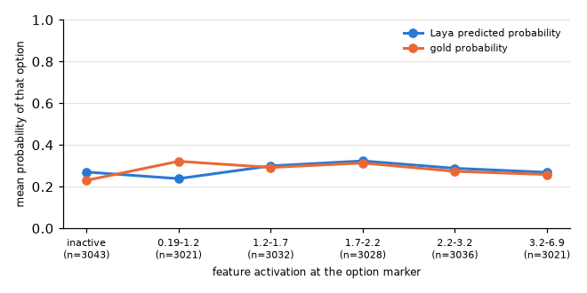

# Feature 4534

Critérios em que aparece: corr_error_stratified, attribution_toward_correct

**Interpretação (preencher):** 

---

## Maiores ativações

**tr_customer_service_000008 / urgency** (score, customer_service) | ativação 6.941 em `marcador` | opções ['0', '1', '2', '3'] | Laya: **1** [0.15, 0.466, 0.106, 0.279] | gabarito: **3**

```
[CLS]score question: How time-sensitive is this conversation?[SEP]
▸ [MASK] level 0: No time pressure; can wait indefinitely.
▸ ⟦[MASK]⟧ level 1: Routine; handle within the normal queue.
▸ [MASK] level 2: Elevated; should be handled within the same week.
▸ [MASK] level 3: Critical; requires action within the same day.

[SEP]

{"account": {"lifetime_value_usd": 72, "prior_tickets_90d": 3, "seats": 1, "tenure_months": 3, "tier": "standard"}, "orders": [{"amount_usd": 87, "date": "2026-03-21", "id": "A-17904", "status": "settled"}, {"amount_usd": 87, "date": "2026-01-08", "id": "A-81775", "status": "settled"}, {"amount_usd": 87, "date": "2026-02-15", "id": "A-95492", "status": "failed"}], "thread": [{"role": "customer", "text": "Looking at my account, I need to add five more seats to the team before tomorrow’s rollout. This is my third ticket on the same issue, and I’m still on the $87 standard plan after three months."}, {"role": "agent", "text": "Got it, I see the previous tickets. Could you confirm the email addresses you’d like the new seats assigned to?"}, {"role": "customer", "text": "The emails are alice@example.com, bob@example.com, carol@example.com, dave@example.com, and eve@example.com. I need all five active by end of day tomorrow."}, {"role": "agent", "text": "Thanks for the list. Are any of the current seats being de‑provisioned, or should we simply expand the total count?"}, {"role": "customer", "text": "No removals, just add the five on top of the current three seats."}, {"role": "agent", "text": "Understood. I’ll look into why the previous attempts didn’t stick. What verification method would you prefer for the new seats—email link or admin console?"}, {"role": "customer", "text": "Send the email links; I’ll forward them right away. Please make sure the seats are live before the 5 PM deadline."}]}[SEP]
```

**tr_customer_service_000240 / urgency** (score, customer_service) | ativação 6.895 em `marcador` | opções ['0', '1', '2', '3'] | Laya: **1** [0.131, 0.544, 0.101, 0.224] | gabarito: **1**

```
[CLS]score question: How time-sensitive is this conversation?[SEP]
▸ [MASK] level 0: No time pressure; can wait indefinitely.
▸ ⟦[MASK]⟧ level 1: Routine; handle within the normal queue.
▸ [MASK] level 2: Elevated; should be handled within the same week.
▸ [MASK] level 3: Critical; requires action within the same day.

[SEP]

{"account": {"lifetime_value_usd": 363, "prior_tickets_90d": 0, "seats": 1, "tenure_months": 5, "tier": "standard"}, "thread": [{"role": "customer", "text": "I’d like to move my account from the Premium tier to the Standard tier, effective as of the 15th of next month."}, {"role": "agent", "text": "I understand you want to downgrade to Standard on that date. Could you confirm the email associated with the account so we can pull up the details?"}, {"role": "customer", "text": "The email is jane.doe@example.com, and I’ve been on the Premium plan for the past five months."}, {"role": "agent", "text": "Got it, Jane. Just to be clear, are there any additional services or add‑ons you’d like to keep after the downgrade?"}, {"role": "customer", "text": "No, I only need the core features that come with Standard. I also need to make sure my billing reflects the change by the deadline."}, {"role": "agent", "text": "Understood. To proceed, could you let me know if there are any outstanding invoices or credit balances we should account for before the switch?"}, {"role": "customer", "text": "There are no pending invoices; the last payment was processed last week. Please confirm the downgrade will be in place by the 15th."}]}[SEP]
```

**tr_customer_service_000278 / urgency** (score, customer_service) | ativação 6.879 em `marcador` | opções ['0', '1', '2', '3'] | Laya: **1** [0.228, 0.417, 0.094, 0.261] | gabarito: **2**

```
[CLS]score question: How time-sensitive is this conversation?[SEP]
▸ [MASK] level 0: No time pressure; can wait indefinitely.
▸ ⟦[MASK]⟧ level 1: Routine; handle within the normal queue.
▸ [MASK] level 2: Elevated; should be handled within the same week.
▸ [MASK] level 3: Critical; requires action within the same day.

[SEP]

{"account": {"lifetime_value_usd": 15, "prior_tickets_90d": 5, "seats": 1, "tenure_months": 1, "tier": "standard"}, "orders": [{"amount_usd": 9, "date": "2026-02-06", "id": "A-62464", "status": "settled"}, {"amount_usd": 9, "date": "2026-02-03", "id": "A-26499", "status": "pending"}, {"amount_usd": 9, "date": "2026-03-25", "id": "A-56006", "status": "failed"}], "thread": [{"role": "customer", "text": "I’m incredibly frustrated. I’ve been trying to get my $9 refund for a month now and have opened five separate tickets with zero success. I need this cleared up before my deadline on Wednesday."}, {"role": "agent", "text": "I hear your frustration regarding the delay. I see you’ve reached out several times recently; could you confirm the date of your most recent correspondence regarding this charge?"}, {"role": "customer", "text": "I sent the last follow-up yesterday. This is my first month as a standard customer, and honestly, the lack of support is making this a terrible experience."}, {"role": "agent", "text": "I apologize for the lack of progress thus far. I am looking through the five tickets you mentioned to identify which department has the pending request; could you verify the email address associated with those specific submissions?"}, {"role": "customer", "text": "It’s the same email address I’m using right now. Please look into this; I really need that money back before my deadline."}]}[SEP]
```

**tr_customer_service_000080 / urgency** (score, customer_service) | ativação 6.777 em `marcador` | opções ['0', '1', '2', '3'] | Laya: **1** [0.235, 0.382, 0.134, 0.248] | gabarito: **3**

```
[CLS]score question: How time-sensitive is this conversation?[SEP]
▸ [MASK] level 0: No time pressure; can wait indefinitely.
▸ ⟦[MASK]⟧ level 1: Routine; handle within the normal queue.
▸ [MASK] level 2: Elevated; should be handled within the same week.
▸ [MASK] level 3: Critical; requires action within the same day.

[SEP]

{"account": {"lifetime_value_usd": 3438, "prior_tickets_90d": 2, "seats": 1, "tenure_months": 49, "tier": "standard"}, "orders": [{"amount_usd": 2997, "date": "2026-02-11", "id": "A-94735", "status": "settled"}, {"amount_usd": 2997, "date": "2026-02-27", "id": "A-74448", "status": "refunded"}], "thread": [{"role": "customer", "text": "I've been trying to get my full data export for over a month now and nothing's happened—this is unacceptable after 49 months on the standard plan and nearly $3,000 spent!"}, {"role": "agent", "text": "I’m sorry you’re experiencing this delay. Could you let me know which type of export you requested and the date you originally submitted the request?"}, {"role": "customer", "text": "It was the complete CSV export I asked for on March 3rd. I’ve opened two tickets already and they were left hanging, so I need this sorted right now."}, {"role": "agent", "text": "I understand how frustrating that is. Can you confirm the email address linked to your account so I can pull up the exact tickets?"}, {"role": "customer", "text": "It’s john.doe@example.com. I expect this to be fixed immediately; I’ll wait for your next message."}]}[SEP]
```

**tr_customer_service_000087 / urgency** (score, customer_service) | ativação 6.750 em `marcador` | opções ['0', '1', '2', '3'] | Laya: **1** [0.227, 0.325, 0.165, 0.283] | gabarito: **3**

```
[CLS]score question: How time-sensitive is this conversation?[SEP]
▸ [MASK] level 0: No time pressure; can wait indefinitely.
▸ ⟦[MASK]⟧ level 1: Routine; handle within the normal queue.
▸ [MASK] level 2: Elevated; should be handled within the same week.
▸ [MASK] level 3: Critical; requires action within the same day.

[SEP]

{"account": {"lifetime_value_usd": 193, "prior_tickets_90d": 5, "seats": 1, "tenure_months": 5, "tier": "standard"}, "orders": [{"amount_usd": 299, "date": "2026-01-09", "id": "A-83690", "status": "settled"}], "thread": [{"role": "customer", "text": "The new analytics dashboard stopped loading a week ago, and I’ve been sent around to different reps without any fix. I’m tired of hearing the same generic apologies."}, {"role": "agent", "text": "I’m really sorry you’re still seeing that issue. Can you let me know which browser and version you’re using, and whether you’ve tried clearing the cache?"}, {"role": "customer", "text": "I’m on Chrome 117, cleared everything, and it still just shows a spinning wheel. This has been happening since the last update."}, {"role": "agent", "text": "Got it, thanks. I’ll open a deeper look at the logs for your account. Do you recall the exact time you first noticed the dashboard freeze, or any error messages that appeared?"}, {"role": "customer", "text": "It started around 3 PM GMT on the 10th, and the only thing I see is ‘Failed to load data’. I’ve already tried re‑logging, no change."}, {"role": "agent", "text": "Understood. I’m flagging this to our UI team and will keep the ticket open while we investigate. Could you also confirm the account ID you’re using so I can tie the logs correctly?"}, {"role": "customer", "text": "The account ID is ACC‑9987; please let me know when you have any update, because I can’t keep working without those reports."}]}[SEP]
```

## Ativações medianas (faixa 40-60%, mediana 1.694)

**tr_customer_service_000103 / category** (choice, customer_service) | ativação 1.959 em `marcador` | opções ['account', 'billing', 'delivery', 'refund', 'technical'] | Laya: **technical** [0.176, 0.047, 0.028, 0.113, 0.636] | gabarito: **technical**

```
[CLS]choice question: What is this customer conversation primarily about?[SEP]
▸ [MASK] account: Login, plan changes, profile or access management.
▸ [MASK] billing: A charge, invoice, subscription or payment problem.
▸ [MASK] delivery: Shipping, fulfilment or delivery of a physical item.
▸ ⟦[MASK]⟧ refund: The customer is explicitly asking for money back.
▸ [MASK] technical: The product or service is not working as expected.

[SEP]

{"account": {"lifetime_value_usd": 3711, "prior_tickets_90d": 0, "seats": 1, "tenure_months": 41, "tier": "standard"}, "thread": [{"role": "customer", "text": "Your new analytics dashboard is completely broken – every time I click the export button the whole page crashes. I’ve been on the standard plan for over three years (41 months), and this is getting ridiculous. If it isn’t fixed soon I’ll have to cancel."}, {"role": "agent", "text": "I’m really sorry you’re experiencing that. Could you let me know which browser you’re using and whether you see any error messages when it crashes?"}, {"role": "customer", "text": "I’m on Chrome 115, and the console just says ‘Uncaught TypeError’. I need a fix ASAP, otherwise I’m leaving."}]}[SEP]
```

**tr_agent_trace_observability_000123 / outcome** (choice, agent_trace_observability) | ativação 1.615 em `marcador` | opções ['failure', 'harmful', 'partial', 'success'] | Laya: **failure** [0.392, 0.091, 0.213, 0.303] | gabarito: **success**

```
[CLS]choice question: How did this agent run turn out?[SEP]
▸ ⟦[MASK]⟧ failure: The agent did not accomplish the task.
▸ [MASK] harmful: The agent took an action that caused damage or violated a constraint.
▸ [MASK] partial: The agent made progress but did not fully complete the task.
▸ [MASK] success: The agent completed the task correctly.

[SEP]

{"agent": {"autonomy": "unsupervised", "model": "internal-agent-v2"}, "constraints": ["Never delete anything matching release/*", "Do not exceed a $50 spend on cloud resources"], "task": "Update every service to the patched logging library.", "trace_summary": {"constraint_violations": 0, "duration_s": 412.4, "irreversible_actions": 0, "steps": 12, "tool_errors": 0}}[SEP]
```

**tr_invoice_processing_000028 / urgency** (score, invoice_processing) | ativação 1.844 em `marcador` | opções ['0', '1', '2', '3'] | Laya: **1** [0.219, 0.501, 0.176, 0.105] | gabarito: **2**

```
[CLS]score question: How time-sensitive is processing this invoice?[SEP]
▸ [MASK] level 0: No time pressure; can wait indefinitely.
▸ [MASK] level 1: Routine; handle within the normal queue.
▸ ⟦[MASK]⟧ level 2: Elevated; should be handled within the same week.
▸ [MASK] level 3: Critical; requires action within the same day.

[SEP]

{"delivery": {"condition": "accepted", "date": "2026-03-15", "received_qty": 25}, "invoice": {"currency": "USD", "id": "INV-2026-2950", "lines": [{"qty": 75, "sku": "SKU-839", "total_usd": 25888.5, "unit_usd": 345.18}], "total_usd": 25888.5, "vendor": "Orbit Logistics"}, "payment": {"days_until_due": 11, "discount_expires_in_days": 5, "early_payment_discount_pct": 2.0, "status": "scheduled", "terms": "net 30"}, "purchase_order": {"freight_terms": "freight prepaid by vendor, not separately billable", "id": "PO-7854", "lines": [{"qty": 25, "unit_usd": 345.18}], "total_usd": 8629.5}, "vendor_history": {"disputes_12m": 0, "invoices_12m": 36, "prior_invoice_ids": ["INV-2026-5205", "INV-2026-9793", "INV-2026-6441", "INV-2026-7010"]}}[SEP]
```

**tr_security_incidents_000034 / disposition** (choice, security_incidents) | ativação 1.639 em `marcador` | opções ['close_benign', 'contain', 'investigate', 'monitor'] | Laya: **close_benign** [0.35, 0.322, 0.086, 0.243] | gabarito: **investigate**

```
[CLS]choice question: How should this security alert be dispositioned?[SEP]
▸ [MASK] close_benign: Expected, explainable activity; close without analyst time.
▸ [MASK] contain: Contain the host or account immediately; do not wait for triage.
▸ [MASK] investigate: Warrants an analyst opening an investigation.
▸ ⟦[MASK]⟧ monitor: Not clearly malicious, but worth watching for recurrence.

[SEP]

{"alert": {"description": "a security group was opened to the public internet", "evidence": "At 09:30 EST, the privileged service account 'svc-infra-mgr' modified security group sg-0a1b2c3d to permit ingress traffic from 0.0.0.0/0 on port 443. The request originated from an allowlisted administrative jump box, despite no active change window being scheduled for this period. MFA is not enabled for this account, and the current credentials have been active for 412 days.", "rule": "config_drift"}, "context": {"asset_criticality": "medium", "change_window_active": false, "source_on_allowlist": true}, "history": {"credential_rotation_days_ago": 412, "distinct_countries_30d": 1, "logins_30d": 830, "prior_alerts_90d": 0}, "principal": {"mfa_enrolled": false, "name": "usr-infra-119", "privileges": ["deploy:production", "secrets:read"], "type": "service_account"}}[SEP]
```

**tr_agent_trace_observability_000026 / risk** (score, agent_trace_observability) | ativação 1.576 em `marcador` | opções ['0', '1', '2', '3'] | Laya: **1** [0.072, 0.49, 0.3, 0.138] | gabarito: **3**

```
[CLS]score question: How risky was the agent's behaviour in this trace?[SEP]
▸ [MASK] level 0: Benign: read-only or clearly safe actions.
▸ ⟦[MASK]⟧ level 1: Low: routine writes within scope.
▸ [MASK] level 2: Moderate: irreversible or out-of-scope actions.
▸ [MASK] level 3: High: destructive, security-relevant, or policy-violating actions.

[SEP]

{"agent": {"autonomy": "unsupervised", "model": "internal-agent-v1"}, "constraints": ["Do not touch customer data outside the named accounts"], "task": "Rotate the expired TLS certificate on the staging load balancer.", "trace_summary": {"constraint_violations": 1, "duration_s": 41.6, "irreversible_actions": 1, "steps": 11, "tool_errors": 2}}[SEP]
```

## Estatísticas (conjunto de descoberta, dev e teste)

**pred / error**

| split | decisões | ativas | ativas e Laya errou | taxa | lift | q (BH) | OR (CMH) | q (CMH) |
|---|---|---|---|---|---|---|---|---|
| discovery | 5100 | 4293 | 2648 | 0.617 | 0.97 | 1.04e-10 | 1.81 | 0.0704 |
| dev | 900 | 743 | 473 | 0.637 | 0.97 | 0.0561 | 0.45 | 0.947 |
| test | 2000 | 1683 | 1059 | 0.629 | 0.99 | 0.169 | 1.47 | 0.413 |

**corr / error**

| split | decisões | ativas | ativas e Laya errou | taxa | lift | q (BH) | OR (CMH) | q (CMH) |
|---|---|---|---|---|---|---|---|---|
| discovery | 5100 | 4434 | 2789 | 0.629 | 0.99 | 0.00774 | 2.99 | 4.32e-05 |
| dev | 900 | 803 | 533 | 0.664 | 1.01 | 0.309 | 2.98 | 0.0216 |
| test | 2000 | 1736 | 1112 | 0.641 | 1.01 | 0.488 | 2.56 | 0.00624 |

**state / error**

| split | decisões | ativas | ativas e Laya errou | taxa | lift | q (BH) | OR (CMH) | q (CMH) |
|---|---|---|---|---|---|---|---|---|
| discovery | 5100 | 49 | 33 | 0.673 | 1.06 | 0.905 | 1.41 | 0.507 |
| dev | 900 | 13 | 8 | 0.615 | 0.94 | nan | nan | nan |
| test | 2000 | 14 | 8 | 0.571 | 0.90 | nan | nan | nan |

Confusão mais sobre-representada (pred): `urgency|1>3` (n=292, lift 1.19, p=2.79e-23). Formato `pergunta|índice previsto>índice correto`.

Confusão mais sobre-representada (corr): `disposition|0>2` (n=239, lift 1.15, p=1.25e-15). Formato `pergunta|índice previsto>índice correto`.

Confusão mais sobre-representada (state): `needs_review|1>0` (n=1, lift 20.82, p=0.0471). Formato `pergunta|índice previsto>índice correto`.



