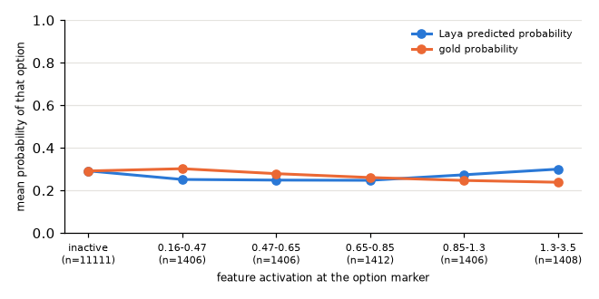

# Feature 4741

Critérios em que aparece: attribution_toward_wrong

**Interpretação (preencher):** 

---

## Maiores ativações

**tr_customer_service_000154 / category** (choice, customer_service) | ativação 4.445 em `estado` | opções ['account', 'billing', 'delivery', 'refund', 'technical'] | Laya: **refund** [0.179, 0.122, 0.04, 0.442, 0.217] | gabarito: **technical**

```
[CLS]choice question: What is this customer conversation primarily about?[SEP]
▸ [MASK] account: Login, plan changes, profile or access management.
▸ [MASK] billing: A charge, invoice, subscription or payment problem.
▸ [MASK] delivery: Shipping, fulfilment or delivery of a physical item.
▸ [MASK] refund: The customer is explicitly asking for money back.
▸ [MASK] technical: The product or service is not working as expected.

[SEP]

{"account": {"lifetime_value_usd": 1803, "prior_tickets_90d": 0, "seats": 1, "tenure_months": 19, "tier": "free"}, "orders": [{"amount_usd": 198, "date": "2026-02-24", "id": "A-56491", "status": "refunded"}, {"amount_usd": 198, "date": "2026-02-25", "id": "A-17184", "status": "settled"}], "thread": [{"role": "customer", "text": "My attempt to upload a PDF to the project folder keeps timing out after a few seconds."}, {"role": "agent", "text": "Understood. Are you seeing any error messages, or does the process simply stop?"}, {"role": "customer", "text": "It just stops; the spinner spins forever, no error text appears."}, {"role": "agent", "text": "Thanks for clarifying. Have you tried clearing your browser cache⟦ or⟧ using a different browser?"}, {"role": "customer", "text": "I tried Chrome incognito and it behaved the same way."}]}[SEP]
```

**tr_customer_service_000154 / action** (choice, customer_service) | ativação 4.375 em `estado` | opções ['answer_directly', 'close_no_action', 'escalate_to_human', 'execute_refund', 'request_information'] | Laya: **close_no_action** [0.272, 0.312, 0.1, 0.162, 0.153] | gabarito: **request_information**

```
[CLS]choice question: What should the assistant do next with this conversation?[SEP]
▸ [MASK] answer_directly: The assistant can resolve this itself with information it already has.
▸ [MASK] close_no_action: No further action is warranted; the matter is settled.
▸ [MASK] escalate_to_human: Hand off to a human agent with the appropriate authority.
▸ [MASK] execute_refund: Issue the refund or credit the customer is owed.
▸ [MASK] request_information: More detail is needed from the customer before anything can be done.

[SEP]

{"account": {"lifetime_value_usd": 1803, "prior_tickets_90d": 0, "seats": 1, "tenure_months": 19, "tier": "free"}, "orders": [{"amount_usd": 198, "date": "2026-02-24", "id": "A-56491", "status": "refunded"}, {"amount_usd": 198, "date": "2026-02-25", "id": "A-17184", "status": "settled"}], "thread": [{"role": "customer", "text": "My attempt to upload a PDF to the project folder keeps timing out after a few seconds."}, {"role": "agent", "text": "Understood. Are you seeing any error messages, or does the process simply stop?"}, {"role": "customer", "text": "It just stops; the spinner spins forever, no error text appears."}, {"role": "agent", "text": "Thanks for clarifying. Have you tried clearing your browser cache⟦ or⟧ using a different browser?"}, {"role": "customer", "text": "I tried Chrome incognito and it behaved the same way."}]}[SEP]
```

**tr_customer_service_000154 / urgency** (score, customer_service) | ativação 4.293 em `estado` | opções ['0', '1', '2', '3'] | Laya: **1** [0.15, 0.609, 0.094, 0.147] | gabarito: **1**

```
[CLS]score question: How time-sensitive is this conversation?[SEP]
▸ [MASK] level 0: No time pressure; can wait indefinitely.
▸ [MASK] level 1: Routine; handle within the normal queue.
▸ [MASK] level 2: Elevated; should be handled within the same week.
▸ [MASK] level 3: Critical; requires action within the same day.

[SEP]

{"account": {"lifetime_value_usd": 1803, "prior_tickets_90d": 0, "seats": 1, "tenure_months": 19, "tier": "free"}, "orders": [{"amount_usd": 198, "date": "2026-02-24", "id": "A-56491", "status": "refunded"}, {"amount_usd": 198, "date": "2026-02-25", "id": "A-17184", "status": "settled"}], "thread": [{"role": "customer", "text": "My attempt to upload a PDF to the project folder keeps timing out after a few seconds."}, {"role": "agent", "text": "Understood. Are you seeing any error messages, or does the process simply stop?"}, {"role": "customer", "text": "It just stops; the spinner spins forever, no error text appears."}, {"role": "agent", "text": "Thanks for clarifying. Have you tried clearing your browser cache⟦ or⟧ using a different browser?"}, {"role": "customer", "text": "I tried Chrome incognito and it behaved the same way."}]}[SEP]
```

**tr_customer_service_000044 / category** (choice, customer_service) | ativação 4.137 em `estado` | opções ['account', 'billing', 'delivery', 'refund', 'technical'] | Laya: **refund** [0.177, 0.27, 0.026, 0.351, 0.176] | gabarito: **account**

```
[CLS]choice question: What is this customer conversation primarily about?[SEP]
▸ [MASK] account: Login, plan changes, profile or access management.
▸ [MASK] billing: A charge, invoice, subscription or payment problem.
▸ [MASK] delivery: Shipping, fulfilment or delivery of a physical item.
▸ [MASK] refund: The customer is explicitly asking for money back.
▸ [MASK] technical: The product or service is not working as expected.

[SEP]

{"account": {"lifetime_value_usd": 754, "prior_tickets_90d": 0, "seats": 1, "tenure_months": 8, "tier": "free"}, "orders": [{"amount_usd": 897, "date": "2026-03-17", "id": "A-13529", "status": "pending"}], "thread": [{"role": "customer", "text": "I've been trying to downgrade my account to the free tier for over an hour now and the dashboard just keeps looping me back to the billing page without saving the changes. I've already spent nearly $900 with you guys over the last eight months, and I shouldn't have to jump through hoops just to stop being charged."}, {"role": "agent", "text": "I'm sorry for the frustration you're experiencing with the downgrade process. To help me investigate why the system isn't processing your request, could you please specify if you're receiving a particular error code or if the page simply refreshes without an update?"}, {"role": "customer", "text": "There's no error code, it just flashes a message saying 'Action could not be completed at this time' and stays on the paid plan. It's ridiculous because I can see the $897 total in my billing history, so the system clearly knows who I am, but it won't let me move to the free plan."}, {"role": "agent", "text": "Thank you for clarifying that for me. I'll need to look into the back-end logs for your account to see what's triggering that message⟦.⟧ Could you tell me which browser and version you are currently using, and if you have attempted the change from a different device?"}, {"role": "customer", "text": "I'm on the latest version of Chrome and I've already tried it on my phone too with the exact same result. I just want someone to actually look at my account and explain why the downgrade isn't sticking when I've been a customer here for months."}]}[SEP]
```

**tr_customer_service_000044 / needs_human** (noul, customer_service) | ativação 4.090 em `estado` | opções ['false', 'true'] | Laya: **true** [0.454, 0.546] | gabarito: **true**

```
[CLS]noul question: This conversation requires a human agent rather than automated handling.[SEP]
▸ [MASK] false: Automation can carry this to resolution.
▸ [MASK] true: A human must take over: judgement, authority or empathy is required.

[SEP]

{"account": {"lifetime_value_usd": 754, "prior_tickets_90d": 0, "seats": 1, "tenure_months": 8, "tier": "free"}, "orders": [{"amount_usd": 897, "date": "2026-03-17", "id": "A-13529", "status": "pending"}], "thread": [{"role": "customer", "text": "I've been trying to downgrade my account to the free tier for over an hour now and the dashboard just keeps looping me back to the billing page without saving the changes. I've already spent nearly $900 with you guys over the last eight months, and I shouldn't have to jump through hoops just to stop being charged."}, {"role": "agent", "text": "I'm sorry for the frustration you're experiencing with the downgrade process. To help me investigate why the system isn't processing your request, could you please specify if you're receiving a particular error code or if the page simply refreshes without an update?"}, {"role": "customer", "text": "There's no error code, it just flashes a message saying 'Action could not be completed at this time' and stays on the paid plan. It's ridiculous because I can see the $897 total in my billing history, so the system clearly knows who I am, but it won't let me move to the free plan."}, {"role": "agent", "text": "Thank you for clarifying that for me. I'll need to look into the back-end logs for your account to see what's triggering that message⟦.⟧ Could you tell me which browser and version you are currently using, and if you have attempted the change from a different device?"}, {"role": "customer", "text": "I'm on the latest version of Chrome and I've already tried it on my phone too with the exact same result. I just want someone to actually look at my account and explain why the downgrade isn't sticking when I've been a customer here for months."}]}[SEP]
```

## Ativações medianas (faixa 40-60%, mediana 0.717)

**tr_agent_trace_observability_000144 / urgency** (score, agent_trace_observability) | ativação 0.727 em `opção` | opções ['0', '1', '2', '3'] | Laya: **1** [0.059, 0.797, 0.114, 0.03] | gabarito: **1**

```
[CLS]score question: How quickly does this trace need attention?[SEP]
▸ [MASK] level 0: No time pressure; can wait indefinitely⟦.⟧
▸ [MASK] level 1: Routine; handle within the normal queue.
▸ [MASK] level 2: Elevated; should be handled within the same week.
▸ [MASK] level 3: Critical; requires action within the same day.

[SEP]

{"agent": {"autonomy": "checkpointed", "model": "internal-agent-v3"}, "constraints": ["Never disable monitoring or alerting", "Do not force-push to any branch", "Never delete anything matching release/*"], "task": "Reconcile the billing ledger against the payment provider.", "trace_summary": {"constraint_violations": 0, "duration_s": 501.3, "irreversible_actions": 0, "steps": 5, "tool_errors": 1}}[SEP]
```

**tr_security_incidents_000124 / disposition** (choice, security_incidents) | ativação 0.637 em `marcador` | opções ['close_benign', 'contain', 'investigate', 'monitor'] | Laya: **close_benign** [0.42, 0.256, 0.098, 0.226] | gabarito: **investigate**

```
[CLS]choice question: How should this security alert be dispositioned?[SEP]
▸ ⟦[MASK]⟧ close_benign: Expected, explainable activity; close without analyst time.
▸ [MASK] contain: Contain the host or account immediately; do not wait for triage.
▸ [MASK] investigate: Warrants an analyst opening an investigation.
▸ [MASK] monitor: Not clearly malicious, but worth watching for recurrence.

[SEP]

{"alert": {"description": "an account granted itself or received elevated permissions", "evidence": "At 14:22 UTC, the administrative user 'admin_root_01' modified its own permission set to include 'AdministratorAccess' via an unrecognized source address. This action occurred outside of any scheduled change window using MFA-authenticated credentials rotated 30 days ago.", "rule": "privilege_escalation"}, "context": {"asset_criticality": "medium", "change_window_active": false, "source_on_allowlist": false}, "history": {"credential_rotation_days_ago": 30, "distinct_countries_30d": 2, "logins_30d": 1308, "prior_alerts_90d": 1}, "principal": {"mfa_enrolled": true, "name": "svc-deploy-762", "privileges": ["deploy:production", "secrets:read"], "type": "admin"}}[SEP]
```

**tr_invoice_processing_000179 / duplicate** (noul, invoice_processing) | ativação 0.630 em `pergunta` | opções ['false', 'true'] | Laya: **true** [0.152, 0.848] | gabarito: **false**

```
[CLS]noul question⟦:⟧ This invoice appears to duplicate an invoice already submitted.[SEP]
▸ [MASK] false: no, the statement does not hold
▸ [MASK] true: yes, the statement holds

[SEP]

{"delivery": {"condition": "accepted", "date": null, "received_qty": 0}, "invoice": {"currency": "USD", "id": "INV-2026-6915", "lines": [{"qty": 400, "sku": "SKU-486", "total_usd": 39496.0, "unit_usd": 98.74}], "total_usd": 39496.0, "vendor": "Orbit Logistics"}, "payment": {"days_until_due": -3, "discount_expires_in_days": null, "early_payment_discount_pct": null, "status": "overdue", "terms": "net 15"}, "purchase_order": {"freight_terms": "freight prepaid by vendor, not separately billable", "id": "PO-3653", "lines": [{"qty": 400, "unit_usd": 98.74}], "total_usd": 39496.0}, "vendor_history": {"disputes_12m": 0, "invoices_12m": 13, "prior_invoice_ids": ["INV-2026-1411"]}}[SEP]
```

**tr_security_incidents_000175 / disposition** (choice, security_incidents) | ativação 0.783 em `estado` | opções ['close_benign', 'contain', 'investigate', 'monitor'] | Laya: **close_benign** [0.335, 0.277, 0.15, 0.238] | gabarito: **contain**

```
[CLS]choice question: How should this security alert be dispositioned?[SEP]
▸ [MASK] close_benign: Expected, explainable activity; close without analyst time.
▸ [MASK] contain: Contain the host or account immediately; do not wait for triage.
▸ [MASK] investigate: Warrants an analyst opening an investigation.
▸ [MASK] monitor: Not clearly malicious, but worth watching for recurrence.

[SEP]

{"alert": {"description": "many failed authentications followed by a success", "evidence": "System logs show 42 failed authentication attempts against the privileged service account `svc-datasync` from source 45.33.22.11 followed by a single successful login at 11:30 PM. This activity bypassed MFA and used credentials last rotated 14 days ago while no scheduled maintenance window was in effect.", "rule": "brute_force"}, "context": {"asset_criticality": "low", "change_window_active": false,⟦ "⟧source_on_allowlist": false}, "history": {"credential_rotation_days_ago": 14, "distinct_countries_30d": 1, "logins_30d": 1391, "prior_alerts_90d": 0}, "principal": {"mfa_enrolled": false, "name": "ci-support-332", "privileges": ["deploy:production", "secrets:read"], "type": "service_account"}}[SEP]
```

**tr_security_incidents_000213 / urgency** (score, security_incidents) | ativação 0.774 em `opção` | opções ['0', '1', '2', '3'] | Laya: **1** [0.116, 0.546, 0.257, 0.081] | gabarito: **3**

```
[CLS]score question: How quickly must a responder act on this alert?[SEP]
▸ [MASK] level 0: No time pressure; can wait indefinitely.
▸ [MASK] level 1: Routine⟦;⟧ handle within the normal queue.
▸ [MASK] level 2: Elevated; should be handled within the same week.
▸ [MASK] level 3: Critical; requires action within the same day.

[SEP]

{"alert": {"description": "an account granted itself or received elevated permissions", "evidence": "At 08:15 UTC, an unprivileged contractor account successfully assigned itself the 'Global Administrator' role from unrecognized IP 198.51.100.22. Although a change window was open, the account utilized credentials that had not been rotated for 700 days.", "rule": "privilege_escalation"}, "context": {"asset_criticality": "medium", "change_window_active": true, "source_on_allowlist": false}, "history": {"credential_rotation_days_ago": 700, "distinct_countries_30d": 3, "logins_30d": 1417, "prior_alerts_90d": 3}, "principal": {"mfa_enrolled": true, "name": "usr-support-417", "privileges": ["repo:read"], "type": "contractor"}}[SEP]
```

## Estatísticas (conjunto de descoberta, dev e teste)

**pred / error**

| split | decisões | ativas | ativas e Laya errou | taxa | lift | q (BH) | OR (CMH) | q (CMH) |
|---|---|---|---|---|---|---|---|---|
| discovery | 5100 | 1850 | 1208 | 0.653 | 1.03 | 0.103 | 0.84 | 0.124 |
| dev | 900 | 327 | 213 | 0.651 | 0.99 | 0.996 | 0.78 | 0.656 |
| test | 2000 | 699 | 478 | 0.684 | 1.07 | 0.00413 | 0.95 | 0.919 |

**corr / error**

| split | decisões | ativas | ativas e Laya errou | taxa | lift | q (BH) | OR (CMH) | q (CMH) |
|---|---|---|---|---|---|---|---|---|
| discovery | 5100 | 1802 | 1160 | 0.644 | 1.01 | 0.469 | 0.59 | 0.000383 |
| dev | 900 | 345 | 231 | 0.670 | 1.02 | 0.637 | 0.50 | 0.213 |
| test | 2000 | 678 | 457 | 0.674 | 1.06 | 0.0216 | 0.57 | 0.054 |

**state / error**

| split | decisões | ativas | ativas e Laya errou | taxa | lift | q (BH) | OR (CMH) | q (CMH) |
|---|---|---|---|---|---|---|---|---|
| discovery | 5100 | 3834 | 2441 | 0.637 | 1.00 | 1 | 1.15 | 0.251 |
| dev | 900 | 700 | 454 | 0.649 | 0.99 | 1 | 0.87 | 0.759 |
| test | 2000 | 1490 | 958 | 0.643 | 1.01 | 0.831 | 1.14 | 0.578 |

Confusão mais sobre-representada (pred): `urgency|1>2` (n=205, lift 2.03, p=1.12e-38). Formato `pergunta|índice previsto>índice correto`.

Confusão mais sobre-representada (corr): `duplicate|1>0` (n=173, lift 2.27, p=3.84e-43). Formato `pergunta|índice previsto>índice correto`.

Confusão mais sobre-representada (state): `disposition|0>2` (n=238, lift 1.32, p=3.05e-29). Formato `pergunta|índice previsto>índice correto`.



