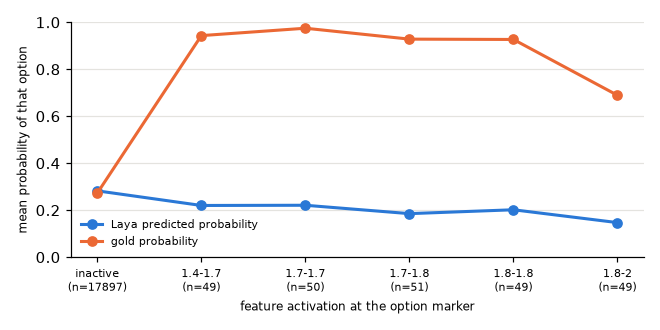

# Feature 4832

Critérios em que aparece: state_error

**Interpretação (preencher):** 

---

## Maiores ativações

**tr_invoice_processing_000199 / duplicate** (noul, invoice_processing) | ativação 6.383 em `opção` | opções ['false', 'true'] | Laya: **true** [0.086, 0.914] | gabarito: **true**

```
[CLS]noul question: This invoice appears to duplicate an invoice already submitted.[SEP]
▸ [MASK] false: no, the statement does not⟦ hold⟧
▸ [MASK] true: yes, the statement holds

[SEP]

{"delivery": {"condition": "accepted", "date": "2026-03-09", "received_qty": 1000}, "invoice": {"currency": "USD", "id": "INV-2026-1122", "lines": [{"qty": 1000, "sku": "SKU-843", "total_usd": 114150.0, "unit_usd": 114.15}], "total_usd": 114150.0, "vendor": "Orbit Logistics"}, "payment": {"days_until_due": 44, "discount_expires_in_days": 1, "early_payment_discount_pct": 2.0, "status": "scheduled", "terms": "net 30"}, "purchase_order": {"freight_terms": "freight prepaid by vendor, not separately billable", "id": "PO-5232", "lines": [{"qty": 1000, "unit_usd": 114.15}], "total_usd": 114150.0}, "vendor_history": {"disputes_12m": 5, "invoices_12m": 48, "prior_invoice_ids": ["INV-2026-1122", "INV-2026-2468", "INV-2026-5673", "INV-2026-6777"]}}[SEP]
```

**tr_invoice_processing_000114 / duplicate** (noul, invoice_processing) | ativação 6.309 em `opção` | opções ['false', 'true'] | Laya: **true** [0.044, 0.956] | gabarito: **true**

```
[CLS]noul question: This invoice appears to duplicate an invoice already submitted.[SEP]
▸ [MASK] false: no, the statement does not⟦ hold⟧
▸ [MASK] true: yes, the statement holds

[SEP]

{"delivery": {"condition": "accepted", "date": "2026-03-28", "received_qty": 10}, "invoice": {"currency": "USD", "id": "INV-2026-6695", "lines": [{"qty": 10, "sku": "SKU-935", "total_usd": 3947.2, "unit_usd": 394.72}], "total_usd": 3947.2, "vendor": "Northwind Components"}, "payment": {"days_until_due": 44, "discount_expires_in_days": null, "early_payment_discount_pct": null, "status": "scheduled", "terms": "net 30"}, "purchase_order": {"freight_terms": "freight prepaid by vendor, not separately billable", "id": "PO-4278", "lines": [{"qty": 10, "unit_usd": 394.72}], "total_usd": 3947.2}, "vendor_history": {"disputes_12m": 5, "invoices_12m": 37, "prior_invoice_ids": ["INV-2026-6695", "INV-2026-6530", "INV-2026-5636", "INV-2026-6226"]}}[SEP]
```

**tr_invoice_processing_000289 / duplicate** (noul, invoice_processing) | ativação 6.301 em `opção` | opções ['false', 'true'] | Laya: **true** [0.158, 0.842] | gabarito: **false**

```
[CLS]noul question: This invoice appears to duplicate an invoice already submitted.[SEP]
▸ [MASK] false: no, the statement does not⟦ hold⟧
▸ [MASK] true: yes, the statement holds

[SEP]

{"delivery": {"condition": "accepted with exceptions", "date": "2026-03-27", "received_qty": 100}, "invoice": {"currency": "USD", "id": "INV-2026-8801", "lines": [{"qty": 100, "sku": "SKU-986", "total_usd": 27049.0, "unit_usd": 270.49}], "total_usd": 27049.0, "vendor": "Orbit Logistics"}, "payment": {"days_until_due": 18, "discount_expires_in_days": 4, "early_payment_discount_pct": 2.0, "status": "scheduled", "terms": "net 30"}, "purchase_order": {"freight_terms": "freight prepaid by vendor, not separately billable", "id": "PO-5260", "lines": [{"qty": 100, "unit_usd": 270.49}], "total_usd": 27049.0}, "vendor_history": {"disputes_12m": 5, "invoices_12m": 52, "prior_invoice_ids": ["INV-2026-2893", "INV-2026-9152", "INV-2026-3271", "INV-2026-5562"]}}[SEP]
```

**tr_invoice_processing_000070 / duplicate** (noul, invoice_processing) | ativação 6.289 em `opção` | opções ['false', 'true'] | Laya: **true** [0.121, 0.879] | gabarito: **false**

```
[CLS]noul question: This invoice appears to duplicate an invoice already submitted.[SEP]
▸ [MASK] false: no, the statement does not⟦ hold⟧
▸ [MASK] true: yes, the statement holds

[SEP]

{"delivery": {"condition": "accepted", "date": null, "received_qty": 0}, "invoice": {"currency": "USD", "id": "INV-2026-1390", "lines": [{"qty": 0, "sku": "SKU-445", "total_usd": 0.0, "unit_usd": 80.08}], "total_usd": 0.0, "vendor": "Orbit Logistics"}, "payment": {"days_until_due": 18, "discount_expires_in_days": 7, "early_payment_discount_pct": 2.0, "status": "scheduled", "terms": "net 45"}, "purchase_order": {"freight_terms": "freight prepaid by vendor, not separately billable", "id": "PO-6605", "lines": [{"qty": 50, "unit_usd": 80.08}], "total_usd": 4004.0}, "vendor_history": {"disputes_12m": 1, "invoices_12m": 34, "prior_invoice_ids": ["INV-2026-6730", "INV-2026-5049"]}}[SEP]
```

**tr_invoice_processing_000142 / duplicate** (noul, invoice_processing) | ativação 6.281 em `opção` | opções ['false', 'true'] | Laya: **true** [0.249, 0.751] | gabarito: **false**

```
[CLS]noul question: This invoice appears to duplicate an invoice already submitted.[SEP]
▸ [MASK] false: no, the statement does not⟦ hold⟧
▸ [MASK] true: yes, the statement holds

[SEP]

{"delivery": {"condition": "accepted", "date": "2026-03-27", "received_qty": 10}, "invoice": {"currency": "USD", "id": "INV-2026-5434", "lines": [{"qty": 60, "sku": "SKU-316", "total_usd": 3445.2, "unit_usd": 57.42}], "total_usd": 3445.2, "vendor": "Northwind Components"}, "payment": {"days_until_due": -21, "discount_expires_in_days": null, "early_payment_discount_pct": null, "status": "overdue", "terms": "net 30"}, "purchase_order": {"freight_terms": "freight prepaid by vendor, not separately billable", "id": "PO-2682", "lines": [{"qty": 10, "unit_usd": 57.42}], "total_usd": 574.2}, "vendor_history": {"disputes_12m": 0, "invoices_12m": 8, "prior_invoice_ids": ["INV-2026-8778", "INV-2026-3447"]}}[SEP]
```

## Ativações medianas (faixa 40-60%, mediana 1.778)

**tr_invoice_processing_000034 / duplicate** (noul, invoice_processing) | ativação 2.135 em `opção` | opções ['false', 'true'] | Laya: **true** [0.16, 0.84] | gabarito: **false**

```
[CLS]noul question: This invoice appears to duplicate an invoice already submitted.[SEP]
▸ [MASK] false: no, the statement does⟦ not⟧ hold
▸ [MASK] true: yes, the statement holds

[SEP]

{"delivery": {"condition": "accepted", "date": "2026-03-16", "received_qty": 25}, "invoice": {"currency": "USD", "id": "INV-2026-2701", "lines": [{"qty": 25, "sku": "SKU-886", "total_usd": 2944.25, "unit_usd": 117.77}, {"qty": 1, "sku": "FREIGHT", "total_usd": 276.83, "unit_usd": 276.83}], "total_usd": 3221.08, "vendor": "Vantage Materials"}, "payment": {"days_until_due": 11, "discount_expires_in_days": null, "early_payment_discount_pct": null, "status": "scheduled", "terms": "net 30"}, "purchase_order": {"freight_terms": "freight prepaid by vendor, not separately billable", "id": "PO-3751", "lines": [{"qty": 25, "unit_usd": 117.77}], "total_usd": 2944.25}, "vendor_history": {"disputes_12m": 0, "invoices_12m": 9, "prior_invoice_ids": ["INV-2026-5941", "INV-2026-9758", "INV-2026-7863", "INV-2026-5149"]}}[SEP]
```

**tr_invoice_processing_000239 / duplicate** (noul, invoice_processing) | ativação 1.762 em `marcador` | opções ['false', 'true'] | Laya: **true** [0.118, 0.882] | gabarito: **false**

```
[CLS]noul question: This invoice appears to duplicate an invoice already submitted.[SEP]
▸ ⟦[MASK]⟧ false: no, the statement does not hold
▸ [MASK] true: yes, the statement holds

[SEP]

{"delivery": {"condition": "accepted with exceptions", "date": "2026-03-09", "received_qty": 25}, "invoice": {"currency": "USD", "id": "INV-2026-6058", "lines": [{"qty": 25, "sku": "SKU-229", "total_usd": 10799.0, "unit_usd": 431.96}], "total_usd": 10799.0, "vendor": "Kestrel Supply"}, "payment": {"days_until_due": -3, "discount_expires_in_days": null, "early_payment_discount_pct": null, "status": "overdue", "terms": "net 15"}, "purchase_order": {"freight_terms": "freight prepaid by vendor, not separately billable", "id": "PO-3159", "lines": [{"qty": 25, "unit_usd": 431.96}], "total_usd": 10799.0}, "vendor_history": {"disputes_12m": 2, "invoices_12m": 2, "prior_invoice_ids": ["INV-2026-6719", "INV-2026-4543", "INV-2026-1306"]}}[SEP]
```

**tr_invoice_processing_000298 / duplicate** (noul, invoice_processing) | ativação 1.724 em `CLS` | opções ['false', 'true'] | Laya: **true** [0.212, 0.788] | gabarito: **false**

```
⟦[CLS]⟧noul question: This invoice appears to duplicate an invoice already submitted.[SEP]
▸ [MASK] false: no, the statement does not hold
▸ [MASK] true: yes, the statement holds

[SEP]

{"delivery": {"condition": "accepted", "date": "2026-03-26", "received_qty": 50}, "invoice": {"currency": "USD", "id": "INV-2026-9385", "lines": [{"qty": 55, "sku": "SKU-286", "total_usd": 18960.15, "unit_usd": 344.73}], "total_usd": 18960.15, "vendor": "Acme Fabrication"}, "payment": {"days_until_due": 18, "discount_expires_in_days": null, "early_payment_discount_pct": null, "status": "scheduled", "terms": "net 30"}, "purchase_order": {"freight_terms": "freight prepaid by vendor, not separately billable", "id": "PO-3004", "lines": [{"qty": 50, "unit_usd": 344.73}], "total_usd": 17236.5}, "vendor_history": {"disputes_12m": 0, "invoices_12m": 36, "prior_invoice_ids": ["INV-2026-2578", "INV-2026-7197", "INV-2026-9334"]}}[SEP]
```

**tr_invoice_processing_000208 / duplicate** (noul, invoice_processing) | ativação 1.976 em `opção` | opções ['false', 'true'] | Laya: **true** [0.279, 0.721] | gabarito: **false**

```
[CLS]noul question: This invoice appears to duplicate an invoice already submitted.[SEP]
▸ [MASK] false: no, the statement does⟦ not⟧ hold
▸ [MASK] true: yes, the statement holds

[SEP]

{"delivery": {"condition": "accepted", "date": "2026-03-19", "received_qty": 10}, "invoice": {"currency": "USD", "id": "INV-2026-6082", "lines": [{"qty": 10, "sku": "SKU-170", "total_usd": 1515.9, "unit_usd": 151.59}], "total_usd": 1515.9, "vendor": "Orbit Logistics"}, "payment": {"days_until_due": -9, "discount_expires_in_days": null, "early_payment_discount_pct": null, "status": "overdue", "terms": "net 45"}, "purchase_order": {"freight_terms": "freight prepaid by vendor, not separately billable", "id": "PO-4990", "lines": [{"qty": 10, "unit_usd": 151.59}], "total_usd": 1515.9}, "vendor_history": {"disputes_12m": 0, "invoices_12m": 22, "prior_invoice_ids": ["INV-2026-4660"]}}[SEP]
```

**tr_invoice_processing_000110 / duplicate** (noul, invoice_processing) | ativação 1.797 em `marcador` | opções ['false', 'true'] | Laya: **true** [0.163, 0.837] | gabarito: **false**

```
[CLS]noul question: This invoice appears to duplicate an invoice already submitted.[SEP]
▸ ⟦[MASK]⟧ false: no, the statement does not hold
▸ [MASK] true: yes, the statement holds

[SEP]

{"delivery": {"condition": "accepted", "date": "2026-03-01", "received_qty": 400}, "invoice": {"currency": "USD", "id": "INV-2026-3749", "lines": [{"qty": 400, "sku": "SKU-775", "total_usd": 98092.0, "unit_usd": 245.23}], "total_usd": 98092.0, "vendor": "Pallas Industrial"}, "payment": {"days_until_due": -3, "discount_expires_in_days": null, "early_payment_discount_pct": null, "status": "overdue", "terms": "net 45"}, "purchase_order": {"freight_terms": "freight prepaid by vendor, not separately billable", "id": "PO-4329", "lines": [{"qty": 400, "unit_usd": 245.23}], "total_usd": 98092.0}, "vendor_history": {"disputes_12m": 0, "invoices_12m": 48, "prior_invoice_ids": ["INV-2026-9469", "INV-2026-8195", "INV-2026-6930", "INV-2026-5533"]}}[SEP]
```

## Estatísticas (conjunto de descoberta, dev e teste)

**pred / error**

| split | decisões | ativas | ativas e Laya errou | taxa | lift | q (BH) | OR (CMH) | q (CMH) |
|---|---|---|---|---|---|---|---|---|
| discovery | 5100 | 1 | 0 | 0.000 | 0.00 | nan | nan | nan |
| dev | 900 | 0 | 0 | nan | nan | nan | nan | nan |
| test | 2000 | 0 | 0 | nan | nan | nan | nan | nan |

**corr / error**

| split | decisões | ativas | ativas e Laya errou | taxa | lift | q (BH) | OR (CMH) | q (CMH) |
|---|---|---|---|---|---|---|---|---|
| discovery | 5100 | 217 | 216 | 0.995 | 1.56 | 7.9e-41 | nan | nan |
| dev | 900 | 55 | 55 | 1.000 | 1.52 | 7.03e-10 | nan | nan |
| test | 2000 | 89 | 89 | 1.000 | 1.57 | 2.67e-17 | nan | nan |

**state / error**

| split | decisões | ativas | ativas e Laya errou | taxa | lift | q (BH) | OR (CMH) | q (CMH) |
|---|---|---|---|---|---|---|---|---|
| discovery | 5100 | 105 | 87 | 0.829 | 1.30 | 0.00148 | 1.12 | 0.83 |
| dev | 900 | 25 | 21 | 0.840 | 1.28 | 0.802 | 0.74 | 0.849 |
| test | 2000 | 38 | 34 | 0.895 | 1.40 | 0.0649 | 2.67 | 0.201 |

Confusão mais sobre-representada (corr): `duplicate|1>0` (n=216, lift 23.50, p=0). Formato `pergunta|índice previsto>índice correto`.

Confusão mais sobre-representada (state): `duplicate|1>0` (n=71, lift 15.97, p=0). Formato `pergunta|índice previsto>índice correto`.



