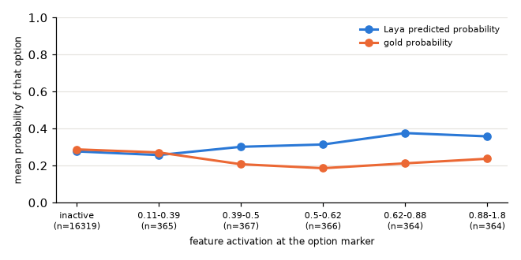

# Feature 4915

Critérios em que aparece: attribution_toward_wrong

**Interpretação (preencher):** 

---

## Maiores ativações

**tr_customer_service_000299 / churn_risk** (score, customer_service) | ativação 7.625 em `estado` | opções ['0', '1', '2', '3'] | Laya: **3** [0.054, 0.142, 0.388, 0.416] | gabarito: **3**

```
[CLS]score question: How likely is this customer to stop doing business with us because of this interaction?[SEP]
▸ [MASK] level 0: No sign of dissatisfaction.
▸ [MASK] level 1: Mild frustration, but the relationship is intact.
▸ [MASK] level 2: Clearly unhappy; repeat problems or explicit complaints.
▸ [MASK] level 3: Imminent: threatening to cancel, dispute or leave.

[SEP]

{"account": {"lifetime_value_usd": 4289, "prior_tickets_90d": 1, "seats": 3, "tenure_months": 72, "tier": "premium"}, "orders": [{"amount_usd": 29, "date": "2026-01-21", "id": "A-19524", "status": "settled⟦"},⟧ {"amount_usd": 29, "date": "2026-03-11", "id": "A-67481", "status": "settled"}, {"amount_usd": 29, "date": "2026-03-12", "id": "A-89299", "status": "settled"}], "thread": [{"role": "customer", "text": "I've had this account for six years and I'm done. Cancel my subscription immediately!"}, {"role": "agent", "text": "I can certainly look into that for you. To ensure I have the right account, could you please verify the email address associated with your billing?"}, {"role": "customer", "text": "You should already have it from the ticket I opened last month that you guys barely even helped me with!"}]}[SEP]
```

**tr_customer_service_000064 / category** (choice, customer_service) | ativação 7.543 em `estado` | opções ['account', 'billing', 'delivery', 'refund', 'technical'] | Laya: **billing** [0.086, 0.578, 0.023, 0.259, 0.054] | gabarito: **billing**

```
[CLS]choice question: What is this customer conversation primarily about?[SEP]
▸ [MASK] account: Login, plan changes, profile or access management.
▸ [MASK] billing: A charge, invoice, subscription or payment problem.
▸ [MASK] delivery: Shipping, fulfilment or delivery of a physical item.
▸ [MASK] refund: The customer is explicitly asking for money back.
▸ [MASK] technical: The product or service is not working as expected.

[SEP]

{"account": {"lifetime_value_usd": 50, "prior_tickets_90d": 0, "seats": 1, "tenure_months": 2, "tier": "free"}, "orders": [{"amount_usd": 999, "date": "2026-02-13", "id": "A-85122", "status": "settled⟦"},⟧ {"amount_usd": 999, "date": "2026-02-11", "id": "A-24999", "status": "failed"}], "thread": [{"role": "customer", "text": "Hey—my payment just bounced. I was charged nearly a thousand dollars ($999) for the free plan, and I've been with you for two months. I need this fixed right now."}]}[SEP]
```

**tr_customer_service_000299 / action** (choice, customer_service) | ativação 7.508 em `estado` | opções ['answer_directly', 'close_no_action', 'escalate_to_human', 'execute_refund', 'request_information'] | Laya: **close_no_action** [0.146, 0.445, 0.122, 0.183, 0.104] | gabarito: **escalate_to_human**

```
[CLS]choice question: What should the assistant do next with this conversation?[SEP]
▸ [MASK] answer_directly: The assistant can resolve this itself with information it already has.
▸ [MASK] close_no_action: No further action is warranted; the matter is settled.
▸ [MASK] escalate_to_human: Hand off to a human agent with the appropriate authority.
▸ [MASK] execute_refund: Issue the refund or credit the customer is owed.
▸ [MASK] request_information: More detail is needed from the customer before anything can be done.

[SEP]

{"account": {"lifetime_value_usd": 4289, "prior_tickets_90d": 1, "seats": 3, "tenure_months": 72, "tier": "premium"}, "orders": [{"amount_usd": 29, "date": "2026-01-21", "id": "A-19524", "status": "settled⟦"},⟧ {"amount_usd": 29, "date": "2026-03-11", "id": "A-67481", "status": "settled"}, {"amount_usd": 29, "date": "2026-03-12", "id": "A-89299", "status": "settled"}], "thread": [{"role": "customer", "text": "I've had this account for six years and I'm done. Cancel my subscription immediately!"}, {"role": "agent", "text": "I can certainly look into that for you. To ensure I have the right account, could you please verify the email address associated with your billing?"}, {"role": "customer", "text": "You should already have it from the ticket I opened last month that you guys barely even helped me with!"}]}[SEP]
```

**tr_customer_service_000064 / urgency** (score, customer_service) | ativação 7.266 em `estado` | opções ['0', '1', '2', '3'] | Laya: **3** [0.089, 0.27, 0.164, 0.477] | gabarito: **3**

```
[CLS]score question: How time-sensitive is this conversation?[SEP]
▸ [MASK] level 0: No time pressure; can wait indefinitely.
▸ [MASK] level 1: Routine; handle within the normal queue.
▸ [MASK] level 2: Elevated; should be handled within the same week.
▸ [MASK] level 3: Critical; requires action within the same day.

[SEP]

{"account": {"lifetime_value_usd": 50, "prior_tickets_90d": 0, "seats": 1, "tenure_months": 2, "tier": "free"}, "orders": [{"amount_usd": 999, "date": "2026-02-13", "id": "A-85122", "status": "settled⟦"},⟧ {"amount_usd": 999, "date": "2026-02-11", "id": "A-24999", "status": "failed"}], "thread": [{"role": "customer", "text": "Hey—my payment just bounced. I was charged nearly a thousand dollars ($999) for the free plan, and I've been with you for two months. I need this fixed right now."}]}[SEP]
```

**tr_customer_service_000064 / needs_human** (noul, customer_service) | ativação 6.902 em `estado` | opções ['false', 'true'] | Laya: **false** [0.528, 0.472] | gabarito: **true**

```
[CLS]noul question: This conversation requires a human agent rather than automated handling.[SEP]
▸ [MASK] false: Automation can carry this to resolution.
▸ [MASK] true: A human must take over: judgement, authority or empathy is required.

[SEP]

{"account": {"lifetime_value_usd": 50, "prior_tickets_90d": 0, "seats": 1, "tenure_months": 2, "tier": "free"}, "orders": [{"amount_usd": 999, "date": "2026-02-13", "id": "A-85122", "status": "settled⟦"},⟧ {"amount_usd": 999, "date": "2026-02-11", "id": "A-24999", "status": "failed"}], "thread": [{"role": "customer", "text": "Hey—my payment just bounced. I was charged nearly a thousand dollars ($999) for the free plan, and I've been with you for two months. I need this fixed right now."}]}[SEP]
```

## Ativações medianas (faixa 40-60%, mediana 0.817)

**tr_invoice_processing_000288 / discrepancy_severity** (score, invoice_processing) | ativação 0.714 em `estado` | opções ['0', '1', '2', '3'] | Laya: **0** [0.359, 0.205, 0.232, 0.204] | gabarito: **0**

```
[CLS]score question: How material is any discrepancy between the invoice, the order and the delivery?[SEP]
▸ [MASK] level 0: None: everything reconciles.
▸ [MASK] level 1: Trivial: rounding or a cosmetic difference.
▸ [MASK] level 2: Moderate: a real difference worth confirming.
▸ [MASK] level 3: Material: a large or unexplained difference.

[SEP]

{"delivery": {"condition": "accepted", "date": "2026-03-18", "received_qty": 1000}, "invoice": {"currency": "USD", "id": "INV-2026-4845", "lines": [{"qty": 1000, "sku": "SKU-946", "total_usd": 365740.0, "unit_usd": 365.74}], "total_usd": 365740.0, "vendor": "Northwind Components"}, "payment": {"days_until_due": 18, "discount_expires_in_days": 1, "early_payment_discount_pct": 2.0, "status": "scheduled", "terms": "net 15"},⟦ "⟧purchase_order": {"freight_terms": "freight prepaid by vendor, not separately billable", "id": "PO-3908", "lines": [{"qty": 1000, "unit_usd": 365.74}], "total_usd": 365740.0}, "vendor_history": {"disputes_12m": 0, "invoices_12m": 45, "prior_invoice_ids": ["INV-2026-4845", "INV-2026-1550", "INV-2026-3604"]}}[SEP]
```

**tr_invoice_processing_000161 / duplicate** (noul, invoice_processing) | ativação 0.827 em `estado` | opções ['false', 'true'] | Laya: **true** [0.228, 0.772] | gabarito: **false**

```
[CLS]noul question: This invoice appears to duplicate an invoice already submitted.[SEP]
▸ [MASK] false: no, the statement does not hold
▸ [MASK] true: yes, the statement holds

[SEP]

{"delivery": {"condition": "accepted", "date": "2026-03-03", "received_qty": 50}, "invoice": {"currency": "USD", "id": "INV-2026-8683", "lines": [{"qty": 50, "sku": "SKU-646", "total_usd": 19787.0, "unit_usd": 395.74},⟦ {"⟧qty": 1, "sku": "FREIGHT", "total_usd": 1105.75, "unit_usd": 1105.75}], "total_usd": 20892.75, "vendor": "Acme Fabrication"}, "payment": {"days_until_due": -21, "discount_expires_in_days": null, "early_payment_discount_pct": null, "status": "overdue", "terms": "net 15"}, "purchase_order": {"freight_terms": "freight prepaid by vendor, not separately billable", "id": "PO-7596", "lines": [{"qty": 50, "unit_usd": 395.74}], "total_usd": 19787.0}, "vendor_history": {"disputes_12m": 1, "invoices_12m": 42, "prior_invoice_ids": ["INV-2026-5464", "INV-2026-8986", "INV-2026-1686", "INV-2026-3280"]}}[SEP]
```

**tr_customer_service_000049 / action** (choice, customer_service) | ativação 0.738 em `opção` | opções ['answer_directly', 'close_no_action', 'escalate_to_human', 'execute_refund', 'request_information'] | Laya: **close_no_action** [0.204, 0.579, 0.065, 0.079, 0.072] | gabarito: **escalate_to_human**

```
[CLS]choice question: What should the assistant do next with this conversation?[SEP]
▸ [MASK] answer_directly: The assistant can resolve this itself with information it already has.
▸ [MASK] close⟦_⟧no_action: No further action is warranted; the matter is settled.
▸ [MASK] escalate_to_human: Hand off to a human agent with the appropriate authority.
▸ [MASK] execute_refund: Issue the refund or credit the customer is owed.
▸ [MASK] request_information: More detail is needed from the customer before anything can be done.

[SEP]

{"account": {"lifetime_value_usd": 3497, "prior_tickets_90d": 1, "seats": 1, "tenure_months": 60, "tier": "standard"}, "orders": [{"amount_usd": 38, "date": "2026-02-24", "id": "A-41622", "status": "failed"}, {"amount_usd": 38, "date": "2026-01-19", "id": "A-95313", "status": "pending"}, {"amount_usd": 38, "date": "2026-01-24", "id": "A-54468", "status": "settled"}], "thread": [{"role": "customer", "text": "I’ve been a loyal customer for 5 years, and receiving the wrong $38 item is unacceptable. I have a hard deadline for this event tomorrow, and if this isn't corrected right now, I'm taking my business elsewhere."}]}[SEP]
```

**tr_invoice_processing_000245 / urgency** (score, invoice_processing) | ativação 0.930 em `estado` | opções ['0', '1', '2', '3'] | Laya: **1** [0.222, 0.541, 0.169, 0.068] | gabarito: **2**

```
[CLS]score question: How time-sensitive is processing this invoice?[SEP]
▸ [MASK] level 0: No time pressure; can wait indefinitely.
▸ [MASK] level 1: Routine; handle within the normal queue.
▸ [MASK] level 2: Elevated; should be handled within the same week.
▸ [MASK] level 3: Critical; requires action within the same day.

[SEP]

{"delivery": {"condition": "accepted", "date": "2026-03-14", "received_qty": 1000}, "invoice": {"currency": "EUR", "id": "INV-2026-4696", "lines": [{"qty": 1000, "sku": "SKU-228", "total_usd": 175820.0, "unit_usd": 175.82}], "total_usd": 175820.0, "vendor": "Orbit Logistics⟦"},⟧ "payment": {"days_until_due": -3, "discount_expires_in_days": null, "early_payment_discount_pct": null, "status": "overdue", "terms": "net 15"}, "purchase_order": {"freight_terms": "freight prepaid by vendor, not separately billable", "id": "PO-4111", "lines": [{"qty": 1000, "unit_usd": 175.82}], "total_usd": 175820.0}, "vendor_history": {"disputes_12m": 0, "invoices_12m": 48, "prior_invoice_ids": ["INV-2026-6883", "INV-2026-3464"]}}[SEP]
```

**tr_security_incidents_000196 / credential_compromise** (noul, security_incidents) | ativação 0.825 em `opção` | opções ['false', 'true'] | Laya: **true** [0.178, 0.822] | gabarito: **false**

```
[CLS]noul question: The evidence indicates a credential or account has been compromised.[SEP]
▸ [MASK] false: no, the statement does⟦ not⟧ hold
▸ [MASK] true: yes, the statement holds

[SEP]

{"alert": {"description": "an unrecognised binary executed on a server", "evidence": "During an open change window, an unrecognized binary named 'svc_temp_6.exe' was executed on server WEB-PROD-01 by an unprivileged administrator account. The execution was initiated from an allowlisted source address using credentials that were last rotated 180 days ago.", "rule": "suspicious_process"}, "context": {"asset_criticality": "medium", "change_window_active": true, "source_on_allowlist": true}, "history": {"credential_rotation_days_ago": 180, "distinct_countries_30d": 4, "logins_30d": 5, "prior_alerts_90d": 25}, "principal": {"mfa_enrolled": true, "name": "adm-deploy-891", "privileges": ["repo:read"], "type": "admin"}}[SEP]
```

## Estatísticas (conjunto de descoberta, dev e teste)

**pred / error**

| split | decisões | ativas | ativas e Laya errou | taxa | lift | q (BH) | OR (CMH) | q (CMH) |
|---|---|---|---|---|---|---|---|---|
| discovery | 5100 | 751 | 549 | 0.731 | 1.15 | 2.02e-08 | 0.84 | 0.599 |
| dev | 900 | 107 | 78 | 0.729 | 1.11 | 0.328 | 0.80 | 0.934 |
| test | 2000 | 276 | 189 | 0.685 | 1.08 | 0.138 | 0.64 | 0.488 |

**corr / error**

| split | decisões | ativas | ativas e Laya errou | taxa | lift | q (BH) | OR (CMH) | q (CMH) |
|---|---|---|---|---|---|---|---|---|
| discovery | 5100 | 367 | 165 | 0.450 | 0.71 | 2.09e-13 | 0.49 | 0.0237 |
| dev | 900 | 47 | 18 | 0.383 | 0.58 | 0.000368 | 0.28 | 0.393 |
| test | 2000 | 156 | 69 | 0.442 | 0.69 | 1.05e-06 | 0.96 | 0.965 |

**state / error**

| split | decisões | ativas | ativas e Laya errou | taxa | lift | q (BH) | OR (CMH) | q (CMH) |
|---|---|---|---|---|---|---|---|---|
| discovery | 5100 | 3332 | 2057 | 0.617 | 0.97 | 0.0049 | 1.10 | 0.467 |
| dev | 900 | 615 | 401 | 0.652 | 0.99 | 1 | 1.06 | 0.905 |
| test | 2000 | 1324 | 844 | 0.637 | 1.00 | 1 | 1.26 | 0.257 |

Confusão mais sobre-representada (pred): `action|1>2` (n=91, lift 4.94, p=0). Formato `pergunta|índice previsto>índice correto`.

Confusão mais sobre-representada (corr): `risk|1>3` (n=40, lift 11.83, p=9.84e-40). Formato `pergunta|índice previsto>índice correto`.

Confusão mais sobre-representada (state): `duplicate|1>0` (n=216, lift 1.53, p=9.57e-42). Formato `pergunta|índice previsto>índice correto`.



