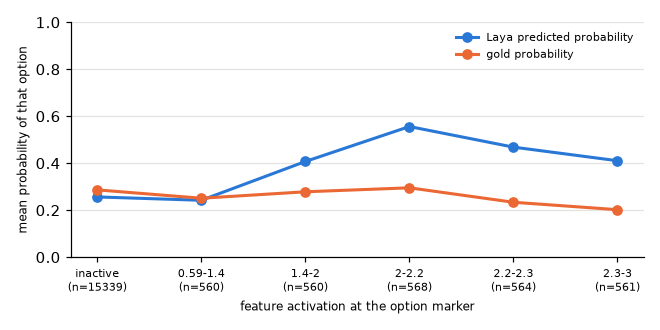

# Feature 4990

Critérios em que aparece: attribution_toward_wrong

**Interpretação (preencher):** 

---

## Maiores ativações

**tr_security_incidents_000153 / severity** (score, security_incidents) | ativação 7.777 em `opção` | opções ['0', '1', '2', '3', '4'] | Laya: **2** [0.032, 0.309, 0.397, 0.213, 0.049] | gabarito: **1**

```
[CLS]score question: How severe is the potential impact if this alert is real?[SEP]
▸ [MASK] level 0: Negligible: no access to anything sensitive⟦.⟧
▸ [MASK] level 1: Low: limited access, easily reversed.
▸ [MASK] level 2: Moderate: access to internal systems or non-public data.
▸ [MASK] level 3: High: access to production, secrets or customer data.
▸ [MASK] level 4: Critical: active compromise of crown-jewel systems.

[SEP]

{"alert": {"description": "an unusual volume of files read in a short window", "evidence": "The user account accessed 450 files within a two-minute window, significantly exceeding the baseline for this principal. The activity originated from an unrecognized IP address at 03:14 UTC, outside of any scheduled change management window.", "rule": "mass_download"}, "context": {"asset_criticality": "low", "change_window_active": false, "source_on_allowlist": false}, "history": {"credential_rotation_days_ago": 3, "distinct_countries_30d": 1, "logins_30d": 415, "prior_alerts_90d": 0}, "principal": {"mfa_enrolled": true, "name": "adm-analytics-872", "privileges": ["repo:read"], "type": "employee"}}[SEP]
```

**tr_security_incidents_000251 / severity** (score, security_incidents) | ativação 7.512 em `opção` | opções ['0', '1', '2', '3', '4'] | Laya: **2** [0.031, 0.257, 0.343, 0.316, 0.052] | gabarito: **3**

```
[CLS]score question: How severe is the potential impact if this alert is real?[SEP]
▸ [MASK] level 0: Negligible: no access to anything sensitive⟦.⟧
▸ [MASK] level 1: Low: limited access, easily reversed.
▸ [MASK] level 2: Moderate: access to internal systems or non-public data.
▸ [MASK] level 3: High: access to production, secrets or customer data.
▸ [MASK] level 4: Critical: active compromise of crown-jewel systems.

[SEP]

{"alert": {"description": "an unusual volume of files read in a short window", "evidence": "A privileged service account read 4,500 files within a five-minute window starting at 14:00 UTC. The account lacks MFA and has not undergone a credential rotation in the past 365 days, although the activity originated from an allowlisted network range.", "rule": "mass_download"}, "context": {"asset_criticality": "low", "change_window_active": false, "source_on_allowlist": true}, "history": {"credential_rotation_days_ago": 365, "distinct_countries_30d": 3, "logins_30d": 1531, "prior_alerts_90d": 1}, "principal": {"mfa_enrolled": false, "name": "adm-billing-460", "privileges": ["deploy:production", "secrets:read"], "type": "service_account"}}[SEP]
```

**tr_security_incidents_000135 / severity** (score, security_incidents) | ativação 7.496 em `opção` | opções ['0', '1', '2', '3', '4'] | Laya: **1** [0.074, 0.422, 0.387, 0.1, 0.018] | gabarito: **0**

```
[CLS]score question: How severe is the potential impact if this alert is real?[SEP]
▸ [MASK] level 0: Negligible: no access to anything sensitive⟦.⟧
▸ [MASK] level 1: Low: limited access, easily reversed.
▸ [MASK] level 2: Moderate: access to internal systems or non-public data.
▸ [MASK] level 3: High: access to production, secrets or customer data.
▸ [MASK] level 4: Critical: active compromise of crown-jewel systems.

[SEP]

{"alert": {"description": "a first-ever sign-in from an unfamiliar country", "evidence": "The service account successfully authenticated from a new country, identified as an allowlisted source. The account has not rotated credentials in 180 days, though MFA is currently enabled.", "rule": "new_country_login"}, "context": {"asset_criticality": "low", "change_window_active": false, "source_on_allowlist": true}, "history": {"credential_rotation_days_ago": 180, "distinct_countries_30d": 2, "logins_30d": 722, "prior_alerts_90d": 1}, "principal": {"mfa_enrolled": true, "name": "usr-billing-596", "privileges": ["repo:read"], "type": "service_account"}}[SEP]
```

**tr_security_incidents_000241 / severity** (score, security_incidents) | ativação 7.383 em `opção` | opções ['0', '1', '2', '3', '4'] | Laya: **2** [0.087, 0.408, 0.429, 0.059, 0.018] | gabarito: **2**

```
[CLS]score question: How severe is the potential impact if this alert is real?[SEP]
▸ [MASK] level 0: Negligible: no access to anything sensitive⟦.⟧
▸ [MASK] level 1: Low: limited access, easily reversed.
▸ [MASK] level 2: Moderate: access to internal systems or non-public data.
▸ [MASK] level 3: High: access to production, secrets or customer data.
▸ [MASK] level 4: Critical: active compromise of crown-jewel systems.

[SEP]

{"alert": {"description": "audit logging was turned off on a host", "evidence": "A service account disabled audit logging on the host, an action performed outside of any defined change window. While the activity originated from an allowlisted source, the account lacks MFA and has not rotated credentials in 180 days.", "rule": "disabled_logging"}, "context": {"asset_criticality": "medium", "change_window_active": false, "source_on_allowlist": true}, "history": {"credential_rotation_days_ago": 180, "distinct_countries_30d": 3, "logins_30d": 613, "prior_alerts_90d": 0}, "principal": {"mfa_enrolled": false, "name": "adm-infra-357", "privileges": ["repo:read"], "type": "service_account"}}[SEP]
```

**tr_security_incidents_000218 / severity** (score, security_incidents) | ativação 7.367 em `opção` | opções ['0', '1', '2', '3', '4'] | Laya: **1** [0.033, 0.369, 0.345, 0.188, 0.065] | gabarito: **1**

```
[CLS]score question: How severe is the potential impact if this alert is real?[SEP]
▸ [MASK] level 0: Negligible: no access to anything sensitive⟦.⟧
▸ [MASK] level 1: Low: limited access, easily reversed.
▸ [MASK] level 2: Moderate: access to internal systems or non-public data.
▸ [MASK] level 3: High: access to production, secrets or customer data.
▸ [MASK] level 4: Critical: active compromise of crown-jewel systems.

[SEP]

{"alert": {"description": "two successful logins from distant locations too close together", "evidence": "Contractor account `ext_dev_04` successfully logged in from London at 09:00 UTC and again from Singapore at 11:15 UTC. Both MFA-validated sessions originated from allowlisted access points during a period with no active change window.", "rule": "impossible_travel"}, "context": {"asset_criticality": "low", "change_window_active": false, "source_on_allowlist": true}, "history": {"credential_rotation_days_ago": 90, "distinct_countries_30d": 1, "logins_30d": 1029, "prior_alerts_90d": 3}, "principal": {"mfa_enrolled": true, "name": "usr-billing-374", "privileges": ["repo:read"], "type": "contractor"}}[SEP]
```

## Ativações medianas (faixa 40-60%, mediana 2.141)

**tr_invoice_processing_000169 / discrepancy_severity** (score, invoice_processing) | ativação 1.873 em `opção` | opções ['0', '1', '2', '3'] | Laya: **0** [0.369, 0.227, 0.231, 0.172] | gabarito: **0**

```
[CLS]score question: How material is any discrepancy between the invoice, the order and the delivery?[SEP]
▸ [MASK] level 0: None: everything reconciles.
▸ [MASK] level 1: Trivial: rounding or a cosmetic difference.
▸ [MASK] level 2: Moderate: a real difference worth confirming⟦.⟧
▸ [MASK] level 3: Material: a large or unexplained difference.

[SEP]

{"delivery": {"condition": "accepted", "date": "2026-03-20", "received_qty": 400}, "invoice": {"currency": "USD", "id": "INV-2026-2565", "lines": [{"qty": 400, "sku": "SKU-890", "total_usd": 22948.0, "unit_usd": 57.37}], "total_usd": 22948.0, "vendor": "Kestrel Supply"}, "payment": {"days_until_due": 2, "discount_expires_in_days": null, "early_payment_discount_pct": null, "status": "scheduled", "terms": "net 15"}, "purchase_order": {"freight_terms": "freight prepaid by vendor, not separately billable", "id": "PO-1197", "lines": [{"qty": 400, "unit_usd": 57.37}], "total_usd": 22948.0}, "vendor_history": {"disputes_12m": 0, "invoices_12m": 39, "prior_invoice_ids": ["INV-2026-8904", "INV-2026-5420", "INV-2026-1117", "INV-2026-2620"]}}[SEP]
```

**tr_invoice_processing_000077 / discrepancy_severity** (score, invoice_processing) | ativação 2.180 em `marcador` | opções ['0', '1', '2', '3'] | Laya: **0** [0.434, 0.245, 0.208, 0.113] | gabarito: **2**

```
[CLS]score question: How material is any discrepancy between the invoice, the order and the delivery?[SEP]
▸ [MASK] level 0: None: everything reconciles.
▸ ⟦[MASK]⟧ level 1: Trivial: rounding or a cosmetic difference.
▸ [MASK] level 2: Moderate: a real difference worth confirming.
▸ [MASK] level 3: Material: a large or unexplained difference.

[SEP]

{"delivery": {"condition": "accepted with exceptions", "date": "2026-03-08", "received_qty": 100}, "invoice": {"currency": "USD", "id": "INV-2026-4183", "lines": [{"qty": 100, "sku": "SKU-157", "total_usd": 11758.0, "unit_usd": 117.58}], "total_usd": 11758.0, "vendor": "Northwind Components"}, "payment": {"days_until_due": 18, "discount_expires_in_days": null, "early_payment_discount_pct": null, "status": "scheduled", "terms": "net 15"}, "purchase_order": {"freight_terms": "freight prepaid by vendor, not separately billable", "id": "PO-2671", "lines": [{"qty": 100, "unit_usd": 117.58}], "total_usd": 11758.0}, "vendor_history": {"disputes_12m": 0, "invoices_12m": 26, "prior_invoice_ids": ["INV-2026-3365", "INV-2026-5702", "INV-2026-1342", "INV-2026-4633"]}}[SEP]
```

**tr_invoice_processing_000289 / discrepancy_severity** (score, invoice_processing) | ativação 2.311 em `marcador` | opções ['0', '1', '2', '3'] | Laya: **0** [0.35, 0.245, 0.247, 0.158] | gabarito: **0**

```
[CLS]score question: How material is any discrepancy between the invoice, the order and the delivery?[SEP]
▸ [MASK] level 0: None: everything reconciles.
▸ ⟦[MASK]⟧ level 1: Trivial: rounding or a cosmetic difference.
▸ [MASK] level 2: Moderate: a real difference worth confirming.
▸ [MASK] level 3: Material: a large or unexplained difference.

[SEP]

{"delivery": {"condition": "accepted with exceptions", "date": "2026-03-27", "received_qty": 100}, "invoice": {"currency": "USD", "id": "INV-2026-8801", "lines": [{"qty": 100, "sku": "SKU-986", "total_usd": 27049.0, "unit_usd": 270.49}], "total_usd": 27049.0, "vendor": "Orbit Logistics"}, "payment": {"days_until_due": 18, "discount_expires_in_days": 4, "early_payment_discount_pct": 2.0, "status": "scheduled", "terms": "net 30"}, "purchase_order": {"freight_terms": "freight prepaid by vendor, not separately billable", "id": "PO-5260", "lines": [{"qty": 100, "unit_usd": 270.49}], "total_usd": 27049.0}, "vendor_history": {"disputes_12m": 5, "invoices_12m": 52, "prior_invoice_ids": ["INV-2026-2893", "INV-2026-9152", "INV-2026-3271", "INV-2026-5562"]}}[SEP]
```

**tr_invoice_processing_000199 / discrepancy_severity** (score, invoice_processing) | ativação 2.271 em `marcador` | opções ['0', '1', '2', '3'] | Laya: **0** [0.376, 0.228, 0.245, 0.152] | gabarito: **0**

```
[CLS]score question: How material is any discrepancy between the invoice, the order and the delivery?[SEP]
▸ [MASK] level 0: None: everything reconciles.
▸ ⟦[MASK]⟧ level 1: Trivial: rounding or a cosmetic difference.
▸ [MASK] level 2: Moderate: a real difference worth confirming.
▸ [MASK] level 3: Material: a large or unexplained difference.

[SEP]

{"delivery": {"condition": "accepted", "date": "2026-03-09", "received_qty": 1000}, "invoice": {"currency": "USD", "id": "INV-2026-1122", "lines": [{"qty": 1000, "sku": "SKU-843", "total_usd": 114150.0, "unit_usd": 114.15}], "total_usd": 114150.0, "vendor": "Orbit Logistics"}, "payment": {"days_until_due": 44, "discount_expires_in_days": 1, "early_payment_discount_pct": 2.0, "status": "scheduled", "terms": "net 30"}, "purchase_order": {"freight_terms": "freight prepaid by vendor, not separately billable", "id": "PO-5232", "lines": [{"qty": 1000, "unit_usd": 114.15}], "total_usd": 114150.0}, "vendor_history": {"disputes_12m": 5, "invoices_12m": 48, "prior_invoice_ids": ["INV-2026-1122", "INV-2026-2468", "INV-2026-5673", "INV-2026-6777"]}}[SEP]
```

**tr_customer_service_000114 / category** (choice, customer_service) | ativação 1.969 em `opção` | opções ['account', 'billing', 'delivery', 'refund', 'technical'] | Laya: **technical** [0.09, 0.299, 0.045, 0.212, 0.354] | gabarito: **technical**

```
[CLS]choice question: What is this customer conversation primarily about?[SEP]
▸ [MASK] account: Login, plan changes, profile or access management⟦.⟧
▸ [MASK] billing: A charge, invoice, subscription or payment problem.
▸ [MASK] delivery: Shipping, fulfilment or delivery of a physical item.
▸ [MASK] refund: The customer is explicitly asking for money back.
▸ [MASK] technical: The product or service is not working as expected.

[SEP]

{"account": {"lifetime_value_usd": 483, "prior_tickets_90d": 2, "seats": 1, "tenure_months": 11, "tier": "standard"}, "orders": [{"amount_usd": 18, "date": "2026-02-08", "id": "A-56150", "status": "settled"}, {"amount_usd": 18, "date": "2026-03-21", "id": "A-45857", "status": "settled"}], "thread": [{"role": "customer", "text": "The PDF export tool is failing to generate files again. I've been on the standard plan for 11 months now and this is the third time this specific feature has stopped working for me."}, {"role": "agent", "text": "I see that you've encountered issues with the PDF export previously. To help me triage this, could you let me know if you are seeing a specific error code when the generation fails?"}, {"role": "customer", "text": "There isn't an error code; the loading bar just hangs at 15% and then the browser times out. I'm paying about $18 a month for this and it's frustrating that a feature that was previously fixed has broken again."}, {"role": "agent", "text": "That sounds like a persistent hang in the rendering process. Does this happen with all of your documents, or is it only occurring with files that contain large images?"}, {"role": "customer", "text": "It's happening even with simple text-only documents. This is exactly what happened the last two times I reported this, so it seems like the old bug has returned."}]}[SEP]
```

## Estatísticas (conjunto de descoberta, dev e teste)

**pred / error**

| split | decisões | ativas | ativas e Laya errou | taxa | lift | q (BH) | OR (CMH) | q (CMH) |
|---|---|---|---|---|---|---|---|---|
| discovery | 5100 | 1593 | 1037 | 0.651 | 1.02 | 0.212 | nan | nan |
| dev | 900 | 274 | 183 | 0.668 | 1.02 | 0.896 | nan | nan |
| test | 2000 | 633 | 462 | 0.730 | 1.15 | 3.65e-08 | nan | nan |

**corr / error**

| split | decisões | ativas | ativas e Laya errou | taxa | lift | q (BH) | OR (CMH) | q (CMH) |
|---|---|---|---|---|---|---|---|---|
| discovery | 5100 | 729 | 173 | 0.237 | 0.37 | 5.01e-123 | nan | nan |
| dev | 900 | 124 | 33 | 0.266 | 0.41 | 1.15e-19 | nan | nan |
| test | 2000 | 227 | 56 | 0.247 | 0.39 | 3.65e-35 | nan | nan |

**state / error**

| split | decisões | ativas | ativas e Laya errou | taxa | lift | q (BH) | OR (CMH) | q (CMH) |
|---|---|---|---|---|---|---|---|---|
| discovery | 5100 | 65 | 32 | 0.492 | 0.77 | 0.144 | 0.74 | 0.403 |
| dev | 900 | 8 | 8 | 1.000 | 1.52 | nan | nan | nan |
| test | 2000 | 21 | 14 | 0.667 | 1.05 | 1 | 1.24 | 0.84 |

Confusão mais sobre-representada (pred): `urgency|1>2` (n=279, lift 3.20, p=0). Formato `pergunta|índice previsto>índice correto`.

Confusão mais sobre-representada (corr): `discrepancy_severity|0>2` (n=65, lift 7.00, p=0). Formato `pergunta|índice previsto>índice correto`.

Confusão mais sobre-representada (state): `matches_order|1>0` (n=5, lift 3.57, p=0.0126). Formato `pergunta|índice previsto>índice correto`.



