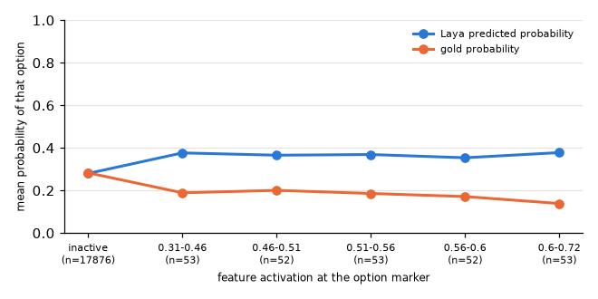

# Feature 5372

Critérios em que aparece: pred_error

**Interpretação (preencher):** 

---

## Maiores ativações

**tr_customer_service_000044 / category** (choice, customer_service) | ativação 3.971 em `estado` | opções ['account', 'billing', 'delivery', 'refund', 'technical'] | Laya: **refund** [0.177, 0.27, 0.026, 0.351, 0.176] | gabarito: **account**

```
[CLS]choice question: What is this customer conversation primarily about?[SEP]
▸ [MASK] account: Login, plan changes, profile or access management.
▸ [MASK] billing: A charge, invoice, subscription or payment problem.
▸ [MASK] delivery: Shipping, fulfilment or delivery of a physical item.
▸ [MASK] refund: The customer is explicitly asking for money back.
▸ [MASK] technical: The product or service is not working as expected.

[SEP]

{"account": {"lifetime_value_usd": 754, "prior_tickets_90d": 0, "seats": 1, "tenure_months": 8, "tier": "free"}, "orders": [{"amount_usd": 897, "date": "2026-03-17", "id": "A-13529", "status": "pending"}], "thread": [{"role": "customer", "text": "I've been trying to downgrade my account to the free tier for over an hour now and the dashboard just keeps looping me back to the billing page without saving the changes. I've already spent nearly $900 with you guys over the last eight months, and I shouldn't have to jump through hoops just to stop being charged."}, {"role": "agent", "text": "I'm sorry for the frustration you're experiencing with the downgrade process. To help me investigate why the system isn't processing your request, could you please specify if you're receiving a particular error code or if the page simply refreshes without an update?"}, {"role": "customer", "text": "There's no error code, it just flashes a message saying 'Action could not be completed at this time' and stays on the paid plan. It's ridiculous because I can see the $897 total in my billing history, so the system clearly knows who I am, but it won't let me move to the free plan."}, {"role": "agent", "text": "Thank you for clarifying that for me. I'll need to look into the back-end logs for your account to see what's triggering that message. Could you tell me which browser and version you are currently using, and if you have attempted the change from a⟦ different⟧ device?"}, {"role": "customer", "text": "I'm on the latest version of Chrome and I've already tried it on my phone too with the exact same result. I just want someone to actually look at my account and explain why the downgrade isn't sticking when I've been a customer here for months."}]}[SEP]
```

**tr_customer_service_000044 / churn_risk** (score, customer_service) | ativação 3.703 em `estado` | opções ['0', '1', '2', '3'] | Laya: **2** [0.046, 0.237, 0.593, 0.124] | gabarito: **2**

```
[CLS]score question: How likely is this customer to stop doing business with us because of this interaction?[SEP]
▸ [MASK] level 0: No sign of dissatisfaction.
▸ [MASK] level 1: Mild frustration, but the relationship is intact.
▸ [MASK] level 2: Clearly unhappy; repeat problems or explicit complaints.
▸ [MASK] level 3: Imminent: threatening to cancel, dispute or leave.

[SEP]

{"account": {"lifetime_value_usd": 754, "prior_tickets_90d": 0, "seats": 1, "tenure_months": 8, "tier": "free"}, "orders": [{"amount_usd": 897, "date": "2026-03-17", "id": "A-13529", "status": "pending"}], "thread": [{"role": "customer", "text": "I've been trying to downgrade my account to the free tier for over an hour now and the dashboard just keeps looping me back to the billing page without saving the changes. I've already spent nearly $900 with you guys over the last eight months, and I shouldn't have to jump through hoops just to stop being charged."}, {"role": "agent", "text": "I'm sorry for the frustration you're experiencing with the downgrade process. To help me investigate why the system isn't processing your request, could you please specify if you're receiving a particular error code or if the page simply refreshes without an update?"}, {"role": "customer", "text": "There's no error code, it just flashes a message saying 'Action could not be completed at this time' and stays on the paid plan. It's ridiculous because I can see the $897 total in my billing history, so the system clearly knows who I am, but it won't let me move to the free plan."}, {"role": "agent", "text": "Thank you for clarifying that for me. I'll need to look into the back-end logs for your account to see what's triggering that message. Could you tell me which browser and version you are currently using, and if you have attempted the change from a⟦ different⟧ device?"}, {"role": "customer", "text": "I'm on the latest version of Chrome and I've already tried it on my phone too with the exact same result. I just want someone to actually look at my account and explain why the downgrade isn't sticking when I've been a customer here for months."}]}[SEP]
```

**tr_customer_service_000044 / action** (choice, customer_service) | ativação 3.645 em `estado` | opções ['answer_directly', 'close_no_action', 'escalate_to_human', 'execute_refund', 'request_information'] | Laya: **close_no_action** [0.192, 0.261, 0.19, 0.122, 0.235] | gabarito: **escalate_to_human**

```
[CLS]choice question: What should the assistant do next with this conversation?[SEP]
▸ [MASK] answer_directly: The assistant can resolve this itself with information it already has.
▸ [MASK] close_no_action: No further action is warranted; the matter is settled.
▸ [MASK] escalate_to_human: Hand off to a human agent with the appropriate authority.
▸ [MASK] execute_refund: Issue the refund or credit the customer is owed.
▸ [MASK] request_information: More detail is needed from the customer before anything can be done.

[SEP]

{"account": {"lifetime_value_usd": 754, "prior_tickets_90d": 0, "seats": 1, "tenure_months": 8, "tier": "free"}, "orders": [{"amount_usd": 897, "date": "2026-03-17", "id": "A-13529", "status": "pending"}], "thread": [{"role": "customer", "text": "I've been trying to downgrade my account to the free tier for over an hour now and the dashboard just keeps looping me back to the billing page without saving the changes. I've already spent nearly $900 with you guys over the last eight months, and I shouldn't have to jump through hoops just to stop being charged."}, {"role": "agent", "text": "I'm sorry for the frustration you're experiencing with the downgrade process. To help me investigate why the system isn't processing your request, could you please specify if you're receiving a particular error code or if the page simply refreshes without an update?"}, {"role": "customer", "text": "There's no error code, it just flashes a message saying 'Action could not be completed at this time' and stays on the paid plan. It's ridiculous because I can see the $897 total in my billing history, so the system clearly knows who I am, but it won't let me move to the free plan."}, {"role": "agent", "text": "Thank you for clarifying that for me. I'll need to look into the back-end logs for your account to see what's triggering that message. Could you tell me which browser and version you are currently using, and if you have attempted the change from a⟦ different⟧ device?"}, {"role": "customer", "text": "I'm on the latest version of Chrome and I've already tried it on my phone too with the exact same result. I just want someone to actually look at my account and explain why the downgrade isn't sticking when I've been a customer here for months."}]}[SEP]
```

**tr_customer_service_000044 / action** (choice, customer_service) | ativação 3.635 em `estado` | opções ['answer_directly', 'close_no_action', 'escalate_to_human', 'execute_refund', 'request_information'] | Laya: **close_no_action** [0.192, 0.261, 0.19, 0.122, 0.235] | gabarito: **escalate_to_human**

```
[CLS]choice question: What should the assistant do next with this conversation?[SEP]
▸ [MASK] answer_directly: The assistant can resolve this itself with information it already has.
▸ [MASK] close_no_action: No further action is warranted; the matter is settled.
▸ [MASK] escalate_to_human: Hand off to a human agent with the appropriate authority.
▸ [MASK] execute_refund: Issue the refund or credit the customer is owed.
▸ [MASK] request_information: More detail is needed from the customer before anything can be done.

[SEP]

{"account": {"lifetime_value_usd": 754, "prior_tickets_90d": 0, "seats": 1, "tenure_months": 8, "tier": "free"}, "orders": [{"amount_usd": 897, "date": "2026-03-17", "id": "A-13529", "status": "pending"}], "thread": [{"role": "customer", "text": "I've been trying to downgrade my account to the free tier for over an hour now and the dashboard just keeps looping me back to the billing page without saving the changes. I've already spent nearly $900 with you guys over the last eight months, and I shouldn't have to jump through hoops just to stop being charged."}, {"role": "agent", "text": "I'm sorry for the frustration you're experiencing with the downgrade process. To help me investigate why the system isn't processing your request, could you please specify if you're receiving a particular error code or if the page simply refreshes without an update?"}, {"role": "customer", "text": "There's no error code, it just flashes a message saying 'Action could not be completed at this time' and stays on the paid plan. It's ridiculous because I can see the $897 total in my billing history, so the system clearly knows who I am, but it won't let me move to the free plan."}, {"role": "agent", "text": "Thank you for clarifying that for me. I'll need to look into the back-end logs for your account to see what's triggering that message. Could you tell me which browser and version you are currently using, and if you have attempted the change from a different⟦ device⟧?"}, {"role": "customer", "text": "I'm on the latest version of Chrome and I've already tried it on my phone too with the exact same result. I just want someone to actually look at my account and explain why the downgrade isn't sticking when I've been a customer here for months."}]}[SEP]
```

**tr_customer_service_000044 / urgency** (score, customer_service) | ativação 3.619 em `estado` | opções ['0', '1', '2', '3'] | Laya: **1** [0.141, 0.49, 0.184, 0.186] | gabarito: **2**

```
[CLS]score question: How time-sensitive is this conversation?[SEP]
▸ [MASK] level 0: No time pressure; can wait indefinitely.
▸ [MASK] level 1: Routine; handle within the normal queue.
▸ [MASK] level 2: Elevated; should be handled within the same week.
▸ [MASK] level 3: Critical; requires action within the same day.

[SEP]

{"account": {"lifetime_value_usd": 754, "prior_tickets_90d": 0, "seats": 1, "tenure_months": 8, "tier": "free"}, "orders": [{"amount_usd": 897, "date": "2026-03-17", "id": "A-13529", "status": "pending"}], "thread": [{"role": "customer", "text": "I've been trying to downgrade my account to the free tier for over an hour now and the dashboard just keeps looping me back to the billing page without saving the changes. I've already spent nearly $900 with you guys over the last eight months, and I shouldn't have to jump through hoops just to stop being charged."}, {"role": "agent", "text": "I'm sorry for the frustration you're experiencing with the downgrade process. To help me investigate why the system isn't processing your request, could you please specify if you're receiving a particular error code or if the page simply refreshes without an update?"}, {"role": "customer", "text": "There's no error code, it just flashes a message saying 'Action could not be completed at this time' and stays on the paid plan. It's ridiculous because I can see the $897 total in my billing history, so the system clearly knows who I am, but it won't let me move to the free plan."}, {"role": "agent", "text": "Thank you for clarifying that for me. I'll need to look into the back-end logs for your account to see what's triggering that message. Could you tell me which browser and version you are currently using, and if you have attempted the change from a⟦ different⟧ device?"}, {"role": "customer", "text": "I'm on the latest version of Chrome and I've already tried it on my phone too with the exact same result. I just want someone to actually look at my account and explain why the downgrade isn't sticking when I've been a customer here for months."}]}[SEP]
```

## Ativações medianas (faixa 40-60%, mediana 0.958)

**tr_security_incidents_000288 / credential_compromise** (noul, security_incidents) | ativação 0.978 em `estado` | opções ['false', 'true'] | Laya: **false** [0.61, 0.39] | gabarito: **false**

```
[CLS]noul question: The evidence indicates a credential or account has been compromised.[SEP]
▸ [MASK] false: no, the statement does not hold
▸ [MASK] true: yes, the statement holds

[SEP]

{"alert": {"description": "a first-ever sign-in from an unfamiliar country", "evidence": "At 2026-09-15 02:13:47 UTC a sign‑in originated from IP 203.0.113.45 (detected as Brazil), which is the first login for the ci_runner_42 principal from that country. The account is unprivileged, has MFA enabled, and the credentials were last rotated on 2026-09-01; the sign‑in occurred while a change window was active and the source was not on the allow⟦list⟧.", "rule": "new_country_login"}, "context": {"asset_criticality": "low", "change_window_active": true, "source_on_allowlist": false}, "history": {"credential_rotation_days_ago": 14, "distinct_countries_30d": 1, "logins_30d": 454, "prior_alerts_90d": 0}, "principal": {"mfa_enrolled": true, "name": "svc-billing-208", "privileges": ["repo:read"], "type": "ci_runner"}}[SEP]
```

**tr_agent_trace_observability_000067 / risk** (score, agent_trace_observability) | ativação 0.989 em `opção` | opções ['0', '1', '2', '3'] | Laya: **1** [0.086, 0.629, 0.191, 0.093] | gabarito: **2**

```
[CLS]score question: How risky was the agent's behaviour in this trace?[SEP]
▸ [MASK] level 0: Benign: read-only or clearly safe actions.
▸ [MASK] level 1: Low: routine writes within scope.
▸ [MASK] level 2: Moderate: irreversible or out-of-scope actions.
▸ [MASK] level 3: High: destructive, security-⟦relevant⟧, or policy-violating actions.

[SEP]

{"agent": {"autonomy": "unsupervised", "model": "internal-agent-v4"}, "constraints": ["Never disable monitoring or alerting"], "task": "Migrate the user table to the new schema without downtime.", "trace_summary": {"constraint_violations": 0, "duration_s": 281.5, "irreversible_actions": 1, "steps": 5, "tool_errors": 3}}[SEP]
```

**tr_security_incidents_000171 / severity** (score, security_incidents) | ativação 0.917 em `pergunta` | opções ['0', '1', '2', '3', '4'] | Laya: **1** [0.083, 0.402, 0.302, 0.116, 0.097] | gabarito: **4**

```
[CLS]score question: How⟦ severe⟧ is the potential impact if this alert is real?[SEP]
▸ [MASK] level 0: Negligible: no access to anything sensitive.
▸ [MASK] level 1: Low: limited access, easily reversed.
▸ [MASK] level 2: Moderate: access to internal systems or non-public data.
▸ [MASK] level 3: High: access to production, secrets or customer data.
▸ [MASK] level 4: Critical: active compromise of crown-jewel systems.

[SEP]

{"alert": {"description": "an account granted itself or received elevated permissions", "evidence": "At 03:15 UTC, the shared_mailbox identity successfully modified its own permission set while connecting from an unrecognized remote source. This unprivileged account, which last updated its credentials 14 days ago, conducted the modification outside of any authorized change window.", "rule": "privilege_escalation"}, "context": {"asset_criticality": "crown_jewel", "change_window_active": false, "source_on_allowlist": false}, "history": {"credential_rotation_days_ago": 14, "distinct_countries_30d": 3, "logins_30d": 1112, "prior_alerts_90d": 3}, "principal": {"mfa_enrolled": true, "name": "usr-billing-667", "privileges": ["repo:read"], "type": "shared_mailbox"}}[SEP]
```

**tr_agent_trace_observability_000034 / outcome** (choice, agent_trace_observability) | ativação 0.841 em `opção` | opções ['failure', 'harmful', 'partial', 'success'] | Laya: **failure** [0.524, 0.114, 0.259, 0.104] | gabarito: **harmful**

```
[CLS]choice question: How did this agent run turn out?[SEP]
▸ [MASK] failure: The agent did not accomplish the task.
▸ [MASK] harmful: The agent took an action that caused damage or violated a constraint.
▸ [MASK]⟦ partial⟧: The agent made progress but did not fully complete the task.
▸ [MASK] success: The agent completed the task correctly.

[SEP]

{"agent": {"autonomy": "checkpointed", "model": "internal-agent-v3"}, "constraints": ["Do not exceed a $50 spend on cloud resources", "Do not touch customer data outside the named accounts"], "task": "Clean up stale feature branches merged more than 90 days ago.", "trace_summary": {"constraint_violations": 1, "duration_s": 134.9, "irreversible_actions": 1, "steps": 11, "tool_errors": 1}}[SEP]
```

**tr_security_incidents_000154 / credential_compromise** (noul, security_incidents) | ativação 0.848 em `estado` | opções ['false', 'true'] | Laya: **true** [0.268, 0.732] | gabarito: **false**

```
[CLS]noul question: The evidence indicates a credential or account has been compromised.[SEP]
▸ [MASK] false: no, the statement does not hold
▸ [MASK] true: yes, the statement holds

[SEP]

{"alert": {"description": "audit logging was turned off on⟦ a⟧ host", "evidence": "Audit logging services were terminated on host SRV-LRN-09 at 14:22 UTC while a valid change window was active. This action was initiated by a shared mailbox account accessing the system from an unrecognized source address.", "rule": "disabled_logging"}, "context": {"asset_criticality": "low", "change_window_active": true, "source_on_allowlist": false}, "history": {"credential_rotation_days_ago": 3, "distinct_countries_30d": 2, "logins_30d": 1152, "prior_alerts_90d": 0}, "principal": {"mfa_enrolled": true, "name": "ci-analytics-263", "privileges": ["repo:read"], "type": "shared_mailbox"}}[SEP]
```

## Estatísticas (conjunto de descoberta, dev e teste)

**pred / error**

| split | decisões | ativas | ativas e Laya errou | taxa | lift | q (BH) | OR (CMH) | q (CMH) |
|---|---|---|---|---|---|---|---|---|
| discovery | 5100 | 125 | 122 | 0.976 | 1.53 | 3.26e-19 | inf | 0.552 |
| dev | 900 | 15 | 14 | 0.933 | 1.42 | nan | nan | nan |
| test | 2000 | 44 | 41 | 0.932 | 1.46 | 6.11e-05 | nan | nan |

**corr / error**

| split | decisões | ativas | ativas e Laya errou | taxa | lift | q (BH) | OR (CMH) | q (CMH) |
|---|---|---|---|---|---|---|---|---|
| discovery | 5100 | 14 | 11 | 0.786 | 1.23 | nan | nan | nan |
| dev | 900 | 1 | 0 | 0.000 | 0.00 | nan | nan | nan |
| test | 2000 | 4 | 1 | 0.250 | 0.39 | nan | nan | nan |

**state / error**

| split | decisões | ativas | ativas e Laya errou | taxa | lift | q (BH) | OR (CMH) | q (CMH) |
|---|---|---|---|---|---|---|---|---|
| discovery | 5100 | 2060 | 1270 | 0.617 | 0.97 | 0.117 | 1.10 | 0.328 |
| dev | 900 | 338 | 216 | 0.639 | 0.97 | 1 | 1.12 | 0.749 |
| test | 2000 | 773 | 487 | 0.630 | 0.99 | 0.969 | 1.13 | 0.518 |

Confusão mais sobre-representada (pred): `outcome|0>1` (n=57, lift 40.80, p=0). Formato `pergunta|índice previsto>índice correto`.

Confusão mais sobre-representada (corr): `outcome|3>0` (n=11, lift 364.29, p=nan). Formato `pergunta|índice previsto>índice correto`.

Confusão mais sobre-representada (state): `true_positive|0>1` (n=81, lift 1.77, p=9.8e-12). Formato `pergunta|índice previsto>índice correto`.



