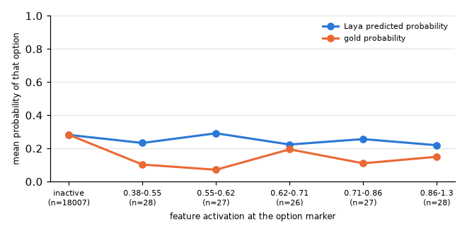

# Feature 5679

Critérios em que aparece: pred_error

**Interpretação (preencher):** 

---

## Maiores ativações

**tr_customer_service_000088 / needs_human** (noul, customer_service) | ativação 8.023 em `estado` | opções ['false', 'true'] | Laya: **true** [0.424, 0.576] | gabarito: **true**

```
[CLS]noul question: This conversation requires a human agent rather than automated handling.[SEP]
▸ [MASK] false: Automation can carry this to resolution.
▸ [MASK] true: A human must take over: judgement, authority or empathy is required.

[SEP]

{"account": {"lifetime_value_usd": 73, "prior_tickets_90d": 1, "seats": 5, "tenure_months": 2, "tier": "enterprise"}, "orders": [{"amount_usd": 19, "date": "2026-02-04", "id": "A-66055", "status": "settled"}], "thread": [{"role": "customer", "text": "Hello, I hope you can help – I tried to renew our Enterprise plan⟦ today⟧ and the $19 charge didn’t go through. This is our second month with you, and we’ve already opened a ticket about a similar issue that was resolved, but it seems to be happening again."}, {"role": "agent", "text": "I’m sorry to hear the payment didn’t process. Could you let me know the date of the attempted charge and the last four digits of the card you used?"}, {"role": "customer", "text": "The attempt was on September 12th, and the card ends in 8427. I also tried using the same card on the portal, but it still shows a failure."}, {"role": "agent", "text": "Thank you for the details. Have you tried using a different payment method, or does the same error appear with another card?"}, {"role": "customer", "text": "We only have the one corporate card for billing, so we haven’t switched. The earlier ticket (ID #12345) was resolved, but the problem resurfaced today."}, {"role": "agent", "text": "I see, and I’ve noted the previous ticket. I’ll look into the transaction logs and see why the charge is failing again."}, {"role": "customer", "text": "Please let me know when you have an update, as we need the renewal to be confirmed before the end of the week."}]}[SEP]
```

**tr_customer_service_000032 / action** (choice, customer_service) | ativação 7.461 em `estado` | opções ['answer_directly', 'close_no_action', 'escalate_to_human', 'execute_refund', 'request_information'] | Laya: **execute_refund** [0.143, 0.231, 0.244, 0.312, 0.07] | gabarito: **escalate_to_human**

```
[CLS]choice question: What should the assistant do next with this conversation?[SEP]
▸ [MASK] answer_directly: The assistant can resolve this itself with information it already has.
▸ [MASK] close_no_action: No further action is warranted; the matter is settled.
▸ [MASK] escalate_to_human: Hand off to a human agent with the appropriate authority.
▸ [MASK] execute_refund: Issue the refund or credit the customer is owed.
▸ [MASK] request_information: More detail is needed from the customer before anything can be done.

[SEP]

{"account": {"lifetime_value_usd": 380, "prior_tickets_90d": 1, "seats": 1, "tenure_months": 5, "tier": "standard"}, "orders": [{"amount_usd": 598, "date": "2026-02-19", "id": "A-24938", "status": "pending"}, {"amount_usd": 598, "date": "2026-03-04", "id": "A-58038", "status": "refunded"}, {"amount_usd": 598, "date": "2026-⟦03⟧-13", "id": "A-45299", "status": "settled"}], "thread": [{"role": "customer", "text": "I am beyond finished with this service. I've poured nearly six hundred dollars into this account over the last five months and my previous ticket is still sitting there completely ignored. Just cancel my entire account immediately."}, {"role": "agent", "text": "I understand you're looking to close your account today. To ensure I have the right context, could you please clarify if the lack of response on your previous ticket is the primary reason for your decision to leave the standard plan?"}, {"role": "customer", "text": "It's the fact that I'm paying for a premium tier and getting treated like I don't exist while you keep my $598. I'm not here to talk it out or wait for a fix that isn't coming—I want the cancellation processed now."}]}[SEP]
```

**tr_customer_service_000088 / urgency** (score, customer_service) | ativação 7.383 em `estado` | opções ['0', '1', '2', '3'] | Laya: **1** [0.192, 0.369, 0.159, 0.28] | gabarito: **2**

```
[CLS]score question: How time-sensitive is this conversation?[SEP]
▸ [MASK] level 0: No time pressure; can wait indefinitely.
▸ [MASK] level 1: Routine; handle within the normal queue.
▸ [MASK] level 2: Elevated; should be handled within the same week.
▸ [MASK] level 3: Critical; requires action within the same day.

[SEP]

{"account": {"lifetime_value_usd": 73, "prior_tickets_90d": 1, "seats": 5, "tenure_months": 2, "tier": "enterprise"}, "orders": [{"amount_usd": 19, "date": "2026-02-04", "id": "A-66055", "status": "settled"}], "thread": [{"role": "customer", "text": "Hello, I hope you can help – I tried to renew our Enterprise plan⟦ today⟧ and the $19 charge didn’t go through. This is our second month with you, and we’ve already opened a ticket about a similar issue that was resolved, but it seems to be happening again."}, {"role": "agent", "text": "I’m sorry to hear the payment didn’t process. Could you let me know the date of the attempted charge and the last four digits of the card you used?"}, {"role": "customer", "text": "The attempt was on September 12th, and the card ends in 8427. I also tried using the same card on the portal, but it still shows a failure."}, {"role": "agent", "text": "Thank you for the details. Have you tried using a different payment method, or does the same error appear with another card?"}, {"role": "customer", "text": "We only have the one corporate card for billing, so we haven’t switched. The earlier ticket (ID #12345) was resolved, but the problem resurfaced today."}, {"role": "agent", "text": "I see, and I’ve noted the previous ticket. I’ll look into the transaction logs and see why the charge is failing again."}, {"role": "customer", "text": "Please let me know when you have an update, as we need the renewal to be confirmed before the end of the week."}]}[SEP]
```

**tr_customer_service_000032 / category** (choice, customer_service) | ativação 6.734 em `estado` | opções ['account', 'billing', 'delivery', 'refund', 'technical'] | Laya: **refund** [0.074, 0.052, 0.012, 0.818, 0.044] | gabarito: **account**

```
[CLS]choice question: What is this customer conversation primarily about?[SEP]
▸ [MASK] account: Login, plan changes, profile or access management.
▸ [MASK] billing: A charge, invoice, subscription or payment problem.
▸ [MASK] delivery: Shipping, fulfilment or delivery of a physical item.
▸ [MASK] refund: The customer is explicitly asking for money back.
▸ [MASK] technical: The product or service is not working as expected.

[SEP]

{"account": {"lifetime_value_usd": 380, "prior_tickets_90d": 1, "seats": 1, "tenure_months": 5, "tier": "standard"}, "orders": [{"amount_usd": 598, "date": "2026-02-19", "id": "A-24938", "status": "pending"}, {"amount_usd": 598, "date": "2026-03-04", "id": "A-58038", "status": "refunded"}, {"amount_usd": 598, "date": "2026-⟦03⟧-13", "id": "A-45299", "status": "settled"}], "thread": [{"role": "customer", "text": "I am beyond finished with this service. I've poured nearly six hundred dollars into this account over the last five months and my previous ticket is still sitting there completely ignored. Just cancel my entire account immediately."}, {"role": "agent", "text": "I understand you're looking to close your account today. To ensure I have the right context, could you please clarify if the lack of response on your previous ticket is the primary reason for your decision to leave the standard plan?"}, {"role": "customer", "text": "It's the fact that I'm paying for a premium tier and getting treated like I don't exist while you keep my $598. I'm not here to talk it out or wait for a fix that isn't coming—I want the cancellation processed now."}]}[SEP]
```

**tr_customer_service_000032 / churn_risk** (score, customer_service) | ativação 6.617 em `estado` | opções ['0', '1', '2', '3'] | Laya: **3** [0.014, 0.062, 0.268, 0.657] | gabarito: **3**

```
[CLS]score question: How likely is this customer to stop doing business with us because of this interaction?[SEP]
▸ [MASK] level 0: No sign of dissatisfaction.
▸ [MASK] level 1: Mild frustration, but the relationship is intact.
▸ [MASK] level 2: Clearly unhappy; repeat problems or explicit complaints.
▸ [MASK] level 3: Imminent: threatening to cancel, dispute or leave.

[SEP]

{"account": {"lifetime_value_usd": 380, "prior_tickets_90d": 1, "seats": 1, "tenure_months": 5, "tier": "standard"}, "orders": [{"amount_usd": 598, "date": "2026-02-19", "id": "A-24938", "status": "pending"}, {"amount_usd": 598, "date": "2026-03-04", "id": "A-58038", "status": "refunded"}, {"amount_usd": 598, "date": "2026-⟦03⟧-13", "id": "A-45299", "status": "settled"}], "thread": [{"role": "customer", "text": "I am beyond finished with this service. I've poured nearly six hundred dollars into this account over the last five months and my previous ticket is still sitting there completely ignored. Just cancel my entire account immediately."}, {"role": "agent", "text": "I understand you're looking to close your account today. To ensure I have the right context, could you please clarify if the lack of response on your previous ticket is the primary reason for your decision to leave the standard plan?"}, {"role": "customer", "text": "It's the fact that I'm paying for a premium tier and getting treated like I don't exist while you keep my $598. I'm not here to talk it out or wait for a fix that isn't coming—I want the cancellation processed now."}]}[SEP]
```

## Ativações medianas (faixa 40-60%, mediana 0.869)

**tr_customer_service_000196 / needs_human** (noul, customer_service) | ativação 0.939 em `estado` | opções ['false', 'true'] | Laya: **true** [0.409, 0.591] | gabarito: **true**

```
[CLS]noul question: This conversation requires a human agent rather than automated handling.[SEP]
▸ [MASK] false: Automation can carry this to resolution.
▸ [MASK] true: A human must take over: judgement, authority or empathy is required.

[SEP]

{"account": {"lifetime_value_usd": 167, "prior_tickets_90d": 2, "seats": 1, "tenure_months": 5, "tier": "standard"}, "orders": [{"amount_usd": 149, "date": "2026-01-12", "id": "A-65487", "status": "settled"}], "thread": [{"role": "customer", "text": "I’m honestly at my wit's end here. It’s been five months of paying for this standard plan, and I’m still waiting on that $149 refund. I’ve opened two tickets already and nothing has changed—if you guys can't get⟦ this⟧ sorted, I’m just going to take my business elsewhere."}, {"role": "agent", "text": "I’m sorry to hear that you haven't received your refund yet. Could you please provide the ticket numbers from your previous interactions so I can look into the status of those requests for you?"}, {"role": "customer", "text": "I don't have time to dig through my archives for ticket numbers that should be attached to my account profile. This is exactly why I'm considering leaving; you have all my information, so why is this still pending?"}]}[SEP]
```

**tr_security_incidents_000090 / true_positive** (noul, security_incidents) | ativação 0.931 em `estado` | opções ['false', 'true'] | Laya: **false** [0.693, 0.307] | gabarito: **true**

```
[CLS]noul question: This alert reflects genuinely malicious or unauthorised activity.[SEP]
▸ [MASK] false: Benign activity, a misconfiguration, or a known false positive.
▸ [MASK] true: The underlying behaviour is malicious or unauthorised.

[SEP]

{"alert": {"description": "two successful logins from distant locations too close together", "evidence": "At 2026-09-14 03:12:04 UTC a successful authentication for the CI_Runner service was logged from IP 203.0.113.45 (Paris, FR). A second successful login for the same principal occurred 6 minutes later from IP 198.51.100.22 (Tokyo, JP), and the system flagged the source as not present in the allowlist. The change‑window flag was active and the associated credentials were last rotated on 2026-08-15.", "rule": "impossible_travel"}, "context": {"asset_criticality": "high", "change_window_active": true, "source_on_allowlist": false}, "history": {"credential_rotation_days_ago": 30, "distinct_countries_30d": 1, "logins_⟦30⟧d": 587, "prior_alerts_90d": 0}, "principal": {"mfa_enrolled": true, "name": "adm-billing-542", "privileges": ["deploy:production", "secrets:read"], "type": "ci_runner"}}[SEP]
```

**tr_invoice_processing_000129 / urgency** (score, invoice_processing) | ativação 0.895 em `estado` | opções ['0', '1', '2', '3'] | Laya: **1** [0.258, 0.509, 0.127, 0.107] | gabarito: **3**

```
[CLS]score question: How time-sensitive is processing this invoice?[SEP]
▸ [MASK] level 0: No time pressure; can wait indefinitely.
▸ [MASK] level 1: Routine; handle within the normal queue.
▸ [MASK] level 2: Elevated; should be handled within the same week.
▸ [MASK] level 3: Critical; requires action within the same day.

[SEP]

{"delivery": {"condition": "accepted", "date": "2026-03-28", "received_qty": 10}, "in⟦voice⟧": {"currency": "EUR", "id": "INV-2026-8563", "lines": [{"qty": 10, "sku": "SKU-495", "total_usd": 988.4, "unit_usd": 98.84}], "total_usd": 988.4, "vendor": "Kestrel Supply"}, "payment": {"days_until_due": 0, "discount_expires_in_days": 1, "early_payment_discount_pct": 2.0, "status": "scheduled", "terms": "net 60"}, "purchase_order": {"freight_terms": "freight prepaid by vendor, not separately billable", "id": "PO-1536", "lines": [{"qty": 10, "unit_usd": 98.84}], "total_usd": 988.4}, "vendor_history": {"disputes_12m": 0, "invoices_12m": 9, "prior_invoice_ids": ["INV-2026-7035", "INV-2026-7348", "INV-2026-2760"]}}[SEP]
```

**tr_customer_service_000015 / action** (choice, customer_service) | ativação 0.838 em `opção` | opções ['answer_directly', 'close_no_action', 'escalate_to_human', 'execute_refund', 'request_information'] | Laya: **close_no_action** [0.192, 0.282, 0.143, 0.148, 0.235] | gabarito: **execute_refund**

```
[CLS]choice question: What should the assistant do next with this conversation?[SEP]
▸ [MASK] answer_directly: The assistant can resolve this itself with information it already has.
▸ [MASK] close_no_action: No further action is warranted; the matter is settled.
▸ [MASK] escalate_to_human: Hand off to a human agent with the appropriate authority.
▸ [MASK] execute_refund⟦:⟧ Issue the refund or credit the customer is owed.
▸ [MASK] request_information: More detail is needed from the customer before anything can be done.

[SEP]

{"account": {"lifetime_value_usd": 261, "prior_tickets_90d": 0, "seats": 1, "tenure_months": 3, "tier": "free"}, "thread": [{"role": "customer", "text": "My statement shows two identical $45 charges from yesterday for the free plan, and I need this cleared by Friday."}, {"role": "agent", "text": "I see. Can you confirm the last four digits of the card used and forward a screenshot of the statement?"}, {"role": "customer", "text": "The card ends in 1234, and I’ve attached the screenshot. I’m not sure why this happened, but I need it fixed before Friday."}, {"role": "agent", "text": "Thanks for that. Have you noticed any other duplicate transactions in the past month?"}, {"role": "customer", "text": "No, this is the first time it’s occurred, and the deadline is firm—if it isn’t resolved by Friday, I’ll have to dispute the charge."}, {"role": "agent", "text": "Understood. While I investigate, could you let me know if the merchant name appears the same on both entries?"}, {"role": "customer", "text": "Both entries list the same merchant, ‘CloudServe’, and I’m still waiting for you to tell me what will happen before Friday."}]}[SEP]
```

**tr_invoice_processing_000115 / matches_order** (noul, invoice_processing) | ativação 0.960 em `estado` | opções ['false', 'true'] | Laya: **true** [0.475, 0.525] | gabarito: **false**

```
[CLS]noul question: The invoice reconciles with the purchase order and the recorded delivery.[SEP]
▸ [MASK] false: There is a discrepancy against the order or the delivery.
▸ [MASK] true: Line items, quantities and amounts reconcile.

[SEP]

{"delivery": {"condition": "accepted", "date": "2026-03-01", "received_qty": 250}, "invoice": {"currency": "USD", "id": "INV-2026-2237", "lines": [{"qty": 250, "sku": "SKU-253", "total_usd": 43517.5, "unit_usd": 174.07}], "total_usd": 43517.5, "vendor": "Acme Fabrication"}, "payment": {"days_until_due": -21, "discount_expires_in_days": 6, "early_payment_discount_pct": 2.0, "status": "overdue", "terms": "net 15"}, "purchase_order": {"freight_terms": "freight prepaid by vendor, not separately billable", "id": "PO-2032", "lines": [{"qty": 250, "unit_usd": 169.0}], "total_usd": 42250.0}, "vendor_history": {"disputes_12m": 1, "invoices_12m": 42, "prior_invoice_ids": ["INV-2026-7782", "INV-2026-3580", "INV-20⟦26⟧-5842"]}}[SEP]
```

## Estatísticas (conjunto de descoberta, dev e teste)

**pred / error**

| split | decisões | ativas | ativas e Laya errou | taxa | lift | q (BH) | OR (CMH) | q (CMH) |
|---|---|---|---|---|---|---|---|---|
| discovery | 5100 | 51 | 47 | 0.922 | 1.45 | 1.99e-05 | 1.88 | 0.459 |
| dev | 900 | 11 | 9 | 0.818 | 1.25 | nan | nan | nan |
| test | 2000 | 19 | 16 | 0.842 | 1.32 | nan | nan | nan |

**corr / error**

| split | decisões | ativas | ativas e Laya errou | taxa | lift | q (BH) | OR (CMH) | q (CMH) |
|---|---|---|---|---|---|---|---|---|
| discovery | 5100 | 14 | 10 | 0.714 | 1.12 | nan | nan | nan |
| dev | 900 | 4 | 2 | 0.500 | 0.76 | nan | nan | nan |
| test | 2000 | 4 | 1 | 0.250 | 0.39 | nan | nan | nan |

**state / error**

| split | decisões | ativas | ativas e Laya errou | taxa | lift | q (BH) | OR (CMH) | q (CMH) |
|---|---|---|---|---|---|---|---|---|
| discovery | 5100 | 4837 | 3072 | 0.635 | 1.00 | 0.773 | 1.12 | 0.656 |
| dev | 900 | 845 | 555 | 0.657 | 1.00 | 1 | 1.04 | 0.974 |
| test | 2000 | 1873 | 1207 | 0.644 | 1.01 | 0.233 | 1.92 | 0.0154 |

Confusão mais sobre-representada (pred): `action|1>2` (n=17, lift 13.60, p=1.01e-15). Formato `pergunta|índice previsto>índice correto`.

Confusão mais sobre-representada (corr): `churn_risk|1>3` (n=3, lift 72.86, p=nan). Formato `pergunta|índice previsto>índice correto`.

Confusão mais sobre-representada (state): `duplicate|1>0` (n=216, lift 1.05, p=8.37e-06). Formato `pergunta|índice previsto>índice correto`.



