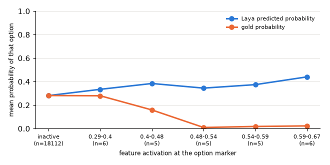

# Feature 5946

Critérios em que aparece: pred_error

**Interpretação (preencher):** 

---

## Maiores ativações

**tr_customer_service_000071 / urgency** (score, customer_service) | ativação 2.150 em `estado` | opções ['0', '1', '2', '3'] | Laya: **1** [0.117, 0.63, 0.111, 0.142] | gabarito: **1**

```
[CLS]score question: How time-sensitive is this conversation?[SEP]
▸ [MASK] level 0: No time pressure; can wait indefinitely.
▸ [MASK] level 1: Routine; handle within the normal queue.
▸ [MASK] level 2: Elevated; should be handled within the same week.
▸ [MASK] level 3: Critical; requires action within the same day.

[SEP]

{"account": {"lifetime_value_usd": 34, "prior_tickets_90d": 0, "seats": 5, "tenure_months": 1, "tier": "premium"}, "orders": [{"amount_usd": 49, "date": "2026-03-16", "id": "A-22387", "status": "refunded"}], "thread": [{"role": "customer", "text": "I want to cancel the account. We're on the premium plan, about $49 a month, and we've only been using it for a month."}, {"role": "agent", "text": "I can help with that. Could you let me know whether you want to cancel at the end of the current billing period or immediately, if immediate cancellation is an option?"}, {"role": "customer", "text": "I'd prefer it to stop at the end⟦ of⟧ the current period. I don't want to continue into another month."}, {"role": "agent", "text": "Understood. Could you also confirm whether you want to keep any data until the current period ends, or have you already completed your migration?"}, {"role": "customer", "text": "We still need read-only access until the period ends. After that, the account can be closed."}, {"role": "agent", "text": "I understand. For the record, is this a standard account cancellation, or do you need a specific invoice or final access request included in the cancellation note?"}, {"role": "customer", "text": "Standard cancellation. If a final invoice is generated, please make sure it reflects the current period only."}]}[SEP]
```

**tr_customer_service_000014 / action** (choice, customer_service) | ativação 2.047 em `estado` | opções ['answer_directly', 'close_no_action', 'escalate_to_human', 'execute_refund', 'request_information'] | Laya: **execute_refund** [0.138, 0.212, 0.071, 0.471, 0.108] | gabarito: **escalate_to_human**

```
[CLS]choice question: What should the assistant do next with this conversation?[SEP]
▸ [MASK] answer_directly: The assistant can resolve this itself with information it already has.
▸ [MASK] close_no_action: No further action is warranted; the matter is settled.
▸ [MASK] escalate_to_human: Hand off to a human agent with the appropriate authority.
▸ [MASK] execute_refund: Issue the refund or credit the customer is owed.
▸ [MASK] request_information: More detail is needed from the customer before anything can be done.

[SEP]

{"account": {"lifetime_value_usd": 563, "prior_tickets_90d": 0, "seats": 1, "tenure_months": 8, "tier": "free"}, "thread": [{"role": "customer", "text": "I requested a refund two weeks ago and haven’t heard anything; I’ve⟦ been⟧ on the free plan for eight months, so I’m just waiting now."}, {"role": "agent", "text": "I’m sorry for the delay. Could you provide the refund request reference number or the email it was sent from?"}, {"role": "customer", "text": "It was sent from my account@myemail.com, reference #R5678. Please let me know what the next steps are."}]}[SEP]
```

**tr_customer_service_000295 / needs_human** (noul, customer_service) | ativação 2.025 em `estado` | opções ['false', 'true'] | Laya: **true** [0.402, 0.598] | gabarito: **true**

```
[CLS]noul question: This conversation requires a human agent rather than automated handling.[SEP]
▸ [MASK] false: Automation can carry this to resolution.
▸ [MASK] true: A human must take over: judgement, authority or empathy is required.

[SEP]

{"account": {"lifetime_value_usd": 4435, "prior_tickets_90d": 1, "seats": 3, "tenure_months": 49, "tier": "enterprise"}, "thread": [{"role": "customer", "text": "Our enterprise dashboard is crawling—pages take over a minute to load, and our team can’t meet the rollout deadline tomorrow. This needs to be fixed ASAP."}, {"role": "agent", "text": "I’m sorry you’re seeing that slowdown. Could you tell me which modules are affected and whether the latency started after the recent update you mentioned in ticket #98765?"}, {"role": "customer", "text": "It’s the analytics⟦ and⟧ reporting sections, and yes, the issue reappeared after the last patch. We need an immediate investigation; let me know what you can do before the deadline."}]}[SEP]
```

**tr_customer_service_000071 / needs_human** (noul, customer_service) | ativação 2.016 em `estado` | opções ['false', 'true'] | Laya: **true** [0.454, 0.546] | gabarito: **false**

```
[CLS]noul question: This conversation requires a human agent rather than automated handling.[SEP]
▸ [MASK] false: Automation can carry this to resolution.
▸ [MASK] true: A human must take over: judgement, authority or empathy is required.

[SEP]

{"account": {"lifetime_value_usd": 34, "prior_tickets_90d": 0, "seats": 5, "tenure_months": 1, "tier": "premium"}, "orders": [{"amount_usd": 49, "date": "2026-03-16", "id": "A-22387", "status": "refunded"}], "thread": [{"role": "customer", "text": "I want to cancel the account. We're on the premium plan, about $49 a month, and we've only been using it for a month."}, {"role": "agent", "text": "I can help with that. Could you let me know whether you want to cancel at the end of the current billing period or immediately, if immediate cancellation is an option?"}, {"role": "customer", "text": "I'd prefer it to stop at the end⟦ of⟧ the current period. I don't want to continue into another month."}, {"role": "agent", "text": "Understood. Could you also confirm whether you want to keep any data until the current period ends, or have you already completed your migration?"}, {"role": "customer", "text": "We still need read-only access until the period ends. After that, the account can be closed."}, {"role": "agent", "text": "I understand. For the record, is this a standard account cancellation, or do you need a specific invoice or final access request included in the cancellation note?"}, {"role": "customer", "text": "Standard cancellation. If a final invoice is generated, please make sure it reflects the current period only."}]}[SEP]
```

**tr_customer_service_000014 / churn_risk** (score, customer_service) | ativação 1.958 em `estado` | opções ['0', '1', '2', '3'] | Laya: **1** [0.133, 0.349, 0.318, 0.2] | gabarito: **1**

```
[CLS]score question: How likely is this customer to stop doing business with us because of this interaction?[SEP]
▸ [MASK] level 0: No sign of dissatisfaction.
▸ [MASK] level 1: Mild frustration, but the relationship is intact.
▸ [MASK] level 2: Clearly unhappy; repeat problems or explicit complaints.
▸ [MASK] level 3: Imminent: threatening to cancel, dispute or leave.

[SEP]

{"account": {"lifetime_value_usd": 563, "prior_tickets_90d": 0, "seats": 1, "tenure_months": 8, "tier": "free"}, "thread": [{"role": "customer", "text": "I requested a refund two weeks ago and haven’t heard anything; I’ve⟦ been⟧ on the free plan for eight months, so I’m just waiting now."}, {"role": "agent", "text": "I’m sorry for the delay. Could you provide the refund request reference number or the email it was sent from?"}, {"role": "customer", "text": "It was sent from my account@myemail.com, reference #R5678. Please let me know what the next steps are."}]}[SEP]
```

## Ativações medianas (faixa 40-60%, mediana 0.670)

**tr_customer_service_000203 / needs_human** (noul, customer_service) | ativação 0.652 em `estado` | opções ['false', 'true'] | Laya: **false** [0.601, 0.399] | gabarito: **false**

```
[CLS]noul question: This conversation requires a human agent rather than automated handling.[SEP]
▸ [MASK] false: Automation can carry this to resolution.
▸ [MASK] true: A human must take over: judgement, authority or empathy is required.

[SEP]

{"account": {"lifetime_value_usd": 303, "prior_tickets_90d": 1, "seats": 12, "tenure_months": 5,⟦ "⟧tier": "premium"}, "thread": [{"role": "customer", "text": "Since the last update, the sync process has been taking around 15 minutes for a few megabytes, which is much slower than before."}]}[SEP]
```

**tr_customer_service_000108 / action** (choice, customer_service) | ativação 0.668 em `opção` | opções ['answer_directly', 'close_no_action', 'escalate_to_human', 'execute_refund', 'request_information'] | Laya: **close_no_action** [0.123, 0.636, 0.037, 0.161, 0.043] | gabarito: **answer_directly**

```
[CLS]choice question: What should the assistant do next with this conversation?[SEP]
▸ [MASK] answer_directly: The assistant can resolve this itself with information it already has.
▸ [MASK] close⟦_⟧no_action: No further action is warranted; the matter is settled.
▸ [MASK] escalate_to_human: Hand off to a human agent with the appropriate authority.
▸ [MASK] execute_refund: Issue the refund or credit the customer is owed.
▸ [MASK] request_information: More detail is needed from the customer before anything can be done.

[SEP]

{"account": {"lifetime_value_usd": 212, "prior_tickets_90d": 0, "seats": 1, "tenure_months": 5, "tier": "standard"}, "orders": [{"amount_usd": 198, "date": "2026-01-14", "id": "A-21848", "status": "refunded"}], "thread": [{"role": "customer", "text": "I've been trying to log in for a while now, but the page just keeps bringing me back to the sign‑in screen. I guess there's not much I can do."}]}[SEP]
```

**tr_customer_service_000152 / action** (choice, customer_service) | ativação 0.625 em `opção` | opções ['answer_directly', 'close_no_action', 'escalate_to_human', 'execute_refund', 'request_information'] | Laya: **close_no_action** [0.097, 0.678, 0.041, 0.033, 0.151] | gabarito: **request_information**

```
[CLS]choice question: What should the assistant do next with this conversation?[SEP]
▸ [MASK] answer_directly: The assistant can resolve this itself with information it already has.
▸ [MASK] close⟦_⟧no_action: No further action is warranted; the matter is settled.
▸ [MASK] escalate_to_human: Hand off to a human agent with the appropriate authority.
▸ [MASK] execute_refund: Issue the refund or credit the customer is owed.
▸ [MASK] request_information: More detail is needed from the customer before anything can be done.

[SEP]

{"account": {"lifetime_value_usd": 799, "prior_tickets_90d": 0, "seats": 1, "tenure_months": 33, "tier": "standard"}, "thread": [{"role": "customer", "text": "Hello, I'm writing because the analytics dashboard stopped updating as of this morning, and I need the latest data by 5 pm today to finalize my report. Could you please look into this?"}]}[SEP]
```

**tr_agent_trace_observability_000030 / needs_review** (noul, agent_trace_observability) | ativação 0.655 em `estado` | opções ['false', 'true'] | Laya: **false** [0.742, 0.258] | gabarito: **true**

```
[CLS]noul question: This trace requires human review.[SEP]
▸ [MASK] false: No human attention is warranted.
▸ [MASK] true: A human should inspect this run.

[SEP]

{"agent": {"autonomy": "unsupervised",⟦ "⟧model": "internal-agent-v4"}, "constraints": ["Do not force-push to any branch"], "task": "Update every service to the patched logging library.", "trace_summary": {"constraint_violations": 0, "duration_s": 12.2, "irreversible_actions": 0, "steps": 5, "tool_errors": 2}}[SEP]
```

**tr_agent_trace_observability_000113 / action** (choice, agent_trace_observability) | ativação 0.667 em `estado` | opções ['continue', 'human_review', 'observe', 'stop'] | Laya: **continue** [0.724, 0.053, 0.147, 0.077] | gabarito: **continue**

```
[CLS]choice question: What should the observability system do with this trace?[SEP]
▸ [MASK] continue: Let the agent proceed without interruption.
▸ [MASK] human_review: Queue this trace for a human to review.
▸ [MASK] observe: Keep running, but flag the trace for later sampling.
▸ [MASK] stop: Halt the agent now.

[SEP]

{"agent": {"autonomy": "dry_run", "model": "internal-agent-v4"}, "constraints": ["Never disable monitoring⟦ or⟧ alerting", "Never modify production without an approved change ticket"], "task": "Triage and close duplicate issues in the support tracker.", "trace_summary": {"constraint_violations": 0, "duration_s": 807.3, "irreversible_actions": 1, "steps": 12, "tool_errors": 0}}[SEP]
```

## Estatísticas (conjunto de descoberta, dev e teste)

**pred / error**

| split | decisões | ativas | ativas e Laya errou | taxa | lift | q (BH) | OR (CMH) | q (CMH) |
|---|---|---|---|---|---|---|---|---|
| discovery | 5100 | 20 | 20 | 1.000 | 1.57 | 0.000618 | inf | 0.66 |
| dev | 900 | 0 | 0 | nan | nan | nan | nan | nan |
| test | 2000 | 7 | 7 | 1.000 | 1.57 | nan | nan | nan |

**corr / error**

| split | decisões | ativas | ativas e Laya errou | taxa | lift | q (BH) | OR (CMH) | q (CMH) |
|---|---|---|---|---|---|---|---|---|
| discovery | 5100 | 2 | 2 | 1.000 | 1.57 | nan | nan | nan |
| dev | 900 | 0 | 0 | nan | nan | nan | nan | nan |
| test | 2000 | 2 | 2 | 1.000 | 1.57 | nan | nan | nan |

**state / error**

| split | decisões | ativas | ativas e Laya errou | taxa | lift | q (BH) | OR (CMH) | q (CMH) |
|---|---|---|---|---|---|---|---|---|
| discovery | 5100 | 664 | 418 | 0.630 | 0.99 | 0.919 | 0.96 | 0.801 |
| dev | 900 | 107 | 85 | 0.794 | 1.21 | 0.271 | 2.33 | 0.0285 |
| test | 2000 | 254 | 163 | 0.642 | 1.01 | 1 | 1.00 | 0.999 |

Confusão mais sobre-representada (pred): `action|1>2` (n=9, lift 18.36, p=3.2e-10). Formato `pergunta|índice previsto>índice correto`.

Confusão mais sobre-representada (corr): `risk|1>0` (n=2, lift 94.44, p=nan). Formato `pergunta|índice previsto>índice correto`.

Confusão mais sobre-representada (state): `needs_human|1>0` (n=19, lift 2.28, p=0.000332). Formato `pergunta|índice previsto>índice correto`.



