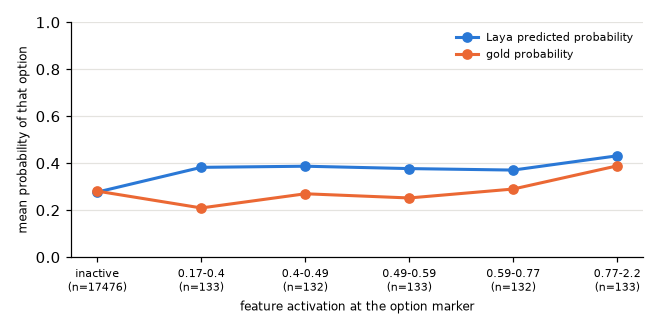

# Feature 6041

Critérios em que aparece: attribution_toward_wrong

**Interpretação (preencher):** 

---

## Maiores ativações

**tr_customer_service_000173 / category** (choice, customer_service) | ativação 3.342 em `estado` | opções ['account', 'billing', 'delivery', 'refund', 'technical'] | Laya: **refund** [0.018, 0.065, 0.01, 0.845, 0.062] | gabarito: **refund**

```
[CLS]choice question: What is this customer conversation primarily about?[SEP]
▸ [MASK] account: Login, plan changes, profile or access management.
▸ [MASK] billing: A charge, invoice, subscription or payment problem.
▸ [MASK] delivery: Shipping, fulfilment or delivery of a physical item.
▸ [MASK] refund: The customer is explicitly asking for money back.
▸ [MASK] technical: The product or service is not working as expected.

[SEP]

{"account": {"lifetime_value_usd": 985, "prior_tickets_90d": 0, "seats": 1, "tenure_months": 11, "tier": "free"}, "orders": [{"amount_usd": 19, "date": "2026-01-24", "id": "A-47026", "status": "pending"}], "thread": [{"role": "customer", "text": "It has been two weeks since I requested my $19 refund and I still haven't seen anything. I've been a loyal customer for 11 months, but if you guys can't handle basic billing, I’m taking my business elsewhere."}, {"role": "agent", "text": "I apologize for the delay you've experienced. Could you please provide the case number from your initial refund request so I can look into the status of that transaction for you?"}, {"role": "customer", "text": "I⟦ don⟧'t have a case number because nobody ever sent me one, which is exactly why I'm so frustrated."}]}[SEP]
```

**tr_security_incidents_000236 / disposition** (choice, security_incidents) | ativação 3.105 em `estado` | opções ['close_benign', 'contain', 'investigate', 'monitor'] | Laya: **close_benign** [0.334, 0.29, 0.118, 0.258] | gabarito: **investigate**

```
[CLS]choice question: How should this security alert be dispositioned?[SEP]
▸ [MASK] close_benign: Expected, explainable activity; close without analyst time.
▸ [MASK] contain: Contain the host or account immediately; do not wait for triage.
▸ [MASK] investigate: Warrants an analyst opening an investigation.
▸ [MASK] monitor: Not clearly malicious, but worth watching for recurrence.

[SEP]

{"alert": {"description": "a long-unused account became active", "evidence": "The privileged admin_01 account, which⟦ had⟧ shown no activity for 120 consecutive days, successfully authenticated from allowlisted IP 10.0.4.55 at 02:00 AM. This session was established with MFA enabled and used credentials rotated 30 days ago, though no change tickets were active at the time.", "rule": "dormant_account_use"}, "context": {"asset_criticality": "medium", "change_window_active": false, "source_on_allowlist": true}, "history": {"credential_rotation_days_ago": 30, "distinct_countries_30d": 3, "logins_30d": 15, "prior_alerts_90d": 0}, "principal": {"mfa_enrolled": true, "name": "ci-infra-266", "privileges": ["deploy:production", "secrets:read"], "type": "admin"}}[SEP]
```

**tr_customer_service_000173 / action** (choice, customer_service) | ativação 3.033 em `estado` | opções ['answer_directly', 'close_no_action', 'escalate_to_human', 'execute_refund', 'request_information'] | Laya: **execute_refund** [0.194, 0.234, 0.18, 0.248, 0.144] | gabarito: **execute_refund**

```
[CLS]choice question: What should the assistant do next with this conversation?[SEP]
▸ [MASK] answer_directly: The assistant can resolve this itself with information it already has.
▸ [MASK] close_no_action: No further action is warranted; the matter is settled.
▸ [MASK] escalate_to_human: Hand off to a human agent with the appropriate authority.
▸ [MASK] execute_refund: Issue the refund or credit the customer is owed.
▸ [MASK] request_information: More detail is needed from the customer before anything can be done.

[SEP]

{"account": {"lifetime_value_usd": 985, "prior_tickets_90d": 0, "seats": 1, "tenure_months": 11, "tier": "free"}, "orders": [{"amount_usd": 19, "date": "2026-01-24", "id": "A-47026", "status": "pending"}], "thread": [{"role": "customer", "text": "It has been two weeks since I requested my $19 refund and I still haven't seen anything. I've been a loyal customer for 11 months, but if you guys can't handle basic billing, I’m taking my business elsewhere."}, {"role": "agent", "text": "I apologize for the delay you've experienced. Could you please provide the case number from your initial refund request so I can look into the status of that transaction for you?"}, {"role": "customer", "text": "I⟦ don⟧'t have a case number because nobody ever sent me one, which is exactly why I'm so frustrated."}]}[SEP]
```

**tr_security_incidents_000236 / disposition** (choice, security_incidents) | ativação 2.971 em `estado` | opções ['close_benign', 'contain', 'investigate', 'monitor'] | Laya: **close_benign** [0.334, 0.29, 0.118, 0.258] | gabarito: **investigate**

```
[CLS]choice question: How should this security alert be dispositioned?[SEP]
▸ [MASK] close_benign: Expected, explainable activity; close without analyst time.
▸ [MASK] contain: Contain the host or account immediately; do not wait for triage.
▸ [MASK] investigate: Warrants an analyst opening an investigation.
▸ [MASK] monitor: Not clearly malicious, but worth watching for recurrence.

[SEP]

{"alert": {"description": "a long-unused account became active", "evidence": "The privileged admin_01 account,⟦ which⟧ had shown no activity for 120 consecutive days, successfully authenticated from allowlisted IP 10.0.4.55 at 02:00 AM. This session was established with MFA enabled and used credentials rotated 30 days ago, though no change tickets were active at the time.", "rule": "dormant_account_use"}, "context": {"asset_criticality": "medium", "change_window_active": false, "source_on_allowlist": true}, "history": {"credential_rotation_days_ago": 30, "distinct_countries_30d": 3, "logins_30d": 15, "prior_alerts_90d": 0}, "principal": {"mfa_enrolled": true, "name": "ci-infra-266", "privileges": ["deploy:production", "secrets:read"], "type": "admin"}}[SEP]
```

**tr_customer_service_000173 / churn_risk** (score, customer_service) | ativação 2.926 em `estado` | opções ['0', '1', '2', '3'] | Laya: **2** [0.033, 0.316, 0.475, 0.176] | gabarito: **3**

```
[CLS]score question: How likely is this customer to stop doing business with us because of this interaction?[SEP]
▸ [MASK] level 0: No sign of dissatisfaction.
▸ [MASK] level 1: Mild frustration, but the relationship is intact.
▸ [MASK] level 2: Clearly unhappy; repeat problems or explicit complaints.
▸ [MASK] level 3: Imminent: threatening to cancel, dispute or leave.

[SEP]

{"account": {"lifetime_value_usd": 985, "prior_tickets_90d": 0, "seats": 1, "tenure_months": 11, "tier": "free"}, "orders": [{"amount_usd": 19, "date": "2026-01-24", "id": "A-47026", "status": "pending"}], "thread": [{"role": "customer", "text": "It has been two weeks since I requested my $19 refund and I still haven't seen anything. I've been a loyal customer for 11 months, but if you guys can't handle basic billing, I’m taking my business elsewhere."}, {"role": "agent", "text": "I apologize for the delay you've experienced. Could you please provide the case number from your initial refund request so I can look into the status of that transaction for you?"}, {"role": "customer", "text": "I⟦ don⟧'t have a case number because nobody ever sent me one, which is exactly why I'm so frustrated."}]}[SEP]
```

## Ativações medianas (faixa 40-60%, mediana 0.711)

**tr_security_incidents_000130 / severity** (score, security_incidents) | ativação 0.730 em `estado` | opções ['0', '1', '2', '3', '4'] | Laya: **2** [0.024, 0.228, 0.353, 0.325, 0.069] | gabarito: **3**

```
[CLS]score question: How severe is the potential impact if this alert is real?[SEP]
▸ [MASK] level 0: Negligible: no access to anything sensitive.
▸ [MASK] level 1: Low: limited access, easily reversed.
▸ [MASK] level 2: Moderate: access to internal systems or non-public data.
▸ [MASK] level 3: High: access to production, secrets or customer data.
▸ [MASK] level 4: Critical: active compromise of crown-jewel systems.

[SEP]

{"alert": {"description": "a first-ever sign-in from an unfamiliar country", "evidence": "A sign-in for this privileged shared_mailbox originated from a country not previously associated with the account. The connection was established from an allowlisted IP address while a maintenance change window was active.", "rule": "new_country⟦_⟧login"}, "context": {"asset_criticality": "high", "change_window_active": true, "source_on_allowlist": true}, "history": {"credential_rotation_days_ago": 365, "distinct_countries_30d": 4, "logins_30d": 1717, "prior_alerts_90d": 1}, "principal": {"mfa_enrolled": true, "name": "ci-deploy-712", "privileges": ["deploy:production", "secrets:read"], "type": "shared_mailbox"}}[SEP]
```

**tr_customer_service_000158 / needs_human** (noul, customer_service) | ativação 0.784 em `estado` | opções ['false', 'true'] | Laya: **false** [0.542, 0.458] | gabarito: **false**

```
[CLS]noul question: This conversation requires a human agent rather than automated handling.[SEP]
▸ [MASK] false: Automation can carry this to resolution.
▸ [MASK] true: A human must take over: judgement, authority or empathy is required.

[SEP]

{"account": {"lifetime_value_usd": 134, "prior_tickets_90d": 5, "seats": 5, "tenure_months": 3, "tier": "enterprise"},⟦ "⟧orders": [{"amount_usd": 49, "date": "2026-02-16", "id": "A-54178", "status": "settled"}, {"amount_usd": 49, "date": "2026-02-18", "id": "A-29578", "status": "settled"}, {"amount_usd": 49, "date": "2026-01-24", "id": "A-46676", "status": "refunded"}], "thread": [{"role": "customer", "text": "The bulk‑upload feature stopped accepting CSV files; it returns a generic error as soon as I click Submit."}]}[SEP]
```

**tr_security_incidents_000144 / true_positive** (noul, security_incidents) | ativação 0.733 em `pergunta` | opções ['false', 'true'] | Laya: **false** [0.516, 0.484] | gabarito: **true**

```
[CLS]noul question: This alert reflects⟦ genuinely⟧ malicious or unauthorised activity.[SEP]
▸ [MASK] false: Benign activity, a misconfiguration, or a known false positive.
▸ [MASK] true: The underlying behaviour is malicious or unauthorised.

[SEP]

{"alert": {"description": "a large transfer to an external destination", "evidence": "An administrative account initiated a large data transfer to an unrecognized external destination at 14:22 UTC. This activity occurred outside of any scheduled change window, and the account’s credentials were last updated 14 days ago.", "rule": "data_egress"}, "context": {"asset_criticality": "high", "change_window_active": false, "source_on_allowlist": false}, "history": {"credential_rotation_days_ago": 14, "distinct_countries_30d": 2, "logins_30d": 1277, "prior_alerts_90d": 1}, "principal": {"mfa_enrolled": true, "name": "svc-support-636", "privileges": ["deploy:production", "secrets:read"], "type": "admin"}}[SEP]
```

**tr_invoice_processing_000099 / urgency** (score, invoice_processing) | ativação 0.674 em `opção` | opções ['0', '1', '2', '3'] | Laya: **1** [0.236, 0.48, 0.168, 0.116] | gabarito: **2**

```
[CLS]score question: How time-sensitive is processing this invoice?[SEP]
▸ [MASK] level 0: No time pressure; can wait indefinitely.
▸ [MASK] level 1: Routine; handle within the normal queue.
▸ [MASK] level 2: Elevated; should be handled within the same week.
▸ [MASK] level 3: Critical;⟦ requires⟧ action within the same day.

[SEP]

{"delivery": {"condition": "accepted with exceptions", "date": "2026-03-27", "received_qty": 100}, "invoice": {"currency": "USD", "id": "INV-2026-9286", "lines": [{"qty": 100, "sku": "SKU-290", "total_usd": 522.0, "unit_usd": 5.22}], "total_usd": 522.0, "vendor": "Vantage Materials"}, "payment": {"days_until_due": -3, "discount_expires_in_days": null, "early_payment_discount_pct": null, "status": "overdue", "terms": "net 30"}, "purchase_order": {"freight_terms": "freight prepaid by vendor, not separately billable", "id": "PO-3274", "lines": [{"qty": 100, "unit_usd": 5.22}], "total_usd": 522.0}, "vendor_history": {"disputes_12m": 0, "invoices_12m": 52, "prior_invoice_ids": ["INV-2026-4748", "INV-2026-3085"]}}[SEP]
```

**tr_invoice_processing_000081 / duplicate** (noul, invoice_processing) | ativação 0.793 em `opção` | opções ['false', 'true'] | Laya: **true** [0.287, 0.713] | gabarito: **false**

```
[CLS]noul question: This invoice appears to duplicate an invoice already submitted.[SEP]
▸ [MASK] false: no, the statement does not⟦ hold⟧
▸ [MASK] true: yes, the statement holds

[SEP]

{"delivery": {"condition": "accepted with exceptions", "date": "2026-03-23", "received_qty": 1000}, "invoice": {"currency": "USD", "id": "INV-2026-7992", "lines": [{"qty": 1000, "sku": "SKU-899", "total_usd": 334970.0, "unit_usd": 334.97}], "total_usd": 334970.0, "vendor": "Vantage Materials"}, "payment": {"days_until_due": -3, "discount_expires_in_days": null, "early_payment_discount_pct": null, "status": "overdue", "terms": "net 30"}, "purchase_order": {"freight_terms": "freight prepaid by vendor, not separately billable", "id": "PO-7997", "lines": [{"qty": 1000, "unit_usd": 325.21}], "total_usd": 325210.0}, "vendor_history": {"disputes_12m": 0, "invoices_12m": 29, "prior_invoice_ids": ["INV-2026-4318"]}}[SEP]
```

## Estatísticas (conjunto de descoberta, dev e teste)

**pred / error**

| split | decisões | ativas | ativas e Laya errou | taxa | lift | q (BH) | OR (CMH) | q (CMH) |
|---|---|---|---|---|---|---|---|---|
| discovery | 5100 | 343 | 245 | 0.714 | 1.12 | 0.00437 | 1.59 | 0.019 |
| dev | 900 | 49 | 34 | 0.694 | 1.06 | 0.895 | 1.17 | 0.894 |
| test | 2000 | 143 | 99 | 0.692 | 1.09 | 0.26 | 1.29 | 0.622 |

**corr / error**

| split | decisões | ativas | ativas e Laya errou | taxa | lift | q (BH) | OR (CMH) | q (CMH) |
|---|---|---|---|---|---|---|---|---|
| discovery | 5100 | 181 | 83 | 0.459 | 0.72 | 2.08e-06 | 0.45 | 0.000948 |
| dev | 900 | 29 | 14 | 0.483 | 0.74 | 0.113 | 0.51 | 0.641 |
| test | 2000 | 79 | 35 | 0.443 | 0.70 | 0.000924 | 0.21 | 0.000135 |

**state / error**

| split | decisões | ativas | ativas e Laya errou | taxa | lift | q (BH) | OR (CMH) | q (CMH) |
|---|---|---|---|---|---|---|---|---|
| discovery | 5100 | 2617 | 1683 | 0.643 | 1.01 | 0.619 | 1.18 | 0.0613 |
| dev | 900 | 463 | 301 | 0.650 | 0.99 | 1 | 0.88 | 0.698 |
| test | 2000 | 1015 | 656 | 0.646 | 1.01 | 0.857 | 1.13 | 0.495 |

Confusão mais sobre-representada (pred): `urgency|1>3` (n=57, lift 2.90, p=3.73e-14). Formato `pergunta|índice previsto>índice correto`.

Confusão mais sobre-representada (corr): `churn_risk|1>2` (n=23, lift 11.78, p=7.75e-20). Formato `pergunta|índice previsto>índice correto`.

Confusão mais sobre-representada (state): `duplicate|1>0` (n=170, lift 1.53, p=1.91e-17). Formato `pergunta|índice previsto>índice correto`.



